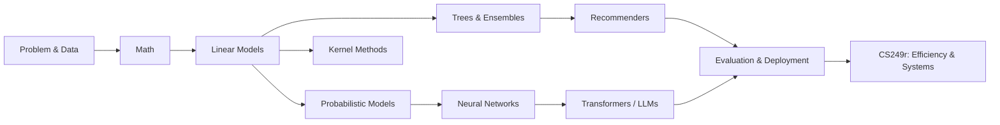

# Machine Learning from Zero: From Algorithms to AI Systems

[中文](README.md) | [English](README.en.md)

An open course for graduate students with no prior ML background. It follows the algorithmic arc of
Stanford CS229 and Andrew Ng's Machine Learning Specialization, while adding the systems perspective
of Harvard CS249r: not only *how a model learns*, but also *how it becomes part of an LLM,
recommender, or production system*.

Each concept begins with **why it exists**, then shows observable data and failure cases before the
derivation. Reproducible plots, code, counterexamples, Socratic questions, and modern-AI bridges turn
the notes into a course rather than a formula list.


## Start here

1. [Chapter 0 — Beginner preparation](docs/en/00-prerequisites.md)
2. [28-week beginner / 24-week fast roadmap](docs/en/00-course-roadmap.md)
3. [Chapter 1 — What Is Machine Learning?](docs/en/01-what-is-ml.md)
4. [Chapter 2 — Mathematical Foundations](docs/en/02-math-foundations.md)
5. [Chapter 3 — Linear Regression](docs/en/03-linear-regression.md)
6. [Chapter 4 — Logistic Regression, Perceptron, and GLMs](docs/en/04-logistic-regression.md)
7. [Chapter 5 — Generative Classification](docs/en/05-generative-classifiers.md)
8. [Chapter 6 — Neighbors and Kernels](docs/en/06-neighbors-and-kernels.md)
9. [Chapter 7 — Support Vector Machines](docs/en/07-support-vector-machines.md)
10. [Chapter 8 — Trees and Ensembles](docs/en/08-trees-and-ensembles.md)
11. [Chapter 9 — Learning Theory and Model Selection](docs/en/09-learning-theory-and-model-selection.md)
12. [Chapter 10 — Clustering, GMM, EM, and ELBO](docs/en/10-clustering-em-and-elbo.md)
13. [Chapter 11 — Dimensionality Reduction](docs/en/11-dimensionality-reduction.md)
14. [Chapter 12 — Neural Networks and Backpropagation](docs/en/12-neural-networks-and-backprop.md)
15. [Chapter 13 — Representation Learning](docs/en/13-representation-learning.md)
16. [Chapter 14 — Sequence, Vision, and Attention](docs/en/14-sequence-vision-and-attention.md)
17. [Chapter 15 — Transformers, LLMs, and Fine-tuning](docs/en/15-transformers-llms-and-finetuning.md)
18. [Chapter 16 — VAE and Diffusion](docs/en/16-vae-and-diffusion.md)
19. [Chapter 17 — Recommender Systems](docs/en/17-recommender-systems.md)
20. [Chapter 18 — Reinforcement Learning](docs/en/18-reinforcement-learning.md)
21. [Chapter 19 — Evaluation, Causality, and MLOps](docs/en/19-evaluation-causality-and-mlops.md)
22. [Chapter 20 — Machine-Learning Systems](docs/en/20-machine-learning-systems.md)
23. [Chapter 21 — Interviews and Capstone](docs/en/21-interview-and-capstone.md)
24. [Course-wide notation](docs/en/appendix-a-notation.md)
25. [Chinese course / 中文入口](README.md)



Every algorithm chapter uses the same learning chain: **intuition → formulation → derivation →
NumPy implementation → framework implementation → diagnosis → modern-AI connection → Socratic
check → interview questions**.

## Run an example

```bash
python code/chapter03/regression_family_comparison.py
python code/chapter04/logistic_regression.py
python code/chapter05/generative_classifiers.py
python code/chapter06/neighbors_and_kernels.py
python code/chapter07/support_vector_machine.py
python code/chapter08/trees_and_ensembles.py
python code/chapter09/learning_theory.py
python code/chapter10/clustering_and_em.py
python code/chapter11/dimensionality_reduction.py
python code/chapter12/miniautograd.py
python code/chapter12/neural_networks.py
python code/chapter13/representation_learning.py
python code/chapter14/sequence_and_vision.py
python code/chapter15/transformers_and_llms.py
python code/chapter16/generative_models.py
python code/chapter17/recommender_systems.py
python code/chapter18/reinforcement_learning.py
python code/chapter19/evaluation_and_mlops.py
python code/chapter20/ml_systems.py
python code/chapter21/capstone_and_interviews.py
python scripts/validate_course.py
```

## Sources and positioning

- [Stanford CS229](https://cs229.stanford.edu/)
- [Andrew Ng Machine Learning Specialization](https://www.deeplearning.ai/specializations/machine-learning)
- [Harvard CS249r / Machine Learning Systems](https://github.com/harvard-edge/cs249r_book)

These notes are independently written and are not affiliated with those courses.
