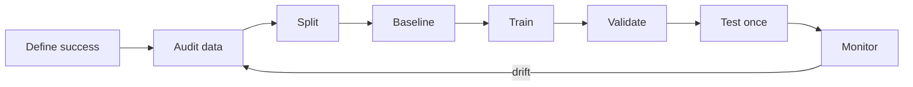

# Chapter 1 — What Is Machine Learning?

[← Chapter 0](00-prerequisites.md) | [中文](../zh-CN/01-what-is-ml.md) | [Notation](appendix-a-notation.md) | [Next: Math →](02-math-foundations.md)

Machine learning replaces a brittle collection of hand-written rules with a model learned from
examples. In Mitchell's compact framing, performance $P$ on task $T$ improves with experience $E$.
For spam filtering, $T$ is classification, $E$ is labeled email, and $P$ may combine precision and
recall. Good training performance is not enough: success means **generalization** to unseen data.

## Why do we need it—and when do we not?

ML is useful when rules are too numerous, high-dimensional, changing, or inherently uncertain:
spam, vision, recommendations, and rent estimation. Prefer an ordinary rule or formula when the rule
is exact, data is unavailable, success cannot be defined, or errors cannot be safely reviewed.

Ask five questions throughout this course: **What is it? Why is it needed? What breaks without it?
How do we know it works? Where does it appear in modern AI?**

### A two-pass route for first-time learners

On the first pass, master sample, feature, label, $X$ versus $x^{(i)}$, train/validation/test roles, and the visual
difference among underfitting, useful fitting, and overfitting. On the second pass, return to ROC/PR, calibration, and
macro/micro averaging. Those metrics are important, but they should not block the first complete mental model.

## From a table to notation

Suppose each row describes one home:

| home | area $x_1$ | age $x_2$ | elevator $x_3$ | rent $y$ |
|---:|---:|---:|---:|---:|
| 1 | 28 | 5 | 1 | 1,864 |
| 2 | 45 | 10 | 0 | 2,510 |
| 3 | 72 | 18 | 1 | 3,760 |
| 4 | 96 | 7 | 0 | 4,585 |

An **example/sample** is one object we learn from: one row or one home here. A **feature** is an input
attribute available at prediction time: area, age, or elevator. The **target/label** is the answer to
predict: rent.

The third feature vector is

$$x^{(3)}=[72,18,1]^T\in\mathbb R^3.$$

It is an ordered collection of three real numbers. Parenthesized superscript $(3)$ means “example 3,”
not a power. Subscript $j$ means “feature $j$.” Thus $x_2^{(3)}=18$ means feature 2 of example 3.

Stacking examples as rows gives the data matrix:

```math
X=\begin{bmatrix}28&5&1\\45&10&0\\72&18&1\\96&7&0\end{bmatrix}
\in\mathbb R^{4\times3}.
```


| Notation | Meaning |
|---|---|
| $x$ | one unspecified feature vector |
| $x^{(i)}$ | feature vector of example $i$ |
| $x_j$ | feature $j$ of one vector |
| $x_j^{(i)}=X_{ij}$ | feature $j$ of example $i$ |
| $X\in\mathbb R^{m\times d}$ | all inputs; $m$ examples by $d$ features |
| $y^{(i)}$ | true target for example $i$ |
| $\hat y^{(i)}$ | predicted target; the hat marks an estimate |
| $\theta$ | all learned parameters; e.g. $(w,b)$ |
| $\ell$ | loss on one example |
| $J$ | aggregate training objective |

A linear model $\hat y=f_\theta(x)=w^Tx+b$ maps features to a prediction. Parameters are learned;
hyperparameters such as learning rate or regularization strength are configured outside that fit.

Most algorithms can be introduced as empirical risk minimization:

$$\hat\theta=\arg\min_\theta\frac1m\sum_{i=1}^m
\ell(f_\theta(x^{(i)}),y^{(i)}).$$

Read it left to right: predict example $i$; compare prediction with its target; sum losses from 1 to
$m$; average; then find the parameter values that make the result smallest. `argmin` returns the
parameter, not the minimum loss value.

A loss measures one example, an objective aggregates losses and regularization, and a metric measures
what we ultimately care about. We may train with differentiable cross-entropy and report accuracy.

Fitting means choosing parameters from training data. It does not itself prove learning. Before
fitting, inspect who each row represents, units, missingness, label provenance, and coverage.


The plot reveals an overall trend, unexplained variation at similar areas, and uneven target coverage.
Distribution comes before model choice.

## Learning paradigms and today's AI

- **Supervised:** labeled regression/classification; instruction tuning and CTR prediction.
- **Unsupervised:** clustering, dimensionality reduction, density estimation; embedding analysis.
- **Self-supervised:** labels are constructed from raw data; next-token prediction in an LLM.
- **Reinforcement learning:** actions learn from rewards; RLHF, bandits, and robotics.

An LLM still has a model, data, loss, and optimizer. A recommender commonly retrieves candidates by
vector similarity and ranks them with a classifier/regressor. RAG uses learned embeddings for
retrieval. The CS249r view adds constraints that pure accuracy misses: memory, throughput, latency,
energy, and privacy.

## Experimental workflow



Training data fits parameters; validation data selects models and hyperparameters; the test set is a
one-time simulation of unseen use. Reusing it leaks information. Split by time or entity when random
splitting would put the same patient/user or future information on both sides.

Underfitting means both training and validation error are high. Overfitting means low training error
but worse validation error. Diagnose with learning curves before adding capacity or regularization.


There is no universal error threshold for overfitting. Evidence is a persistent generalization gap:
$E_{val}-E_{train}$ grows while training improves and independent validation worsens.


Combat the cause: obtain better-covered data, reduce capacity, add regularization, augment data,
early-stop, deduplicate, and repair leakage. Cross-validation helps distinguish a pattern from a
single noisy split. In LLMs, memorization of rare sequences is an analogous risk; in recommendation,
the model may learn position bias rather than preference.

## Evaluation metrics: what does “good” mean?

A loss tells the optimizer how to update parameters; a metric tells us whether the result serves the
task. First define the **positive class**—the event we want to detect, such as disease or fraud. Positive
does not mean morally good.

In 1,000 transactions, suppose 10 are fraud. The model catches 8, misses 2, and incorrectly flags 12
legitimate transactions:


Rows are actual classes and columns are predictions. TP and TN are correct; FP is a false alarm and FN
is a missed positive. Always check a library's row/column convention.

$$Accuracy=\frac{TP+TN}{N},\qquad
Precision=\frac{TP}{TP+FP},\qquad
Recall=TPR=\frac{TP}{TP+FN},$$

$$Specificity=TNR=\frac{TN}{TN+FP},\qquad
FPR=1-Specificity,\qquad
F_1=\frac{2\,Precision\,Recall}{Precision+Recall}.$$

Accuracy asks what fraction of all decisions are correct. Precision asks how trustworthy positive
alerts are; recall asks how many real positives are found. Specificity asks how many negatives are
correctly cleared. In this example accuracy is 98.6%, precision 40%, recall 80%, and F1 53.3%—so a
high accuracy can coexist with many false alerts. Balanced accuracy averages recall and specificity
when class frequencies are uneven.

Many classifiers output a score and apply a threshold $\hat y=\mathbb I[s(x)\ge\tau]$. Lowering the
threshold usually raises both TP and FP: recall tends to rise while precision may fall. Choose the
threshold on validation data according to error costs, never by repeatedly inspecting the test set.


Every curve point is the same model at a different threshold. ROC plots FPR horizontally and TPR
vertically; the upper-left corner is ideal. ROC-AUC measures ranking across all thresholds, not
calibration or the final operating point. With rare positives, the many true negatives can make ROC
look optimistic. A precision–recall curve directly shows alert quality versus positive coverage; its
random baseline equals positive prevalence and is often more informative for rare-event detection.

If probabilities drive decisions, also report binary log loss and Brier score:

$$LogLoss=-\frac1m\sum_i[y^{(i)}\log p^{(i)}+(1-y^{(i)})\log(1-p^{(i)})],\qquad
Brier=\frac1m\sum_i(p^{(i)}-y^{(i)})^2.$$

Calibration asks whether roughly 80% of samples assigned probability 0.8 are actually positive. High
AUC does not guarantee calibration. For multiclass metrics, macro averaging weights every class
equally, weighted averaging follows class frequency, and micro averaging pools counts first.

Regression uses different metrics. MAE, $m^{-1}\sum_i|y^{(i)}-\hat y^{(i)}|$, measures typical absolute
error; RMSE square-penalizes large errors but returns to target units. $R^2$ measures improvement over
predicting the target mean and may be negative on held-out data. MAPE is undefined at zero and unstable
near zero. Always connect the metric to real error costs rather than treating any one score as universal.

## Socratic check

<details><summary>Does 100% training accuracy prove the model is good?</summary>
No. It may have memorized the training set. Check truly independent data and the split itself.
</details>

<details><summary>Is LLM pretraining supervised or unsupervised?</summary>
It is usually called self-supervised: text supplies its own next-token targets. Instruction tuning is
supervised; alignment may also use preference learning or reinforcement learning.
</details>

<details><summary>Why not always optimize accuracy directly?</summary>
Accuracy is generally non-differentiable and supplies no smooth update direction. Cross-entropy is a
trainable surrogate; accuracy remains an evaluation metric.
</details>

## Interview recap

- **Overfitting:** the model captures training-specific accidents that fail to generalize.
- **Parameter vs hyperparameter:** weights are learned; learning rate and tree depth are configured.
- **Data leakage:** training uses information unavailable at prediction time.
- **Why a baseline:** it validates the pipeline and gives complexity an honest comparison.

[Next: build the mathematical toolkit →](02-math-foundations.md)
