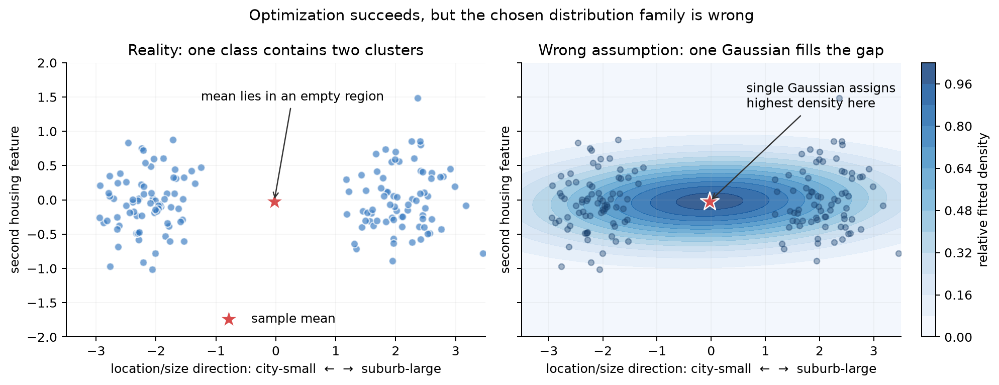
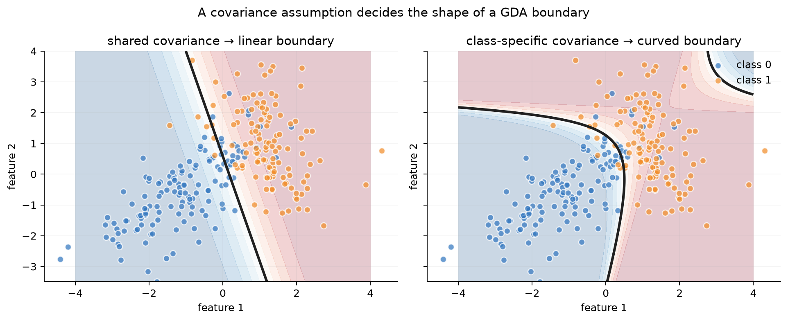
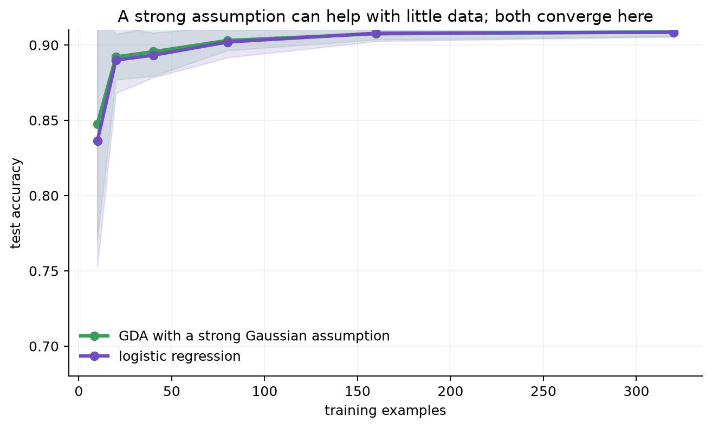
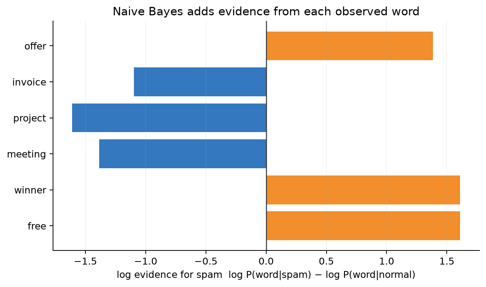
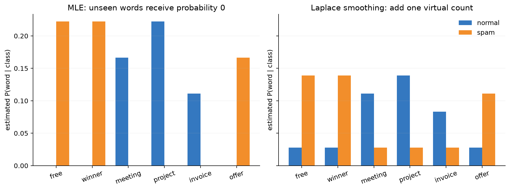

# Chapter 5 — Generative Classification: GDA, Naive Bayes, and Smoothing

[← Chapter 4](04-logistic-regression.md) | [中文](../zh-CN/05-generative-classifiers.md) | [Notation](appendix-a-notation.md)

Chapter 4 directly learned $p(y\mid x)$. This chapter instead models how each class generates the
features, $p(x\mid y)$, combines it with the prior $p(y)$, and applies Bayes' rule. “Generative” here
does not mean the model must generate images or prose.

## Why another classifier?

Logistic regression makes fewer assumptions about the feature distribution. A generative classifier
spends stronger assumptions to estimate $p(x\mid y)$; those assumptions can improve sample efficiency
when approximately correct and create systematic bias when wrong. It can also expose density,
missing-feature, or anomaly information that a boundary-only model does not explicitly represent.

For example, affordable homes may form two clusters—small city apartments and large suburban homes.
One Gaussian can place its mean in an almost empty region between them and call that region typical.
This is model bias caused by the distribution family, not failed optimization.



The MLE optimizer succeeds: it correctly computes the sample mean and covariance. The distribution
family is the failure. A single Gaussian must put its maximum density at the mean, even though the
observed class has an empty gap there.

## Gaussian discriminant analysis

For binary labels, shared-covariance GDA assumes

$$y\sim\mathrm{Bernoulli}(\phi),\qquad
x\mid y=c\sim\mathcal N(\mu_c,\Sigma).$$

Maximum likelihood gives

$$\hat\phi=n_1/m,\qquad
\hat\mu_c=\frac{\sum_i\mathbf1\{y^{(i)}=c\}x^{(i)}}{n_c},$$

$$\hat\Sigma=\frac1m\sum_i
(x^{(i)}-\hat\mu_{y^{(i)}})(x^{(i)}-\hat\mu_{y^{(i)}})^T.$$

Expanding the Gaussian log-likelihood ratio cancels the shared $x^T\Sigma^{-1}x$ terms, leaving
$\log[p(y=1\mid x)/p(y=0\mid x)]=w^Tx+b$. Thus LDA has a linear boundary. Giving each class its own
covariance prevents cancellation and produces QDA's quadratic boundary.



Here LDA means Linear Discriminant Analysis, not Latent Dirichlet Allocation.

Both LDA and QDA are trained generatively: estimate $p(y)$ and $p(x\mid y)$, apply Bayes' rule, then
draw the induced $p(y=1\mid x)=0.5$ boundary. A plotted boundary does not make training discriminative.
LDA shares one covariance; QDA estimates one per class. With $d=20$, a symmetric covariance has 210
unique entries, so binary QDA estimates 420 covariance values versus LDA's 210. Thus a correct strong
assumption may save samples, while relaxing it for flexibility raises variance on small data.

## Generative versus discriminative learning



Repeated experiments show variance with little data and convergence on this simple problem. The plot
does not establish a universal winner: a strong Gaussian assumption can help when approximately right
and hurt on multimodal, heavy-tailed, or shifted data.

## Multinomial Naive Bayes

Conditional independence factorizes an otherwise intractable high-dimensional distribution:

$$p(x\mid y=c)=\prod_jp(x_j\mid y=c).$$

For word counts, classification uses

$$\log p(y=c\mid x)=\mathrm{constant}+\log p(y=c)+\sum_jx_j\log\theta_{cj}.$$



Bernoulli NB models presence/absence; Multinomial NB models counts; Gaussian NB models continuous
features. The conditional-independence assumption is usually false, but classification rankings can
remain useful while probabilities become overconfident.

For a count example with vocabulary `[free, report]`, suppose spam totals are $[3,1]$ and normal totals are $[0,4]$.
With equal class priors and add-one smoothing, spam word probabilities are $[4/6,2/6]$ and normal probabilities are
$[1/6,5/6]$. A message containing `free free report` adds two copies of the `free` log evidence and one `report`
term. Its spam score is much larger even though `report` alone favors normal mail. This is the full NB prediction:
prior plus additive per-word log evidence.

## Zero probabilities and Laplace smoothing

MLE sets $\hat\theta_{cj}=N_{cj}/\sum_kN_{ck}$. One unseen class–word pair then zeros an entire
document likelihood. Add-α smoothing uses

$$\hat\theta_{cj}=\frac{N_{cj}+\alpha}{\sum_kN_{ck}+\alpha V}.$$



The denominator must add $\alpha V$ to preserve normalization. Excessive smoothing erases class
evidence, so select $\alpha$ on validation data. It does not solve words absent from the vocabulary.

## Implementation and evidence

```bash
python code/chapter05/generative_classifiers.py
```

The NumPy implementation fits LDA/QDA using stable solves and log determinants, implements
Multinomial NB in log space, and compares both against scikit-learn. Expected LDA probability gaps are
about 0.002 because covariance normalization conventions differ; NB log probabilities agree to floating
point precision.

LDA costs roughly $O(md^2+d^3)$ and stores $O(d^2)$ covariance state. QDA stores one covariance per
class. Sparse Multinomial NB trains in $O(\mathrm{nnz})$ and stores $O(KV)$ parameters. Singular
covariance, prior drift, correlated-word overconfidence, and vocabulary drift require explicit tests.

## Modern-AI bridge

Autoregressive LLMs are generative models of token conditionals, but not Naive Bayes. NB's additive
log evidence is a useful lens for log-linear scoring; Mahalanobis distance appears in embedding-space
anomaly methods; and lightweight NB can be a latency baseline for intent routing or RAG dispatch.

## Mastery check

- [ ] Distinguish $p(y\mid x)$, $p(x\mid y)$, the prior, and the joint distribution.
- [ ] Derive GDA's MLEs and the linear boundary under shared covariance.
- [ ] Implement Multinomial NB in log space and derive add-α smoothing.
- [ ] Diagnose covariance singularity, correlated evidence, calibration, and prior drift.
- [ ] Choose fairly among logistic regression, LDA, QDA, and NB.

Exercises and feedback: [Chapter 5 hints and reference answers](solutions/05-solutions.md).

[Continue to Chapter 6: neighbors and kernels →](06-neighbors-and-kernels.md)
