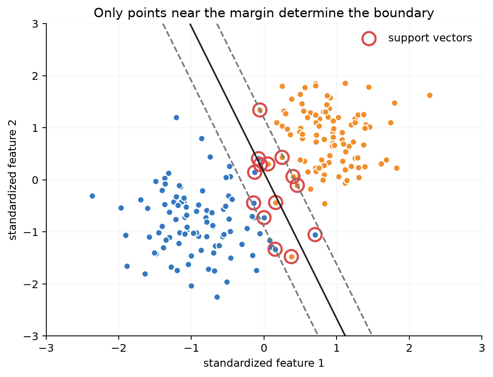
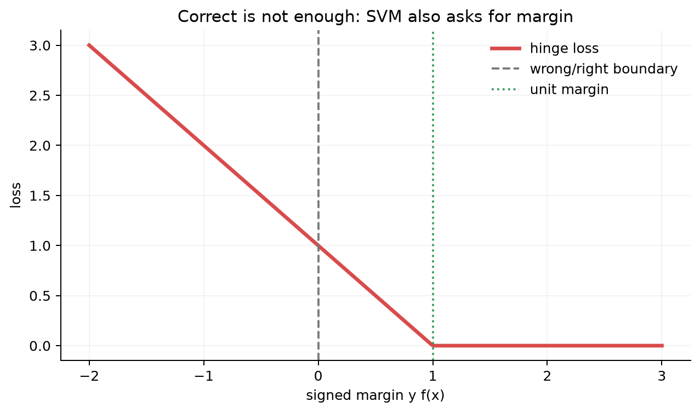
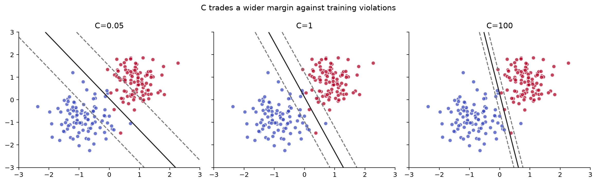
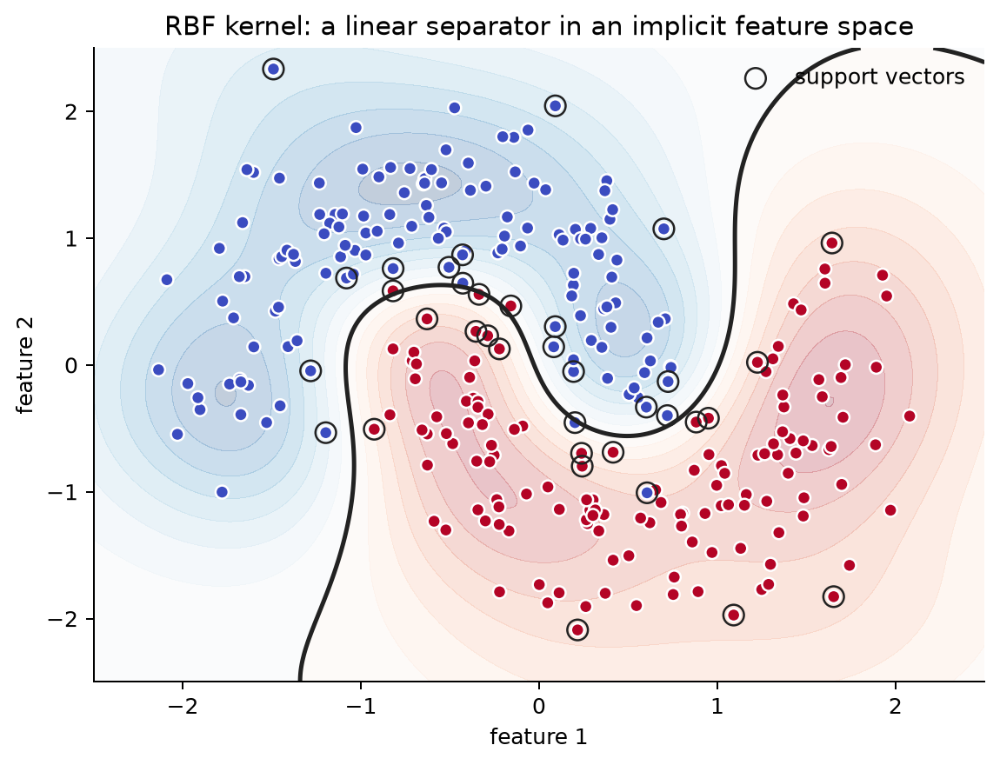

# Chapter 7 — Support Vector Machines

[← Chapter 6](06-neighbors-and-kernels.md) | [中文](../zh-CN/07-support-vector-machines.md) | [Chapter 8 →](08-trees-and-ensembles.md)

Many lines can classify the same training set perfectly. A line that nearly touches a point can flip its
prediction after a tiny measurement change, so training accuracy alone cannot choose among them. SVM
prefers the boundary with the widest safety buffer, later determined by only the closest support vectors.

For $y\in\{-1,+1\}$, $f(x)=w^Tx+b$ is the score. The functional margin is $yf(x)$; dividing by
$\|w\|$ removes arbitrary scaling and gives geometric distance. The hard-margin problem solves

$$\min_{w,b}\tfrac12\|w\|^2\quad\text{s.t.}\quad y^{(i)}(w^Tx^{(i)}+b)\ge1.$$



The black solid line is $f(x)=0$; gray dashed lines mark $f(x)=\pm1$. Circled points touch or violate
these margins and therefore support the solution. Far-away points usually do not move the boundary.

Soft margin yields hinge loss $\max(0,1-yf(x))$. Correct points inside the margin still incur loss.



The horizontal axis is signed margin $yf(x)$. Negative values are mistakes, values from zero to one are
correct but inside the safety buffer, and values at least one have zero loss.

Large $C$ penalizes violations strongly; small $C$ permits violations for a wider margin.



Both panels use the same data. Small $C$ tolerates some violations for stronger regularization; large
$C$ pays more attention to every training violation and can fit noise.

The dual contains data only through dot products:

$$\max_\alpha\sum_i\alpha_i-\tfrac12\sum_{i,j}\alpha_i\alpha_jy^{(i)}y^{(j)}K(x^{(i)},x^{(j)}),$$

with $0\le\alpha_i\le C$ and $\sum_i\alpha_i y^{(i)}=0$. SMO updates two multipliers at a time to
preserve the equality constraint. Nonzero multipliers identify support vectors.

For a solvable numerical case, use $x^{(1)}=-1,y^{(1)}=-1$ and $x^{(2)}=1,y^{(2)}=1$. Their Gram matrix is
$[[1,-1],[-1,1]]$. The equality constraint forces $\alpha_1=\alpha_2=a$, reducing the dual to
$W(a)=2a-2a^2$. Its maximum is $a=0.5$, which gives $w=1,b=0$ and signed margin one for both points. Both are
therefore support vectors. This shows that $\alpha_i$ records a sample's contribution rather than being decorative
notation.



Dots are observed classes, the black curve is the zero-score boundary, and circled dots are support
vectors. Background color is decision score, not calibrated probability. The kernel creates a curved
input-space boundary while remaining linear in an implicit feature space.

```bash
python code/chapter07/support_vector_machine.py
python code/chapter07/course_lab.py
```

The course lab prints hinge losses, one primal update, and the two-point Gram/dual calculation. The scratch linear SVM
and scikit-learn both score 0.952 in the fixed test. SVM scores are not
probabilities; calibration requires held-out data. Kernel SVMs can require $O(m^2)$ Gram memory, while
linear SVMs remain strong for large sparse text.

## Modern AI connections

Triplet and some contrastive losses share the idea of separating positives and negatives by a margin,
although InfoNCE is not hinge loss. Pairwise recommender ranking can use
$\max(0,1-s(x^+)+s(x^-))$. A linear SVM on frozen language or vision embeddings is a strong low-data
probe, classifier, or routing baseline; probe readability does not prove causal use by the base model.
Nyström and random Fourier features approximate kernels for larger datasets.

## Failure diagnosis

Jointly validate scaling, $C$, and $\gamma$. Fragmented RBF regions often mean excessive locality;
all-majority predictions suggest imbalance or a poor operating point. Record support-vector count,
Gram memory, model size, and p95 latency. Calibrate scores on independent data when probabilities matter.

## Socratic mentor

<details><summary>Why can a correctly classified point still have hinge loss?</summary>
Correct sign is insufficient: its signed margin must reach one to leave the safety buffer.
</details>

<details><summary>Does larger C mean stronger regularization?</summary>
No. Larger $C$ penalizes violations more, so the model may sacrifice margin width to fit training points.
</details>

<details><summary>Why does SMO update two multipliers?</summary>
Changing one alone would generally violate $\sum_i\alpha_i y^{(i)}=0$.
</details>

## Exercises

Derive geometric margin; analyze hinge subgradients; plot a $C\times\gamma$ validation heatmap; remove
support and non-support points; calibrate scores; compare logistic regression, linear SVM, and kNN on
the same embeddings. [Hints and answers](solutions/07-solutions.md).

## Interview recap

- SVM balances margin width against violations; support vectors determine the expansion.
- Hard margin permits no violations; soft margin introduces slack controlled by $C$.
- The dual exposes dot products, enabling kernels; SMO preserves the equality constraint.
- Large RBF $\gamma$ is local and can overfit; small $\gamma$ is smoother.
- Decision scores are not probabilities; kernel SVM can be impractical at large sample counts.

## Mastery checklist

- [ ] I can derive functional/geometric margin and hard/soft objectives.
- [ ] I can explain hinge loss, $C$, support vectors, and subgradients.
- [ ] I can derive why dot products appear in the dual and apply a kernel.
- [ ] I can jointly tune $C,\gamma$ and inspect support count and calibration.
- [ ] I can explain modern margin connections without claiming algorithmic identity.

### Further reading

- [Stanford CS229 syllabus and SVM materials](https://cs229.stanford.edu/syllabus-new.html)
- [scikit-learn Support Vector Machines guide](https://scikit-learn.org/stable/modules/svm.html)
- [RBF SVM parameter example](https://scikit-learn.org/stable/auto_examples/svm/plot_rbf_parameters.html)
- [LIBSVM paper](https://www.csie.ntu.edu.tw/~cjlin/papers/libsvm.pdf)
