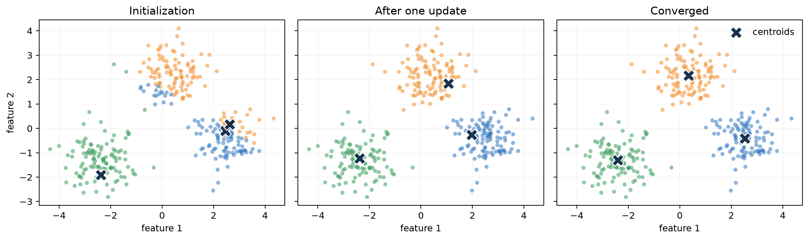
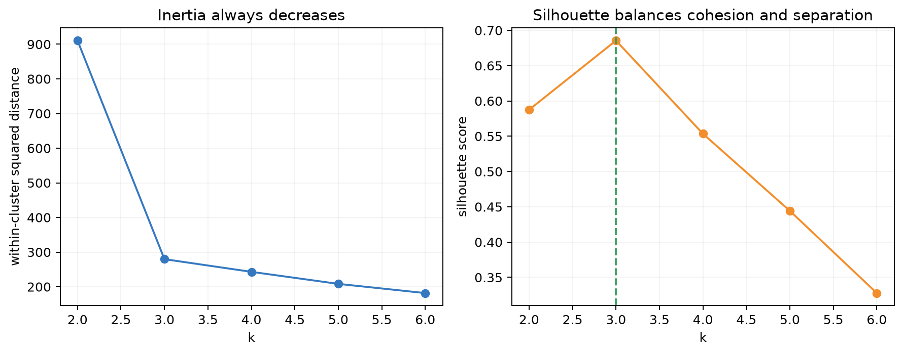
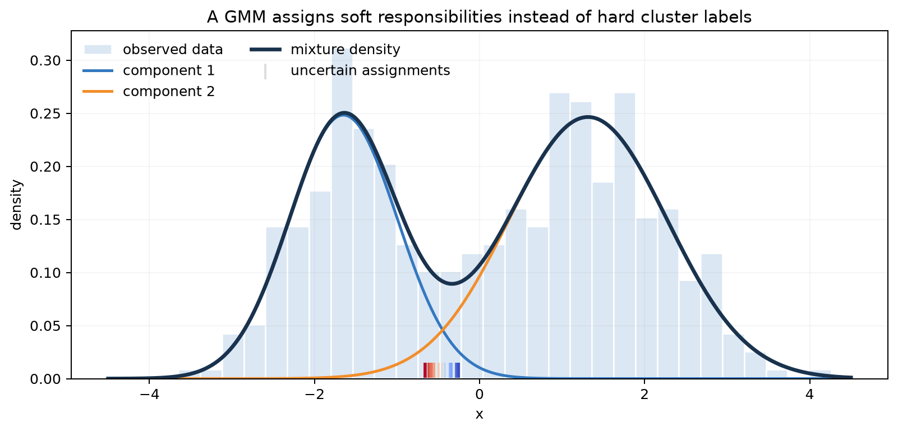
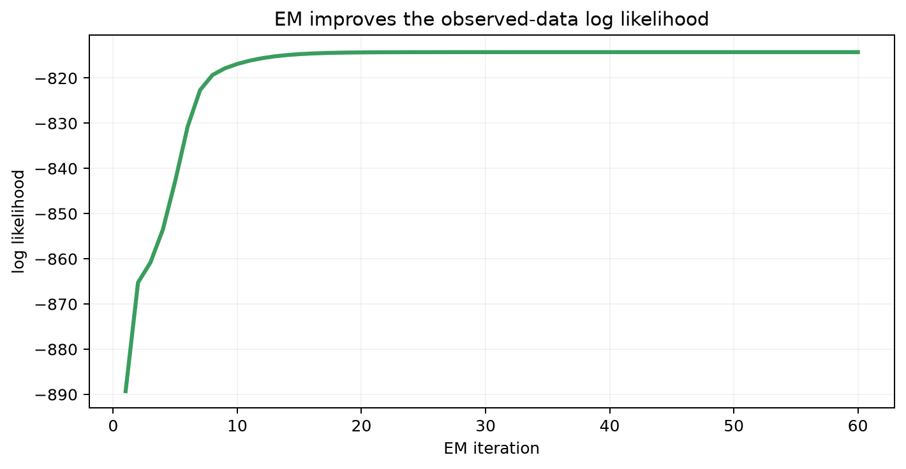

# Chapter 10: Clustering, GMM, EM, and ELBO

[← Chapter 9](09-learning-theory-and-model-selection.md) | [中文](../zh-CN/10-clustering-em-and-elbo.md) | [Notation](appendix-a-notation.md)

> **Prerequisites:** probability, maximum likelihood, Bayes' rule, and model selection.

## From Chapter 9 to this chapter

Labels are expensive, while raw customer events, medical records, images, and documents are abundant. Unsupervised
learning asks whether $X$ itself contains useful structure. We move from hard k-means assignments to probabilistic
Gaussian mixtures, then derive EM for learning with unobserved variables.


## 10.1 Why clustering?

Clustering can propose customer segments, prototypes, anomalies, or batches for human labeling. It does not reveal a
unique natural truth: the same customers may group differently by spending, product taste, or life cycle. Features,
scaling, distance, and assumptions define the answer, so validation must return to the intended use.

## 10.2 k-means as alternating optimization

For $x^{(i)}\in\mathbb R^d$ and $K$ centers, k-means minimizes

$$J=\sum_{i=1}^{m}\|x^{(i)}-\mu_{z_i}\|_2^2.$$

Alternate two exact subproblems:

$$z_i\leftarrow\arg\min_k\|x^{(i)}-\mu_k\|^2,
\qquad
\mu_k\leftarrow\frac1{|C_k|}\sum_{i\in C_k}x^{(i)}.$$

The mean follows by differentiating the within-cluster squared distance. Each step cannot increase $J$, so the
algorithm stabilizes, but only at a local optimum.



The three panels show initialization, one update, and convergence. Colored points are current assignments and black
crosses are current centers. Comparing the panels shows random centers moving into the three dense regions. Different starts can produce different solutions, which is
why k-means++ and multiple restarts are standard.

Scaling is part of the model: if spending ranges to 10,000 and visit count to 100, raw Euclidean distance is mostly a
spending metric. Standardizing asserts that one standard deviation in either feature is comparable.

## 10.3 Choosing $K$



Inertia on the left can only decrease as $K$ grows, so “choose minimum inertia” is meaningless. One may inspect an
elbow. Silhouette on the right balances cohesion and separation and favors $K=3$ here. Neither measure establishes
business usefulness. Stability under resampling, interpretability, and downstream performance remain necessary.

## 10.4 Gaussian mixture models

A GMM generates a latent component and then an observation:

$$z\sim\mathrm{Categorical}(\pi),\qquad x\mid z=k\sim\mathcal N(\mu_k,\Sigma_k),$$

$$p(x)=\sum_{k=1}^{K}\pi_k\mathcal N(x;\mu_k,\Sigma_k).$$

The posterior responsibility is

$$\gamma_{ik}=p(z_i=k\mid x^{(i)})=
\frac{\pi_k\mathcal N(x^{(i)};\mu_k,\Sigma_k)}
{\sum_j\pi_j\mathcal N(x^{(i)};\mu_j,\Sigma_j)}.$$



The histogram is the observed sample, blue and orange curves are weighted components, and the dark curve is their
mixture. Short marks near the horizontal axis identify observations whose responsibilities are closest to 0.5; they
lie in the overlap region. Far from the overlap, membership approaches zero or one. This is model-based uncertainty, not guaranteed calibration under a misspecified
mixture.

## 10.5 EM from missing labels

The observed log-likelihood contains a log of a sum:

$$\ell(\theta)=\sum_i\log\sum_k\pi_k\mathcal N(x^{(i)};\mu_k,\Sigma_k),$$

so the component parameters do not separate. EM alternates:

- **E-step:** compute $\gamma_{ik}=p(z_i=k\mid x^{(i)},\theta^{old})$.
- **M-step:** perform weighted maximum likelihood, with $N_k=\sum_i\gamma_{ik}$:

$$\pi_k=\frac{N_k}{m},\quad
\mu_k=\frac1{N_k}\sum_i\gamma_{ik}x^{(i)},$$

$$\Sigma_k=\frac1{N_k}\sum_i\gamma_{ik}(x^{(i)}-\mu_k)(x^{(i)}-\mu_k)^\top.$$

For any $q(z)$,

$$\log p(x)=
\underbrace{\mathbb E_q\log p(x,z)-\mathbb E_q\log q(z)}_{ELBO}
+D_{KL}(q(z)\|p(z\mid x)).$$

The E-step sets $q$ to the current posterior, making the bound tight; the M-step raises the bound. Observed likelihood
therefore does not decrease, although EM can still reach a poor local optimum.



The curve rises rapidly and then plateaus. This verifies the monotonic property in this run, not global optimality or
the real-world meaning of the components.

## 10.6 Reproduce and compare

```bash
python code/chapter10/clustering_and_em.py
```

The NumPy implementation checks that k-means cost never increases, responsibility rows sum to one, and EM likelihood
never decreases. With the fixed seed, k-means stabilizes in about three rounds and the fitted 1-D GMM means are about
$[-1.649,1.314]$.

Use k-means for large, roughly spherical groups and prototypes; GMM for overlapping elliptical groups and soft
membership; DBSCAN for some irregular density-separated shapes; and hierarchical clustering when a tree of groups is
the desired object. Always test sensitivity to features and scaling.

## 10.7 Complexity and failure modes

k-means costs about $O(mKd)$ per round. Full-covariance GMM uses $O(Kd^2)$ covariance storage and roughly
$O(mKd^2)$ work per round. Diagonal covariance or prior PCA can make high-dimensional problems feasible.

Watch for outliers, empty clusters, local optima, singular GMM covariance, and label switching. Swapping component
indices leaves the same density, so cluster number itself has no ordinal meaning.

## Worked reasoning checkpoint

For the points {1,2,3,8,9,10}, two centers initialized at 2 and 3 move to 1.5 and 7.5, then to 2 and 9.
The objective falls from 111 to 41 to 4. This concrete iteration explains both monotonic improvement and the need
for multiple initializations.

For a two-component GMM with means 0 and 4, unit variances, and equal priors, the responsibility of component 1
for x=1 is about 0.982. The M-step uses that value as a weight, not as a permanent label. Real implementations use
log-sum-exp and covariance regularization to avoid underflow and singular components.

## Modern AI connections

- Vector quantization maps continuous vectors to codebook entries; it is related to nearest-center assignment.
- Embedding clustering supports topic discovery, deduplication, sampling, and error analysis.
- VAEs maximize an ELBO with an amortized approximate posterior when exact E-steps are unavailable.
- MoE routing resembles soft assignment but is task-trained with load-balancing constraints; it is not GMM-EM.

## Socratic mentor

<details><summary>How can clustering be correct without labels?</summary>
There is no task-free unique answer. Geometry, stability, domain interpretation, and downstream utility test different aspects.
</details>

<details><summary>Why not choose the largest $K$ by inertia?</summary>
More centers cannot worsen optimal inertia; with one center per observation it is zero but provides no compression.
</details>

<details><summary>Does the E-step create true labels?</summary>
No. It computes revisable posterior responsibilities under the current model assumptions.
</details>

<details><summary>Why use multiple EM initializations if likelihood rises every round?</summary>
Monotonic ascent does not imply ascent to the global maximum.
</details>

<details><summary>Does responsibility 0.99 guarantee real confidence?</summary>
No. A misspecified feature space, component count, or density family can be confidently wrong.
</details>

## Exercises

See [Chapter 10 solutions](solutions/10-solutions.md).

1. Perform two k-means rounds by hand for five 2-D points.
2. Prove that the mean minimizes within-cluster squared distance.
3. Compute a GMM responsibility for a supplied 1-D sample.
4. Derive the M-step updates for $\pi_k$ and $\mu_k$.
5. Compare k-means, GMM, and DBSCAN on moons, unequal density, and outlier data.
6. Select $K$ using inertia, silhouette, resampling stability, and domain utility.
7. Cluster text embeddings and audit sensitivity to encoder, normalization, and distance.

## Interview recap

- **k-means objective?** Sum of squared distances to assigned centers.
- **Why the mean?** It is the stationary minimizer of squared distance.
- **Does k-means converge globally?** It stabilizes monotonically, but only locally.
- **What does GMM add?** Mixture weights, covariances, densities, and soft posterior membership.
- **What are EM's two steps?** Infer the latent posterior, then maximize expected complete-data log-likelihood.
- **What is the ELBO?** Expected joint log probability minus the variational log-density term.
- **Why monotonic EM?** Tighten the bound in E, raise it in M.
- **Main GMM risks?** Local optima, label switching, singular covariance, and misspecification.

## Mastery checklist

- [ ] I can derive one k-means round and prove the mean update.
- [ ] I can write the GMM generation process and posterior responsibility.
- [ ] I can explain the log-sum difficulty and derive EM updates.
- [ ] I can use $\log p(x)=ELBO+KL$ to explain monotonicity and its limits.
- [ ] I can diagnose scaling, initialization, outliers, and singular covariance.
- [ ] I can connect clustering to vector quantization, embeddings, VAEs, and MoE without conflating them.

### Further reading

- [scikit-learn: Clustering](https://scikit-learn.org/stable/modules/clustering.html)
- [scikit-learn: Gaussian mixtures](https://scikit-learn.org/stable/modules/mixture.html)
- [Dempster, Laird & Rubin: EM](https://doi.org/10.1111/j.2517-6161.1977.tb01600.x)
- [Bishop: Pattern Recognition and Machine Learning](https://www.microsoft.com/en-us/research/people/cmbishop/prml-book/)

[Next: Dimensionality Reduction →](11-dimensionality-reduction.md)
