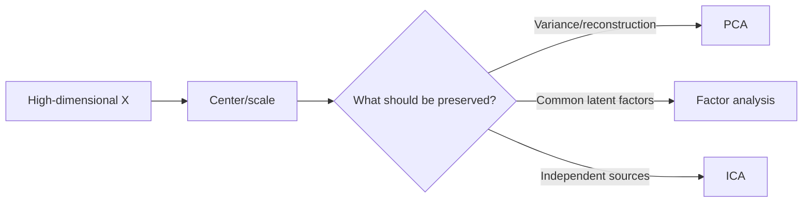

# Chapter 11: Dimensionality Reduction—PCA, Factor Analysis, and ICA

[← Chapter 10](10-clustering-em-and-elbo.md) | [中文](../zh-CN/11-dimensionality-reduction.md) | [Notation](appendix-a-notation.md)

> **Prerequisites:** vectors, matrices, eigenvalues, covariance, and unsupervised learning.

## From Chapter 10 to this chapter

High-dimensional features are often redundant and noisy: area and room count both reflect house size, nearby pixels
are correlated, and not every embedding dimension is equally useful. Dimensionality reduction builds fewer coordinates,
but different methods preserve different things. PCA preserves linear variance, factor analysis models common latent
causes, and ICA seeks statistically independent sources.



### Learning boundary

PCA is the required core: you should be able to center data, use covariance or SVD, project, reconstruct, and choose
a retained dimension. Factor analysis and ICA are survey extensions here: understand their assumptions, outputs, and
failure boundaries, but do not treat full optimizer derivations as course requirements.

## 11.1 PCA from maximum variance

Center $X\in\mathbb R^{m\times d}$ as $X_c=X-\mathbf1\mu^\top$. For a unit direction $w$,

$$\mathrm{Var}(X_cw)=w^\top\left(\frac1mX_c^\top X_c\right)w=w^\top Sw.$$

Maximize $w^\top Sw$ subject to $w^\top w=1$. The Lagrange condition is

$$Sw=\lambda w,$$

so the first principal direction is the eigenvector of covariance with largest eigenvalue. Later directions use the
remaining orthogonal eigenvectors.


The red axis follows the longest variation in the cloud. Gray segments connect observations to their one-dimensional
reconstructions on that axis; their perpendicular length is discarded information. A narrow cloud loses little, while
a round cloud cannot be summarized well by one direction. Flipping the sign of an axis leaves the subspace unchanged.

## 11.2 Maximum variance equals minimum reconstruction error

For centered $x$, its one-component reconstruction is $\hat x=ww^\top x$. Orthogonality gives

$$\|x-\hat x\|^2=\|x\|^2-(w^\top x)^2.$$

Total input energy is fixed, so minimizing reconstruction error maximizes projected variance. For $k$ components,

$$Z=X_cW_k,\qquad \hat X=ZW_k^\top+\mu.$$

This is why PCA relates to a constrained linear autoencoder, but its unsupervised reconstruction objective does not
guarantee preservation of label information.

## 11.3 SVD and component selection

Use the singular value decomposition

$$X_c=U\Sigma V^\top.$$

Columns of $V$ are principal axes, $X_cV_k=U_k\Sigma_k$ are scores, and covariance eigenvalues satisfy
$\lambda_j=\sigma_j^2/m$ under the population convention. SVD avoids explicitly forming a potentially unstable
$d\times d$ covariance matrix.


Bars show variance added by each component, and the line shows cumulative variance. About 21 components reach 90%
in this run. Ninety percent is a design choice, not a law: high variance may encode lighting or batch effects, while a
low-variance direction may carry rare-class information.


Read this figure **down each column**, not continuously from left to right. Each column is one fixed digit example,
while different columns may contain different digits. The first row is the original image, the second reconstructs
it with 8 components, and the third reconstructs it with 20. Comparing rows two and three within one column shows
how additional components restore stroke detail toward the original. The script separately reports a 10-component
reconstruction MSE of about 0.019; that setting is not one of the three displayed rows. Recognizable images still do
not guarantee performance on every downstream task.

Centering is essential. Standardization is conditional: it is appropriate when raw units should be comparable, but
not when their physical variance is itself meaningful.

## 11.4 Factor analysis

Factor analysis posits

$$x=\mu+\Lambda z+\epsilon,\qquad z\sim\mathcal N(0,I),\quad
\epsilon\sim\mathcal N(0,\Psi),$$

usually with diagonal $\Psi$. Hence

$$\mathrm{Cov}(x)=\Lambda\Lambda^\top+\Psi.$$

PCA explains total variance with an orthogonal projection. Factor analysis is a probabilistic model separating common
factor covariance from feature-specific noise. A named factor is an interpretation, not automatically a discovered
causal variable.

## 11.5 ICA and independent sources

ICA assumes observations are linear mixtures $x=As$ of independent, mostly non-Gaussian sources. It learns an
unmixing matrix $W$ so that $\hat s=Wx$. Uncorrelatedness from PCA is weaker than independence.


The top row contains two sources, the middle row their microphone mixtures, and the bottom row ICA estimates. Shape is
recovered, but order, sign, and scale may differ; these are inherent ambiguities. If several sources are Gaussian,
orthogonal rotations are indistinguishable and identification fails.

## 11.6 Reproduce and choose a method

```bash
python code/chapter11/dimensionality_reduction.py
```

The script implements PCA with NumPy SVD, compares its subspace with a library implementation, reconstructs digits,
and runs FastICA. Compare subspaces or reconstructions rather than raw signed eigenvectors.

| Method | Preserves/models | Typical use |
|---|---|---|
| PCA | global linear variance | compression, denoising, preprocessing |
| Factor analysis | shared latent covariance and unique noise | measurement models |
| ICA | independent non-Gaussian sources | blind source separation |
| t-SNE | local neighbor probabilities | exploratory 2-D plots |
| UMAP | local manifold structure | exploration and embeddings |

t-SNE/UMAP can distort global distance, area, and direction. Their plots suggest questions; they do not by themselves
prove natural clusters.

## 11.7 Complexity and failure modes

Large matrices may require randomized or incremental PCA. Save the training mean and axes and apply the same transform
online. Never fit PCA separately on test data or before a cross-validation split. Also audit unit dominance, outliers,
and downstream task quality rather than relying on explained variance alone.

## Worked reasoning checkpoint

For centered points (-2,-1), (-1,-2), (1,2), and (2,1), the covariance matrix has eigenvalues 4.5 and 0.5.
The first direction is (1,1)/sqrt(2) and preserves 90% of total variance. PCA removes an orthogonal combination,
not an original feature column. Fit stores the training mean and axes; transform and inverse-transform must reuse them.

Sparse text matrices often use uncentered Truncated SVD because centering destroys sparsity. ICA adds independence and
non-Gaussian assumptions after whitening. t-SNE and UMAP are exploratory maps: vary seeds and neighborhood settings,
measure neighbor preservation in the original space, and never tune them by looking at test labels.

## Modern AI connections

- PCA can compress text/image embeddings, but choose dimension using retrieval quality, latency, and memory.
- Whitening decorrelates and rescales components but can amplify small-eigenvalue noise.
- PCA of hidden states describes variation; it does not make a component causal or uniquely interpretable.
- LoRA shares the low-dimensional-change intuition, but it learns task-specific low-rank weight updates rather than
  applying PCA to activations.
- Nonlinear autoencoders extend compression capacity at the cost of harder optimization and validation.

## Socratic mentor

<details><summary>Why center before PCA?</summary>
Otherwise the offset from the origin can dominate instead of variation around the mean.
</details>

<details><summary>Does 95% explained variance mean 95% of task information?</summary>
No. It is 95% of input variance; discriminative information may live in low-variance directions.
</details>

<details><summary>Are large loadings causal?</summary>
No. They describe linear association with a component, not an intervention effect.
</details>

<details><summary>Why does ICA need non-Gaussianity?</summary>
Independent Gaussian sources remain indistinguishable after orthogonal rotation.
</details>

<details><summary>Do distant t-SNE clusters imply distant original groups?</summary>
No. t-SNE prioritizes local neighborhoods and can distort global geometry.
</details>

## Exercises

See [Chapter 11 solutions](solutions/11-solutions.md).

1. Compute covariance, eigenvalues, the first axis, and scores for three centered 2-D points.
2. Prove the equivalence between maximum variance and minimum squared reconstruction.
3. Write the thin-SVD shapes for $X\in\mathbb R^{m\times d}$.
4. Multiply one feature by 100 and compare centered versus standardized PCA.
5. Plot digit classification accuracy, time, and dimension after PCA.
6. Test ICA as source correlation, Gaussianity, and noise change.
7. Compress embeddings and report memory, latency, Recall@1/10, and reconstruction.

## Interview recap

- **PCA objective?** Maximum projected variance, equivalently minimum linear reconstruction error.
- **Why center?** To model variation around the mean.
- **Eigen-decomposition or SVD?** Both connect; direct SVD is often more stable.
- **How choose $k$?** Combine explained variance, reconstruction, downstream quality, and system budget.
- **Must PCA standardize?** Only when feature units/variances should be made comparable.
- **Why can signs differ?** $v$ and $-v$ span the same component.
- **PCA versus FA?** Projection of total variance versus a latent probabilistic noise model.
- **PCA versus ICA?** Uncorrelated orthogonal directions versus independent non-Gaussian sources.
- **Can PCA leak data?** Yes, if fitted before splitting or outside each CV fold.

## Mastery checklist

- [ ] I can derive PCA's eigenproblem and reconstruction equivalence.
- [ ] I can implement PCA with SVD and track all matrix shapes.
- [ ] I can decide when to center or standardize without leakage.
- [ ] I can compare PCA, factor analysis, and ICA by objective and assumptions.
- [ ] I can evaluate embedding compression using both quality and system metrics.

### Further reading

- [scikit-learn: Decomposition](https://scikit-learn.org/stable/modules/decomposition.html)
- [scikit-learn: FastICA](https://scikit-learn.org/stable/modules/generated/fastica-function.html)
- [Jolliffe & Cadima: PCA review](https://doi.org/10.1098/rsta.2015.0202)
- [Hyvärinen & Oja: ICA](https://www.cs.helsinki.fi/u/ahyvarin/papers/NN00new.pdf)

[Next: Neural Networks and Backpropagation →](12-neural-networks-and-backprop.md)
