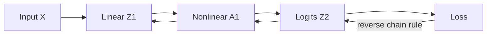

# Chapter 12: Neural Networks and Backpropagation

[← Chapter 11](11-dimensionality-reduction.md) | [中文](../zh-CN/12-neural-networks-and-backprop.md) | [Notation](appendix-a-notation.md)

> **Prerequisites:** matrices, the chain rule, gradient descent, cross-entropy, and regularization.

## From Chapter 11 to this chapter

PCA is a fixed linear representation. Stacking linear transforms without activations still produces one linear
transform. Neural networks alternate linear maps with nonlinear activations, learning task-specific intermediate
features. Backpropagation makes this practical by computing all parameter gradients in one reverse pass.



## 12.1 Why nonlinear activations are essential

Without an activation,

$$h=XW_1+b_1,\quad o=hW_2+b_2
=X(W_1W_2)+(b_1W_2+b_2),$$

so depth collapses into one affine map. Activations prevent this collapse and make curved or piecewise boundaries
possible.


Sigmoid and tanh saturate at large magnitudes, where their derivatives approach zero and deep gradients can vanish.
ReLU preserves a unit derivative on its positive side but has zero derivative on the negative side, which can create
dead units. GELU and SiLU are common smooth alternatives. The network, initialization, and task determine the choice.

## 12.2 A minimal two-layer MLP

For batch size $m$, input width $d$, and hidden width $h$:

$$Z_1=XW_1+b_1,\quad A_1=\tanh Z_1,$$
$$Z_2=A_1W_2+b_2,\quad p=\sigma Z_2,$$

where $X:m\times d$, $W_1:d\times h$, $A_1:m\times h$, and $W_2:h\times1$.
The mean binary cross-entropy is

$$L=-\frac1m\sum_i[y^{(i)}\log p^{(i)}+(1-y^{(i)})\log(1-p^{(i)})].$$

Production code should use a stable logits-based implementation rather than explicitly taking $\log0$.

### Visualizing an MLP with two hidden layers


Read the diagram from left to right: two input features feed a four-neuron first hidden layer, then a three-neuron
second hidden layer, and finally one output neuron produces a binary-class probability. Adjacent layers are fully
connected, so every line represents a learnable weight. Biases are omitted from the drawing to reduce clutter, but
every non-input neuron still has one.

$$A_1=\phi(XW_1+b_1),\qquad
A_2=\phi(A_1W_2+b_2),\qquad
p=\sigma(A_2W_3+b_3).$$

For input width 2 and hidden widths 4 and 3, the weight shapes are
$W_1:2\times4$, $W_2:4\times3$, and $W_3:3\times1$. This is an MLP with **two hidden layers**; it is also
sometimes called a three-layer network when authors count parameterized transformations. The numerical example below
uses only one small hidden layer so that every arithmetic step remains readable. A second hidden layer repeats the
same affine-transform-plus-activation pattern.

## 12.3 Backpropagation line by line

For sigmoid plus BCE,

$$dZ_2=\frac{p-y}{m}.$$

Then

$$dW_2=A_1^\top dZ_2,\quad db_2=\sum_i dZ_{2,i},$$
$$dA_1=dZ_2W_2^\top,$$
$$dZ_1=dA_1\odot(1-A_1^2),$$
$$dW_1=X^\top dZ_1,\quad db_1=\sum_i dZ_{1,i}.$$

Each line is “upstream gradient times local derivative.” Shapes provide a powerful correctness check: every parameter
gradient must have the same shape as its parameter. Backprop computes gradients; SGD or Adam decides how to update.

## 12.4 Reverse-mode autodiff and gradient checking

Frameworks record forward operations in a computation graph, topologically traverse it backward from $dL/dL=1$,
and sum gradient contributions from every downstream path.

```bash
python code/chapter12/miniautograd.py
```

The tiny scalar engine implements only addition, multiplication, and tanh, yet matches the hand-derived gradient.
For a small network, verify analytic gradients with central differences:

$$g_j^{num}=\frac{L(\theta+\epsilon e_j)-L(\theta-\epsilon e_j)}{2\epsilon}.$$

Use relative error, tiny batches, and differentiable points. Numerical checking is a development test, not a training method.

## 12.5 Initialization and signal flow

All-zero weights preserve symmetry: hidden units receive identical outputs and gradients forever. Randomness breaks
symmetry, but scale must preserve signal. Xavier commonly uses variance about $1/n_{in}$ for tanh, while He uses
$2/n_{in}$ for ReLU.


Very small weights shrink variance through depth; very large weights amplify it or saturate activations. A matched
initialization keeps forward signal more stable. This diagnostic alone does not guarantee trainability—normalization,
residual paths, and the optimizer also matter.

## 12.6 SGD, momentum, and Adam

Mini-batch SGD uses a noisy but efficient gradient estimate:

$$\theta_{t+1}=\theta_t-\eta g_t.$$

Momentum smooths directions,

$$v_t=\beta v_{t-1}+(1-\beta)g_t,\quad \theta_{t+1}=\theta_t-\eta v_t,$$

while Adam tracks bias-corrected first and second moments and scales each coordinate. Adam often eases early training,
but it does not remove the need for schedules, validation, or regularization. AdamW decouples weight decay from the
adaptive gradient update.

## 12.7 Fitting a nonlinear boundary


The background is the NumPy MLP's positive-class probability and the black contour is 0.5. A hidden nonlinear
representation lets the output layer follow the gap between the moons. The framework model is evaluated numerically
on the same split below rather than overlaid, which keeps the probability field readable.


Loss decreases while accuracy rises and stabilizes. Mini-batch noise explains small oscillations. A flat training
loss suggests an optimization or implementation problem; improving training with degrading validation suggests
overfitting.

```bash
python code/chapter12/neural_networks.py
```

With the fixed seed, gradient-check relative error is about $2.45\times10^{-9}$, the NumPy MLP reaches test accuracy
about 0.927, and the library reference about 0.953. Gradient checks, shape assertions, tiny-set overfitting, and a
reference model form a stronger verification chain than accuracy alone.

## 12.8 Regularization, systems, and diagnosis

Weight decay, dropout, early stopping, data augmentation, and normalization constrain training in different ways.
First make a tiny dataset overfit to near-zero loss; then scale data and inspect train/validation curves; only then
search regularization and architecture.

A dense layer costs roughly $O(mn_{in}n_{out})$. Training memory also stores gradients, optimizer states, and
activations. Mixed precision, gradient accumulation, activation checkpointing, and data parallelism make training
feasible but do not replace numerical and statistical validation.

Common failures include accidental broadcasting, mismatched labels and loss, missing train/eval mode switches,
unstable logits, exploding gradients, and data leakage.

## Worked reasoning checkpoint

With x=[1,2], a two-unit tanh layer can produce z1=[0.7,0.6], a1 approximately [0.604,0.537], and a positive-class
probability near 0.508. For y=1, backprop starts with dz2=p-y and returns gradients with exactly the shapes of W2,
W1, and their biases. A single gradient-descent update should lower the same example's loss.

Xavier and He scaling follow an approximate variance-preservation calculation, not magic constants. Report batch size,
optimization steps, epochs, gradient accumulation, schedules, and seeds separately. Debug in this order: data and loss,
overfit a tiny set, inspect gradients and parameter changes, compare a baseline, then tune capacity and regularization.

## Modern AI connections

- Transformer blocks contain token-wise Linear→GELU/SiLU→Linear MLPs in addition to attention.
- Query/key/value projections and softmax attention are trained by the same backpropagation machinery.
- Pretraining, full fine-tuning, and LoRA differ in which parameters update, not in the need for independent validation.
- GPU/TPU kernels fuse tensor operations, but the mathematical core remains tensor algebra and reverse-mode AD.

## Socratic mentor

<details><summary>Why can many linear layers not solve XOR?</summary>
Their composition is still one affine map and therefore one linear boundary.
</details>

<details><summary>Backprop versus gradient descent?</summary>
Backprop computes gradients; an optimizer uses them to update parameters.
</details>

<details><summary>Why sum gradients from multiple graph paths?</summary>
The multivariate chain rule adds every path through which the variable affects the loss.
</details>

<details><summary>What should be checked first after NaN loss?</summary>
Learning rate, input scale, unstable log/exp/division, gradient norms, and anomalous data.
</details>

<details><summary>Can similar accuracy prove a handwritten backward pass is correct?</summary>
No. Use per-parameter numerical checks and intermediate-tensor comparisons.
</details>

## Exercises

See [Chapter 12 solutions](solutions/12-solutions.md).

1. Write every forward and backward shape for $m=32,d=10,h=20$.
2. Derive $dZ=(p-y)/m$ for sigmoid plus BCE.
3. Add ReLU, a second hidden layer, and mini-batches to the NumPy MLP.
4. Remove the tanh derivative and inspect gradient checks and training.
5. Compare zero, tiny, huge, Xavier, and He initialization.
6. Compare SGD, Momentum, and AdamW under equal budgets.
7. Count parameters and tensor shapes in a Transformer attention and MLP block.

## Interview recap

- **Why activations?** Without them, depth collapses to one linear map.
- **What is backprop?** Reverse-mode application of the chain rule on a computation graph.
- **Why vanishing/exploding gradients?** Products of layer Jacobians shrink or grow exponentially.
- **Why not zero initialization?** Hidden-unit symmetry is never broken.
- **Xavier versus He?** Variance scaling matched roughly to tanh/linear versus ReLU.
- **SGD versus Adam?** Lower-state noisy updates versus adaptive moment-scaled updates.
- **What does mini-batching provide?** Efficient hardware use, frequent updates, and controlled gradient noise.
- **How verify backprop?** Numerical gradients, tiny-set overfitting, shapes, and framework comparisons.

## Mastery checklist

- [ ] I can prove that linear depth collapses without activations.
- [ ] I can derive every gradient and tensor shape in a two-layer MLP.
- [ ] I can implement reverse-mode autodiff and numerical gradient checking.
- [ ] I can explain Xavier/He initialization via signal variance.
- [ ] I can compare optimizers and regularizers using validation evidence.
- [ ] I can locate MLPs, backpropagation, and autodiff inside modern Transformers.

### Further reading

- [Deep Learning Book: Feedforward Networks](https://www.deeplearningbook.org/contents/mlp.html)
- [Deep Learning Book: Optimization](https://www.deeplearningbook.org/contents/optimization.html)
- [Karpathy: micrograd](https://github.com/karpathy/micrograd)
- [PyTorch: Autograd mechanics](https://pytorch.org/docs/stable/notes/autograd.html)

[Next: Representation Learning →](13-representation-learning.md)
