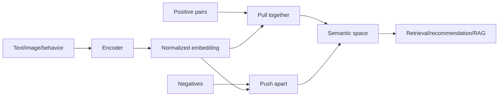
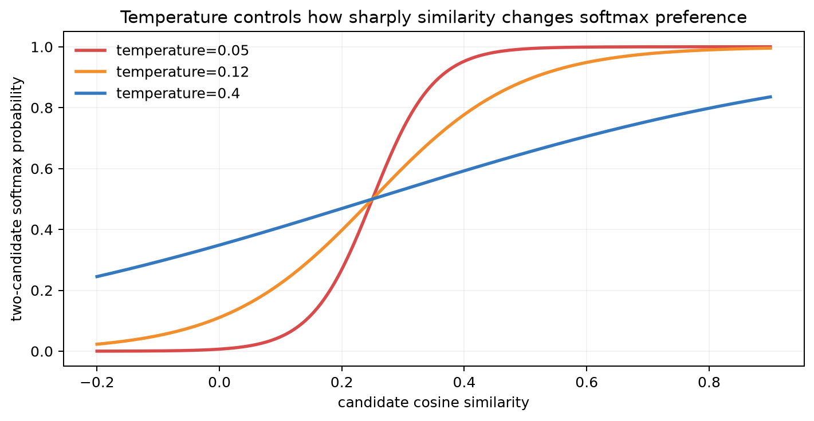
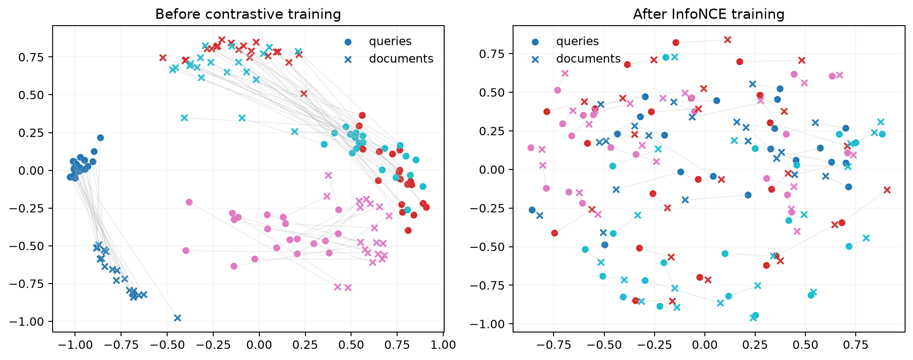
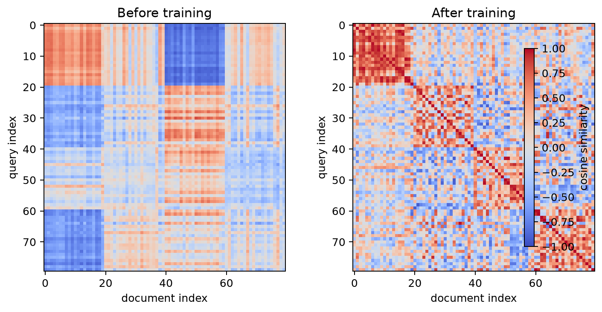
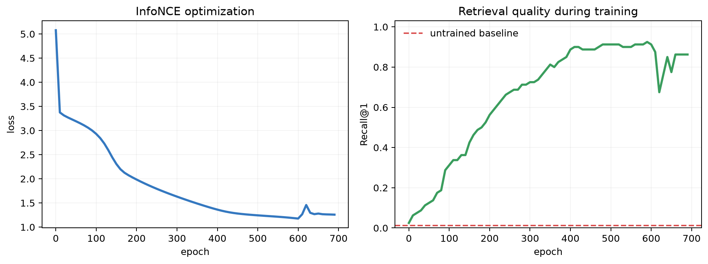

# Chapter 13: Representation Learning and Contrastive Retrieval

[← Chapter 12](12-neural-networks-and-backprop.md) | [中文](../zh-CN/13-representation-learning.md) | [Notation](appendix-a-notation.md)

> **Prerequisites:** similarity and high-dimensional distance, softmax cross-entropy, and neural networks.

## From Chapter 12 to this chapter

A hidden layer learns intermediate features, but ordinary classification only separates predefined labels. Modern AI
needs reusable representations: paraphrases, paired images and captions, or users and relevant items should be close
even without sharing a class ID. Representation learning makes task-relevant similarity geometric.



## 13.1 What should a representation preserve?

An encoder $f_\theta:\mathcal X\to\mathbb R^d$ maps input to an embedding. A useful representation ignores
task-irrelevant changes, preserves task-relevant distinctions, supports simple downstream decisions, and transfers to
new data. Invariance is never universally good: treating a rotated 6 as identical to 9 would corrupt digit semantics.
The positive-pair design is itself supervision.

Self-supervised learning creates targets from data structure: predict masked content, match two views of one object,
or align paired images and text. Pretraining transfers statistical structure but also transfers dataset bias and gaps.

## 13.2 Dual encoders and cosine similarity

For query $x_q^{(i)}$ and matching document $x_d^{(i)}$,

$$q^{(i)}=f_\theta(x_q^{(i)}),\qquad d^{(i)}=g_\phi(x_d^{(i)}).$$

After L2 normalization,

$$\bar q_i=\frac{q_i}{\|q_i\|_2},\quad
\bar d_i=\frac{d_i}{\|d_i\|_2},\quad
s_{ij}=\bar q_i^\top\bar d_j.$$

Documents can be encoded and indexed offline, so online work is one query encoding plus nearest-neighbor search. A
cross-encoder jointly reads each query-document pair and models richer interactions, but must run once per candidate;
it is therefore often used for reranking.

## 13.3 InfoNCE as batch classification

In a batch of $B$ matched pairs, $(q_i,d_i)$ is positive and other documents are in-batch negatives:

$$P(d_j\mid q_i)=\frac{\exp(s_{ij}/\tau)}{\sum_{k=1}^{B}\exp(s_{ik}/\tau)},$$

$$\mathcal L_{q\to d}=-\frac1B\sum_i\log
\frac{\exp(s_{ii}/\tau)}{\sum_j\exp(s_{ij}/\tau)}.$$

Thus each similarity row is a softmax classifier whose correct class is the diagonal position. A symmetric objective
also classifies queries from documents.



Small temperature magnifies similarity differences and emphasizes hard negatives, but also creates sharper, more
sensitive gradients. Large temperature flattens the distribution and can weaken the signal. It must be validated with
batch size and similarity scale rather than minimized blindly.

## 13.4 How training changes the space



Before training, two views of the same latent object point in different directions. After training, the query and
document towers align their shared semantic structure. This synthetic 2-D view demonstrates the mechanism; a visually
clean plot alone cannot establish real-world retrieval quality.



Each row is a query and each column a document. A bright diagonal means matched pairs receive high similarity. Bright
off-diagonal cells reveal confusions, duplicate semantics, or false negatives that an average loss may hide.



InfoNCE falls while Recall@1 rises and then saturates. They measure different objects: batch classification versus
gallery ranking. Select checkpoints using deployment-relevant retrieval metrics, not training loss alone.

## 13.5 Negatives, collapse, and shortcuts

Pulling only positive pairs permits every input to map to the same vector—representation collapse. Negatives state
which inputs must remain distinguishable, but create false negatives when an unlabeled candidate is actually relevant.
Very easy negatives provide little gradient; biased hard-negative mining can teach shortcuts. Larger batches add
negatives but also false-negative risk, quadratic similarity memory, and cross-device communication.

Mitigations include deduplication, same-label masking, curated hard negatives, queues, distillation, or negative-free
objectives with stop-gradient and redundancy constraints. The method must preserve the task's actual semantics.

## 13.6 Evaluation and retrieval systems

- **Recall@k:** whether a relevant item appears in the first $k$.
- **MRR:** $\frac1m\sum_i1/r_i$, emphasizing the first relevant rank.
- **NDCG@k:** graded relevance with larger credit near the top.
- **Linear probe/kNN:** whether frozen representations make downstream structure easily accessible.
- **Transfer tests:** robustness across tasks, domains, and subgroups.

Deduplicate train and test corpora and evaluate at realistic gallery size. In-batch retrieval is much easier than a
million-document search.

```bash
python code/chapter13/representation_learning.py
```

The NumPy experiment manually differentiates two linear towers and InfoNCE, then uses a nearest-neighbor index. With
the fixed seed, Recall@1 moves from about 0.013 to 0.863, Recall@5 reaches about 0.975, and MRR about 0.908. These
numbers validate a synthetic mechanism, not language understanding.

Approximate nearest-neighbor indexes trade a small amount of recall for speed and memory. Report encoding cost, index
build time, P95 latency, throughput, memory, and exact Recall@k together.

## 13.7 Architecture and failure diagnosis

A practical pipeline often uses a dual encoder to retrieve hundreds, a cross-encoder to rerank dozens, and a rule or
generative model to produce the final output. Diagnose retrieval misses, reranking mistakes, and generation failures
separately. A generator cannot use evidence that retrieval never found.

In-batch similarity costs $O(B^2d)$ work and $O(B^2)$ matrix memory. Common failures include duplicate leakage,
ID shortcuts, wrong positive pairs, missing normalization, tiny evaluation galleries, stale indexes after encoder
updates, and popularity bias.

## Worked reasoning checkpoint

If cosine similarities are [0.8,0.3,0.1] and temperature is 0.2, the logits are [4,1.5,0.5], the positive probability
is about 0.899, and InfoNCE is about 0.107. Raising a negative similarity to 0.75 makes it a hard negative and raises
the loss sharply. If that document is actually synonymous, the stronger gradient is harmful.

Production retrieval includes chunking, deduplication, encoding, versioned indexing, ANN retrieval, filtering,
reranking, and feedback. Monitor collapse, anisotropy, hubness, subgroup recall, and stale indexes. Updating the
query encoder without rebuilding the document index silently mixes incompatible spaces.

## Modern AI connections

- RAG embeds queries and passages, retrieves evidence, and gives it to an LLM; evaluate retrieval, evidence use, and
  answer correctness separately.
- CLIP contrastively aligns paired images and text for cross-modal retrieval and zero-shot classification.
- Recommender dual towers encode users and items for retrieval before interaction-heavy ranking.
- Sentence embeddings support semantic search, clustering, and deduplication; high cosine similarity does not imply
  factual equivalence.
- LLM hidden states are contextual representations, but layer choice, pooling, and fine-tuning change their utility.

## Socratic mentor

<details><summary>Why can uninterpretable individual dimensions still be useful?</summary>
Information may be distributed across combinations of dimensions; downstream geometry need not assign a name to each axis.
</details>

<details><summary>What assumption is encoded by two augmented views as a positive pair?</summary>
The task should be invariant to those augmentations; label-destroying augmentation teaches the wrong invariance.
</details>

<details><summary>Why is InfoNCE a classification loss?</summary>
For each query, batch documents are classes, the matched index is the label, and scaled similarities are logits.
</details>

<details><summary>Why can high Recall@5 still feel poor?</summary>
The result may rank fifth, relevance labels may be incomplete, or reranking/generation may ignore it.
</details>

<details><summary>Why can a larger batch help and hurt?</summary>
It adds informative negatives but also false negatives, quadratic cost, and sensitivity to optimization settings.
</details>

## Exercises

See [Chapter 13 solutions](solutions/13-solutions.md).

1. Compute one row of InfoNCE from a $3\times3$ similarity matrix.
2. Explain how its gradient changes the positive and the highest-scoring negative.
3. Compare temperatures 0.03, 0.1, 0.5, and 1.0.
4. Add duplicate-semantic false negatives and test masking.
5. Compare shared and separate query/document tower parameters.
6. Compare exact and ANN search by recall, P95 latency, throughput, and memory.
7. Design a RAG evaluation separating retrieval, reranking, and generation failures.

## Interview recap

- **Representation learning?** Learning reusable features from data and objectives rather than only hand engineering.
- **Self-supervision?** Training signals constructed from the data's own structure.
- **Why dual encoders?** Candidate embeddings can be precomputed and indexed.
- **Cosine versus dot product?** They are equal after L2 normalization.
- **InfoNCE?** Temperature-scaled cross-entropy over one positive and sampled negatives.
- **Temperature?** It controls softmax sharpness and hard-negative gradient emphasis.
- **Collapse?** Many inputs map to the same representation and lose discriminability.
- **False negative?** A semantically relevant example incorrectly treated as negative.
- **Dual versus cross encoder?** Indexable weak interaction versus expensive rich joint interaction.
- **How evaluate embeddings?** Ranking, probes, transfer, robustness, and system cost together.

## Mastery checklist

- [ ] I can define representation quality relative to task, invariance, and evaluation.
- [ ] I can derive dual-encoder cosine scores and InfoNCE as cross-entropy.
- [ ] I can explain temperature, collapse, false negatives, and shortcut learning.
- [ ] I can evaluate with Recall, MRR, NDCG, probes, transfer, and realistic galleries.
- [ ] I can design a dual-encoder retrieval, cross-encoder reranking, and generation pipeline.
- [ ] I can locate contrastive representations in CLIP, recommendation, sentence search, and RAG.

### Further reading

- [SimCLR](https://arxiv.org/abs/2002.05709)
- [Contrastive Predictive Coding / InfoNCE](https://arxiv.org/abs/1807.03748)
- [CLIP](https://arxiv.org/abs/2103.00020)
- [Sentence-BERT](https://arxiv.org/abs/1908.10084)

[Next: Sequence, vision, and attention →](14-sequence-vision-and-attention.md)
