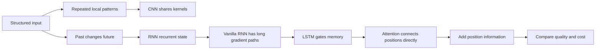

# Chapter 14: Structured Neural Networks—CNNs, RNNs, LSTMs, and Attention

[← Chapter 13](13-representation-learning.md) | [中文](../zh-CN/14-sequence-vision-and-attention.md) | [Notation](appendix-a-notation.md) | [Roadmap](00-course-roadmap.md)

> **Prerequisites:** neural networks and backpropagation, representation learning, matrix multiplication, and softmax.

## From Chapter 13 to this chapter

A single embedding hides internal structure. Images contain spatial neighborhoods; text and time series have order.
Treating every pixel or token as an unrelated feature wastes parameters and removes useful priors. CNNs share local
filters across positions, vanilla RNNs reuse a state transition through time, LSTMs add controlled long-term memory,
and attention lets every position choose which other positions to read. Although these models share one chapter, the
CNN, RNN, and LSTM sections each follow the full motivation → example → mathematics → implementation → diagnosis arc.



## 14.1 Why dense layers are not enough

A dense layer from a $224\times224\times3$ image to 1,000 units has roughly 150 million weights, although the same
edge detector should work anywhere. Convolution encodes locality and weight sharing. A bag of words cannot distinguish
“good” from “not good”; recurrence encodes order. When related tokens are hundreds of steps apart, recurrent paths are
long, while attention builds a direct content-dependent link.

## 14.2 CNN mini-chapter: why share a local detector?

### 14.2.1 Motivation and one prediction

A crack detector should recognize the same short, high-contrast boundary in the top-left or bottom-right of an image.
A dense layer learns unrelated weights at every location. A CNN instead assumes **local connectivity** and **weight
sharing**. These assumptions reduce parameters and encode a useful spatial prior, but can be wrong when arbitrary global
relations dominate.

For one-dimensional input $x\in\mathbb R^n$, kernel $w\in\mathbb R^k$, stride one, and no padding,

$$y_t=b+\sum_{j=0}^{k-1}w_jx_{t+j}.$$

For $x=[0,0,1,1,1]$ and $w=[-1,0,1]$, valid stride-one cross-correlation has
$5-3+1=3$ outputs. At every position it selects three values, aligns them with the same three kernel weights,
multiplies element by element, and adds:

| Output | Window | Elementwise products | Sum |
|---|---|---|---:|
| $y_0$ | $[0,0,1]$ | $[0\times(-1),0\times0,1\times1]=[0,0,1]$ | 1 |
| $y_1$ | $[0,1,1]$ | $[0\times(-1),1\times0,1\times1]=[0,0,1]$ | 1 |
| $y_2$ | $[1,1,1]$ | $[1\times(-1),1\times0,1\times1]=[-1,0,1]$ | 0 |


The orange outline marks the active window. The three panels are exactly $y_0,y_1,y_2$: select a window, reuse the
same kernel, multiply aligned entries, and sum the green products. Because the middle weight is zero,
$y_t=x_{t+2}-x_t$. A rising change is positive, a falling change is negative, and equal endpoints produce zero.
The first two windows therefore both output one even though their middle entries differ.

This reuse of $[-1,0,1]$ at all three locations is **weight sharing**. With stride one, the kernel moves one position
at a time; with no padding, it never extends outside the input. Deep-learning libraries implement cross-correlation
without kernel reversal, although the layer is conventionally called convolution because learned weights can absorb
the reversal convention.


The hand-calculation figure tracks one short input and one edge kernel. This overview uses a longer signal and compares
a smoothing kernel with an edge kernel. The upper signal is
$[0,0,1,1,1,0,0,-1,-1,0,0]$. The lower panel places each output at the **center** $c$ of its three-value
window $[x_{c-1},x_c,x_{c+1}]$, so outputs exist only for centers 1 through 9.

The green kernel $[1/3,1/3,1/3]$ computes a local mean. The red kernel $[-1,0,1]$ computes right minus left.
For center 2, window $[0,1,1]$ gives mean $2/3$ and edge response $1$. At center 3, $[1,1,1]$ gives mean 1
and edge 0. At center 4, $[1,1,0]$ gives mean $2/3$ and edge $-1$. At center 8, $[-1,-1,0]$ gives mean
$-2/3$ and edge $1$. Positive red values mark rising transitions, negative values mark falling transitions, and zero
marks equal endpoints. The two curves show that changing shared weights extracts a different feature from the same
sliding windows; trained CNNs learn these weights rather than relying on hand-designed kernels.

### 14.2.2 Two dimensions, channels, and shapes


The left panel is a $12\times12$ image, the center a $3\times3$ vertical-edge kernel, and the right a $10\times10$
feature map. Strong positive/negative bands mark boundaries. A feature map is a local match score, not a class
probability.

For $X\in\mathbb R^{H\times W\times C_{in}}$, a kernel bank has shape
$K_h\times K_w\times C_{in}\times C_{out}$ and output
$H_{out}\times W_{out}\times C_{out}$. One output channel is

$$Y_{r,s,c_o}=b_{c_o}+\sum_{u,v,c_i}W_{u,v,c_i,c_o}X_{r+u,s+v,c_i}.$$

Parameter count is

$$K_hK_wC_{in}C_{out}+C_{out},$$

independent of image area. A $3\times3$, 3-to-64 convolution has 1,792 parameters. PyTorch uses NCHW tensors
`[batch, channel, height, width]`; confusing HWC and NCHW is a common shape bug.

### 14.2.3 Padding, stride, dilation, and receptive field

With padding $p$, stride $s$, and dilation $d$,

$$n_{out}=\left\lfloor\frac{n+2p-d(k-1)-1}{s}\right\rfloor+1.$$

Padding controls boundaries, stride downsamples, and dilation spaces kernel elements apart. Larger stride can skip small
patterns; padding injects artificial values at an edge. A **receptive field** is the input region that can influence one
output. With jump $j_0=1$ and field $r_0=1$,

$$j_l=j_{l-1}s_l,\qquad r_l=r_{l-1}+(k_l-1)d_lj_{l-1}.$$


The horizontal axis is layer count and the vertical axis is visible input positions. Ordinary 3-wide layers grow the
field linearly; doubling dilation grows it faster. Theoretical visibility does not mean all positions have equal learned
influence.

### 14.2.4 A practical CNN block and training

A common path is convolution → normalization → ReLU/GELU → optional downsampling. Nonlinearity prevents a stack from
collapsing into one linear operation. Pooling/strided convolution reduces resolution and compute but loses location.
Residual updates $y=F(x)+x$ create a short optimization path. Global average pooling suits classification; detection
and segmentation must preserve spatial location.

Backpropagation sums a shared kernel's gradient contribution over every location. Small-data CNNs can memorize
watermarks, backgrounds, acquisition devices, or patient identity. Track train/validation curves, transformation stress
tests, grouped splits, confusion matrices, and calibration. Augmentation is valid only if it preserves labels—rotating a
6 may create a 9, and left/right orientation can matter medically.

The chapter script implements valid 1-D/2-D cross-correlation. Framework comparison must fix weights, bias, padding,
stride, and layout:

```python
layer = torch.nn.Conv2d(3, 64, kernel_size=3, padding=1)
x = torch.randn(8, 3, 32, 32)
y = layer(x)  # [8, 64, 32, 32]
```

## 14.3 Vanilla RNN mini-chapter: why maintain a recurrent state?

### 14.3.1 Motivation, shapes, and a complete pass

The same electricity reading can mean ramp-up in the morning or shutdown at night; history changes its interpretation.
A fixed-window MLP has a fixed horizon and separate positional weights. An RNN reads one step, updates a compact state,
and reuses that rule for every time position.

$$a_t=W_xx_t+W_hh_{t-1}+b,$$

$$h_t=\tanh(a_t),\qquad o_t=W_oh_t+c.$$

For input size $d$, hidden size $h$, and output size $q$, the shapes are
$W_x:h\times d$, $W_h:h\times h$, $W_o:q\times h$. Starting at $h_0=0$, the model reads $x_1$ to create $h_1$,
then combines $x_2$ with $h_1$, and so on. The state is a task-dependent summary, not a lossless copy of history.


Input impulses appear in the upper panel; two hidden coordinates appear below. Each event changes state, whose effect
then decays and mixes with later events. Hidden coordinates have no guaranteed human label.

RNNs support many-to-one classification, aligned many-to-many labeling, one-to-many generation, and encoder-decoder
tasks. Reading only the final state creates a bottleneck; pooling or attention over all states can help. A bidirectional
RNN uses future context and is therefore unsuitable for strict online prediction.

### 14.3.2 A hand calculation and BPTT

For a scalar linear recurrence $h_t=x_t+0.5h_{t-1}$, $h_0=0$, and input $[2,0,1]$, the states are $2,1,1.5$.
The first input contributes $2(0.5)^2=0.5$ at step 3, exposing both memory and geometric decay.

With $L=\sum_t\ell_t$, backpropagation through time accumulates shared-weight gradients:

$$\frac{\partial L}{\partial W_h}
=\sum_{t=1}^{T}\frac{\partial L}{\partial a_t}h_{t-1}^{\top}.$$

Long-range state derivatives contain

$$\frac{\partial h_T}{\partial h_t}
=\prod_{k=t+1}^{T}\mathrm{diag}(1-h_k^2)W_h.$$


The logarithmic vertical axis is relative gradient magnitude over time distance. Repeated factors below one vanish and
above one explode. Real Jacobians vary by state; the scalar curves explain the mechanism rather than predict an exact
failure step.

Gradient clipping limits explosion but cannot restore vanished signal. Orthogonal initialization and normalization can
improve conditioning. Truncated BPTT saves memory by backpropagating only $K$ steps, explicitly discarding longer direct
gradients. Diagnose by gradient norms and performance binned by sequence/dependency length, not total loss alone.

### 14.3.3 Implementation, validation, and leakage

```python
h = np.zeros(hidden_size)
for x_t in sequence:
    h = np.tanh(W_x @ x_t + W_h @ h + b)
```

The NumPy script also implements BPTT and finite-differences a recurrent-weight gradient. In PyTorch,
`output, h_last = torch.nn.RNN(d, h, batch_first=True)(x)`. Print shapes before connecting a loss: layer, direction,
batch, and time axes are easy to confuse.

Temporal evaluation must fit preprocessing on the past and test later time. Repeated patients, users, devices, or
adjacent video frames belong in groups rather than random rows. Report quality by length, dependency distance, entity
cold start, and time period, plus streaming step latency and state memory.

## 14.4 LSTM mini-chapter: learn what to keep, write, and reveal

### 14.4.1 Why gates?

A calibration event near the beginning of a sensor sequence may determine an alarm rule hundreds of steps later.
Vanilla recurrence repeatedly transforms that information. LSTM adds a cell state $c_t$ with a more direct additive
path and learns gates for old-memory retention, new-memory insertion, and visible output. It makes long memory easier,
not infinite or automatic.

Let $z_t=[h_{t-1};x_t]$. A complete cell is

$$f_t=\sigma(W_fz_t+b_f),\quad i_t=\sigma(W_iz_t+b_i),$$

$$\tilde c_t=\tanh(W_gz_t+b_g),\quad o_t=\sigma(W_oz_t+b_o),$$

$$c_t=f_t\odot c_{t-1}+i_t\odot\tilde c_t,$$

$$h_t=o_t\odot\tanh(c_t).$$


Follow the top path: old memory is multiplied by the forget gate, receives input-gated candidate memory, and becomes
$c_t$. The output gate exposes only part of it as $h_t$. The gates are learned sigmoid values, not hand-coded rules.

For one dimension with $c_{t-1}=2$, $f_t=.9$, $i_t=.2$, $\tilde c_t=.5$, and $o_t=.6$, we get
$c_t=1.9$ and $h_t=.6\tanh(1.9)\approx.574$.

### 14.4.2 Gradient path, parameter count, and GRU

The direct cell-state derivative is approximately

$$\frac{\partial c_T}{\partial c_t}\approx\prod_{k=t+1}^{T}f_k.$$


At a fixed forget value .99 the direct path decays much more slowly than at .70. The log-scale curves are a mechanism
illustration; real gates vary by input and dimension, and additional derivative paths remain.

Four branches give one unidirectional LSTM

$$4h(h+d)+4h$$

parameters, roughly four times a same-width vanilla RNN. Implementations fuse the four matrix products. A positive
forget bias can encourage initial retention, but gates can still saturate and cell values can still become unstable.

GRU merges memory and hidden state with update/reset gates. It is smaller and can be attractive on limited data or
latency; LSTM separates $c_t$ and $h_t$ for finer control. Compare both under equal splits, tuning, and compute, including
quality by dependency distance.

### 14.4.3 Implementation and failure diagnosis

The chapter script returns every $h_t,c_t$ and gate and asserts that sigmoid gates lie in $[0,1]$. PyTorch returns
`output, (h_last, c_last) = LSTM(...)(x)`. With padded batches, mask loss and select the last real step; otherwise the
model may learn padding length.

Typical failures include gradient NaNs, gate saturation, majority-state prediction, performance collapse beyond train
length, future leakage from bidirectionality, and predictions changing when only padding length changes. Inspect gradient
norms, gate histograms, per-class recall, dependency-distance slices, and prefix invariance before increasing capacity.

## 14.5 Scaled dot-product attention

For $X:T\times d_{model}$,

$$Q=XW_Q,\qquad K=XW_K,\qquad V=XW_V,$$

$$A=\mathrm{softmax}\left(\frac{QK^\top}{\sqrt{d_k}}+M\right),
\qquad O=AV.$$

Row $i$ of $A$ states how query position $i$ weights value positions. Scaling prevents dot-product variance from
growing with $d_k$ and prematurely saturating softmax. $M$ represents padding or causal restrictions.


Rows are query tokens, columns are key tokens, and darker color means larger weight. The synthetic features make
“animal” and “it” similar, producing a stronger link. A weight is one internal computation, not automatically a causal
explanation of the final prediction.

Multi-head attention concatenates several projected relations:

$$\mathrm{MHA}(X)=\mathrm{Concat}(head_1,\ldots,head_H)W_O.$$

Pure self-attention is permutation equivariant, so absolute, relative, or rotary position information must be added.

## 14.6 Complexity and method choice


RNN state work grows linearly with length but is sequential. Full attention materializes $T\times T$ interactions,
giving $O(T^2d)$ score/value work and memory, but training positions can be parallelized. Convolution costs roughly
$O(Tkd_{in}d_{out})$. Hardware kernels, channels, and batching still determine actual time.

| Structure | Prior | Strength | Main limitation | Typical use |
|---|---|---|---|---|
| CNN | local patterns repeat | parallel, efficient, mature kernels | global relations need depth/dilation | images, local signals |
| vanilla RNN | history compresses into state | simplest streaming baseline | severe gradient/memory bottleneck | short sequences |
| LSTM/GRU | gates control memory | stronger long-dependency recurrence | serial and still forgetful | speech, sensors, small time series |
| attention | direct content interaction | short long-range paths, parallel training | full interaction is $O(T^2)$ | LLMs, ViTs, offline context |

Do not choose by age. Ask whether patterns are local, strict streaming is required, how far useful dependency extends,
whether training can be parallelized, and what state/context memory is available. Hybrids are common and should be
compared with equal data and tuning on quality, length slices, P95 latency, peak memory, and parameters.

## 14.7 Reproduce and verify

```bash
python code/chapter14/expanded_models.py
```

The NumPy script implements 1-D/2-D convolution, vanilla RNN forward/BPTT, a complete four-gate LSTM, and scaled
attention. It checks convolution against NumPy correlation, finite-differences an RNN gradient, validates LSTM state and
gate shapes, and verifies attention normalization. Expected diagnostics include an RNN gradient error around $10^{-11}$.
Framework comparison fixes initial weights, bias, masks, padding, batch axes, and layouts.

## 14.8 Failure diagnosis

| Symptom | Likely cause | Test |
|---|---|---|
| CNN fails after shifting/cropping | boundary/downsampling artifact | transformation stress test |
| RNN loss spikes | exploding gradients | gradient-norm trace and clipping |
| LSTM adds no gain | dependency is short or tuning unfair | dependency-distance slices |
| prediction changes with padding | mask/final-state bug | vary padding only |
| attention reads future | causal-mask error | prefix-invariance unit test |
| temporal offline score is implausible | future/entity leakage | chronological grouped split |

## Modern AI connections

- ResNets/ConvNeXt directly use convolution; ViTs tokenize patches; hybrids combine local CNN detail and global attention.
- Streaming speech uses causal convolution plus LSTM/GRU bounded state; Conformer mixes convolution and attention.
- LLM decoder blocks use masked multi-head self-attention directly.
- Multimodal models let text attend to visual/audio tokens.
- Sequential recommenders can use short-pattern CNNs, streaming LSTM state, or attention over key history; future actions
  must never enter earlier features.
- State-space models share recurrent history compression but use different parameterizations and parallel scans; they are
  related to, not identical with, LSTMs.

## Socratic mentor

<details><summary>Why does convolution need fewer parameters than a dense layer?</summary>
It connects only local neighborhoods and reuses one kernel at every position.
</details>

<details><summary>Translation equivariance versus invariance?</summary>
Equivariance moves features with the input; invariance keeps the final output unchanged.
</details>

<details><summary>Can an RNN accept arbitrary length and therefore remember arbitrarily long?</summary>
No. Interface length is not effective memory; finite state, optimization, and training distribution still limit it.
</details>

<details><summary>Why not keep an LSTM forget gate at one forever?</summary>
Never forgetting accumulates irrelevant history and prevents adaptation. Long memory means selective retention, not
permanent retention.
</details>

<details><summary>Why have both cell state and hidden state?</summary>
The cell is the internal additive storage path; the hidden state is the output-gated view exposed now.
</details>

<details><summary>Why can a bidirectional LSTM be invalid for online prediction?</summary>
Its backward branch consumes future observations that are unavailable at serving time.
</details>

<details><summary>Are attention weights feature contributions?</summary>
Not in general. Values, other heads, residuals, and later nonlinear layers also determine output.
</details>

<details><summary>Why divide attention scores by $\sqrt{d_k}$?</summary>
It stabilizes score variance and prevents softmax saturation as dimension grows.
</details>

<details><summary>Is attention always faster than recurrence?</summary>
It is more parallel in training, but quadratic long-context memory and autoregressive decoding can dominate.
</details>

## Exercises

See [Chapter 14 solutions](solutions/14-solutions.md).

1. Compute cross-correlation and true reversed-kernel convolution over six values.
2. Derive output size and multi-channel parameter count with padding, stride, and dilation.
3. Extend the NumPy CNN to batched multi-input/multi-output channels and compare fixed weights with `Conv2d`.
4. Create a watermark shortcut dataset and measure CNN failure after watermark removal.
5. Expand a three-step scalar RNN and derive $\partial h_3/\partial h_0$.
6. Implement all BPTT parameter gradients and finite-difference each one.
7. Compute one LSTM step, including direct cell-state derivative, by hand.
8. Plot LSTM gate histograms by sequence position and diagnose saturation.
9. Fairly compare RNN, GRU, LSTM, and attention on delayed copy by dependency distance.
10. Compute two-token $Q,K,V$ attention and scaling by hand.
11. Implement a causal mask and test prefix invariance.
12. Design grouped chronological splits for video or patient sequences.

## Interview recap

- **CNN priors?** Local connectivity and shared weights.
- **Padding/stride/dilation?** Boundary extension, movement step, and spacing inside a kernel.
- **CNN parameter count?** $K_hK_wC_{in}C_{out}+C_{out}$, independent of image area.
- **Receptive field?** The input region that can influence one feature.
- **Pooling trade-off?** Less resolution/compute and more local invariance, but lost location.
- **RNN state?** A shared-transition task summary of the prefix, not a lossless history.
- **Why RNN gradient problems?** Repeated Jacobian products shrink or amplify.
- **What does clipping fix?** Explosion, not vanished information.
- **LSTM gates?** Forget old memory, write gated candidate memory, and expose gated output.
- **Why does LSTM help gradients?** Its cell has an additive path whose direct derivative is controlled by forget gates.
- **LSTM versus GRU?** Finer separated memory versus fewer, merged-state parameters; validate fairly.
- **Bidirectional limitation?** It uses future context and cannot directly serve strict online/autoregressive tasks.
- **Q/K/V?** What a position seeks, how it is matched, and the information being aggregated.
- **Why positions?** Attention alone cannot distinguish token order.
- **Attention cost?** Full self-attention has quadratic sequence interaction.

## Mastery checklist

- [ ] I can derive convolution output size, parameter count, receptive field, and multi-channel shapes.
- [ ] I can explain pooling, dilation, residuals, augmentation assumptions, and CNN shortcut failure.
- [ ] I can expand an RNN, derive the BPTT Jacobian product, and gradient-check it.
- [ ] I can compute every LSTM gate, distinguish $c_t$ from $h_t$, and explain its gradient path.
- [ ] I can derive scaled attention and implement correct masks.
- [ ] I can compare CNN, RNN, LSTM/GRU, and attention by prior, quality, cost, and streaming needs.
- [ ] I can design leakage-safe visual and temporal evaluation.
- [ ] I can locate these structures in vision, speech, recommendation, and LLMs.

### Further reading

- [LeCun et al., Gradient-Based Learning](https://doi.org/10.1109/5.726791)
- [Hochreiter & Schmidhuber, LSTM](https://doi.org/10.1162/neco.1997.9.8.1735)
- [Vaswani et al., Attention Is All You Need](https://arxiv.org/abs/1706.03762)
- [Dive into Deep Learning](https://d2l.ai/)

[Next: Transformers, LLMs, Fine-Tuning, and MoE →](15-transformers-llms-and-finetuning.md)
