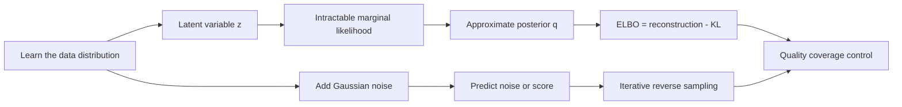

# Chapter 16: Generative Models — VAE and Diffusion

[← Chapter 15](15-transformers-llms-and-finetuning.md) | [中文](../zh-CN/16-vae-and-diffusion.md) | [Notation](appendix-a-notation.md) | [Roadmap](00-course-roadmap.md)

> **Prerequisites:** [GMM, EM, and ELBO](10-clustering-em-and-elbo.md),
> [neural networks](12-neural-networks-and-backprop.md), Gaussian distributions, KL divergence, and likelihood.

Autoregressive models generate discrete tokens in sequence. Images, audio, and other continuous signals also admit two
important routes: a VAE explains an observation through a latent variable, while a diffusion model learns to reverse a
gradual noising process. The central questions are not merely whether a sample looks good, but what distribution is
defined, where the objective comes from, why sampling works, and what can fail.

## Learning route



### Learning boundary

The goal is to understand the two complete loops: encode–sample–decode–optimize for a VAE, and add noise–predict
noise–denoise for diffusion. Modern image architectures, sampler families, and large-scale training details are
orientation material rather than requirements for this introductory course.

## 16.1 Why model a distribution?

A classifier learns $p(y\mid x)$. A generative model learns $p(x)$ or $p(x\mid c)$ so that it can generate, complete,
compress, denoise, or expose latent factors. Assigning a separate probability to every possible image is impossible.
A VAE uses a compact latent variable; diffusion replaces one difficult generation step with many easier denoising steps.

<details><summary>Does realistic generation prove world understanding?</summary>
No. A model may reproduce surface statistics while violating facts, causality, or physics. Evaluation must include
memorization, bias, conditional consistency, and task reliability—not visual appeal alone.
</details>

## 16.2 The VAE generative story

Sample a latent code and decode an observation:

$$z\sim p(z)=\mathcal N(0,I),\qquad x\sim p_\theta(x\mid z).$$

The marginal likelihood

$$p_\theta(x)=\int p_\theta(x\mid z)p(z)\,dz$$

is usually intractable, as is the true posterior $p_\theta(z\mid x)$. An encoder
$q_\phi(z\mid x)$ approximates that posterior, commonly with a diagonal Gaussian whose network outputs are
$\mu_\phi(x)$ and $\log\sigma_\phi^2(x)$.

## 16.3 Deriving the ELBO

Insert $q_\phi$ and apply Jensen's inequality:

$$
\log p_\theta(x)=\log\mathbb E_{q_\phi}
\left[\frac{p_\theta(x,z)}{q_\phi(z\mid x)}\right]
\ge \mathbb E_{q_\phi}[\log p_\theta(x\mid z)]
-D_{KL}(q_\phi(z\mid x)\|p(z)).
$$

The first term rewards reconstruction. The second keeps each posterior near the common prior so that prior samples reach
regions the decoder has seen. Training minimizes negative ELBO: reconstruction loss plus KL. A fixed-variance Gaussian
decoder yields MSE; a Bernoulli decoder yields BCE. The loss follows the observation model rather than convenience.

## 16.4 Reparameterization

Direct sampling blocks ordinary pathwise differentiation. Rewrite it as

$$\epsilon\sim\mathcal N(0,I),\qquad
z=\mu_\phi(x)+\sigma_\phi(x)\odot\epsilon.$$


The blue histogram is standard-normal noise; the orange histogram is the shifted and scaled latent sample. Randomness
has not disappeared. It has moved to an input independent of the learned parameters, leaving a differentiable path
through $z=\mu+\sigma\epsilon$. For diagonal Gaussians,

$$D_{KL}(q\|p)=\frac12\sum_j(\mu_j^2+\sigma_j^2-\log\sigma_j^2-1).$$

## 16.5 Reconstruction and latent regularity conflict

A $\beta$-VAE minimizes

$$L=-\mathbb E_q\log p_\theta(x\mid z)
+\beta D_{KL}(q_\phi(z\mid x)\|p(z)).$$


Increasing $\beta$ pushes the posterior closer to the prior but can remove detail and increase reconstruction error.
The curves illustrate a typical trade-off, not measurements from a particular dataset. A powerful decoder may ignore
$z$, driving KL toward zero; this is posterior collapse. KL warm-up, free bits, decoder constraints, and latent
interventions can help diagnose or reduce it.

## 16.6 The forward diffusion process

Define a simple noising chain:

$$q(x_t\mid x_{t-1})=\mathcal N(\sqrt{1-\beta_t}x_{t-1},\beta_tI).$$

With $\alpha_t=1-\beta_t$ and $\bar\alpha_t=\prod_{s=1}^t\alpha_s$, any time step can be sampled directly:

$$x_t=\sqrt{\bar\alpha_t}x_0+\sqrt{1-\bar\alpha_t}\epsilon,
\qquad\epsilon\sim\mathcal N(0,I).$$


From left to right the two original modes widen and merge as signal is destroyed. The forward process has no learned
parameters; its purpose is to reach an easy terminal distribution.

## 16.7 Learning the reverse process

A network $\epsilon_\theta(x_t,t,c)$ predicts the noise from a noisy sample, time, and optional condition:

$$L_{simple}=\mathbb E_{x_0,t,\epsilon}
\left[\|\epsilon-\epsilon_\theta(x_t,t,c)\|_2^2\right].$$

Noise prediction is related to score prediction $\nabla_{x_t}\log q_t(x_t)$. Sampling starts at $x_T$ from a Gaussian
and applies repeated learned reverse updates. DDPM sampling uses many serial network calls; DDIM, distillation, and
higher-order solvers reduce calls but change the measured speed–quality trade-off.


The vertical axis is the surviving signal fraction. Different schedules allocate difficulty differently across noise
levels. Training parameterization, schedule, and sampler must be compatible.

## 16.8 Conditional generation and guidance

Conditions may be class labels, text embeddings, edges, or another modality. Classifier-free guidance combines
conditional and unconditional estimates:

$$\hat\epsilon=(1+w)\epsilon_\theta(x_t,t,c)-w\epsilon_\theta(x_t,t,\varnothing).$$

Larger $w$ often improves condition adherence while reducing diversity or causing artifacts. Tune it jointly with the
sampler and step count.

## 16.9 Reproduce the figures

```bash
python code/chapter16/generative_models.py
python code/chapter16/course_lab.py
```

The script checks reparameterized mean and standard deviation, then builds the VAE and diffusion figures. A real VAE
experiment should also show reconstructions, prior samples, latent traversals, and per-term loss. A diffusion study
should break error down by $t$ and report sample diversity and nearest training examples.

The course lab trains a manually differentiated linear VAE on 2-D synthetic data and fits a one-step noise predictor.
Read it by checking four things in order: latent mean/log-variance shapes, reconstruction and KL terms, the
reparameterization path, and whether prior samples and denoising outputs have the expected shapes. It is a teaching
model of the mechanism, not a claim of image-generation quality.

## 16.10 Choosing among VAE, autoregression, and diffusion

| Family | Generation | Strength | Main cost |
|---|---|---|---|
| VAE | sample latent, decode once | fast encoding, continuous latent, reconstruction | smooth outputs, ELBO gap |
| Autoregressive | generate dimension/token in order | explicit likelihood, natural for discrete sequences | serial sampling |
| Diffusion | repeatedly denoise | high fidelity and flexible conditioning | many model evaluations |

Latent diffusion compresses an image with an autoencoder and diffuses in latent space. It combines compression and
denoising rather than choosing one family exclusively.

## 16.11 Evaluation and failure diagnosis

Evaluate fidelity, coverage, conditional alignment, memorization/privacy, bias/safety, and cost. FID depends on feature
space and sample count; CLIP score can reward shallow text-image correspondence; human preference depends on prompts
and raters. No single score covers the problem.

| Symptom | Possible cause | Useful check |
|---|---|---|
| blurry VAE output | likelihood, capacity, or excessive KL | per-term loss and $\beta$ sweep |
| latent has no effect | posterior collapse | fix/shuffle $z$, KL warm-up |
| diffusion artifacts | schedule, sampler, guidance mismatch | error by time and ablations |
| few output modes | weak coverage or strong condition | class coverage and diversity |
| suspiciously high quality | train/eval overlap | deduplication and nearest-neighbor audit |

## Worked reasoning checkpoint

If a one-dimensional encoder outputs mean 1 and standard deviation 0.5, then epsilon=-0.4 gives z=0.8 and a KL to
the standard normal of about 0.818. Reconstruction uses q(z|x), while unconditional generation samples p(z);
evaluating only reconstruction can hide a broken prior-sampling path.

For x0=2, alpha1=0.9 and alpha2=0.8 give cumulative alpha 0.72. With epsilon=-0.5, the closed-form noisy sample x2
is about 1.433. Training jumps directly to a random noise level; sampling must follow a reverse solver. Compare VAE,
autoregression, and diffusion using both quality and latency, memory, coverage, and privacy.

## Modern AI connections

- Latent diffusion, attention, and conditioning power modern image/video generators.
- Audio may be diffused as waveform/spectrogram or generated autoregressively as audio tokens.
- World models predict latent futures for planning; visual realism does not ensure correct control.
- Memorization, identity, copyright, and deepfakes require data governance and provenance as well as model controls.

## Socratic mentor

<details><summary>Why not maximize exact VAE likelihood directly?</summary>
The latent integral and posterior are usually intractable; the learned posterior creates an optimizable lower bound.
</details>

<details><summary>Is smaller KL always better?</summary>
No. It may mean useful regularity or that the decoder ignores the latent. Inspect reconstruction and intervene on $z$.
</details>

<details><summary>Why can diffusion training sample only one time step?</summary>
The closed-form marginal constructs any $x_t$ directly from $x_0$ and noise, so the whole forward chain need not run.
</details>

<details><summary>Do more denoising steps always help?</summary>
No. Gains saturate, samplers are step-dependent, and every extra call adds latency.
</details>

## Exercises

Compare with the [Chapter 16 solutions](solutions/16-solutions.md).

1. Derive the VAE ELBO from Jensen's inequality.
2. Derive the diagonal-Gaussian KL to a standard normal.
3. Implement reparameterization and finite-difference its gradients.
4. Train a small VAE and plot reconstructions, samples, traversals, and KL.
5. Derive $q(x_t\mid x_0)$ from the recursive forward process.
6. Compare schedules and sampling step counts on a quality–latency curve.
7. Design audits for memorization, condition adherence, diversity, and group bias.

## Interview recap

- **VAE?** A latent-variable model trained through an approximate posterior and ELBO.
- **ELBO terms?** Expected reconstruction log-likelihood minus posterior-to-prior KL.
- **Reparameterization?** Express parameterized samples as differentiable transforms of external noise.
- **Posterior collapse?** The decoder ignores $z$ and the posterior returns to the prior.
- **Diffusion forward process?** A fixed schedule gradually adds Gaussian noise.
- **Why is diffusion sampling slow?** Reverse generation usually requires many serial network evaluations.
- **Classifier-free guidance?** Combine conditional and unconditional predictions to strengthen conditioning.

## Mastery checklist

- [ ] I can derive the ELBO and diagonal-Gaussian KL.
- [ ] I can explain and implement reparameterization.
- [ ] I can diagnose posterior collapse with latent interventions.
- [ ] I can derive the direct diffusion noising equation and noise objective.
- [ ] I can compare schedules, samplers, guidance, quality, and cost.
- [ ] I can design a multi-dimensional generative-model evaluation.

### Further reading

- [Kingma and Welling, Auto-Encoding Variational Bayes](https://arxiv.org/abs/1312.6114)
- [Ho et al., Denoising Diffusion Probabilistic Models](https://arxiv.org/abs/2006.11239)
- [Song et al., Score-Based Generative Modeling](https://arxiv.org/abs/2011.13456)
- [Rombach et al., Latent Diffusion Models](https://arxiv.org/abs/2112.10752)

[Next: Recommender systems →](17-recommender-systems.md)
