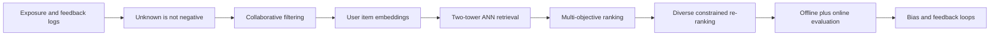
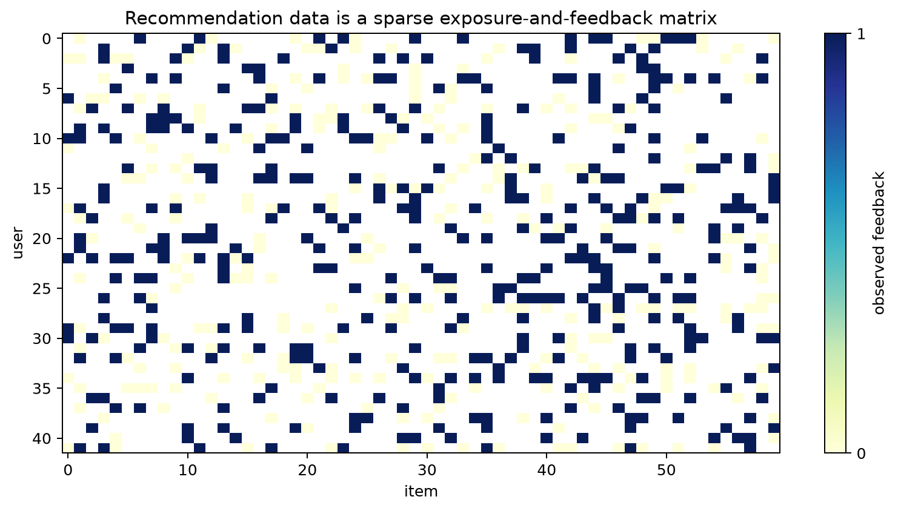
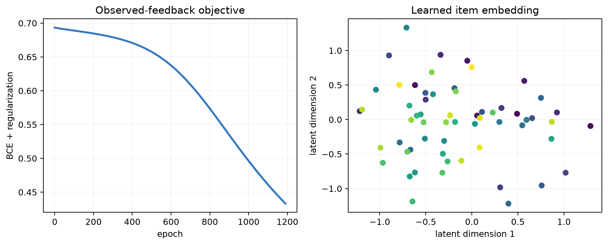
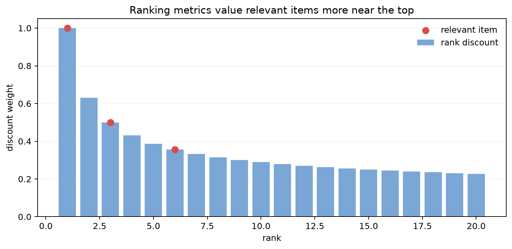
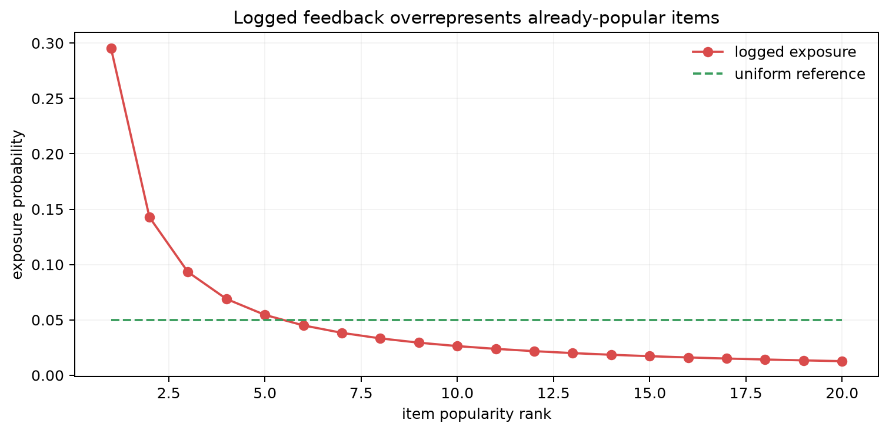

# Chapter 17: Recommender Systems — Retrieval, Ranking, and Feedback

[← Chapter 16](16-vae-and-diffusion.md) | [中文](../zh-CN/17-recommender-systems.md) | [Notation](appendix-a-notation.md) | [Roadmap](00-course-roadmap.md)

> **Prerequisites:** [matrix factorization](02-math-foundations.md),
> [representation learning](13-representation-learning.md), ranking metrics, and leakage-safe validation.

A recommender must select a few useful items from millions. Running the most expensive interaction model over the full
catalog is uneconomical, so production systems naturally become multi-stage: retrieval, ranking, re-ranking, and
feedback. The central statistical difficulty is that logged data were chosen by an earlier policy.

## Learning route



### Learning boundary

You should leave able to explain unknown-versus-negative feedback, compute a neighborhood estimate, train and evaluate
an embedding ranker, and place retrieval, ranking, and re-ranking in one pipeline. Industrial feature platforms and
large-scale ANN tuning remain follow-on topics.

## 17.1 Why recommendation logs are not an ordinary table

Most user–item entries are empty, but empty can mean either “shown and ignored” or “never shown.” Marking all empty
entries negative confuses preference with exposure policy.



Rows are users and columns are items. Colored cells contain observed feedback; blank cells are unknown. Sparsity makes
sharing information across similar users useful, but creates selection bias and cold start. Randomly splitting a single
period may also leak future behavior into training.

<details><summary>Why is no click not automatically a negative label?</summary>
The user may not have seen the item, the position may be low, the UI may have failed, or demand may be absent that day.
Observed labels combine preference, exposure, and interface effects.
</details>

## 17.2 Collaborative filtering and matrix factorization

Approximate a rating matrix $R\in\mathbb R^{M\times N}$ with

$$\hat R=UV^\top,\qquad s(u,i)=p_u^\top q_i+b_u+b_i+\mu.$$

For observed entries $\Omega$, explicit-feedback factorization minimizes

$$\sum_{(u,i)\in\Omega}(R_{ui}-p_u^\top q_i)^2
+\lambda(\|U\|_F^2+\|V\|_F^2).$$

Alternating least squares or SGD can optimize it. Latent dimensions need not have human-readable names; they only need
to predict interaction. Implicit feedback instead uses weighted objectives, sampled BCE, or pairwise ranking.

## 17.3 Implicit feedback and negative sampling

BPR makes a positive item outrank a sampled negative:

$$L_{BPR}=-\log\sigma(s(u,i^+)-s(u,i^-))+\lambda\|\theta\|^2.$$

The negative distribution changes the learned task. Uniform negatives emphasize broad catalog discrimination; popular
negatives are harder but may reinforce popularity. A sampled loss is not a calibrated full-catalog probability, so
production probabilities require correction or calibration on the real candidate distribution.

## 17.4 What matrix-factorization training shows



The left curve shows optimization on observed exposures. The right panel projects two latent dimensions. Falling
training loss does not establish performance on unexposed items, and the axes need not have semantic names. Evaluate
future-time full-catalog ranking instead.

```bash
python code/chapter17/recommender_systems.py
python code/chapter17/course_lab.py
```

The script creates exposure-biased implicit logs, trains factorization from scratch, and verifies objective reduction.
The course lab additionally computes one neighborhood prediction, trains BPR matrix factorization, and evaluates
held-out Recall@5 and NDCG@5 against a random baseline.

For a concrete neighborhood example, suppose Wang rated two movies 5 and 1, while Li rated the same two movies 4 and
1 and a third movie 2. Their similar rating pattern makes Li informative for Wang, so a similarity-weighted estimate
for Wang's third rating is near 2. This transfers observed taste, but it cannot infer a brand-new item's quality when
no interaction or content description exists.

## 17.5 Two-tower retrieval

A user tower encodes history and context as $p_u$; an item tower encodes ID and content as $q_i$:

$$s(u,i)=f_\theta(u,context)^\top g_\phi(i).$$

Item embeddings enter an offline ANN index. Online serving computes one user vector and retrieves top-K candidates.
This is structurally the same as semantic retrieval, but behavior positives and negatives are exposure-dependent. The
point-product bottleneck enables speed but limits fine-grained query–item interaction, so two towers usually retrieve
rather than make the final decision.

## 17.6 Ranking multiple objectives

A ranker can use crossed user, item, and context features with trees or neural networks. Optimizing clicks alone can
reward clickbait. Systems often predict click, watch time, purchase, refund, and retention, then combine utility:

$$score=w_1P(click)+w_2\mathbb E[watch]-w_3P(refund).$$

Weights reflect business value, experiments, and constraints—not whichever values maximize one offline number.
Multi-task gradients can conflict, so inspect each outcome and user segment.

## 17.7 Ranking metrics

Recall@K asks whether relevant items entered the candidate set. Precision@K measures the relevant fraction. MRR
emphasizes the first relevant item. NDCG handles graded relevance and position:

$$DCG@K=\sum_{r=1}^{K}\frac{2^{rel_r}-1}{\log_2(r+1)},
\qquad NDCG@K=\frac{DCG@K}{IDCG@K}.$$



The bar height is the positional discount; red markers identify relevant items. Early relevance matters more, matching
limited user attention. Yet labels come from the old exposure policy, so higher logged NDCG need not mean long-term
satisfaction.

## 17.8 Exposure bias and feedback loops



The red curve is a head-heavy exposure distribution and green is a uniform reference. Models learn popular items more
easily, show them again, and collect yet more evidence. Long-tail and new items lack data, not necessarily value.
Exploration traffic, propensity weighting, content features, cold-start channels, and diversity can help. Incorrect
propensities can also create high variance, so causal correction is not free.

## 17.9 Offline validation and online experiments

Split by time: train on the past and test on the future. Candidate sets should resemble catalog scale; ranking against
100 random negatives can dramatically overestimate full-catalog quality. Every aggregate feature must use information
available before the prediction time.

Online A/B tests examine clicks, watch time, conversion, retention, complaints, latency, and ecosystem health. A short-
term click gain may hurt long-term retention. Predefine primary metrics, guardrails, sample size, and stopping rules.

## 17.10 Diversity, exploration, and constraints

The final slate may constrain category repetition, creator exposure, freshness, inventory, fairness, and safety. Maximum
marginal relevance is a simple re-ranker:

$$MMR(i)=\lambda\,relevance(i)-(1-\lambda)
\max_{j\in selected}similarity(i,j).$$

Larger $\lambda$ favors relevance; smaller values favor diversity. Bandit exploration collects information about
uncertain items, leading directly to Chapter 18.

## 17.11 Complexity and diagnosis

Scoring every item costs $O(Nd)$. ANN reduces search work at the price of approximate recall. Serving also includes
feature reads, networking, rules, and ranking; report P50/P95/P99 latency, throughput, index size, and freshness.

| Symptom | Possible cause | Check |
|---|---|---|
| offline high, online weak | unrealistic candidates or target mismatch | full-catalog replay and segmented A/B |
| new items invisible | no ID interaction history | content tower and exploration |
| repetitive slate | pointwise relevance only | diversity metrics and re-ranking |
| slow response to new taste | stale feature or index | freshness lag monitoring |
| popularity concentration | feedback loop | exposure distribution and tail coverage |

## Worked reasoning checkpoint

A user vector [1,0.5] scores item vectors [0.8,0.2] and [0.1,1] as 0.9 and 0.6. An observed interaction updates both
the user and item vectors, which is how collaborative evidence transfers across the matrix. For BPR, a positive-negative
score gap of one has loss about 0.313; hard negatives create larger gradients but may be false negatives.

With only user and item IDs, matrix factorization is already a minimal two-tower model: one lookup produces the user
vector and another the item vector. This explains the bridge to modern retrieval, and also why ID-only models do not
solve cold start.

A production request passes through multi-source retrieval, deduplication, ranking, constraint-aware reranking, logging,
and delayed feedback. Record exposure position and model, feature, and index versions. Use point-in-time features,
full-catalog temporal evaluation, cold-start slices, and online guardrails.

## Modern AI connections

- LLMs can encode content, explain choices, or re-rank, while catalog retrieval still needs efficient vector methods.
- Generative recommendation tokenizes item IDs and generates candidates autoregressively; constraints remain necessary.
- RAG and recommendation share two towers, ANN, hard negatives, and ranking metrics.
- Multimodal product embeddings improve cold start but introduce modality-specific bias.
- Because policy changes future data, recommendation is closer to online decision-making than static classification.

## Socratic mentor

<details><summary>Why is an unobserved matrix entry not a zero rating?</summary>
It may simply be unexposed; setting it to zero mixes preference with the previous system's policy.
</details>

<details><summary>Why can low-rank factorization fill missing entries?</summary>
It assumes interactions depend on a small set of shared factors, so observed inner products constrain unseen ones.
</details>

<details><summary>Why can high two-tower Recall@100 still yield bad recommendations?</summary>
Ranking, diversity, objective alignment, or biased labels can still fail after retrieval.
</details>

<details><summary>Can sampled-BCE output be served as a probability?</summary>
Not without care. Sampling changes class priors; ranking may remain useful but probability needs correction and validation.
</details>

## Exercises

Compare with the [Chapter 17 solutions](solutions/17-solutions.md).

1. Perform one SGD update for a small rating matrix.
2. Derive BPR gradients for positive and negative scores.
3. Compare uniform and popularity-based negative sampling.
4. Build time-split full-catalog Recall/NDCG and expose sampled-negative bias.
5. Implement a two-tower ANN system and report recall, P95 latency, and index size.
6. Plot an MMR relevance–diversity curve.
7. Design a guarded A/B test for new-item cold start.

## Interview recap

- **Collaborative filtering?** Infer preference from user–item interaction patterns.
- **Matrix factorization?** Learn low-dimensional user and item vectors whose inner product predicts interaction.
- **BPR?** Pairwise logistic loss that makes a positive item outrank a sampled negative.
- **Why multi-stage?** Full-catalog rich ranking is too expensive; retrieval first narrows candidates.
- **Two-tower trade-off?** Fast indexing but limited fine-grained cross interaction.
- **Recall versus NDCG?** Recall asks whether an item appears; NDCG also weights relevance level and position.
- **Exposure bias?** Feedback is observed only after an old policy chooses what to show.
- **Cold start?** New users/items lack collaborative history; use content, priors, exploration, or onboarding.

## Mastery checklist

- [ ] I distinguish unexposed, exposed-not-clicked, and explicit negative feedback.
- [ ] I can derive factorization and BPR objectives.
- [ ] I can explain retrieval, ranking, re-ranking, and ANN roles.
- [ ] I can compute Recall, MRR, and NDCG and explain sampled-negative bias.
- [ ] I can design time-safe offline evaluation and guarded online tests.
- [ ] I can diagnose cold start, popularity loops, and repetitive slates.

### Further reading

- [Koren et al., Matrix Factorization Techniques](https://doi.org/10.1109/MC.2009.263)
- [Rendle et al., BPR](https://arxiv.org/abs/1205.2618)
- [Covington et al., YouTube Recommendations](https://research.google/pubs/deep-neural-networks-for-youtube-recommendations/)
- [Google Rules of ML](https://developers.google.com/machine-learning/guides/rules-of-ml)

[Next: Reinforcement learning →](18-reinforcement-learning.md)
