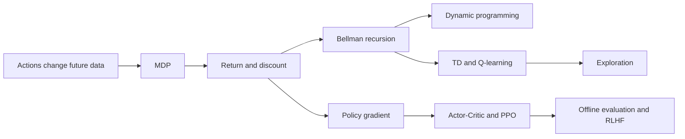
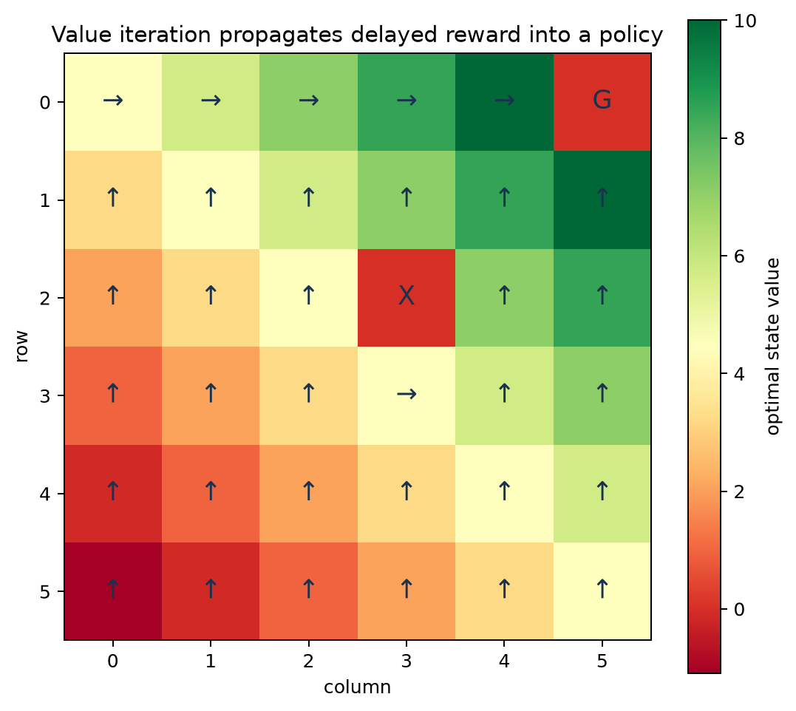
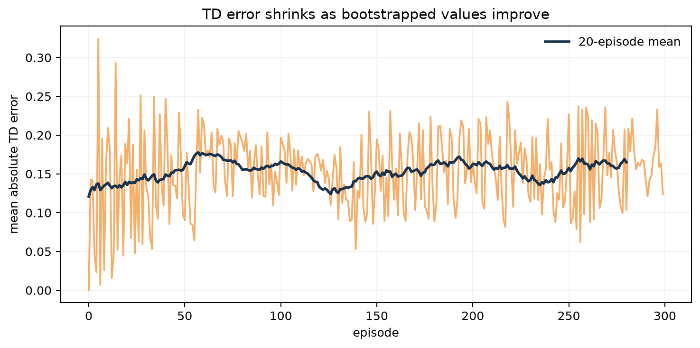
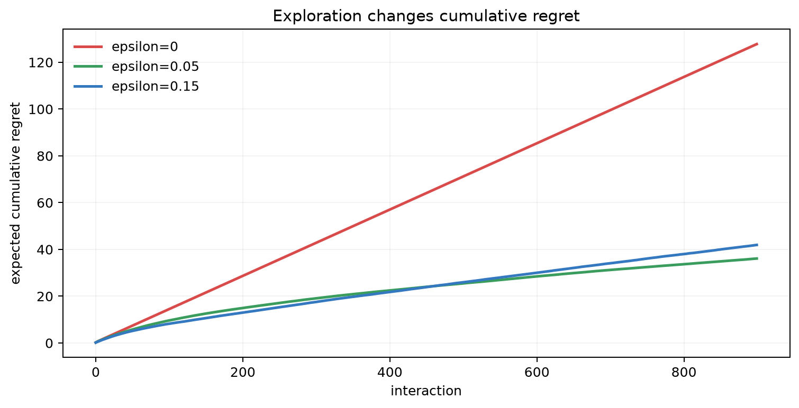
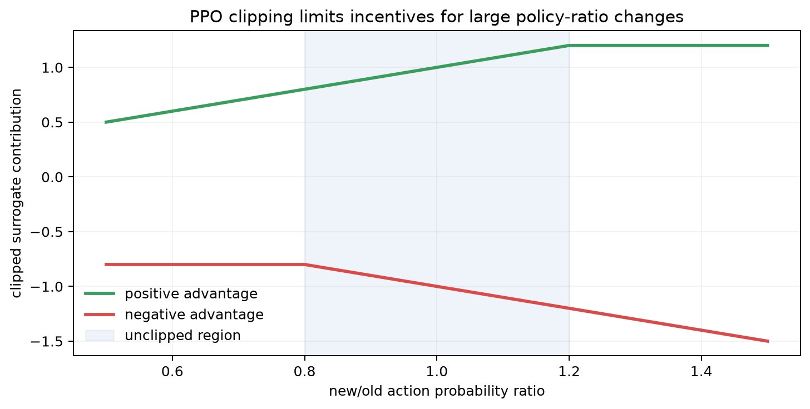

# Chapter 18: Reinforcement Learning — Value, Policy, and PPO

[← Chapter 17](17-recommender-systems.md) | [中文](../zh-CN/18-reinforcement-learning.md) | [Notation](appendix-a-notation.md) | [Roadmap](00-course-roadmap.md)

> **Prerequisites:** conditional expectation, [gradient optimization](12-neural-networks-and-backprop.md),
> [recommendation feedback](17-recommender-systems.md), and importance-sampling intuition.

Supervised learning often treats data as fixed. In navigation, recommendation, robotics, and dialogue, an action changes
the next state and the data that will be observed. Reinforcement learning studies this sequential problem: act, receive
reward, transition, and balance learning about unknown actions with exploiting current knowledge.

## Learning route



### Learning boundary

The core requirements are MDPs, returns, Bellman recursion, TD learning, SARSA, Q-learning, and exploration. Policy
gradients, PPO, offline RL, and RLHF complete the map, but this chapter does not claim production-level mastery of
those separate subjects.

## 18.1 Why immediate reward is not enough

A tempting shortcut may end in a dead end; clickbait may win one click and lose retention; an agreeable assistant may
win immediate preference while sacrificing truth. Action $a_t$ produces reward $r_{t+1}$ and changes state
$s_{t+1}$, which changes every later option.

<details><summary>Why is behavior cloning not automatically reinforcement learning?</summary>
It imitates logged actions without explicitly optimizing their effect on future states and returns. Once it leaves the
demonstration distribution, errors may compound.
</details>

## 18.2 Markov decision processes

An MDP is $(\mathcal S,\mathcal A,P,R,\gamma)$: states, actions, transition probabilities, rewards, and discount.
The Markov assumption is

$$p(s_{t+1}\mid s_0,a_0,\ldots,s_t,a_t)=p(s_{t+1}\mid s_t,a_t).$$

If an observation omits predictive history, the problem is partially observable; history, a belief state, or a memory
network may approximate state. A policy $\pi(a\mid s)$ defines action probabilities. Discounted return is

$$G_t=\sum_{k=0}^{\infty}\gamma^k r_{t+k+1}.$$

Larger $\gamma$ emphasizes the future but raises variance and sensitivity to misspecification. It does not repair a bad
reward.

## 18.3 Value functions and Bellman equations

$$V^\pi(s)=\mathbb E_\pi[G_t\mid s_t=s],\qquad
Q^\pi(s,a)=\mathbb E_\pi[G_t\mid s_t=s,a_t=a].$$

Separate the first reward from the remaining return:

$$V^\pi(s)=\sum_a\pi(a\mid s)\sum_{s'}P(s'\mid s,a)
[R(s,a,s')+\gamma V^\pi(s')].$$

The optimal recursion is

$$V^{\ast}(s)=\max_a\sum_{s'}P(s'\mid s,a)[R(s,a,s')+\gamma V^{\ast}(s')].$$

Future consequences are not discarded; the value of the next state summarizes them recursively.

## 18.4 Dynamic programming with a known model

Value iteration repeatedly applies

$$V_{k+1}(s)\leftarrow\max_a\sum_{s'}P(s'\mid s,a)
[R(s,a,s')+\gamma V_k(s')].$$



Color is optimal value and arrows are greedy actions; G is the goal and X a trap. Reward information propagates
outward through Bellman backups. The arrows are valid only for the chosen transition, reward, and discount model.

## 18.5 Monte Carlo and temporal difference learning

Monte Carlo waits for a complete return:

$$V(s_t)\leftarrow V(s_t)+\alpha(G_t-V(s_t)).$$

TD(0) bootstraps from the current next-state estimate:

$$\delta_t=r_{t+1}+\gamma V(s_{t+1})-V(s_t),\qquad
V(s_t)\leftarrow V(s_t)+\alpha\delta_t.$$

MC has no bootstrap bias but often high variance and delayed updates. TD learns online with lower variance but uses an
imperfect target.

On the same three-step trajectory with rewards $[0,0,1]$ and $\gamma=0.9$, Monte Carlo targets are
$[0.81,0.9,1]$. If the current next-state estimates are $[0.4,0.7,0]$, the one-step TD targets are
$[0.36,0.63,1]$. MC waits for what actually happened; TD updates earlier using what it currently believes.



The pale trace is per-episode mean absolute TD error and the dark line a moving average. Random trajectories still
fluctuate. Small TD error means greater Bellman consistency, not that rewards are correct or all states were explored.

## 18.6 Q-learning and the deadly triad

$$Q(s_t,a_t)\leftarrow Q(s_t,a_t)+\alpha
[r_{t+1}+\gamma\max_{a'}Q(s_{t+1},a')-Q(s_t,a_t)].$$

An $\epsilon$-greedy behavior policy can collect data while the target is greedy, making Q-learning off-policy. DQN
adds a replay buffer and target network. Function approximation, bootstrapping, and off-policy learning together may
be unstable—the deadly triad. Double DQN reduces max-induced overestimation by separating action selection from value
evaluation.

## 18.7 Exploration versus exploitation

A multi-armed bandit removes state transitions and isolates exploration.



Regret is opportunity loss relative to always choosing the best arm. Greedy may commit to an early mistake; moderate
exploration can discover the best arm; too much exploration keeps paying unnecessary cost. The best $\epsilon$ depends
on horizon, reward gap, and initialization. UCB and Thompson sampling use uncertainty more explicitly.

## 18.8 Policy gradients and Actor-Critic

For a policy $\pi_\theta$,

$$J(\theta)=\mathbb E_{\tau\sim\pi_\theta}
\left[\sum_t\gamma^t r_{t+1}\right].$$

The log-derivative trick gives REINFORCE:

$$\nabla_\theta J=\mathbb E\left[
\sum_t\nabla_\theta\log\pi_\theta(a_t\mid s_t)G_t\right].$$

Subtracting an action-independent baseline preserves expectation and reduces variance. The advantage

$$A^\pi(s,a)=Q^\pi(s,a)-V^\pi(s)$$

measures how much better an action is than the policy average. The Actor updates policy; the Critic estimates value or
advantage.

## 18.9 PPO and constrained policy change

Define the probability ratio

$$r_t(\theta)=\frac{\pi_\theta(a_t\mid s_t)}{\pi_{old}(a_t\mid s_t)}$$

and clipped surrogate

$$L^{clip}=\mathbb E_t\left[
\min(r_tA_t,\mathrm{clip}(r_t,1-\epsilon,1+\epsilon)A_t)
\right].$$



For positive advantage, increasing the ratio beyond the upper bound stops improving the surrogate; for negative
advantage, excessive probability reduction is similarly limited. Clipping is a heuristic, not a safety theorem. Track
actual KL, clip fraction, entropy, value loss, and return.

## 18.10 Reproduce the experiments

```bash
python code/chapter18/reinforcement_learning.py
python code/chapter18/course_lab.py
```

The script implements GridWorld value iteration, random-walk TD, a bandit, and the PPO clipping curve. Real experiments
need multiple seeds, return distributions, environment steps, success rate, and wall-clock—not the best run alone.

The course lab compares SARSA and Q-learning in the same GridWorld, prints MC and TD targets for one trajectory, and
evaluates the PPO clipped objective on fixed probability ratios. The PPO calculation is a local objective illustration,
not a full PPO training implementation.

## 18.11 On-policy, off-policy, and offline RL

- On-policy methods update from current-policy data; data are fresh but expensive.
- Off-policy methods reuse other-policy data; they are efficient but face distribution shift.
- Offline RL uses fixed logs. Values can become unrealistically high for actions unsupported by those logs.

Importance-sampling evaluation is

$$\hat J(\pi)=\frac1N\sum_{i=1}^{N}
\left(\prod_t\frac{\pi(a_t^{(i)}\mid s_t^{(i)})}{\mu(a_t^{(i)}\mid s_t^{(i)})}\right)G^{(i)}.$$

Long products create enormous variance. Model-based, doubly robust, and conservative methods help but cannot recover
counterfactual evidence where behavior-policy coverage is absent.

## 18.12 Reward design and failure diagnosis

A reward is a proxy. An agent searches every route to increase it, including loopholes. Combine intended success,
cost, safety, and long-term impact, while preserving hard constraints that no scalar reward should replace.

| Symptom | Possible cause | Check |
|---|---|---|
| high return, absurd behavior | reward hacking | trajectory review and independent safety metrics |
| huge seed variance | exploration or optimization instability | report distributions and diagnostics |
| exploding value loss | scale, bootstrap, learning rate | normalization, targets, clipping |
| aggressive offline policy | unsupported-action extrapolation | coverage and conservative constraints |
| simulation success, real failure | sim-to-real gap | randomization and safe real trials |

## Worked reasoning checkpoint

Suppose safe terminates with reward 2, while risky enters a state whose final reward is 4 with probability 0.8 and -2
otherwise. With discount 0.9, risky is worth 2.52 versus 2 for safe. This tiny MDP shows why immediate reward can
select the wrong action.

Policy evaluation, policy iteration, and value iteration answer different questions. SARSA includes the behavior
policy's exploratory next action; Q-learning uses a greedy target. DQN uses replay and a delayed target network to
reduce correlation and moving-target instability. PPO evaluation requires multiple seeds, environment steps, safety
violations, KL, entropy, clip fraction, and actual policy rollouts.

## Modern AI connections

- RLHF fits preference reward signals and often uses PPO; reward gaming and KL drift remain concerns.
- DPO optimizes pairwise preferences directly, avoiding an online RL loop but retaining reference/data assumptions.
- Tool-using agents create state–action–observation loops; unconstrained online exploration can be unsafe and costly.
- Recommenders use bandits for exploration and RL for longer-term outcomes.
- Robotics combines simulation, model-predictive control, offline data, and safety constraints.

## Socratic mentor

<details><summary>Does larger discount always mean greater foresight?</summary>
It also increases variance and sensitivity to state/reward error. Planning farther with the wrong model can be worse.
</details>

<details><summary>Why is Q-learning off-policy?</summary>
Data may come from an exploratory behavior policy, while the target uses the greedy action implied by $\max Q$.
</details>

<details><summary>Why multiply policy gradients by advantage?</summary>
Positive-advantage actions should become more likely and negative ones less likely; the baseline removes shared noise.
</details>

<details><summary>Does PPO clipping guarantee a safe update?</summary>
No. It limits surrogate incentives; actual KL, task behavior, and safety constraints still require measurement.
</details>

## Exercises

Compare with the [Chapter 18 solutions](solutions/18-solutions.md).

1. Hand-compute two value-iteration updates for a three-state MDP.
2. Derive expectation and optimality Bellman equations.
3. Implement TD(0), SARSA, and Q-learning and compare policy dependence.
4. Compare $\epsilon$-greedy, UCB, and Thompson-sampling regret.
5. Derive REINFORCE and prove an action-independent baseline preserves expectation.
6. Plot PPO clipping and monitor KL, entropy, and clip fraction.
7. Design reward, guardrails, and reward-hacking tests for an LLM or recommender.

## Interview recap

- **MDP components?** State, action, transition, reward, and discount.
- **Bellman equation?** Current value equals expected immediate reward plus discounted next value.
- **MC versus TD?** MC uses complete returns; TD bootstraps and updates online.
- **SARSA versus Q-learning?** SARSA uses the actual next action; Q-learning uses the maximizing action.
- **DQN stabilizers?** Replay buffer and target network; Double DQN further reduces overestimation.
- **Advantage?** An action's value relative to the policy-average action value at that state.
- **Reward hacking?** Increasing the proxy reward while violating the actual intent.

## Mastery checklist

- [ ] I can formulate an application as an MDP and audit its state and reward.
- [ ] I can derive Bellman equations and compute value iteration.
- [ ] I can implement TD, SARSA, and Q-learning and explain on/off-policy learning.
- [ ] I can analyze exploration with regret.
- [ ] I can derive REINFORCE, advantage, and PPO clipping.
- [ ] I can identify deadly-triad, coverage, variance, and reward-design failures.

### Further reading

- [Sutton and Barto, Reinforcement Learning](http://incompleteideas.net/book/the-book-2nd.html)
- [Mnih et al., Human-level Control](https://doi.org/10.1038/nature14236)
- [Schulman et al., PPO](https://arxiv.org/abs/1707.06347)
- [Ouyang et al., InstructGPT](https://arxiv.org/abs/2203.02155)

[Next: Evaluation, causality, and MLOps →](19-evaluation-causality-and-mlops.md)
