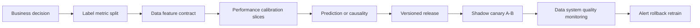
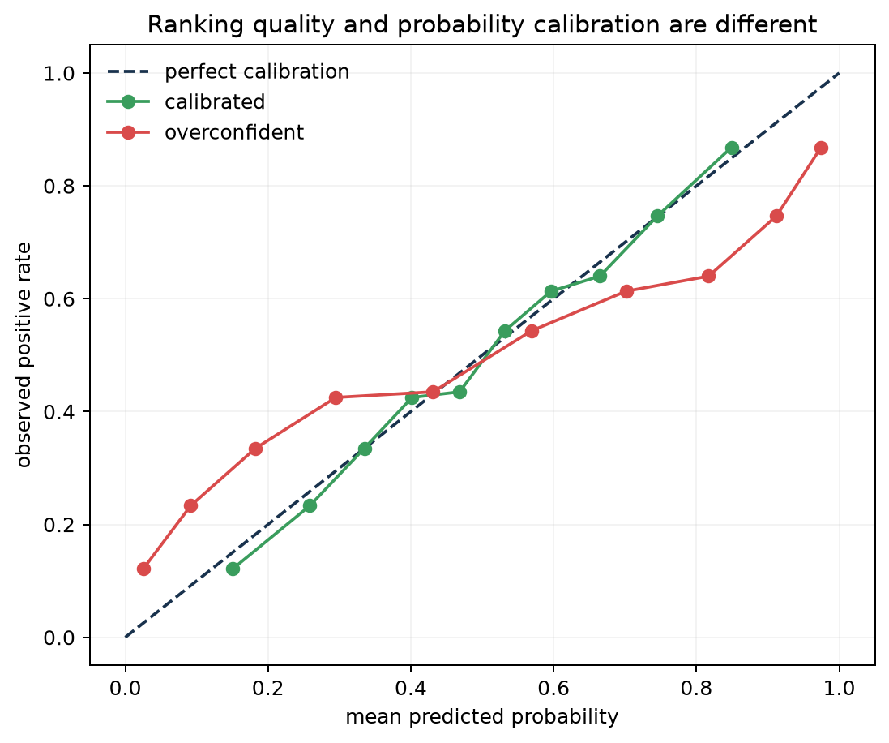
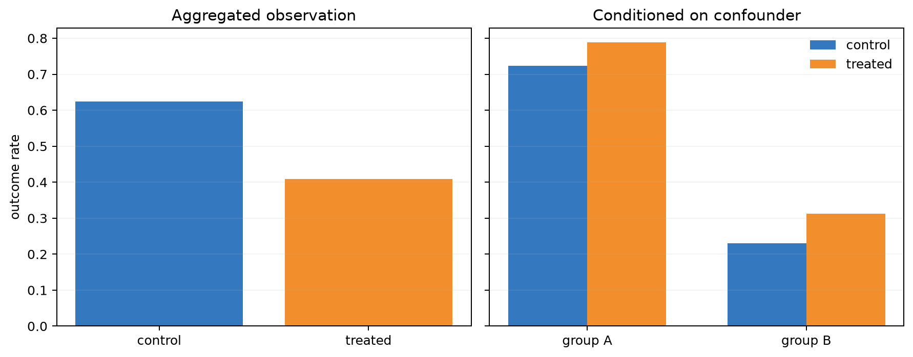
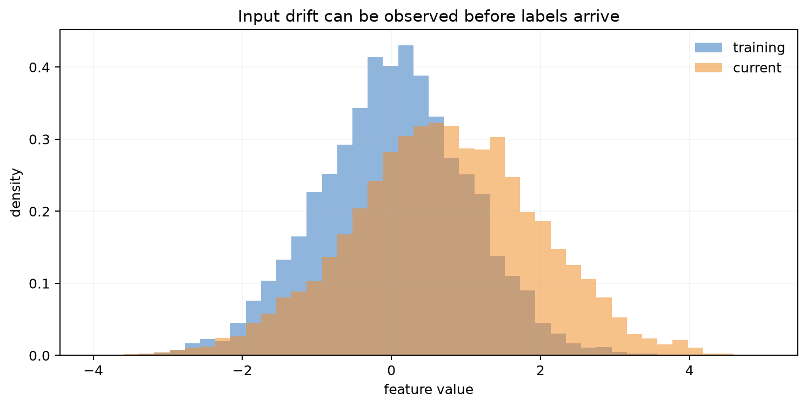
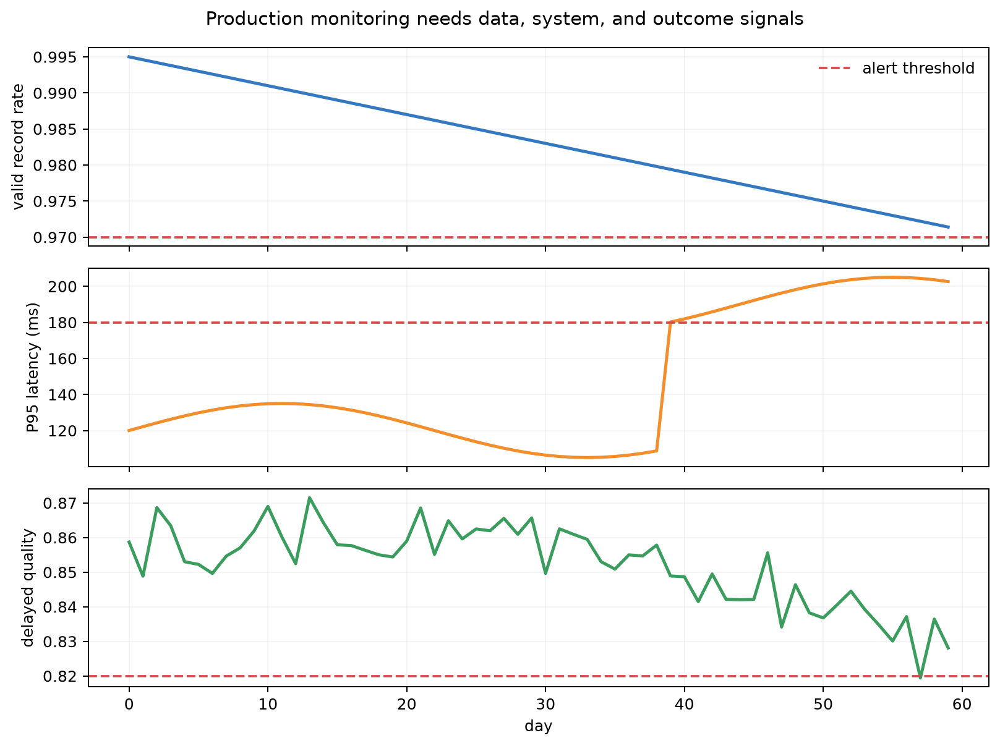

# Chapter 19: Evaluation, Causal Traps, and MLOps

[← Chapter 18](18-reinforcement-learning.md) | [中文](../zh-CN/19-evaluation-causality-and-mlops.md) | [Notation](appendix-a-notation.md) | [Roadmap](00-course-roadmap.md)

> **Prerequisites:** [metrics](01-what-is-ml.md), [model selection](09-learning-theory-and-model-selection.md),
> recommendation feedback bias, probability, and statistical uncertainty.

Many production failures are outside the algorithm: the label changes, offline features differ from online features,
evaluation data leak, the metric misses the decision, or deployment drifts. This chapter builds the delivery loop from
decision definition and data contract through evaluation, causal boundaries, deployment, monitoring, and rollback.

## Learning route



### Learning boundary

The course target is a usable delivery loop: connect thresholds to costs, compare models with paired uncertainty,
separate prediction from intervention, and define release and rollback states. Full causal identification and platform
engineering are intentionally left for dedicated courses.

## 19.1 Begin with the decision

Specify who uses the output, when, which action a threshold triggers, the cost of FP/FN, label delay, and protected
groups. Calibration may be secondary for pure ranking but essential when probabilities set credit or medical resources.

<details><summary>Why not train first and choose the nicest metric afterward?</summary>
Post-hoc metric selection creates selection bias and can optimize a proxy unrelated to real decision costs. Define the
decision, primary metric, guardrails, and split before comparison.
</details>

## 19.2 Discrimination and calibration differ

AUC measures ranking and is largely invariant to monotone score transforms. Calibration asks whether roughly 80% of
cases predicted at 0.8 are positive. Brier score is

$$Brier=\frac1m\sum_i(p^{(i)}-y^{(i)})^2.$$



The green reliability curve follows the diagonal; the red model applies an over-sharp monotone transform. Their AUC is
nearly identical, but the red model has worse Brier score. Good ranking therefore does not imply trustworthy
probabilities. Fit Platt, isotonic, or temperature calibration on a separate calibration set, then report on untouched
test data.

## 19.3 Uncertainty and subgroup reporting

A mean hides sampling variation and group failures. Bootstrap IID samples; cluster-bootstrap repeated patients or users;
use block or rolling methods for time series. Report location, device, language, frequency, and time slices without
pretending that tiny groups support precise conclusions. Compare model differences with intervals, and distinguish
pre-specified primary analyses from exploratory slicing.

## 19.4 Prediction is not intervention

Prediction asks what $Y$ is when $X$ is observed. Causality asks what would happen if action $A$ were imposed:

$$p(Y\mid A=a)\neq p(Y\mid do(A=a)).$$



The control arm contains more high-baseline cases, so the aggregate panel makes treatment look harmful even though it
helps inside both groups. This controlled Simpson example does not mean that stratifying everything creates causality: one must
adjust sufficient pre-treatment confounders without conditioning on mediators or colliders.

Randomization breaks confounding by design. Observational estimation requires a causal graph and assumptions such as
exchangeability, positivity, and consistency, followed by sensitivity analysis.

## 19.5 Data contracts and leakage

For every feature record definition, type, unit, range, missing meaning, event time, availability time, source, and
owner. Event time is when reality occurred; processing time is when it reached storage. Prediction may only use
information available at that historical point.

Common leakage includes post-label fields, preprocessing fit on all data, repeated entities or near-duplicates across
splits, future aggregates, and benchmark content present in training. Use point-in-time joins, entity grouping,
deduplication/contamination checks, and feature-availability tests.

## 19.6 Distribution drift

- Covariate shift: $p(x)$ changes while $p(y\mid x)$ is relatively stable.
- Label/prior shift: $p(y)$ changes.
- Concept drift: $p(y\mid x)$ changes.
- Data-quality failure: schema, units, missingness, or the pipeline breaks.



The current feature shifts in mean and variance. This requires investigation but does not alone prove quality loss; the
feature may be irrelevant or the model robust. Conversely, concept can drift while $p(x)$ appears stable. PSI, KS,
Wasserstein, and classifier two-sample tests all depend on sample size and assumptions.

## 19.7 Reproducible release artifacts

Record code commit, data snapshot/query, environment, feature definitions, seeds, configuration, weights, metrics, and
approval. A registry stores model versions and stages; a model card documents purpose, data, subgroup results,
limitations, ethics, and ownership. Reproducibility means controlled provenance and explained tolerance—not a promise
that every parallel floating-point run is bitwise identical.

## 19.8 Shadow, canary, experiments, and rollback

- Shadow: process live requests without affecting users.
- Canary: expose a small share and expand after guardrails pass.
- A/B test: randomize policy exposure to estimate a product effect.
- Rollback: preserve the previous compatible version and explicit triggers.

High-risk systems also need human review, audit logs, automation refusal, and a kill switch. Recovery paths should be
practiced, not only documented.

## 19.9 What to monitor



The rows show valid-record rate, P95 latency, and delayed quality; red lines are alert thresholds. Data and system
signals arrive before labels, while final business quality may lag days. Monitor four layers:

1. data schema, missingness, range, categories, freshness, and drift;
2. model prediction/confidence, calibration, abstention, and slices;
3. system errors, throughput, tail latency, memory, accelerator, and cost;
4. business and safety outcomes, complaints, fairness, and incidents.

Every alert needs an owner, severity, runbook, aggregation rule, and postmortem process.

## 19.10 Reproduce the figures

```bash
python code/chapter19/evaluation_and_mlops.py
python code/chapter19/course_lab.py
```

The script verifies that a monotone probability transform can preserve AUC while harming Brier score, and generates the
confounding, drift, and monitoring figures. Synthetic data isolate mechanisms; real audits require dictionaries,
timestamps, group definitions, and privacy boundaries.

The course lab selects a threshold from FP/FN costs, bootstraps the paired Brier-score difference, computes PSI, and
runs a small promote/rollback gate. A confidence interval on predictive metrics quantifies comparison uncertainty; it
does not by itself identify a causal effect.

## 19.11 Evaluating LLMs, RAG, and agents

Open generation needs layered evaluation: representative and adversarial tasks; retrieval, citation, factuality,
instruction, style, safety, latency, and cost metrics; executable checks, domain raters, and model judges; decontaminated
private rolling sets; repeated sampling and agreement intervals; and agent-trajectory checks for tools, arguments,
permissions, recovery, and side effects.

LLM-as-a-judge scales evaluation but can have position, verbosity, self-preference, and prompt biases. Calibrate it with
blinded human review and executable facts instead of treating it as ground truth.

## 19.12 Cost and failure diagnosis

Evaluation cost grows with samples × model calls × repetitions × judge cost. Run a small regression suite per commit,
a complete suite for release candidates, and periodic expensive human/red-team evaluation.

| Symptom | Possible cause | Direction |
|---|---|---|
| dashboards green, complaints rise | missing outcomes or delayed labels | add user and safety signals |
| offline gain not reproducible | unversioned data/code/randomness | complete provenance chain |
| harmless drift alerts | thresholds ignore importance/seasonality | segmented baselines |
| early A/B significance | peeking and multiplicity | pre-register sample and stopping |
| sudden LLM-eval jump | contamination or judge bias | private rolling set and human calibration |

## Worked reasoning checkpoint

Choose thresholds from costs, not from a default of 0.5. If a false negative costs ten times a false positive, a lower
threshold can improve expected utility even while accuracy falls. Freeze the threshold on validation data and report
the resulting confusion matrix, calibration, and subgroup outcomes on test data.

Draw a causal graph before choosing adjustment variables. Bootstrap paired per-example metric differences, clustering
by patient or user when records repeat. Treat release as a state machine from candidate to shadow, canary, and full
traffic, with observation windows, guardrails, compatible artifacts, and a rehearsed rollback.

## Modern AI connections

- Foundation-model governance needs lineage, contamination checks, capability/safety cards, and release gates.
- RAG requires document version, index freshness, retrieval evidence, and citation monitoring.
- Agents require permission, idempotency, sandbox, budget, and audit controls beyond model scores.
- Recommendation and RL alter the next data distribution, joining offline evaluation with causal experimentation.
- Edge AI must slice by device, power, temperature, and offline conditions.

## Socratic mentor

<details><summary>Why does high AUC not make a 0.9 probability believable?</summary>
AUC only evaluates ordering; a monotone transform can keep ordering while changing every probability and decision cost.
</details>

<details><summary>Should any detected $p(x)$ drift trigger retraining?</summary>
First check the pipeline, affected features, and quality slices. Blind retraining may learn from corrupted labels.
</details>

<details><summary>Does controlling more variables improve causal estimation?</summary>
No. Conditioning on mediators, post-treatment variables, or colliders can introduce bias.
</details>

<details><summary>Can delayed labels prevent all monitoring?</summary>
No. Schema, drift, prediction distribution, latency, and proxy guardrails are immediate; quality is backfilled later.
</details>

## Exercises

Compare with the [Chapter 19 solutions](solutions/19-solutions.md).

1. Construct equal-AUC, different-Brier models and draw reliability curves.
2. Design cluster bootstrap intervals for repeated patients.
3. Draw a recommendation causal graph and identify valid/invalid controls.
4. Audit event time, availability time, and leakage in a feature table.
5. Compare PSI, KS, and classifier drift tests and build a harmless-shift counterexample.
6. Write a model card, release gate, canary metrics, and rollback runbook.
7. Budget a private RAG/agent evaluation with human calibration.

## Interview recap

- **AUC versus calibration?** Ordering quality versus agreement between probability and frequency.
- **Leakage?** Training uses information unavailable at deployment, including preprocessing and duplicate entities.
- **Drift types?** Covariate, label/prior, and concept drift; distinguish pipeline failure.
- **Correlation versus causation?** Observational conditioning is not intervention without identification assumptions.
- **Simpson's paradox?** Aggregate and within-group trends can differ because group composition changes.
- **Shadow/canary/A-B?** No-impact observation, limited release, and randomized causal comparison.
- **Monitoring layers?** Data, model, system, and business/safety.
- **LLM-judge risks?** Position, verbosity, self-preference, prompt, and domain bias.

## Mastery checklist

- [ ] I select metrics, thresholds, splits, and uncertainty from decision costs.
- [ ] I distinguish ranking from calibration and can build a reliability diagram.
- [ ] I detect leakage, duplicates, contamination, and point-in-time errors.
- [ ] I use a causal graph to state the boundary between prediction and intervention.
- [ ] I distinguish data failure and drift types and design layered monitoring.
- [ ] I can specify a versioned release, model card, canary, rollback, and incident process.

### Further reading

- [Google Rules of ML](https://developers.google.com/machine-learning/guides/rules-of-ml)
- [Sculley et al., Hidden Technical Debt](https://papers.nips.cc/paper/5656-hidden-technical-debt-in-machine-learning-systems)
- [Pearl, The Seven Tools of Causal Inference](https://doi.org/10.1145/3241036)
- [Mitchell et al., Model Cards](https://doi.org/10.1145/3287560.3287596)

[Next: Machine-learning systems →](20-machine-learning-systems.md)
