# Chapter 20: Machine-Learning Systems — Performance, Memory, and Deployment

[← Chapter 19](19-evaluation-causality-and-mlops.md) | [中文](../zh-CN/20-machine-learning-systems.md) | [Notation](appendix-a-notation.md) | [Roadmap](00-course-roadmap.md)

> **Prerequisites:** [Transformers and KV cache](15-transformers-llms-and-finetuning.md),
> [MLOps](19-evaluation-causality-and-mlops.md), tensor shapes, and time/space complexity.

An accurate model may still be undeployable because of latency, memory, cost, energy, or failure behavior. Algorithmic
complexity counts operations; systems analysis also asks where bytes move, what hardware parallelizes, how requests
queue, and what happens under overload. This chapter follows the CS249r spirit by treating model, compiler, runtime,
hardware, and product SLO as one constrained design problem.

## Learning route

```mermaid
flowchart LR
  A["Quality and SLO"] --> B["End-to-end profile"]
  B --> C["Compute or bandwidth"]
  C --> D["Batch parallel fusion"]
  D --> E["Quantize prune distill"]
  E --> F["KV and memory"]
  F --> G["Scheduling and tail latency"]
  G --> H["Edge cloud energy"]
  H --> I["Fallback capacity cost"]
```



### Learning boundary

The required habit is: measure end to end, locate the bottleneck, change one constrained component, and revalidate
quality and SLOs. Kernel authoring, compiler internals, and distributed-training implementation are useful extensions,
not prerequisites for completing this course.

## 20.1 Define the SLO before optimizing

State a quality floor, P50/P95/P99 latency, throughput, peak concurrency, availability, memory, energy/cost, privacy,
and device range. A 100-ms mean may hide 1% of requests above five seconds; maximum-throughput settings may ruin an
interactive experience.

<details><summary>If model FLOPs fall by 50%, must service latency halve?</summary>
No. Memory bandwidth, tokenization, queuing, networking, unsupported operators, and utilization may dominate. Profile
end to end.
</details>

## 20.2 Latency budget and Amdahl's law

Inference includes queue, preprocessing, prefill, decode, postprocessing, and network time.


Decode dominates this example, but queue, prefill, and network remain. Doubling one kernel cannot remove the untouched
parts. If fraction $p$ is accelerated by $s$, total speedup is bounded by

$$S=\frac1{(1-p)+p/s}.$$

Measure a distribution for every stage rather than one total average.

## 20.3 FLOPs, bandwidth, and roofline

Arithmetic intensity is

$$I=\frac{\text{operations}}{\text{bytes moved}},$$

and attainable performance is bounded by

$$P\le\min(P_{peak},B_{memory}I).$$


On the sloped roof, reuse and fusion may help; on the flat roof, arithmetic or peak compute is the limit. Real kernels
also depend on occupancy, launch overhead, shapes, and communication. Matrix multiply is often high-intensity, while
normalization, embedding lookup, and elementwise activations can be bandwidth-bound. Fusion keeps intermediates on chip.

## 20.4 Batching trades throughput for latency


Throughput saturates as batch grows, while waiting and execution increase tail latency. Offline work can favor large
batches; interactive systems use dynamic batching with a maximum wait. LLM length variation causes padding waste and
head-of-line blocking. Continuous batching admits and removes sequences between decode steps, improving utilization at
the cost of more complex scheduling and KV management.

## 20.5 Distributed training strategies

- Data parallelism splits the batch and synchronizes gradients; each worker holds the model.
- Tensor parallelism splits a layer's matrices and communicates within each layer.
- Pipeline parallelism assigns layer stages and uses micro-batches, leaving pipeline bubbles.
- ZeRO/FSDP shards parameters, gradients, and optimizer state and gathers them as needed.

Topology, communication volume, and overlap determine scaling. Report

$$E_N=\frac{Throughput_N}{N\,Throughput_1}.$$

Gradient accumulation raises effective batch without the same activation peak, but does not remove compute and may not
reproduce every large-batch training dynamic.

## 20.6 Precision and quantization

Mixed-precision training keeps sensitive accumulation in higher precision. Inference may use int8 or int4. Symmetric
uniform weight quantization uses

$$s=\frac{\max|w|}{2^{b-1}-1},\qquad
q=\mathrm{clip}(\mathrm{round}(w/s),-q_{max},q_{max}),\qquad \hat w=sq.$$


Lower bits increase example weight MSE while storage scales roughly with bit width; int4 weights are about one quarter
of fp16 size. Weight MSE is not task error. Outlier channels, activations, and layer sensitivity differ, and target
hardware must have a useful kernel. PTQ calibrates after training; QAT simulates quantization during training. Per-
channel scales are more precise than per-tensor scales but more complex.

## 20.7 Pruning, distillation, and low rank

Unstructured pruning may shrink stored sparse weights without reducing latency when hardware cannot exploit sparsity.
Structured pruning removes channels, heads, or layers and is easier to accelerate but removes capacity. Distillation
matches teacher targets or representations and can inherit teacher bias. Low-rank factorization helps when singular
values decay and kernels support the new shapes. Compression errors combine, so validate every stack on one baseline.

## 20.8 Prefill, decode, and KV cache

Prefill processes prompt tokens in parallel with large matrix multiplies. Decode handles one new token per sequence and
often becomes bandwidth/KV-read bound. TTFT measures queue plus prefill; TPOT measures continuing decode.


The example uses 32 layers, 32 KV heads, head dimension 128, and fp16. Doubling context doubles per-sequence KV; then
concurrency multiplies it. MQA/GQA reduce KV heads, paged caches reduce fragmentation, and cache quantization reduces
bytes, each requiring quality and kernel validation.

## 20.9 Compilation and hardware mapping

Compilers perform constant folding, fusion, layout selection, memory planning, autotuning, and shape specialization.
Graph breaks, recompilation, and unsupported operators lose gains. Preserve numerical checks on boundary inputs and
task metrics. CPUs suit control flow and small batches; GPUs/TPUs suit tensor parallelism; NPUs/DSPs target specific
precision and edge efficiency. Choose by shape, operators, precision, memory, software, and supply—not a leaderboard.

## 20.10 Reproduce the system models

```bash
python code/chapter20/ml_systems.py
python code/chapter20/course_lab.py
```

The script plots batching, roofline, quantization, a latency budget, and KV growth. These are explanatory models, not
hardware benchmarks. A benchmark must record device, driver, libraries, power mode, warm-up, concurrency, length
distribution, repetition, and uncertainty.

The course lab times a local matrix multiplication, compares int8 and int4 quantization error, estimates Transformer
weight and KV memory, and simulates queueing at two loads. Timing is environment-dependent, so the lab checks internal
consistency instead of imposing a universal GFLOP/s threshold.

## 20.11 Edge, cloud, and privacy

Edge inference reduces network latency and keeps raw data local but faces memory, power, heat, and device diversity.
Cloud centralizes updates and compute but adds network, privacy, and cost. Hybrid systems answer easy cases locally and
escalate authorized hard cases. Federated learning does not automatically prevent gradient leakage; differential privacy
gives a quantitative budget at the price of noise and utility.

## 20.12 Reliability, capacity, and cost

Near 100% utilization, queue delay rises sharply. Leave headroom and add rate limits, priorities, timeouts, degradation,
small-model fallback, and caches. Retries without backoff and idempotency can amplify an outage. Report cost per thousand
requests, million tokens, and preferably successful task. A lower per-token cost can raise total cost if outputs grow.

## 20.13 Failure diagnosis

| Symptom | Possible cause | Check |
|---|---|---|
| low accelerator use | small batch, CPU input, synchronization | timeline/profile, prefetch, fusion |
| fewer FLOPs, same time | bandwidth or unsupported sparsity | roofline and operator profile |
| fast mean, slow P99 | queues, long requests, retry | length buckets, timeout, headroom |
| concurrency OOM | KV, activation, fragmentation | memory accounting and paging |
| quantization quality collapse | outliers or poor calibration set | layer sensitivity, per-channel/QAT |
| weak multi-device scaling | communication or pipeline bubbles | communication fraction and overlap |

## Worked reasoning checkpoint

If kernels are 60% of latency and become four times faster, Amdahl's law gives only about 1.82x end-to-end speedup.
Queueing can make tail latency explode as arrival rate approaches service capacity, so plan for peak length
distributions, failures, rate limits, timeouts, and degradation rather than average QPS.

Keep a memory ledger: weights, master weights, gradients, optimizer states, activations, workspaces, and KV cache.
Checkpointing, sharding, and quantization target different entries. Profile end to end, descend into the dominant stage,
explain it with hardware counters or roofline reasoning, change one factor, verify quality, and profile again.

## Modern AI connections

- LLM serving combines continuous batching, paged KV, GQA, speculative decoding, and quantization.
- RAG shares one latency budget across retrieval, embedding, ranking, and generation.
- Multimodal video/image tokens increase length and preprocessing bandwidth.
- Agent latency includes repeated tool-network calls, so timeout, caching, and concurrency dominate completion.
- Energy/carbon reporting needs utilization, electricity region, and accounting boundary—not FLOPs alone.

## Socratic mentor

<details><summary>Why can a model with fewer parameters be slower?</summary>
Irregular operators, poor memory access, low parallelism, or immature kernels can reduce utilization.
</details>

<details><summary>Why is P99 harder than mean latency?</summary>
The tail combines queueing, length, contention, and failures that averages hide.
</details>

<details><summary>If int4 weights are four times smaller than fp16, is throughput four times larger?</summary>
Not necessarily. Activations, KV, dequantization, bandwidth, and native hardware throughput remain.
</details>

<details><summary>Why does FlashAttention save memory?</summary>
Tiled online softmax avoids writing the complete $T\times T$ score matrix to high-bandwidth memory; arithmetic remains
approximately quadratic.
</details>

## Exercises

Compare with the [Chapter 20 solutions](solutions/20-solutions.md).

1. Use Amdahl's law on attention, network, and preprocessing optimizations.
2. Estimate arithmetic intensity for several operators and place them on a roofline.
3. Benchmark batch, concurrency, and length; plot throughput–P95/P99–memory Pareto fronts.
4. Implement int8/int4 PTQ and compare per-tensor/per-channel quality and speed.
5. Estimate Transformer parameters, optimizer state, activations, and KV memory.
6. Design 8-device data/tensor/pipeline parallelism and communication accounting.
7. Write capacity, overload, fallback, rollback, and cost plans for an LLM service.

## Interview recap

- **FLOPs versus latency?** Latency also depends on bandwidth, kernels, communication, utilization, and queues.
- **Arithmetic intensity?** Operations per byte moved; it helps identify compute or bandwidth limits.
- **Amdahl's law?** Unoptimized work caps total speedup.
- **Batch trade-off?** Better throughput/utilization but more waiting, memory, and tail latency.
- **PTQ versus QAT?** Post-training calibration is cheap; training-aware simulation often preserves quality better.
- **TTFT versus TPOT?** First-token delay versus subsequent per-token delay.
- **KV complexity?** Linear in layers, KV heads, head dimension, cached length, concurrency, and bytes.
- **Speculative decoding?** A small model proposes tokens and a large model validates them in parallel.

## Mastery checklist

- [ ] I can turn quality, latency, throughput, memory, cost, and reliability into SLOs.
- [ ] I can use profiling, Amdahl, and roofline to find the real bottleneck.
- [ ] I can explain batching and parallel strategies with communication and tail costs.
- [ ] I validate quantization on task quality and target hardware, not file size alone.
- [ ] I can estimate model, training-state, activation, and KV memory.
- [ ] I can design scheduling, overload protection, fallback, rollback, and capacity plans.

### Further reading

- [Harvard CS249r Machine Learning Systems](https://github.com/harvard-edge/cs249r_book)
- [Williams et al., Roofline](https://doi.org/10.1145/1498765.1498785)
- [Dao et al., FlashAttention](https://arxiv.org/abs/2205.14135)
- [Kwon et al., vLLM and PagedAttention](https://arxiv.org/abs/2309.06180)
- [Dettmers et al., LLM.int8()](https://arxiv.org/abs/2208.07339)

[Next: Interview review and capstone →](21-interview-and-capstone.md)
