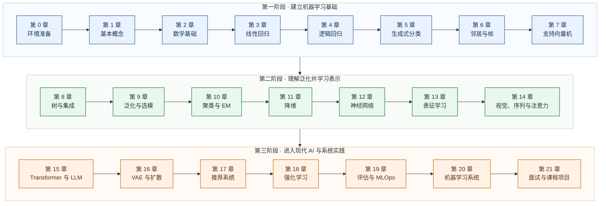

# 课程路线图：从零基础到机器学习系统

[← 首页](../../README.md) | [English](../en/00-course-roadmap.md) | [第 0 章 →](00-prerequisites.md)

这份路线图回答两个问题：22 章为什么按这个顺序排列，以及怎样根据自己的基础安排学习时间。课程从一个房租预测问题起步，先学会描述数据和误差，再逐步扩展到分类、概率建模、无监督学习、深度学习、基础模型与机器学习系统。

零基础路线建议用 28 周完成；已经掌握 Python、线性代数、微积分和概率统计的学习者，可以压缩为 24 周。这里的周数是节奏参考，不是截止日期。

## 1. 学习成果

完成课程后，你应当能够：

- 把真实问题写成样本、特征、标签、目标函数与评估指标；
- 从模型假设推导损失函数、梯度或求解过程，并解释每个符号；
- 用 NumPy 从零实现，再用 scikit-learn / PyTorch 验证；
- 通过数据分布、残差、学习曲线和验证集识别欠拟合、过拟合与数据泄漏；
- 比较算法的假设、容量、计算成本和适用场景，而不是只记名称；
- 说明经典算法在 LLM、推荐、搜索和端侧 AI 中的位置；
- 复现一篇入门论文，完成含消融实验的研究项目。

## 2. 学习顺序

课程不是算法名词的集合。每一章都在回答上一章留下的问题：




前四章尤其重要。第 1 章先建立语言，第 2 章提供数学工具，第 3 章走完第一条完整的回归链，第 4 章再把连续数值预测改成概率分类。如果一开始就在 OLS、Ridge、Lasso、softmax 等术语之间跳跃，很容易记住名字却不知道它们解决了什么问题。第3阶段开始属于入门引导，本课程只带你了解相关内容，因为每一个章节都足以形成一门非常庞大的课程，不在这里深度展开。

## 3. 章节安排

| 阶段 | 零基础周次 | 章节 | 核心产出 | 现代 AI 连接 |
|---|---:|---|---|---|
| 准备 | 0 | [0. Python/NumPy 与实验习惯](00-prerequisites.md) | 可运行环境与自测 | 张量形状、可复现性 |
| 起点 | 1 | [1. 什么是机器学习](01-what-is-ml.md) | 问题定义卡 | LLM 预训练/对齐/推理 |
| 地基 | 2–4 | [2. 数学基础](02-math-foundations.md) | 推导、概率与梯度校验 | embedding、softmax、Adam |
| 回归 | 5 | [3. OLS 到多项式/Ridge/Lasso](03-linear-regression.md) | 双解法与模型选择实验 | 线性层、LoRA、线性探针 |
| 判别 | 6 | [4. 逻辑回归、感知机与 GLM](04-logistic-regression.md) | 多分类器 | token softmax、CTR 预估 |
| 生成式分类 | 7 | [5. 指数族、GDA、NB、Laplace 平滑](05-generative-classifiers.md) | 双生成式分类器 | 生成式与判别式学习 |
| 非参数 | 8 | [6. kNN、特征映射与核方法](06-neighbors-and-kernels.md) | 相似度检索 | 向量数据库、RAG |
| 最大间隔 | 9 | [7. SVM、对偶与 SMO](07-support-vector-machines.md) | 核分类器 | margin、对比表征 |
| 树模型 | 10 | [8. 决策树、RF、GBDT](08-trees-and-ensembles.md) | 表格数据基线 | 推荐排序、风控 |
| 学习理论 | 11–12 | [9. 偏差-方差、正则、交叉验证、学习界](09-learning-theory-and-model-selection.md) | 诊断报告 | double descent、scaling |
| 无监督 | 13–14 | [10. K-means、GMM、EM、ELBO](10-clustering-em-and-elbo.md) | 聚类与隐变量实验 | 向量量化、MoE、VAE |
| 降维 | 15 | [11. PCA、因子分析与 ICA](11-dimensionality-reduction.md) | 压缩/盲源分离 | embedding 压缩 |
| 深度学习 | 16–18 | [12. MLP、反向传播、初始化与优化](12-neural-networks-and-backprop.md) | mini autograd | 深度网络底层 |
| 表征学习 | 19 | [13. 预训练、对比学习与语义检索](13-representation-learning.md) | 双编码器 | RAG、CLIP 思想 |
| 序列与视觉 | 20 | [14. CNN、RNN、LSTM 与 Attention](14-sequence-vision-and-attention.md) | 小型结构化网络 | VLM/时序建模 |
| 基础模型 | 21 | [15. Transformer、LLM、微调与 MoE](15-transformers-llms-and-finetuning.md) | 小型 Transformer | SFT、LoRA、推理 |
| 生成模型 | 22 | [16. VAE 与扩散模型](16-vae-and-diffusion.md) | 去噪生成器 | 图像/视频生成 |
| 推荐 | 23 | [17. 协同过滤、双塔与排序](17-recommender-systems.md) | 两阶段推荐 | embedding、召回、排序 |
| 决策 | 24–25 | [18. MDP、Bellman、Q-learning、策略梯度/PPO](18-reinforcement-learning.md) | grid world | RLHF、在线推荐 |
| 工程 | 26 | [19. 指标、因果陷阱、数据与 MLOps](19-evaluation-causality-and-mlops.md) | 模型卡 | RAG/Agent 评测 |
| 系统 | 27 | [20. CS249r 系统视角](20-machine-learning-systems.md) | 性能剖析 | 量化、KV cache、端侧 AI |
| 收束 | 28 | [21. 面试与研究项目](21-interview-and-capstone.md) | 答辩、复现与消融 | 论文阅读/研究设计 |

## 4. 重要概念在什么时候学

同一个概念会在不同章节多次出现，但每次承担不同任务。第一次建立直觉，第二次完成推导，后来再用于诊断或连接现代模型。

| 概念 | 第一次遇见 | 正式掌握 | 为什么这样安排 |
|---|---|---|---|
| 样本、特征、标签、数据集 | 第 1 章 | 第 1～2 章 | 先统一机器学习语言，再用矩阵表达 |
| 损失函数与梯度下降 | 第 1 章看现象 | 第 2～3 章推导和实现 | 先知道在优化什么，再计算怎样优化 |
| OLS 与多项式回归 | 第 3 章 | 第 3、9 章 | 从简单基线进入容量、欠拟合和过拟合 |
| Ridge、Lasso 与正则化 | 第 1～2 章预告 | 第 3 章实验，第 9 章解释泛化 | 先看到模型失败，正则化才有明确用途 |
| 逻辑回归 | 第 1 章任务示例 | 第 4 章 | 它预测类别概率，不是连续数值回归 |
| 最大似然估计 MLE | 第 2 章 | 第 3～5 章 | 从概率假设推导常见损失函数 |
| MAP 与先验 | 第 2 章 | 第 5、9、10 章 | 连接贝叶斯观点、平滑和正则化 |
| 交叉验证 | 第 1 章认识数据划分 | 第 9 章系统比较 | 先会保护测试集，再讨论公平选模 |
| 反向传播 | 第 2 章链式法则 | 第 12 章从零实现 | 它是复合函数求导在神经网络中的应用 |
| embedding 与注意力 | 前面章节穿插实例 | 第 13～15 章 | 先理解向量和相似度，再学习大模型结构 |

遇到尚未正式讲解的术语，不需要立刻掌握；先记住它试图解决的问题，到对应章节再补上定义、推导和代码。

## 5. 两种学习节奏

### 零基础路线：28 周

- 每周投入 6～8 小时；
- 第 0～2 章不要跳过，数学部分允许边学算法边回查；
- 每章至少完成一次手算、一次代码修改和章末自测；
- 第 9、12、15、18 章后各留半周复习，把前后的概念重新画成知识图。

### 快速路线：24 周

- 适合已经掌握 Python、矩阵运算、求导和基础概率的人；
- 先做第 0 章与第 2 章自测，熟悉的内容可快速阅读；
- 第 3～21 章仍建议按顺序学习，因为后续章节会复用前面的概率、优化与评估方法；
- 把节省的时间用于代码实验、练习和课程项目，而不是只追求阅读速度。

如果目标更明确，也可以在学完第 1～9 章后选择侧重点：

- **LLM / RAG**：重点学习 12～15、19～20 章；
- **推荐系统**：重点学习 8～9、13、17～20 章；
- **计算机视觉**：重点学习 11～16、19～20 章；
- **传统表格建模**：重点学习 3～9、19 章。

这些是侧重路线，不是完全跳过其他章节的理由。至少先完成第 1～9 章，才能有稳定的建模与评估基础。

## 6. 一章课的学习方法


一次学习可以分为五步：

1. **先读问题和图片**：说清楚旧方法为什么不够，以及新方法准备改变什么；
2. **再读定义和推导**：逐个检查符号、维度、假设与等号成立的原因；
3. **手算最小例子**：用两三个样本验证公式，不要直接跳到库函数；
4. **运行并改动代码**：改变数据、超参数或随机种子，观察指标和图怎样变化；
5. **闭卷复述**：回答章中的苏格拉底提问，再完成练习与面试题。

推荐的每周时间分配是：阅读 2 小时、手推 1 小时、编程 2 小时、实验与诊断 1 小时、复述和练习 1 小时。看懂公式只是开始；能解释、能实现、能判断何时不该使用，才算真正掌握。

## 7. 考核与课程项目

| 项目 | 建议比例 | 通过标准 |
|---|---:|---|
| 每章自测与推导 | 20% | 能解释符号、假设和关键步骤 |
| 编程实验 | 30% | 有基线、随机种子、曲线和误差分析 |
| 期中复现 | 20% | 结果可以重复，差异能够解释 |
| 期末课程项目 | 30% | 问题清楚、对照公平，包含消融与局限 |

完成一章后，可以用下面的问题检查自己：

- 我能否用一句话说明这个方法解决什么问题？
- 我能否从模型假设写出目标函数，并解释关键推导？
- 我能否在不看答案时手算一个最小例子？
- 我能否修改代码，并根据图和指标解释结果？
- 我是否知道它最常见的失败方式，以及应该换什么方法？
- 我能否指出它在现代 AI 系统中的对应思想？

第 21 章会把这些能力汇总为面试复习和课程项目。项目不以模型越大越好，而以问题定义清楚、实验可信、结论与证据一致为准。

## 8. 课程文件

```text
docs/zh-CN/       中文正文与参考答案
docs/en/          English chapters and solutions
docs/assets/      数据图、模型图与训练诊断图
code/chapterXX/   各章示例和实验
```

中英文页面采用相同编号，并在页首互相链接。公式使用 LaTeX，流程图使用 Mermaid。准备好环境后，从[第 0 章](00-prerequisites.md)开始；如果已经通过入门自测，可以直接进入[第 1 章](01-what-is-ml.md)。
