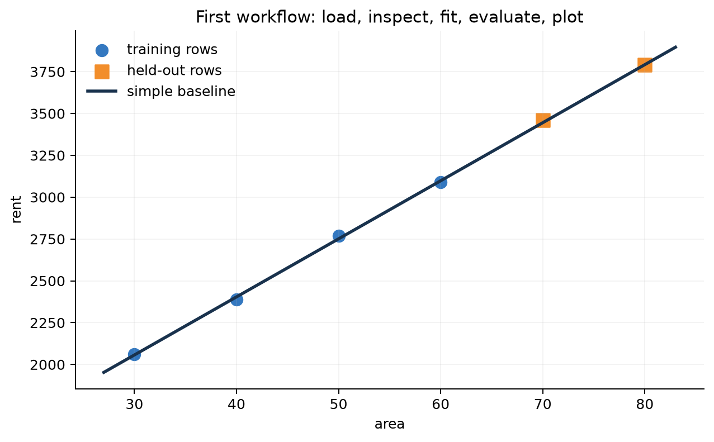

# 第 0 章：零基础学习准备

[← 首页](../../README.md) | [English](../en/00-prerequisites.md) | [符号约定](appendix-a-notation.md) | [第 1 章 →](01-what-is-ml.md)

机器学习的第一步不是背公式，而是能把数据读进来、看懂数组形状、运行一段代码并判断结果是否合理。本章只准备这些必要工具，不会提前塞入复杂算法。

学完本章，你将能够：

- 建立独立的 Python 环境并运行课程代码；
- 看懂变量、列表、函数和简单循环；
- 用 NumPy 表示一批样本，并区分矩阵乘法与逐元素乘法；
- 完成一次“读取—检查—划分—拟合—评价—画图”的小实验；
- 根据报错信息找到最先需要检查的文件和代码行。

## 0.1 开始前需要什么？

最低要求只有三项：会使用电脑文件、愿意阅读简单英文变量名、愿意亲手运行和修改代码。不要求预先懂机器学习、高等数学或 Python。数学会在第 2 章结合图和例子讲解，遇到陌生符号也可以随时查看[符号附录](appendix-a-notation.md)。

### 两条学习路线

- **零基础路线**：先完成本章，再学第 1～2 章；遇到数学术语回查[符号附录](appendix-a-notation.md)。
- **快速路线**：若能完成本章自测，可直接进入第 1 章，把本章当速查表。

### 安装一次课程环境

下载或克隆仓库后，打开终端并进入仓库根目录，也就是能够看到 `README.md` 和 `requirements-course.txt` 的目录。先确认 Python 版本（建议 3.10 或更高）：

```bash
python --version
python -m venv .venv
```

Windows PowerShell 激活环境并安装依赖：

```powershell
.\.venv\Scripts\Activate.ps1
python -m pip install -r requirements-course.txt
```

macOS/Linux：

```bash
source .venv/bin/activate
python -m pip install -r requirements-course.txt
```

为什么使用虚拟环境？它把本课程的 NumPy、Matplotlib 和 scikit-learn 版本与其他项目隔离，
减少“在我的电脑上能跑、换一台就坏”的依赖冲突。若 PowerShell 阻止激活，可直接使用
`.venv\Scripts\python.exe` 运行命令，不必降低整个系统的安全策略。

安装完成后运行：

```bash
python code/chapter00/readiness_check.py
```

如果最后看到 `All readiness checks passed.`，说明 Python、NumPy 和文件路径已经准备好。若命令找不到文件，先确认终端当前目录，而不是重新安装所有软件。

## 0.2 Python 只需要先掌握这些

```python
# 数字、列表和函数
areas = [28, 45, 72]

def predict(area, weight=38, bias=800):
    return weight * area + bias

predictions = [predict(area) for area in areas]
print(predictions)
```

逐行阅读这段代码：`areas` 保存三套房的面积；`predict` 根据面积计算预测租金；`area` 是函数每次收到的一套房面积；`weight` 和 `bias` 有默认值；最后一行列表推导让同一个函数依次处理三套房。

此时只需掌握四件事：变量保存值，列表保存一组值，函数把输入变成输出，循环让同一操作重复执行。类、装饰器和异步编程都不是机器学习入门的前置条件。

## 0.3 为什么需要 NumPy？

Python 列表适合装数据，但不能直接表达高效的向量/矩阵计算：

```python
import numpy as np

X = np.array([[28., 5., 1.],
              [45., 10., 0.],
              [72., 18., 1.]])
w = np.array([38., -6., 120.])
b = 800.

prediction = X @ w + b
print(X.shape)       # (3, 3): 3 个样本、3 个特征
print(prediction)    # 一次得到 3 个预测
```

必须会检查 `shape`。`@` 是矩阵乘法，`*` 是逐元素乘法；混淆二者是入门最常见 bug 之一。

把 `X` 看成一张没有表头的表格：每一行是一套房，每一列是一项特征。这里的三列可以分别表示面积、离地铁距离和是否有电梯。`w` 为每项特征提供一个权重，`X @ w` 会让每套房的三项特征与三个权重一一配对、相乘并求和。

| 数组 | 形状 | 含义 |
|---|---|---|
| `X` | `(3, 3)` | 3 个样本，每个样本 3 个特征 |
| `w` | `(3,)` | 3 个特征各有 1 个权重 |
| `X @ w` | `(3,)` | 3 个样本各得到 1 个预测 |

如果再增加一套房，`X` 会变成 `(4, 3)`，而 `w` 仍是 `(3,)`。样本数改变了，特征定义没有改变。

## 0.4 五个必须养成的实验习惯

1. **固定随机种子**：让同一实验可重复；
2. **先打印形状和范围**：不要等报错后才看数据；
3. **训练/验证/测试分开**：预处理也只能在训练集拟合；
4. **先跑简单基线**：复杂模型必须证明额外价值；
5. **保存配置与结果**：模型结论必须能追溯到数据和参数。

```python
rng = np.random.default_rng(42)
x = rng.normal(size=(100, 3))
print(x.shape, x.min(), x.max(), np.isfinite(x).all())
```

随机种子保证伪随机序列可复现，不保证不同硬件、库版本或并行算法完全逐位一致。

## 0.5 第一次完整运行：读取、检查、拟合、评价、画图

只会阅读零散语句还不等于会完成实验。运行下面的第一个完整工作流：

```bash
python code/chapter00/first_workflow.py
```

脚本会读取 `rent_samples.csv`，打印数据形状和范围，只用前四行拟合一个简单基线，在未参与拟合的两行上计算 MAE，最后保存一张散点图。现在不用理解 `polyfit` 的数学推导；重点是看见一项实验的完整顺序：**读取 → 检查 → 划分 → 拟合 → 评价 → 可视化 → 断言**。



图中的蓝点是用于拟合的四套房，橙色方块是留到最后评价的两套房，直线是模型根据训练数据学到的关系。橙色方块与直线的竖直距离越大，预测误差越大。这里故意把训练点和测试点分开画，是为了提醒你：模型在训练数据上贴得很近，不代表它对没见过的数据也准确。

接着做三个小修改：把 CSV 中最后一套房面积从 80 改成 90，重新运行并观察 MAE；把脚本中的 `deg=1` 错写成 `degree=1`，阅读 traceback 最后一行；再恢复代码。报错不是对学习者的评价，而是程序提供的定位线索。

| 现象 | 先检查什么 |
|---|---|
| `ModuleNotFoundError` | 是否使用课程虚拟环境，依赖是否安装成功 |
| `FileNotFoundError` | 是否从仓库根目录运行，文件名是否正确 |
| `ValueError` / shape 不匹配 | 打印参与运算的每个数组形状 |
| 图没有出现 | 查看终端打印的保存路径，而不是等待弹窗 |
| 不知道从哪里读报错 | 先读 traceback 最后一行，再向上找自己的文件与行号 |

## 0.6 入门诊断：不查资料先试一遍

1. `X.shape == (100, 5)` 表示多少样本、多少特征？
2. 数学中的第 3 个样本，在 Python 中用 `X[?]` 读取？
3. `X @ w` 中若 `X` 是 `(100, 5)`，`w` 应是什么形状？结果是什么形状？
4. 为什么不能先用全体数据算均值，再切分训练和测试集？
5. 把学习率从 0.01 改为 10，一定训练更快吗？

<details><summary>查看答案与补学建议</summary>

1. 100 个样本、5 个特征。
2. `X[2]`，因为 Python 从 0 开始。
3. 常见为 `(5,)`，结果 `(100,)`。
4. 全体均值包含测试信息，形成数据泄漏。
5. 不一定，可能振荡或发散。

第 1～3 题不熟：先练 NumPy 数组与形状；第 4 题不熟：认真学习第 1 章实验流程；第 5 题不熟：
第 2 章会从损失地形重新讲解。
</details>

## 0.7 通关标准

运行：

```bash
python code/chapter00/readiness_check.py
python code/chapter00/first_workflow.py
```

能解释输出中每个 shape，能把面积改成四套房仍正确运行，并能回答上面五题，就可以进入第 1 章。

- [ ] 我能区分 `@` 与 `*`。
- [ ] 我能说明 `(3, 3)` 的两个 3 分别代表什么。
- [ ] 我会从仓库根目录运行脚本并阅读报错的最后几行。
- [ ] 我知道随机种子只帮助复现，不保证模型正确。
- [ ] 我不会用测试集帮助训练或选择超参数。
- [ ] 我能完成一次“读取—检查—拟合—评价—画图”，并根据 traceback 找到报错行。

达到这些标准后，继续学习[第 1 章：什么是机器学习](01-what-is-ml.md)。下一章会给本章出现的“样本、特征、训练集、测试集和 MAE”下精确定义，并解释为什么一套完整的机器学习流程不能只看训练误差。
