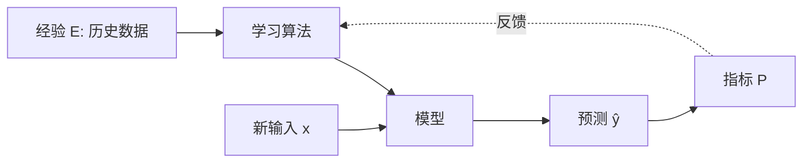
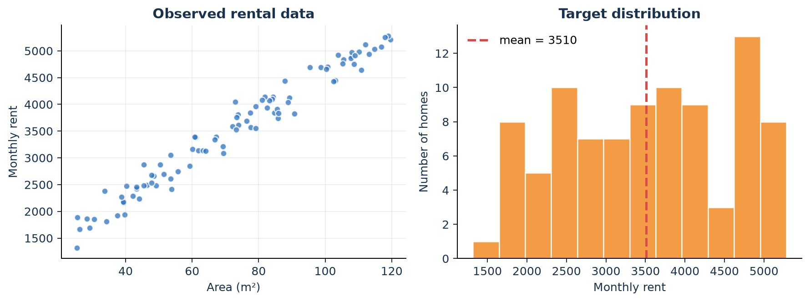
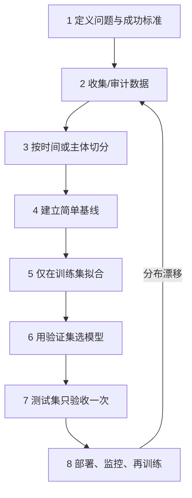
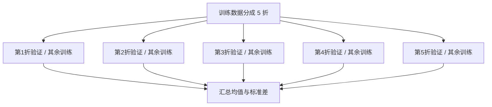
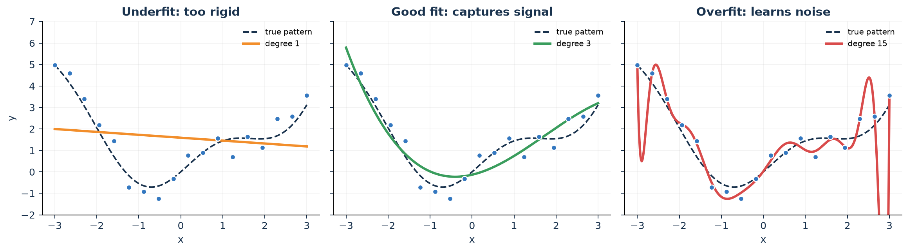
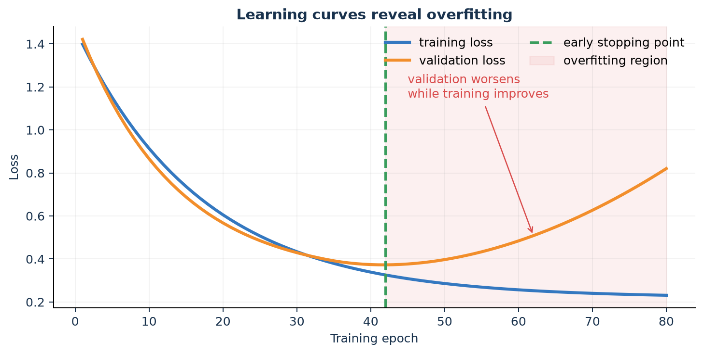
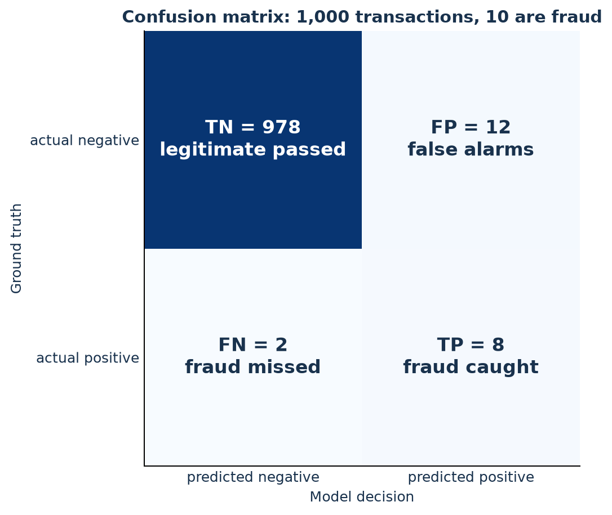
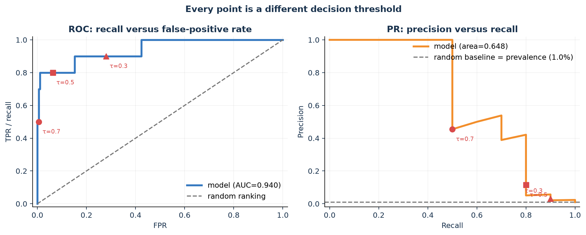
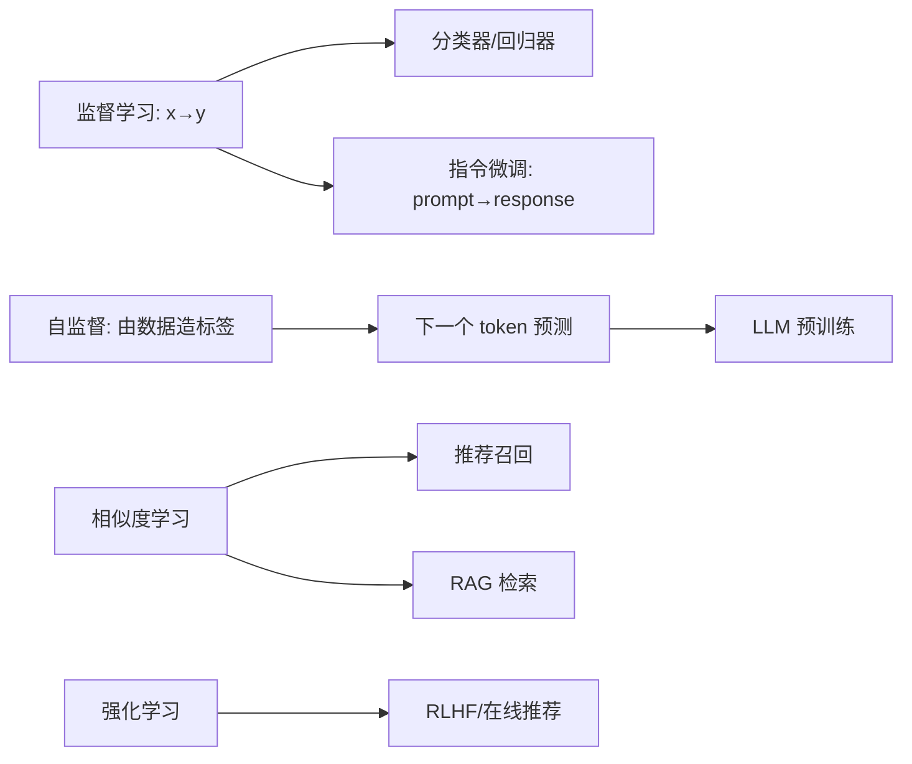
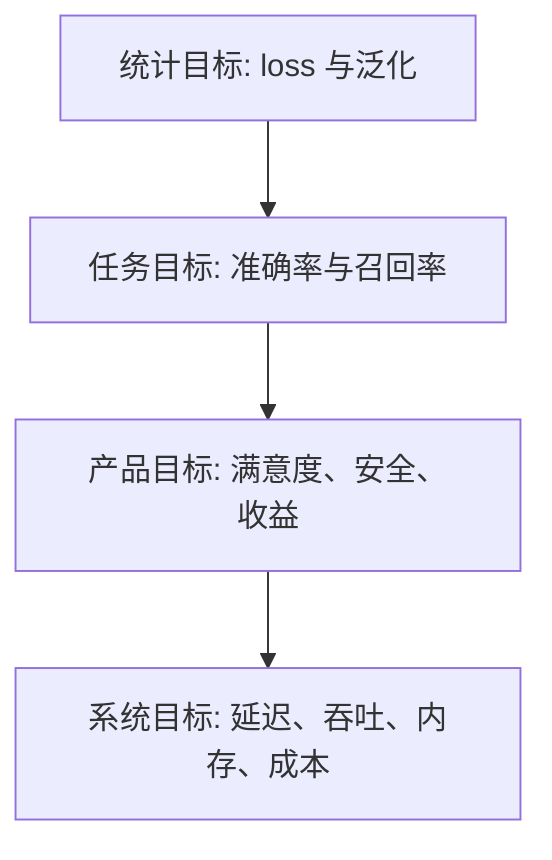

# 第 1 章：什么是机器学习？

[← 第 0 章](00-prerequisites.md) | [English](../en/01-what-is-ml.md) | [符号约定](appendix-a-notation.md) | [下一章：数学基础 →](02-math-foundations.md)

> 本章目标：看到一个问题时，能判断它是否适合机器学习，并把它写成数据、模型、
> 损失函数和评估指标。

> [!TIP]
> 本课程不是让你背定义。遇到每个概念都追问五次：**它是什么？为什么需要？没有它会怎样？
> 怎样知道它有效？它在今天的 AI 里在哪里？**

### 本章学习路线

| 先学什么 | 你要能回答的问题 |
|---|---|
| [为什么需要 ML](#10-为什么需要机器学习) | 哪些问题适合/不适合机器学习？ |
| [零基础符号](#12-从一张表开始样本特征与标签) | $X$、 $x^{(i)}$、 $x_j^{(i)}$ 分别是什么？ |
| [学习范式](#13-机器学习的主要范式) | 回归、分类、自监督和强化学习有何区别？ |
| [实验流程](#14-一次完整的机器学习实验) | 训练、验证、测试集为何要分开？ |
| [拟合与过拟合](#15-拟合欠拟合过拟合与泛化) | 怎样观察、判断和防止过拟合？ |
| [现代 AI 连接](#16-经典概念如何连接今天的-ai) | 这些概念在 LLM、RAG 和推荐中在哪里？ |

## 1.0 为什么需要机器学习？

传统程序是“**规则 + 数据 → 答案**”；机器学习训练是“**数据 + 答案 → 可复用的规则**”。
当规则无法完整写出，却能收集许多例子时，学习通常比手工枚举更合适。

| 为什么用 ML | 例子 | 手写规则为何困难 |
|---|---|---|
| 规则极多且互相影响 | 垃圾邮件识别 | 新词、拼写和话术不断变化 |
| 输入维度巨大 | 图像识别 | 无法逐像素规定“猫”的所有样子 |
| 规律因人或时间变化 | 推荐系统 | 兴趣、库存和热点持续漂移 |
| 需要估计而非精确计算 | 房租预测 | 地段、面积、装修共同影响且有噪声 |

### 什么情况不应该先用机器学习？

- 规则明确且必须完全正确，例如税率计算、权限边界；
- 没有足够或合法的数据，也无法定义“好坏”；
- 一个简单公式或数据库查询已经能可靠解决；
- 错误代价极高，却没有人工复核、回退与审计机制。

> **课堂追问**：判断“某年是不是闰年”需要 ML 吗？判断照片中是否有早期病灶呢？
> 两者最关键的差别是什么？

## 1.1 从“写规则”到“从数据中学习”

假设我们要判断邮件是不是垃圾邮件。

- 传统程序：人写规则，例如“包含‘免费中奖’就拦截”。规则很快会被新表达绕过。
- 机器学习：给机器许多“邮件 + 是否垃圾”的例子，让它学习可推广的规律。

Tom Mitchell 的经典表述可压缩为：对任务 $T$，用性能指标 $P$ 衡量，如果程序从经验
$E$ 中获得提升，就称它在学习。垃圾邮件例子中， $T$ 是分类， $E$ 是历史标注邮件，
$P$ 可以是召回率与精确率。



机器学习不是“背答案”。训练数据表现好、陌生数据也表现好，才叫**泛化**。

> **为什么需要泛化？** 因为上线后遇到的几乎都是训练时没见过的输入。记忆训练集的模型，
> 就像只背历年答案但看不懂新题的学生。

## 1.2 从一张表开始：样本、特征与标签

先不要看公式。假设我们用房屋信息预测月租：

| 房屋编号 | 面积（m²） | 房龄（年） | 有电梯 | 月租（元） |
|---:|---:|---:|---:|---:|
| 1 | 28 | 5 | 1 | 1,864 |
| 2 | 45 | 10 | 0 | 2,510 |
| 3 | 72 | 18 | 1 | 3,760 |
| 4 | 96 | 7 | 0 | 4,585 |

### 1.2.1 什么是样本（sample / example）？

**样本是我们观察或研究的一个对象。** 上表的一行是一套房屋记录，因此一套房屋是一个样本。
在其他任务中：

- 垃圾邮件分类：一封邮件是一个样本；
- 医学影像分类：一次检查或一名病人可能是一个样本，要由问题定义决定；
- 推荐系统：一次“用户—商品曝光”可以是一个样本；
- LLM：一段文本可构造许多“前文—下一个 token”训练样本。

总样本数通常记为 $m$ 或 $n$。本课程默认用 $m$。第 $i$ 个样本用上标括号标记：

$$x^{(i)}.$$

例如 $x^{(3)}$ 表示第 3 套房屋的**所有输入信息**，不是 $x$ 的三次方。

> **为什么要写括号？** $x^3$ 通常表示三次方， $x^{(3)}$ 表示第 3 个样本。括号是在提醒读者
> “这是编号，不是幂”。不同教材约定可能不同，阅读前要先找 notation（符号约定）。

### 1.2.2 什么是特征（feature）？

**特征是描述样本、并在预测时能够获得的输入属性。** 面积、房龄、有无电梯都是特征；月租是
要预测的答案，不是输入特征。

| 特征类型 | 例子 | 常见处理 |
|---|---|---|
| 连续数值 | 面积、温度 | 标准化、分桶 |
| 离散数值 | 房间数、点击次数 | 直接使用或分桶 |
| 类别 | 城区、专业 | one-hot 或 embedding |
| 二元 | 有无电梯 | 0/1 |
| 文本 | 房屋描述 | tokenization + embedding |
| 图像/音频 | 房屋照片、语音 | 像素/频谱或编码器表征 |

第 $j$ 个特征常写为下标 $x_j$。因此：

- $x_1$：某个样本的第 1 个特征，例如面积；
- $x_2$：同一样本的第 2 个特征，例如房龄；
- $x_j^{(i)}$：第 $i$ 个样本的第 $j$ 个特征。

在表格中， $x_2^{(3)}=18$：第 3 套房的第 2 个特征是房龄 18 年。

> [!IMPORTANT]
> $x^{(i)}$ 的上标括号表示“第几个样本”； $x_j$ 的下标表示“第几个特征”。所以
> $x_j^{(i)}$ 同时回答了“第几个样本的第几个特征”。

### 1.2.3 什么是向量（vector）？

当一个样本有多个特征时，把它们按固定顺序排成一列：

$$
x^{(3)}=
\begin{bmatrix}
72\\18\\1
\end{bmatrix}
\in\mathbb R^3.
$$

这就是第 3 个样本的**特征向量**：面积 72、房龄 18、有电梯 1。向量可以先理解成“有顺序的
一组数”。它的三个数叫分量或元素，维度是 $d=3$。

- $x$：小写字母，通常表示一个样本的特征向量；
- $d$：每个样本有多少个特征；
- $x\in\mathbb R^d$：读作“ $x$ 是一个 $d$ 维实数向量”。

为什么不用三个独立变量？向量能把任意数量的特征统一交给同一个公式，并允许一次矩阵运算
处理整个模型。后续 embedding 也是向量，只是每一维通常不再有“面积”这样直观的名字。

### 1.2.4 大写 $X$ 和小写 $x$ 有什么区别？

把所有样本的特征向量按行叠起来，就得到**数据矩阵**：

$$
X=
\begin{bmatrix}
28&5&1\\
45&10&0\\
72&18&1\\
96&7&0
\end{bmatrix}
\in\mathbb R^{4\times3}.
$$


本课程采用最常见的一套约定：

| 写法 | 含义 | 本例 |
|---|---|---|
| $x$ | 一个未特别编号的样本向量 | 某套房的三个特征 |
| $x^{(i)}$ | 第 $i$ 个样本向量 | 第 3 行 $[72,18,1]^T$ |
| $x_j$ | 一个样本的第 $j$ 个特征 | 第 2 个特征“房龄” |
| $x_j^{(i)}$ | 第 $i$ 个样本的第 $j$ 个特征 | $x_2^{(3)}=18$ |
| $X$ | 全部输入组成的数据矩阵 | $4\times3$ 表格 |
| $X_{ij}$ | 矩阵第 $i$ 行第 $j$ 列 | $X_{32}=18$ |
| $m$ | 样本数，即行数 | $m=4$ |
| $d$ | 特征数，即列数 | $d=3$ |

因此 $X\in\mathbb R^{m\times d}$ 读作：“ $X$ 是一个有 $m$ 行、 $d$ 列的实数矩阵；每行是
一个样本，每列是一个特征。”有些书把样本放在列上；这不是谁对谁错，关键是全程一致。

### 1.2.5 什么是标签 $y$？

**标签（label）或目标（target）是希望模型预测的答案。** 四套房的月租组成：

$$y=\begin{bmatrix}1864&2510&3760&4585\end{bmatrix}^T\in\mathbb R^4.$$

- $y^{(i)}$：第 $i$ 个样本的真实答案；例如 $y^{(3)}=3760$；
- $\hat y^{(i)}$：模型对第 $i$ 个样本的预测；“帽子” $\hat{}$ 常表示估计值；
- 分类任务中 $y$ 可能是类别编号或 one-hot 向量；
- 无监督学习没有人工给定的 $y$，算法从 $X$ 本身寻找结构。

为什么不能把预测时才知道的信息放进 $x$？例如用“月底最终成交租金”预测挂牌时的租金，会把
未来答案泄漏给模型。一个特征是否合格，不只看相关性，还要看**预测时是否可用**。

### 1.2.6 模型、参数、预测和超参数

最简单的线性模型为

$$\hat y=f_\theta(x)=w^Tx+b.$$

- $f$：模型，即从输入到输出的映射规则；
- $\theta$：所有可学习参数的统称；在线性模型中 $\theta=(w,b)$；
- $w\in\mathbb R^d$：每个特征对应的权重；
- $b\in\mathbb R$：偏置或截距；所有特征为 0 时的基础值；
- $\hat y$：预测值；它可能不等于真实 $y$；
- 学习率、正则强度、树深等由训练前设置的量叫**超参数**。

例如 $w=[38,-6,120]^T,b=800$，第三套房的预测为

$$\hat y^{(3)}=38\times72-6\times18+120\times1+800=3548.$$

真实值是 3760，所以残差（常用约定）为 $y-\hat y=212$。不同资料也可能定义成
$\hat y-y$，使用前应确认符号。

### 1.2.7 损失函数：模型错了多少？

对一个样本，平方损失可以写成

$$\ell(\hat y^{(i)},y^{(i)})=(\hat y^{(i)}-y^{(i)})^2.$$

$\ell$ 是小写 loss，衡量一个样本；把 $m$ 个样本取平均得到目标函数：

$$J(\theta)=\frac1m\sum_{i=1}^{m}\ell(f_\theta(x^{(i)}),y^{(i)}).$$

逐段翻译：

1. 取第 $i$ 个输入 $x^{(i)}$；
2. 用模型 $f_\theta$ 得到预测；
3. 与第 $i$ 个真实答案 $y^{(i)}$ 比较，得到损失；
4. 对 $i=1$ 到 $m$ 的损失求和；
5. 除以 $m$ 得到平均损失。

训练的目标是

$$\hat\theta=\arg\min_\theta J(\theta).$$

它不是普通等号，而是一句话：“在所有候选参数 $\theta$ 中，找到使 $J$ 最小的那一组，并把
这组参数记为 $\hat\theta$。”后续多数算法都在更换模型 $f_\theta$、损失 $\ell$ 或求解方法。

### 1.2.8 第一份机器学习符号速查表

| 符号 | 读法 | 含义 |
|---|---|---|
| $\mathbb R$ | 实数集合 | 可以是正数、负数或小数 |
| $\in$ | 属于 | $x\in\mathbb R^d$ |
| $m,d$ | m、d | 样本数、特征数 |
| $[a,b]^T$ | 转置 | 把行变为列； $T$ 不是幂 |
| $\sum_{i=1}^m$ | 从 1 到 m 求和 | 把每个样本的量加起来 |
| $\frac1m\sum$ | 平均 | 总和除以样本数 |
| $\|x\|_2$ | x 的二范数 | 向量长度 |
| $p(y\mid x)$ | 给定 x 时 y 的概率 | 竖线读作“条件于” |
| $\nabla_\theta J$ | J 对 θ 的梯度 | 每个参数应向哪里改变 |
| $\arg\min_\theta$ | 使其最小的 θ | 返回参数，不是最小函数值 |
| $\propto$ | 正比于 | 忽略与比较无关的共同常数 |
| $\approx$ | 约等于 | 近似而非严格相等 |

> **符号歧义提醒**：某些资料会用 $n$ 表示样本数、 $p$ 表示特征数，或用 $x_i$ 表示第 $i$ 个
> 样本。符号只是语言，不是规律本身。本课程固定用 $x^{(i)}$ 表示样本、 $x_j^{(i)}$ 表示元素。

### 什么是“拟合”？

拟合（fit）就是利用训练数据选择参数。`model.fit(X_train, y_train)` 并非魔法：内部反复
计算预测、损失与参数更新。拟合得好只表示模型解释了训练数据；是否**学会**，还要看新数据。

### 数据本身也需要读懂

建模前至少回答：样本代表谁？一行是否真是独立样本？单位是什么？缺失值意味着“未知”还是
“没有”？标签由谁、在何时产生？训练数据覆盖上线人群吗？



上图先告诉我们三件事：面积和租金大致正相关；同面积仍有上下波动，说明还有未观测因素；
租金覆盖范围不均匀。结论是：**先看分布，再选模型**。

> **课堂追问**：散点图显示相关性能否证明“扩大面积会导致租金按同样幅度上涨”？为什么？

### 损失、代价与指标不要混用

- **损失 loss**：一个样本错多少；训练时通常要求可微。
- **代价/目标 objective**：全体损失加正则项，例如 $J+\lambda\|w\|_2^2$。
- **指标 metric**：最终关心什么，未必可微，例如准确率、F1、延迟。

训练使用交叉熵、汇报使用准确率并不矛盾：前者容易优化，后者贴近目标。

## 1.3 机器学习的主要范式

| 范式 | 数据信号 | 典型任务 | 现代 AI 中的例子 |
|---|---|---|---|
| 监督学习 | $(x,y)$ | 回归、分类 | 指令微调、CTR 预估、图像分类 |
| 无监督学习 | 只有 $x$ | 聚类、降维、密度估计 | embedding 聚类、异常检测 |
| 自监督学习 | 从 $x$ 构造 $y$ | 掩码/下一个元素预测 | LLM 下一个 token 预测 |
| 强化学习 | 状态、动作、奖励 | 序列决策 | RLHF、广告出价、机器人控制 |

**回归还是分类？** 预测明天气温是回归；预测会不会下雨是分类；生成一句回答本质上
是对词表中下一个 token 的多分类，重复许多次形成序列。

### 用六个例子练习任务识别

| 问题 | 输入 $x$ | 输出/信号 | 类型 | 合适的第一基线 |
|---|---|---|---|---|
| 预测房租 | 面积、位置、房龄 | 连续租金 | 回归 | 均值、线性回归 |
| 垃圾邮件 | 邮件文本 | 垃圾/正常 | 二分类 | 多数类、逻辑回归 |
| 新闻分组 | 文本向量 | 无人工标签 | 聚类 | K-means |
| 商品召回 | 用户与商品历史 | 点击或相似度 | 推荐 | 热门榜、双塔 |
| LLM 预训练 | 前文 token | 下一个 token | 自监督多分类 | n-gram |
| 机械臂抓取 | 状态与动作 | 延迟奖励 | 强化学习 | 随机/启发式策略 |

> **为什么总要有简单基线？** 如果复杂模型没有超过“预测均值”或“推荐最热门商品”，
> 问题通常在数据、指标或实现，而不是模型还不够大。

## 1.4 一次完整的机器学习实验



### 为什么要三份数据？

- 训练集：学习参数。
- 验证集：选模型、阈值和超参数。
- 测试集：模拟一次真正未知的考试。

如果反复看测试成绩再改模型，测试集就悄悄变成了训练信息。这叫**数据泄漏**。
同一病人的多次检查、同一用户的多次点击不能随意拆到不同集合；预测未来时应按时间切分。

### 什么是交叉验证？为什么只切一次可能不可靠？

数据较少时，一次验证集切分可能“碰巧很难”或“碰巧很容易”。 $K$ 折交叉验证把训练数据分成
$K$ 份，每次用 1 份验证、其余 $K-1$ 份训练，最终汇总 $K$ 次结果：



每个样本恰好做一次验证。交叉验证主要用于选择超参数和估计模型稳定性；独立测试集仍应保留。

| 数据类型 | 应怎样分折 | 为什么 |
|---|---|---|
| 普通 i.i.d. 表格 | K-fold；分类常用 stratified | 保持类别比例 |
| 同一患者/用户多行 | Group K-fold | 防止同一主体跨折泄漏 |
| 时间序列 | 向前滚动验证 | 不能用未来预测过去 |
| 调参后还要无偏估计 | Nested CV | 外层评估、内层调参 |

标准化、缺失值填补和特征选择必须在**每一折的训练部分**重新拟合，最好放进 pipeline。先在全数据
上预处理再交叉验证，依然会泄漏验证折信息。

> **为什么通常不把测试集放入交叉验证？** 测试集的职责是最后一次独立验收；让它参与选择，
> 就失去了对真正未知数据的模拟。

## 1.5 拟合、欠拟合、过拟合与泛化



- **欠拟合**：模型太僵硬，连主趋势也没学会；训练误差和验证误差都高。
- **合适拟合**：抓住稳定趋势，忽略随机噪声；训练与验证误差都较低。
- **过拟合**：为迎合每个训练点产生不必要弯折；训练误差很低，验证误差反而升高。

### 怎样才“算过拟合”？

没有适用于所有任务的固定误差阈值。常用证据是**泛化间隙**：

$$\text{generalization gap}=E_{val}-E_{train}.$$

当训练误差持续下降，而独立验证误差停止改善并持续上升，且差异超过随机波动或业务容忍度，
就有过拟合证据。应重复不同随机种子或做交叉验证，避免把一次波动误判为趋势。



图中的绿色虚线是验证损失最低点；之后继续训练只让模型更贴合训练细节。早停会保存该点附近
的参数，而不是最后一轮参数。

### 为什么会过拟合？

模型自由度相对有效数据过大、标签噪声、重复样本、错误切分、特征泄漏、训练过久，都会让模型
找到“训练集捷径”。LLM 也可能记忆训练语料中的罕见片段；推荐模型可能学到位置偏差而非兴趣。

### 如何防止？先诊断，再对症下药

| 方法 | 为什么有效 | 何时优先用 | 注意事项 |
|---|---|---|---|
| 更多且更覆盖的数据 | 降低偶然模式影响 | 数据不足或覆盖差 | 质量比盲目数量重要 |
| 正则化 $L_1/L_2$（此处只需知道用途） | 惩罚过大或过多自由度 | 参数模型 | 第 3 章看到失败后再正式学习 |
| 降低模型容量 | 减少可记忆的细节 | 小数据、复杂模型 | 过度会欠拟合 |
| 数据增强 | 注入合理不变性 | 图像、语音、文本 | 不能改变标签语义 |
| 早停 | 在验证误差恶化前停止 | 迭代训练 | 不能用测试集早停 |
| Dropout | 减少神经元共适应 | 神经网络 | 推理时切换模式 |
| 交叉验证 | 更稳健估计泛化 | 中小数据 | 时间/主体数据不能乱折 |
| 修复泄漏与去重 | 消除虚假的高分 | 验证异常优秀 | 这是数据修复，不是调参 |

先画训练/验证曲线再开药。“模型更大”“多加正则”都不是通用答案：两边误差都高时往往是
欠拟合，此时再增强正则可能更差。

> **课堂追问**：验证误差很低但线上很差，还能只用“过拟合”解释吗？还应检查哪些环节？

### 评估指标：模型的“好”到底是什么意思？

训练损失告诉优化器怎样更新参数，**评估指标（metric）**回答模型是否满足任务目标。二者可以
不同：分类模型常用交叉熵训练，却用 accuracy、recall 或 F1 验收。选择指标之前必须先问：

1. 这是回归、分类，还是概率预测？
2. 哪个类别是我们重点发现的**正类（positive class）**？
3. 漏掉一个正类和误报一个正类，代价是否相同？
4. 最终需要类别、排序，还是可信概率？

这里的“正类”只是研究对象，不等于道德上的“好”。在疾病筛查中，患病可定义为正类；在欺诈
检测中，欺诈也可定义为正类。正类一旦改变，precision、recall 等指标也会改变。

#### 从一次预测开始：TP、FP、FN、TN 是什么？

假设 1000 笔交易中实际有 10 笔欺诈，模型把 20 笔标成欺诈，其中 8 笔确实是欺诈。每笔交易
只有四种结果：

| 缩写 | 中文 | 真实情况 | 模型预测 | 在欺诈例子中 |
|---|---|---|---|---:|
| TP | 真阳性 | 正类 | 正类 | 抓住 8 笔欺诈 |
| FP | 假阳性 / 误报 | 负类 | 正类 | 误报 12 笔正常交易 |
| FN | 假阴性 / 漏报 | 正类 | 负类 | 漏掉 2 笔欺诈 |
| TN | 真阴性 | 负类 | 负类 | 正确放行 978 笔正常交易 |

记忆方法：第一个字母 `T/F` 表示预测**对不对**，第二个字母 `P/N` 表示模型**预测为正还是负**。
例如 FP 是“模型报正，但报错了”，所以真实情况是负类。



在这张混淆矩阵中，行对应真实类别，列对应模型预测。主对角线上的 TN、TP 表示预测正确，
另一条对角线上的 FP、FN 则对应两种不同错误。使用软件生成混淆矩阵时仍要检查坐标约定，因为
有些工具会交换行列顺序。混淆矩阵保存了错误类型，单个准确率会把这些信息压扁。

#### 常用分类指标：每个分母都在问不同的问题

总样本数 $N=TP+FP+FN+TN$。不要先背名字，先读“分母是谁”：

| 指标 | 公式 | 它回答的问题 | 常见用途 |
|---|---|---|---|
| Accuracy 准确率 | $\frac{TP+TN}{N}$ | 所有样本中，预测对了多少？ | 类别较平衡、错误代价接近 |
| Error rate 错误率 | $\frac{FP+FN}{N}=1-Accuracy$ | 所有样本中，错了多少？ | 与 accuracy 互补 |
| Precision 精确率/查准率 | $\frac{TP}{TP+FP}$ | 所有“报为正”的样本中，有多少真是正类？ | 误报代价高，如误杀正常邮件 |
| Recall 召回率/灵敏度/TPR | $\frac{TP}{TP+FN}$ | 所有真实正类中，找回了多少？ | 漏报代价高，如疾病初筛 |
| Specificity 特异度/TNR | $\frac{TN}{TN+FP}$ | 所有真实负类中，正确排除了多少？ | 关注正常样本能否被放行 |
| FPR 假阳性率 | $\frac{FP}{FP+TN}=1-Specificity$ | 所有真实负类中，有多少被误报？ | ROC 横轴、误报风险 |
| FNR 假阴性率 | $\frac{FN}{FN+TP}=1-Recall$ | 所有真实正类中，有多少被漏掉？ | 安全、风控、诊断漏检 |
| $F_1$ | $\frac{2PR}{P+R}=\frac{2TP}{2TP+FP+FN}$ | precision 与 recall 的调和平均 | 需要二者平衡且不强调 TN |
| Balanced accuracy | $\frac{Recall+Specificity}{2}$ | 正负两类平均识别得怎样？ | 类别不平衡时比 accuracy 更稳妥 |

这里 $P$、 $R$ 分别是 precision、recall。 $F_1$ 使用调和平均：只要其中一个很低，结果就不会很高；
但它完全没有使用 TN，所以也不是任何任务的万能指标。若更重视 recall，可用 $F_\beta$ 且
$\beta>1$；更重视 precision，则取 $\beta<1$。

代入上面的欺诈数据：

$$Accuracy=\frac{978+8}{1000}=98.6\%,$$

$$Precision=\frac8{8+12}=40\%,\qquad
Recall=\frac8{8+2}=80\%,$$

$$Specificity=\frac{978}{978+12}\approx98.8\%,\qquad
F_1=\frac{2\times0.4\times0.8}{0.4+0.8}\approx53.3\%.$$

所以“98.6% 准确”与“60% 的欺诈警报是误报”可以同时成立。代码中的计算与公式完全对应：

```python
tp, fp, fn, tn = 8, 12, 2, 978
accuracy = (tp + tn) / (tp + fp + fn + tn)
precision = tp / (tp + fp)
recall = tp / (tp + fn)
specificity = tn / (tn + fp)
f1 = 2 * precision * recall / (precision + recall)
```

实际代码还要规定“分母为 0”时怎样处理，并在报告中写清所用库的 `zero_division` 约定。

#### 阈值为什么会改变 precision 与 recall？

许多分类器先输出分数或概率 $s(x)$，再用阈值 $\tau$ 产生类别：

$$\hat y=\mathbb I[s(x)\ge\tau].$$

降低阈值会把更多样本判为正类，通常 TP 和 FP 都会增加：recall 往往上升，precision 可能下降。
提高阈值则相反。阈值不是固定真理，0.5 也不是所有业务的最佳选择；应在验证集上根据误报、漏报
成本选择，测试集只用于最终验收。

#### ROC 曲线与 ROC-AUC

ROC 曲线让阈值从高到低移动，每个阈值都产生一个点：

$$x=FPR=\frac{FP}{FP+TN},\qquad y=TPR=Recall=\frac{TP}{TP+FN}.$$



左侧 ROC 图的横轴表示“误伤多少真实负类”，纵轴表示“抓住多少真实正类”。越接近左上角
$(0,1)$ 越理想，灰色对角线对应近似随机排序。曲线上的点不是不同模型，而是**同一模型在不同
阈值下的结果**。
ROC-AUC 是曲线下面积，也可理解为：随机抽一个正类和一个负类，模型把正类分数排得更高的概率。

ROC-AUC 衡量跨阈值的**排序能力**，但它不告诉你实际上线阈值、不保证概率校准，也不等于
“模型有 AUC 的概率预测正确”。在极度不平衡问题中，大量 TN 会让 FPR 看起来很小，因此
ROC-AUC 可能显得乐观。

#### PR 曲线与 PR-AUC

右侧 PR 图把 recall 放在横轴、precision 放在纵轴。虚线基线等于数据中的正类比例：欺诈率只有
1%，随机报警的 precision 约为 1%。PR 曲线直接展示“多抓正类”和“警报有多可信”的取舍，
因此正类稀少且我们主要关心正类时，往往比 ROC 更有解释力。

ROC-AUC 与 PR-AUC 都不替你选择阈值；两个模型曲线还可能交叉。应先确定可接受的 FPR、最低
recall 或明确成本，再选择实际工作点。

#### 类别预测正确，还不等于概率可信

若输出概率将用于定价、分诊或风险控制，还应评价概率本身：

$$LogLoss=-\frac1m\sum_{i=1}^m\left[y^{(i)}\log p^{(i)}+
(1-y^{(i)})\log(1-p^{(i)})\right],$$

$$Brier=\frac1m\sum_{i=1}^m(p^{(i)}-y^{(i)})^2.$$

二者越小越好。Log loss 会重罚“非常自信却预测错误”；Brier score 是概率与 0/1 结果的均方差。
**校准（calibration）**进一步追问：被预测为 0.8 的样本，长期来看是否约 80% 为正类？AUC 高
只说明排序好，不保证 0.8 真能解释为 80%。

#### 多分类时的 macro、micro 与 weighted 是什么？

多分类可把每一类依次当成正类，分别计算 precision、recall、F1，再汇总：

- **macro average**：各类别直接平均，每类权重相同，能暴露少数类表现差；
- **weighted average**：按各类样本数加权，大类影响更强；
- **micro average**：先把各类 TP/FP/FN 汇总再计算，更接近总体样本表现。

报告一个“平均 F1”而不注明平均方式是不完整的。医学亚型、安全类别等任务通常还应同时报告
每一类结果与完整混淆矩阵。

#### 回归任务使用哪些常见指标？

回归标签是连续数值，没有 TP/FP。设误差 $e^{(i)}=y^{(i)}-\hat y^{(i)}$：

| 指标 | 公式 | 解释与注意事项 |
|---|---|---|
| MAE | $\frac1m\sum_i\lvert e^{(i)}\rvert$ | 平均差多少原始单位；对极端误差较稳健 |
| MSE | $\frac1m\sum_i(e^{(i)})^2$ | 大误差被平方放大；单位也被平方 |
| RMSE | $\sqrt{MSE}$ | 恢复原始单位，仍更惩罚大误差 |
| $R^2$ | $1-\frac{\sum_i(y^{(i)}-\hat y^{(i)})^2}{\sum_i(y^{(i)}-\bar y)^2}$ | 相对“永远预测均值”改善多少；测试集上可以为负 |
| MAPE | $\frac1m\sum_i\lvert e^{(i)}/y^{(i)}\rvert$ | 相对误差直观，但 $y=0$ 时无定义、接近 0 时会爆炸 |

例如房租 RMSE=300 元比 MSE=90000 元²更容易解释。不同数据集的 $R^2$、RMSE 不能脱离标签
范围直接横向比较；模型选择仍应对应业务代价，例如“误差超过 500 元的比例”。

#### 回到“一个指标陷阱”

若 1000 笔交易只有 10 笔欺诈，永远预测“正常”可得到 99% accuracy，但此时 $TP=0$、
$FN=10$，所以欺诈 recall 为 0。模型在多数类上看似优秀，却完全没有完成发现欺诈的任务。

> **苏格拉底追问 1**：模型 A 的 ROC-AUC 更高，是否一定能在你要求的 FPR≤1% 区域胜过模型 B？
> 不一定。完整曲线可能交叉，应比较目标工作区域，而不只比较一个总面积。

> **苏格拉底追问 2**：提高 recall 是否必然降低 precision？
> 对同一模型单纯降低阈值时常出现这种取舍，但不是数学必然；更好的模型可能同时提高二者。

> **苏格拉底追问 3**：应该在测试集上挑使 F1 最高的阈值吗？
> 不应该。阈值属于模型选择，应在验证集或交叉验证中确定，测试集最后只验收一次。

指标选择是业务、风险与伦理判断，不只是数学。完整报告至少要写明：正类定义、数据分布、阈值、
平均方式、置信区间或跨折波动，以及误报/漏报的真实后果。

## 1.6 经典概念如何连接今天的 AI



- **LLM**：核心训练目标仍是经验风险最小化；token 是标签，Transformer 是模型，
  交叉熵是损失，Adam 类方法负责优化。
- **推荐系统**：召回阶段像大规模近邻搜索，排序阶段常是分类/回归；点击日志还有曝光偏差。
- **RAG**：embedding 将文本变成向量，检索最相近的片段，再交给生成模型。
- **CS249r 系统视角**：模型准确还不够；内存、吞吐、能耗、延迟和隐私都是约束。

### “有用”必须同时满足四层目标



模型离线分数更高但慢十倍，可能无法上线；推荐点击率上升却让内容更单一，也未必是好系统。
这正是算法课程加入 CS249r 视角的原因。

## 1.7 一个最小可运行例子

下面拟合 $\hat y=wx+b$。现在不要求会推导更新式，第 2 章会亲手推出来。

```python
import numpy as np

x = np.array([1., 2., 3., 4.])
y = np.array([3., 5., 7., 9.])       # 规律近似 y = 2x + 1
w, b, lr = 0.0, 0.0, 0.05

for _ in range(1000):
    y_hat = w * x + b
    error = y_hat - y
    dw = 2 * np.mean(error * x)
    db = 2 * np.mean(error)
    w -= lr * dw
    b -= lr * db

print(f"w={w:.3f}, b={b:.3f}, predict(5)={w*5+b:.3f}")
```

机器没有发现“宇宙真理”；它只在给定模型族、数据与损失下找到了好参数。

## 1.8 苏格拉底导师：先答再展开

<details><summary>Q1：模型在训练集 100% 准确，是否说明它很好？</summary>

不说明。可能记住了训练样本。必须观察独立验证/测试集，并检查数据切分是否泄漏。
</details>

<details><summary>Q2：为什么不直接优化准确率？</summary>

准确率对参数通常是分段不变、不可导的，梯度无法提供“往哪改”的连续信号。常用可微的
交叉熵训练，再用准确率验收。
</details>

<details><summary>Q3：LLM 属于监督学习还是无监督学习？</summary>

预训练通常称自监督学习：原始文本没有人工标签，但“前文 → 下一个 token”自动产生监督
信号。指令微调是监督学习，对齐还可能使用偏好学习或强化学习。
</details>

<details><summary>Q4：验证集表现也很好，上线却变差，最先怀疑什么？</summary>

训练/验证数据与线上数据分布不一致、离线指标与业务目标错位、预处理不一致，或反馈环路。
</details>

## 1.9 练习

完成后对照：[第 1～3 章提示、参考答案与评分标准](solutions/01-03-solutions.md)。

1. **概念**：把“为校园食堂预测每道菜明天的需求量”写成 $T,E,P$。
2. **设计**：为疾病筛查选择指标，并解释误报与漏报代价。
3. **手算**：使用 TP=8、FP=12、FN=2、TN=978，闭卷计算 accuracy、precision、recall、
   specificity、FPR 和 F1，并用一句业务语言解释每个结果。
4. **阈值**：已有 6 个样本的真实标签 `[1,0,1,0,1,0]` 和分数
   `[.9,.8,.7,.6,.4,.1]`，分别用阈值 .5 与 .75 写出混淆矩阵，比较 precision/recall。
5. **反例**：构造一种随机切分会泄漏、按主体切分不会泄漏的数据。
6. **编程**：修改示例加入噪声；比较 5、50、500 个样本的测试误差。
7. **研究**：选一个 LLM 或推荐问题，写一页“问题定义卡”：输入、输出、损失、离线指标、
   线上指标、延迟/内存约束、公平性风险。

## 1.10 面试快问快答

- **什么是过拟合？** 训练误差继续下降而泛化误差上升；本质是模型学到不可推广的偶然性。
- **参数与超参数？** 参数由训练学得，如权重；超参数由人或搜索过程设定，如学习率、树深。
- **生成式与判别式模型？** 生成式建模 $p(x,y)$ 或数据生成过程；判别式直接建模
  $p(y\mid x)$ 或决策边界。
- **为什么先做基线？** 验证数据管线和指标，提供比较下限，避免复杂模型掩盖错误。
- **数据泄漏？** 训练时使用了预测时不可获得的信息，包括测试集统计量、未来信息或主体重叠。
- **Precision 与 recall 的区别？** 前者以“预测为正”为分母，问警报有多准；后者以“真实为正”
  为分母，问正类找回多少。
- **ROC-AUC 与 PR-AUC 怎样选择？** ROC 看 TPR–FPR 排序；正类极少且重点关注正类时，PR 曲线
  通常更直观。二者都不能替代阈值和概率校准。

**追问练习**：准确率、精确率、召回率能否同时提高？分布漂移与概念漂移有何区别？

## 本章检查点

你现在应能用一句话解释：**机器学习是在明确任务与指标下，从经验中学习可泛化映射；
完整系统还必须同时满足数据、计算与产品约束。**

- [ ] 给一张新表，我能指出样本、特征、标签和预测时点。
- [ ] 我能区分 $x$、 $x^{(i)}$、 $x_j^{(i)}$、 $X$、 $y^{(i)}$ 与 $\hat y^{(i)}$。
- [ ] 我能把一个问题写成任务 $T$、经验 $E$、指标 $P$。
- [ ] 我能解释训练/验证/测试集各自用途并识别一种泄漏。
- [ ] 我能根据训练与验证曲线区分欠拟合和过拟合。
- [ ] 我能从混淆矩阵计算 accuracy、precision、recall、specificity 与 F1。
- [ ] 我能解释 ROC/PR 曲线的坐标、阈值作用，以及 AUC 不能说明什么。
- [ ] 我能为回归任务区分 MAE、RMSE、 $R^2$，并根据业务代价选择指标。
- [ ] 我能说明 LLM 预训练为何称为自监督学习。

若有两项不能闭卷完成，不建议继续赶进度；回到对应小节并用自己的例子重写一遍。

### 扩展阅读

- [Stanford CS229 官方课程主页](https://cs229.stanford.edu/)
- [Andrew Ng Machine Learning Specialization](https://www.deeplearning.ai/specializations/machine-learning)
- [全课程符号与默认约定](appendix-a-notation.md)

[继续：第 2 章，把上面的符号和梯度真正弄懂 →](02-math-foundations.md)
