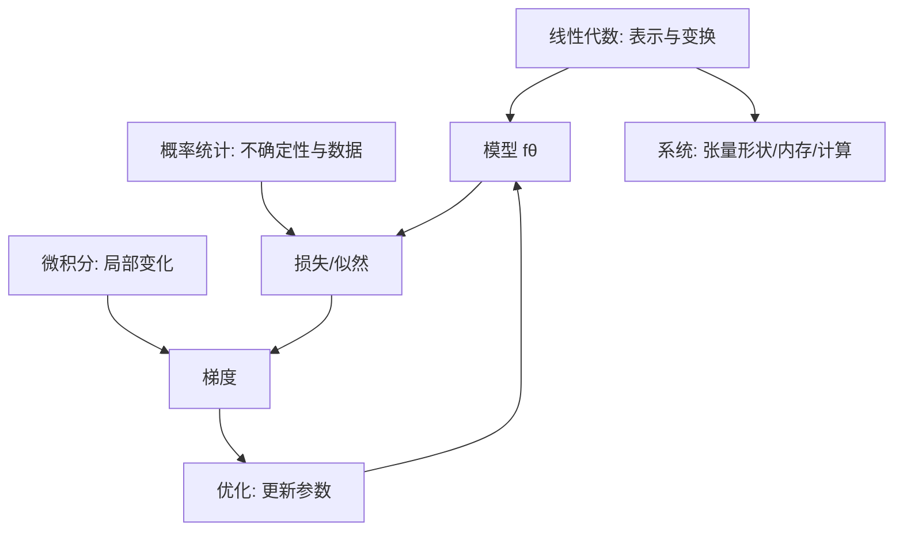
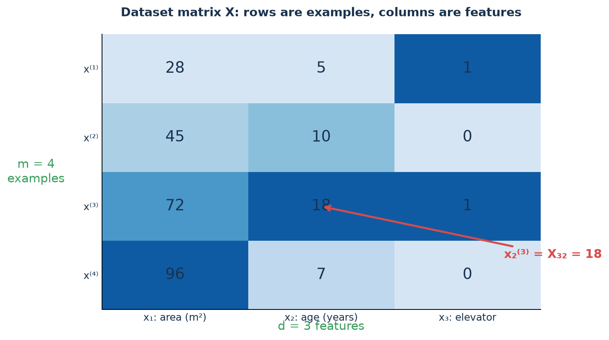
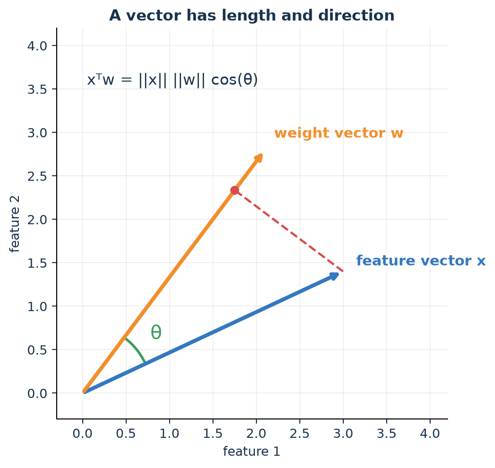
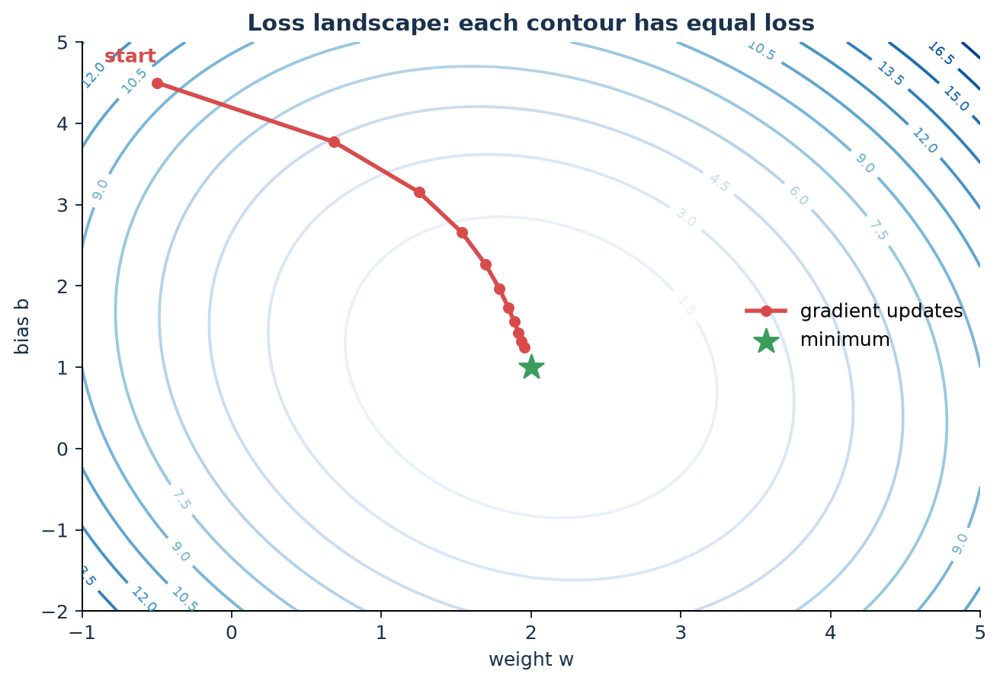
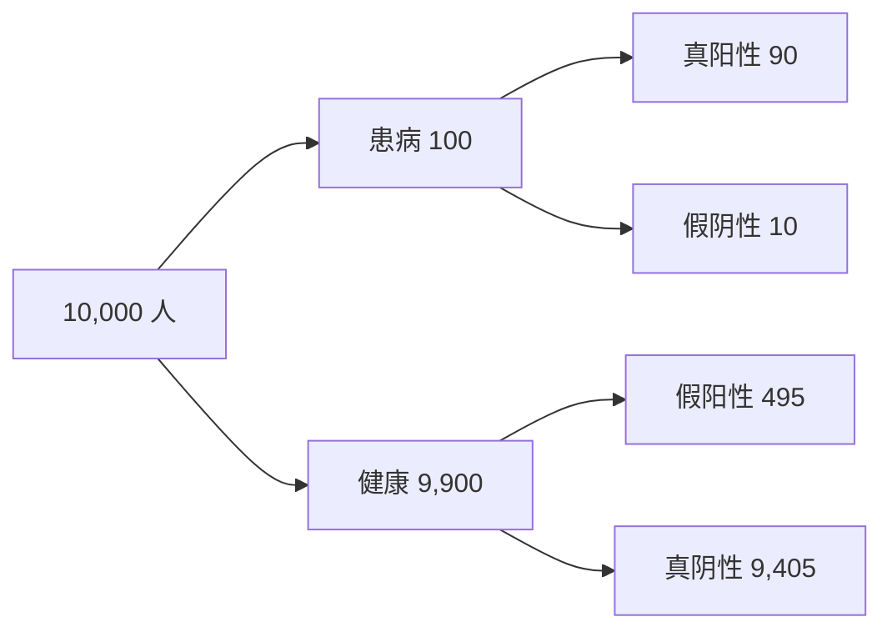
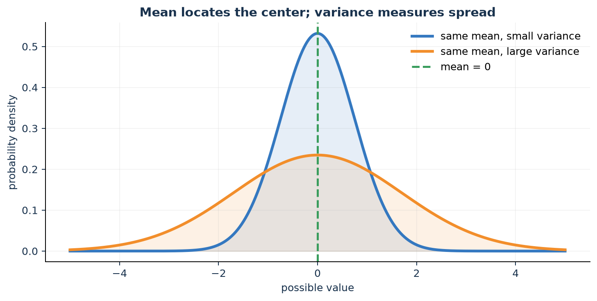

# 第 2 章：机器学习的数学基础

[← 第 1 章](01-what-is-ml.md) | [English](../en/02-math-foundations.md) | [符号约定](appendix-a-notation.md) | [第 3 章 →](03-linear-regression.md)

> 目标不是先学完一本数学书，而是建立一套“遇到公式能读、遇到模型能推、遇到代码能查形状”的工具箱。

> [!TIP]
> **本章不要求一次掌握所有名词。** 主线只需掌握向量/矩阵、梯度、概率、均值方差和梯度下降；
> SVD、Hessian、KL、Adam 等首次阅读只建立“见过、知道解决什么问题”的地图，后续算法用到时
> 再深入。所有数学继续使用第 1 章的房屋表格，而不是突然换成无背景符号。

### 本章学习路线

| 工具 | 先回答的直觉问题 | 章节 |
|---|---|---|
| 线性代数 | 怎样把一行数据变成向量、把许多行一起计算？ | [2.1](#21-标量向量矩阵与张量) |
| 微积分 | 一个参数改变一点，错误会怎样变化？ | [2.2](#22-导数偏导梯度与链式法则) |
| 概率 | 模型如何表达“不确定”和“相信多少”？ | [2.4](#24-概率描述不确定性) |
| 统计 | 有限样本上的结论能否推广到总体？ | [2.6](#26-统计从样本推断总体) |
| 优化 | 知道下坡方向后，怎样稳定走到低处？ | [2.7](#27-优化从方向到走法) |

## 2.0.1 为什么机器学习离不开这些数学？

| 数学工具 | 它解决什么问题 | 如果不会，常见后果 |
|---|---|---|
| 线性代数 | 批量表示数据与模型 | 张量形状错误，不理解 embedding/attention |
| 微积分 | 判断参数怎样改变损失 | 只能调用框架，无法检查梯度与收敛 |
| 概率 | 表达噪声、置信度与生成过程 | 把分数误当概率，损失选择没有依据 |
| 统计 | 从有限样本推断未知总体 | 把偶然提升当成果，忽视偏差与泄漏 |
| 优化 | 在巨大参数空间寻找可用解 | 学习率乱调，loss 发散却不知原因 |

数学不是装饰，而是模型的“说明书”。例如看到 `softmax` 溢出，要靠指数函数与数值稳定性；
看到验证集波动，要靠统计而不是挑一个最好看的随机种子。

## 2.0 一张全景图



知识推导链是：**数据写成向量 → 模型写成矩阵运算 → 概率给出目标 → 微积分给出方向 →
优化算法迭代 → 统计学判断是否能泛化**。

## 2.1 标量、向量、矩阵与张量

- 标量 $a\in\mathbb R$：一个数，如学习率。
- 向量 $x\in\mathbb R^d$：一列特征。
- 矩阵 $X\in\mathbb R^{m\times d}$： $m$ 个样本，每个 $d$ 维。
- 张量：更高维数组；图像批次常为 $[B,C,H,W]$，LLM 隐状态常为 $[B,T,D]$。

### 用“房屋表格”理解四种对象

假设一套房用 `[面积, 房龄, 是否有电梯]` 描述：

- `72` 是标量：只有一个数；
- $x^{(3)}=[72,18,1]^T$ 是向量：描述一套房；
- $X\in\mathbb R^{4\times3}$ 是矩阵：同时描述 4 套房；
- 12 个月、100 套房、3 个特征可组成形状 `[12,100,3]` 的三阶张量。

“阶数”和“形状”不要混淆：矩阵是二阶张量，而 $4\times3$ 是它的形状；向量有 3 个元素，
其形状可写 `[3]` 或列向量 `[3,1]`，具体取决于所用工具。



> **图中练习**：蓝色矩阵第 3 行代表哪个对象？第 2 列代表哪个属性？ $X_{32}$、
> $x_2^{(3)}$ 为什么是同一个数？

若 $X\in\mathbb R^{m\times d}$、 $w\in\mathbb R^d$，则

$$\hat y=Xw+b\mathbf 1\in\mathbb R^m.$$

矩阵乘法内维必须相等： $(m\times d)(d\times1)=(m\times1)$。写公式时标注形状，能消灭
大量代码 bug。

### 矩阵乘法到底在算什么？

取一套房 $x=[72,18,1]^T$ 和权重 $w=[38,-6,120]^T$：

$$w^Tx=38\times72+(-6)\times18+120\times1=2748.$$

每个“特征 × 权重”产生一份贡献，再把贡献相加。若再加截距 $b=800$，预测为 3548。
将 1000 套房叠成 $X$ 后，`X @ w + b` 一次得到 1000 个预测；这就是矩阵运算的价值：
把重复的逐行计算交给高度优化的硬件。

### 点积为什么代表相似性？

$$x^Tz=\|x\|_2\|z\|_2\cos\theta.$$

归一化后，点积就是余弦相似度。推荐双塔模型与 RAG 向量检索常据此给候选项打分；
Transformer attention 中的 $q^Tk$ 也在计算 query 与 key 的匹配程度。



把向量想成地图上的箭头：元素决定终点，范数是箭头长度，方向表示“特征组合”。两个归一化
向量方向相近，夹角小、余弦接近 1；方向相反时接近 -1；垂直时点积为 0。

**小例子**：用户偏好向量 $u=[0.8,0.2]$ 表示更爱科幻而非爱情；电影 A 为
$v_A=[0.9,0.1]$，电影 B 为 $v_B=[0.1,0.9]$。 $u^Tv_A=0.74$， $u^Tv_B=0.26$，因此最简单的
向量推荐会优先 A。真正系统的向量有数百维，但计算思想相同。

### 范数：先认识以后限制模型的两把尺子

$$\|w\|_1=\sum_j|w_j|,\qquad \|w\|_2=\sqrt{\sum_jw_j^2}.$$

$L_2$ 惩罚倾向于让权重整体变小； $L_1$ 的尖角几何更容易产生精确的零，因而可做稀疏选择。
LLM 的 weight decay 与 $L_2$ 思想相关，但在 AdamW 中将衰减从梯度更新中解耦。

这里先认识两种“长度”即可，不要求选择算法。第 3 章会先展示高次模型和共线特征怎样失败，
再把加入 $L_2$ 的方法命名为 Ridge、加入 $L_1$ 的方法命名为 Lasso。

> **为什么限制权重大小？** 若模型靠巨大正负权重相互抵消来穿过训练点，输入轻微变化就可能
> 引起预测剧烈变化。正则化鼓励更平滑、较不敏感的解，但太强也会把真正信号压没。

### 线性无关、秩与可逆

若一个特征能由其他特征线性组合得到， $X$ 的列不满秩， $X^TX$ 可能不可逆，线性回归的
参数解不唯一。实践中可删除冗余特征、加正则，或使用数值更稳定的 QR/SVD/伪逆。

### 特征值、SVD 与低秩：为什么能压缩？

特征向量满足 $Av=\lambda v$：经过变换后方向不变，只缩放 $\lambda$。任意矩阵可写成

$$X=U\Sigma V^T.$$

奇异值矩阵 $\Sigma$ 按重要程度描述不同方向。只保留最大的 $r$ 个奇异值，就得到优秀的
秩 $r$ 近似。PCA、图片压缩、推荐矩阵分解以及 LoRA 的低秩更新都建立在“有效信息集中在
少数方向”这一思想上。

> **课堂追问**：一个 $1000\times1000$ 权重矩阵若用两个秩 8 的矩阵表示更新，参数量从多少
> 变成多少？压缩为什么可能损失信息？

### 广播不是免费的魔法

`X + b` 中，框架可能把 $b$ 沿 batch 维逻辑复制。必须从末尾维度向前检查：维度相同、
其中一个为 1，或该维不存在才可广播。错误广播有时不会报错，却会产生语义错误。

## 2.2 导数、偏导、梯度与链式法则

导数回答：“输入轻微变化，输出变化多快？”

$$f'(x)=\lim_{h\to0}\frac{f(x+h)-f(x)}{h}.$$

### 先用一个数理解导数

只有一个训练样本：输入 $x=2$，真实目标 $y=5$，模型是 $\hat y=wx$：

$$J(w)=(2w-5)^2.$$

- $w=1$ 时，预测 2、损失 9；导数 $J'(w)=4(2w-5)=-12$；
- 导数为负表示稍微增大 $w$ 会让损失下降；
- $w=2.5$ 时预测 5、损失 0、导数也为 0。

导数不是“函数的答案”，而是当前位置的坡度。相同函数在不同 $w$ 上导数不同。

多变量函数 $J(w_1,\ldots,w_d)$ 的梯度为

$$\nabla_wJ=\begin{bmatrix}\partial J/\partial w_1&\cdots&\partial J/\partial w_d\end{bmatrix}^T.$$

为什么变成“偏导”？参数有多个时，先只改变 $w_1$、暂时固定其他参数，得到
$\partial J/\partial w_1$；对所有参数都做一次，再排成向量，就是梯度。

梯度指向局部上升最快方向，所以梯度下降朝反方向走：

$$w\leftarrow w-\eta\nabla_wJ.$$

为什么导数有用？在当前位置附近，函数可以一阶近似：

$$J(w+\Delta w)\approx J(w)+\nabla J(w)^T\Delta w.$$

取 $\Delta w=-\eta\nabla J$，右侧变化约为 $-\eta\|\nabla J\|^2\le0$。这解释了小步长下
为什么负梯度会下降，也解释了步子过大时一阶近似失效、loss 可能反弹。



图中每条蓝线像地形图的等高线，线上各点损失相同。红点从左上出发，每一步沿局部下坡方向
前进，最后接近绿色最小点。路径弯曲是因为 $w$ 与 $b$ 两个方向的坡度和尺度不同。

> **课堂追问**：如果把学习率增大十倍，红点一定更快到终点吗？它可能出现哪三种现象？

### Jacobian 与 Hessian：梯度还不够时

- Jacobian 收集“向量对向量”的全部一阶偏导，是反向传播中形状变化的地图。
- Hessian $H_{ij}=\partial^2J/\partial w_i\partial w_j$ 描述曲率。

Newton 法用 $w\leftarrow w-H^{-1}\nabla J$ 根据曲率调步长，但大模型无法存储完整 Hessian；
现代优化器使用对角、低秩或统计近似。

### 链式法则就是反向传播

若 $z=wx+b,\ \hat y=\sigma(z),\ L=\ell(\hat y,y)$，则

$$\frac{\partial L}{\partial w}
=\frac{\partial L}{\partial\hat y}
 \frac{\partial\hat y}{\partial z}
 \frac{\partial z}{\partial w}.$$

神经网络反向传播没有另一本质：缓存前向计算中的局部量，再从后向前连乘并累加梯度。

## 2.3 从平方误差完整推导梯度

先用单变量模型 $\hat y^{(i)}=wx^{(i)}+b$，均方误差

$$J(w,b)=\frac1m\sum_{i=1}^m(wx^{(i)}+b-y^{(i)})^2.$$

令 $e^{(i)}=wx^{(i)}+b-y^{(i)}$。由链式法则：

$$
\frac{\partial J}{\partial w}
=\frac1m\sum_i 2e^{(i)}\frac{\partial e^{(i)}}{\partial w}
=\frac2m\sum_i e^{(i)}x^{(i)},
\qquad
\frac{\partial J}{\partial b}=\frac2m\sum_i e^{(i)}.
$$

于是：

$$w\leftarrow w-\eta\frac2m\sum_i e^{(i)}x^{(i)},\qquad
b\leftarrow b-\eta\frac2m\sum_i e^{(i)}.$$

向量化后， $e=Xw+b\mathbf1-y$：

$$\nabla_wJ=\frac2mX^Te,\qquad \frac{\partial J}{\partial b}=\frac2m\mathbf1^Te.$$

**形状检查**： $X^T$ 是 $d\times m$，乘 $e\in\mathbb R^m$ 得到 $d$ 维，正好与 $w$ 同形。

## 2.4 概率：描述不确定性

为什么预测还要概率？“模型认为阳性”没有说明把握程度，而 $P(y=1\mid x)=0.51$ 与 0.99
应触发不同决策。概率让我们表达不确定性、组合证据、设置阈值并计算期望风险。

### 条件概率与贝叶斯公式

$$P(A\mid B)=\frac{P(A\cap B)}{P(B)},\qquad
P(\theta\mid D)=\frac{P(D\mid\theta)P(\theta)}{P(D)}.$$

- $P(\theta)$：看数据前的先验。
- $P(D\mid\theta)$：参数为 $\theta$ 时看到数据的可能性，即似然。
- $P(\theta\mid D)$：看数据后的后验。

### 贝叶斯公式的具体例子：阳性不一定患病

假设某病在人群中的患病率为 1%，检测对患者有 90% 概率报阳性，对健康者有 5% 概率误报。
随机检查 10,000 人：



阳性共有 $90+495=585$ 人，其中真正患病只有 90 人：

$$P(患病\mid 阳性)=\frac{90}{585}\approx15.4\%.$$

检测本身不差，结果仍出人意料，是因为健康人的基数非常大。这叫**基础率效应**。医学筛查、
欺诈检测、异常检测都不能只看“准确率”或“检测灵敏度”。

朴素贝叶斯用于经典文本分类；现代生成模型也在建模条件概率。LLM 将
$p(x_{1:T})$ 分解为 $\prod_t p(x_t\mid x_{<t})$。

### 期望、方差与协方差

$$\mathbb E[X]=\sum_xxp(x),\quad
\mathrm{Var}(X)=\mathbb E[(X-\mu)^2],$$

$$\mathrm{Cov}(X,Y)=\mathbb E[(X-\mu_X)(Y-\mu_Y)].$$



图中两个分布中心都在 0，因此均值相同；蓝色更集中，方差小，橙色尾部更宽，方差大。
只报告平均租金无法说明市场是否稳定；只报告模型平均误差也可能隐藏少量极端错误。

协方差为零只说明无线性相关，一般不等于独立。PCA 寻找协方差矩阵方差最大的方向；
BatchNorm/LayerNorm 则围绕激活的统计量稳定训练。

### 常见分布

| 分布 | 用途 | AI 连接 |
|---|---|---|
| $\mathrm{Bernoulli}(p)$ | 二分类 | 点击/不点击 |
| $\mathrm{Categorical}(p)$ | 多分类 | 下一个 token |
| $\mathrm{Gaussian}(\mu,\sigma^2)$ | 连续噪声 | 回归、扩散模型加噪 |
| Uniform | 等可能采样 | 初始化、随机探索 |

### 独立、条件独立与 i.i.d.

独立指 $p(x,y)=p(x)p(y)$；条件独立指给定 $z$ 后
$p(x,y\mid z)=p(x\mid z)p(y\mid z)$。许多教材假设样本独立同分布（i.i.d.），但时间序列、
同一用户点击和推荐反馈环路都违反它。这个假设决定了随机切分是否可信。

## 2.5 最大似然为何变成常见损失

假设回归噪声 $\epsilon^{(i)}\sim\mathcal N(0,\sigma^2)$，即
$y^{(i)}=w^Tx^{(i)}+b+\epsilon^{(i)}$。那么

$$p(y^{(i)}\mid x^{(i)};w,b)=\frac1{\sqrt{2\pi\sigma^2}}
\exp\left[-\frac{(y^{(i)}-w^Tx^{(i)}-b)^2}{2\sigma^2}\right].$$

独立样本的联合似然是乘积。乘法易下溢，且 log 单调，所以最大化似然等价于最大化
对数似然。去掉与参数无关的常数：

$$
\arg\max_{w,b}\log p(y\mid X;w,b)
=\arg\min_{w,b}\sum_i(y^{(i)}-w^Tx^{(i)}-b)^2.
$$

所以 MSE 不是随意拍脑袋：它对应高斯噪声假设。类似地，Bernoulli/Categorical 的最大
似然导出二元/多类交叉熵，正是分类器和 LLM 的常用损失。

### MLE、MAP 与后验分布到底有什么区别？

假设参数是 $\theta$，数据是 $D$：

| 方法 | 数学目标 | 它回答什么 |
|---|---|---|
| MLE 最大似然 | $\hat\theta_{MLE}=\arg\max_\theta p(D\mid\theta)$ | 哪个参数最能解释已观察数据？ |
| MAP 最大后验 | $\hat\theta_{MAP}=\arg\max_\theta p(\theta\mid D)$ | 结合先验后，哪个参数最可能？ |
| 贝叶斯后验 | 保留完整 $p(\theta\mid D)$ | 参数还有多大不确定性？ |

由贝叶斯公式：

$$p(\theta\mid D)\propto p(D\mid\theta)p(\theta).$$

MLE 只看似然；MAP 还乘先验。数据少时先验影响大，数据很多且似然集中时二者常接近。

**抛硬币例子**：只抛 2 次且都是正面，MLE 给正面概率 $\hat\theta=1$。若先验认为大多数硬币
接近公平，MAP 会给小于 1 的估计，避免因两个样本就断言“永远正面”。这不是篡改数据，而是把
数据量不足时的已有知识明确写进模型。

高斯先验 $p(w)\propto\exp(-\alpha\|w\|_2^2)$ 的负对数产生 $L_2$ 正则；Laplace 先验的
负对数产生 $L_1$ 正则。因此后续的 Ridge/Lasso 既可从“控制模型复杂度”理解，也可从 MAP
理解。此处是概率视角预告，正式选择方法放在[第 3 章 3.6 节](03-linear-regression.md#36-基线失败以后问题怎样一步步产生新方法)。

完整贝叶斯预测不会只塞入一个参数点，而会对后验平均：

$$p(y_{\ast}\mid x_{\ast},D)=\int p(y_{\ast}\mid x_{\ast},\theta)p(\theta\mid D)\,d\theta.$$

它能表达参数不确定性，但积分常难以精确计算，需要采样或变分近似。MAP 只是后验峰值，不等于
后验均值，也不提供完整不确定性。

> **课堂追问**：数据非常少时 MLE 为什么容易极端？正则化系数变大，在 MAP 视角相当于先验
> 变强还是变弱？

### Softmax 与交叉熵为什么配在一起？

对 logits $z\in\mathbb R^K$，softmax 将任意实数变为总和为 1 的概率：

$$p_k=\frac{e^{z_k}}{\sum_je^{z_j}},\qquad L=-\sum_ky_k\log p_k.$$

one-hot 标签下， $L=-\log p_{true}$：正确类别概率越小，惩罚越大。推导可得

$$\frac{\partial L}{\partial z}=p-y.$$

这给分类器与 LLM 每个 token 一个清晰更新信号。实现时先令 $z\leftarrow z-\max(z)$；softmax
不变，但避免 $e^z$ 溢出。

**三分类算一遍**：logits 为 $z=[2,1,0]$，softmax 后约为
$p=[0.665,0.245,0.090]$。若正确类别是第 1 类，损失 $-\log0.665\approx0.408$；若正确类别
是第 3 类，损失 $-\log0.090\approx2.408$。模型自信地把正确类排在最后，受到更大惩罚。

> **为什么 logits 不直接叫概率？** 它们可为负、可大于 1、总和也不必为 1；softmax 才把
> 相对分数转换成分类分布。概率还需要校准，高 softmax 值不自动等于真实正确率。

### 熵、交叉熵与 KL 散度

$$H(p)=-\sum_xp(x)\log p(x),\qquad H(p,q)=-\sum_xp(x)\log q(x),$$

$$D_{KL}(p\|q)=\sum_xp(x)\log\frac{p(x)}{q(x)}=H(p,q)-H(p).$$

训练时真实分布 $p$ 固定，最小化交叉熵等价于最小化 $D_{KL}(p\|q)$。知识蒸馏让学生模型
逼近教师分布；VAE、策略优化和 RLHF 中也会出现 KL 约束。

## 2.6 统计：从样本推断总体

- 样本均值 $\bar x=\frac1m\sum_ix^{(i)}$ 是总体均值的估计。
- 大数定律说明样本均值随样本增加趋近真实期望。
- 中心极限定理说明许多条件下样本均值近似正态，有助于构造置信区间。
- 相关不等于因果；推荐系统中“点击的人更爱某内容”可能是系统先曝光造成的。

### 点估计、区间估计与假设检验

报告“准确率提高 0.3%”只是点估计。还应给出不同随机种子或 bootstrap 置信区间，并问提升
是否超过自然波动。统计显著不等于实际重要：0.01% 的稳定提升在十亿请求上可能重要，10% 的
小样本提升也可能只是偶然。

> **课堂追问**：同一测试集比较两个模型时，为什么配对 bootstrap 往往比把两组结果当作独立
> 样本更合理？

### 偏差—方差分解（平方损失）

在固定 $x$ 处，期望预测误差可分成：

$$\mathbb E[(y-\hat f(x))^2]
=\underbrace{\sigma^2}_{\text{不可约噪声}}
+\underbrace{(\mathbb E\hat f(x)-f(x))^2}_{\text{偏差}^2}
+\underbrace{\mathbb E[(\hat f(x)-\mathbb E\hat f(x))^2]}_{\text{方差}}.$$

简单模型常偏差高，复杂模型常方差高；正则化、更多数据和集成方法改变这组权衡。

## 2.7 优化：从“方向”到“走法”

| 方法 | 每次用多少数据 | 特点 |
|---|---:|---|
| Batch GD | 全部 | 稳定但大数据慢 |
| SGD | 1 个 | 噪声大、更新快 |
| Mini-batch GD | 一小批 | GPU 友好，深度学习默认 |

学习率过小会爬得慢；过大会跨过谷底甚至发散。特征标准化
$x'=(x-\mu)/\sigma$ 可让不同方向尺度接近，优化更容易。

### 标准化算一遍

面积 `[40, 60, 80]` 的均值为 60，标准差约 16.33。标准化后约为
`[-1.225, 0, 1.225]`。房龄可能本来只有 `[1, 5, 9]`；标准化让面积与房龄不再因为单位
数值大小相差悬殊，从而让同一个学习率更容易兼顾两个方向。

> **为什么均值和标准差只能在训练集上计算？** 验证/测试集代表未来未知数据。提前使用它们的
> 统计量，等于在训练阶段偷看了考卷分布，会产生轻微但真实的数据泄漏。

学习率的三种典型现象：

| 学习率 | loss 曲线 | 下一步 |
|---|---|---|
| 太小 | 缓慢、稳定下降 | 适当增大或用调度器 |
| 合适 | 较快下降并趋于平台 | 在验证集选择停止点 |
| 太大 | 振荡、突然爆炸或 NaN | 减小学习率并检查梯度/尺度 |

Momentum 用速度积累方向；Adam 用一阶与二阶矩的移动平均自适应缩放。它们改变“怎么走”，
不改变最终在优化哪个目标。非凸神经网络还会遇到鞍点、平坦区与多个极小值。

### 为什么要区分 epoch、batch 与 step？

- batch：一次更新读取的样本集合；
- step/iteration：一次参数更新；
- epoch：全体训练样本大致被看过一遍。

若有 10,000 个样本、batch size 为 100，一轮约有 100 steps。增大 batch 会减少每轮更新次数、
降低梯度噪声并提高硬件利用率，但需要更多内存，学习率也常需随之调整。

### 数值梯度校验

$$\frac{\partial J}{\partial w_j}\approx
\frac{J(w_j+\epsilon)-J(w_j-\epsilon)}{2\epsilon}.$$

它很慢，只用于小模型检查手推/反向传播是否正确，不用于训练。

## 2.8 可运行实验：梯度下降与梯度校验

运行：

```bash
python code/chapter02/gradient_descent_demo.py
```

核心实现：

```python
error = X @ w + b - y
loss = np.mean(error ** 2)
dw = (2 / len(X)) * X.T @ error
db = 2 * np.mean(error)
w -= learning_rate * dw
b -= learning_rate * db
```

完整脚本会生成带噪声数据、切分训练/测试集、标准化、训练、报告 RMSE，并用有限差分检查
解析梯度。注意标准化的均值与标准差只从训练集计算，否则会泄漏测试信息。

## 2.9 CS249r 系统连接：公式也有成本

矩阵乘 $XW$ 的计算量大约随 $m d k$ 增长，存储随张量元素数增长。对 LLM：

- 参数与优化器状态决定训练显存；
- attention 的 $T\times T$ 分数矩阵使朴素注意力随序列长度呈二次增长；
- 量化用更少 bit 表示数，节省内存/带宽，但可能引入误差；
- batch 增大通常提高吞吐，却增加内存并可能提高单请求等待时间。

所以同一个线性代数表达式，代数上等价，运行成本未必相同。系统优化经常是在保持近似数学
语义的前提下，重排、融合或压缩运算。

## 2.10 苏格拉底导师

<details><summary>Q1：为什么梯度下降要减去梯度，而不是加上？</summary>

梯度是函数局部上升最快方向；其反方向是一阶近似下下降最快的方向。学习率控制步长。
</details>

<details><summary>Q2：如果两个向量点积很大，能否断言方向相似？</summary>

不能。点积同时受长度与夹角影响。先做 $L_2$ 归一化后，点积才等于余弦相似度。
</details>

<details><summary>Q3：MSE 隐含什么数据假设？异常值多时会怎样？</summary>

最大似然解释下，它假设独立、同方差的高斯噪声。平方会放大异常值影响；可考虑 MAE、
Huber loss 或显式使用更合适的噪声模型。
</details>

<details><summary>Q4：为什么对数能把最大似然的乘积变成求和，却不改变最优点？</summary>

对数严格单调，所以保持大小次序；同时 $\log\prod_i p_i=\sum_i\log p_i$，更稳定也更易求导。
</details>

<details><summary>Q5：训练 loss 变成 NaN，先检查什么？</summary>

学习率过大、除零、 $\log 0$、指数溢出、输入尺度、异常数据和梯度爆炸；打印有限性、范围和
梯度范数，从第一个出现非有限值的运算向前追。
</details>

## 2.11 练习

完成后对照：[第 1～3 章提示、参考答案与评分标准](solutions/01-03-solutions.md)。

1. **形状**：若 $X:[32,128]$、 $W:[128,64]$，写出 $XW$ 形状与乘加数量级。
2. **推导**：为 $J(w)=\frac1m\|Xw-y\|_2^2+\lambda\|w\|_2^2$ 推导梯度。
3. **概率**：证明最大化 Bernoulli 似然等价于最小化二元交叉熵。
4. **编程**：把示例的 MSE 换成 MAE；不可导点如何处理？比较有异常值时的表现。
5. **系统**：估算形状为 $[B,T,D]=[8,2048,4096]$ 的 FP16 张量占多少 MiB。

## 2.12 面试八股与追问

- **矩阵的秩？** 线性无关行/列的最大数量；反映有效维度。
- **特征值/特征向量？** $Av=\lambda v$；变换后方向不变、长度缩放，PCA 用其找主方向。
- **协方差为 0 是否独立？** 一般不是；联合高斯是常见特例。
- **MLE 与 MAP？** MLE 最大化似然；MAP 最大化后验，相当于加入先验，常对应正则化。
- **L1 与 L2？** L1 倾向稀疏、零点不可导；L2 平滑收缩，优化稳定。
- **为什么用 log-sum-exp？** 避免直接指数产生上溢/下溢：先减去最大值再计算。
- **SGD 为何可能帮助泛化？** mini-batch 噪声可能偏向较平坦解，但不是无条件保证。
- **凸函数的好处？** 任意局部最优也是全局最优；严格凸时最优解至多一个。

**白板追问**：softmax 为什么要减去最大 logit？AdamW 与 L2 正则是否完全相同？奇异矩阵
如何求解线性回归？

## 本章检查点

不要背完整公式表。你应当能做到三件事：

1. 为每个矩阵写形状并检查运算合法性；
2. 从损失通过链式法则推到参数梯度；
3. 从概率假设解释为什么选择某个损失，并意识到计算/内存成本。

- [ ] 我能手算一个三维点积，并解释它为何可表示相似性。
- [ ] 我能从单样本平方误差推到 $w,b$ 的梯度。
- [ ] 我能用 10,000 人树形例子解释基础率效应。
- [ ] 我能手算三个 logits 的 softmax 与正确类别交叉熵。
- [ ] 我能说明均值相同为何不代表两个分布相同。
- [ ] 我能根据 loss 曲线判断学习率太小、合适或太大。

### 扩展阅读

- [CS229 Lecture Notes](https://cs229.stanford.edu/main_notes.pdf)
- [全课程符号与默认约定](appendix-a-notation.md)

回看：[第 1 章的问题定义](01-what-is-ml.md#12-从一张表开始样本特征与标签) ·
[继续：第 3 章线性回归 →](03-linear-regression.md)
