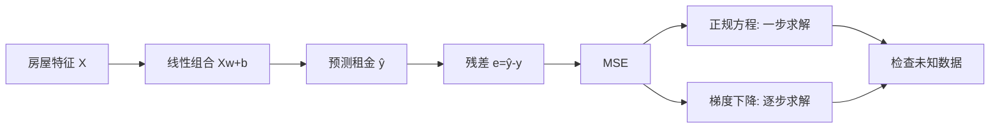
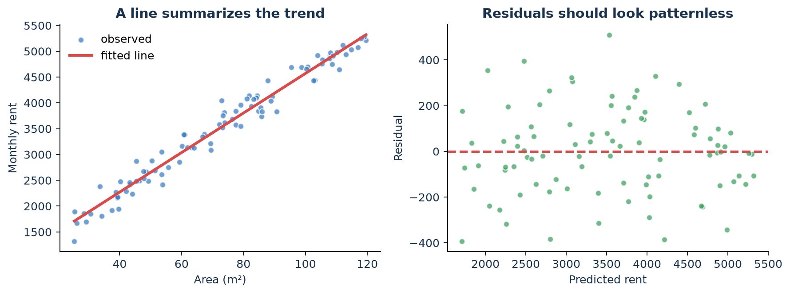
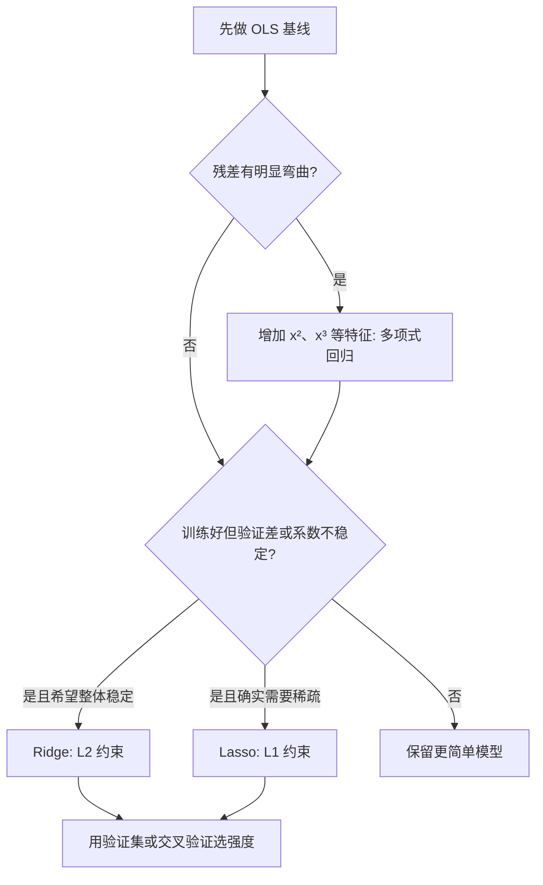
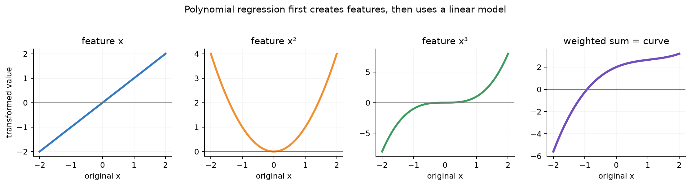
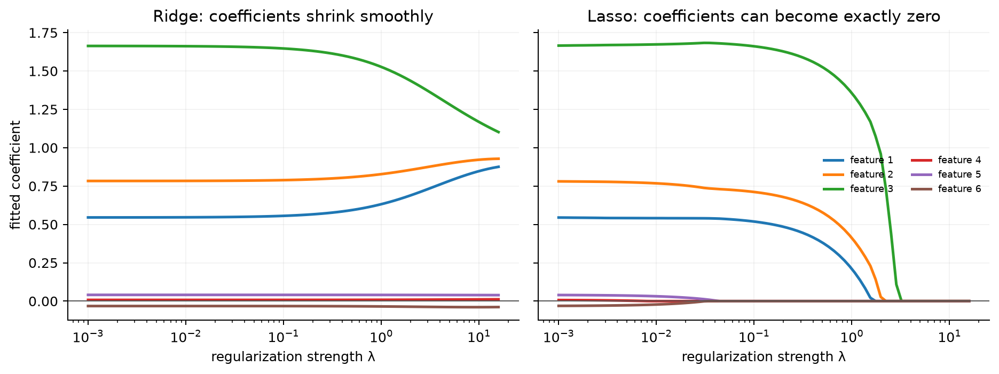
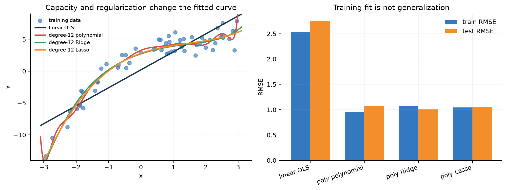
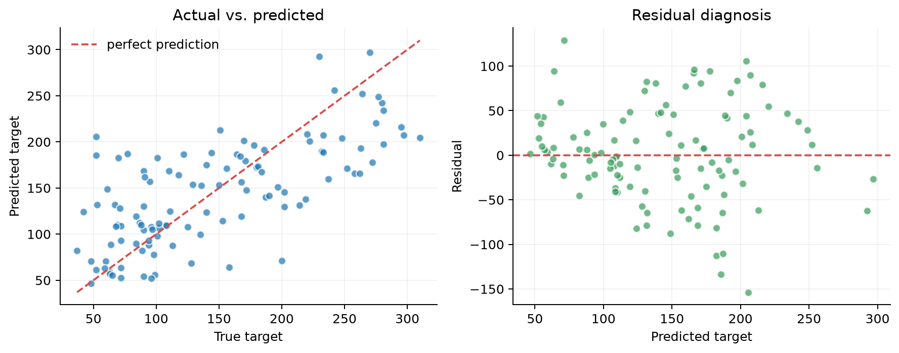

# 第 3 章：线性回归——第一条完整算法链

[← 数学基础](02-math-foundations.md) | [English](../en/03-linear-regression.md) | [符号约定](appendix-a-notation.md) | [课程设计](00-course-roadmap.md)

> 先修：[经验风险最小化](01-what-is-ml.md#127-损失函数模型错了多少)、
> [矩阵与梯度](02-math-foundations.md#23-从平方误差完整推导梯度)、
> [高斯噪声与 MLE](02-math-foundations.md#25-最大似然为何变成常见损失)。

> [!NOTE]
> **为什么第一种算法先学线性回归？** 因为它足够简单，可以完整看见“数据—假设—损失—
> 求解—评估—诊断”的闭环；同时它又足够重要，神经网络线性层、回归头、推荐打分和 LoRA
> 都延续它的线性代数。

## 3.1 一个问题，两种求解方式

预测房租：面积每增加一平方米，房租平均增加多少？线性回归假设

$$y=w^Tx+b+\epsilon,\qquad \epsilon\sim\mathcal N(0,\sigma^2).$$

它不是声称世界完全线性，而是在问：“在给定特征范围内，一条直线是不是有用、可解释的
近似？”

### 先看数据，不要急着调用 `fit`

下面是教学数据中的五个样本；真实项目还要检查单位、缺失值、重复房源和采集时间。

| 面积（m²） | 月租（示意） | 单位面积租金 | 初步观察 |
|---:|---:|---:|---|
| 28 | 1,864 | 66.6 | 小户型单价可能较高 |
| 45 | 2,510 | 55.8 | 接近总体趋势 |
| 72 | 3,760 | 52.2 | 同面积仍可能波动 |
| 96 | 4,585 | 47.8 | 不能只看总价 |
| 118 | 5,245 | 44.4 | 边界样本较少 |


观察这组数据时，可以依次看中心（典型租金）、离散程度（同面积差多少）、整体形状（直线还是曲线），再看
看异常与覆盖（边界有没有足够样本）。散点近似直线支持线性基线，但不证明因果，也不保证
对 120 m² 以外的房子仍成立。

> **为什么不能直接画一条穿过所有点的曲线？** 因为每个点同时包含稳定规律和随机噪声；
> 穿过噪声会得到训练集的漂亮答案，却损害对新房源的预测。



## 3.2 知识推导链

1. 选模型：$f_{w,b}(x)=w^Tx+b$。
2. 假设观测值围绕直线有高斯噪声。
3. 最大似然等价于最小化残差平方和。
4. 对目标求梯度，可迭代更新；令梯度为零，也可得到解析解。
5. 在未见数据上用 RMSE/MAE/$R^2$ 验证假设是否有用。
6. 看残差图检查非线性、异方差、异常值与遗漏变量。

### 再看三个线性回归例子

| 场景 | 特征 | 目标 | 线性模型提供什么 |
|---|---|---|---|
| 实验室能耗 | 温度、设备时长 | 每日 kWh | 每个因素的边际关联与预测基线 |
| 广告校准 | 原始模型分数 | 实际转化率 | 把偏高/偏低的分数校准到现实比例 |
| LLM 线性探针 | 冻结的 hidden state | 属性标签/连续得分 | 检查表征能否被线性读出 |

线性模型对参数线性，不要求对原始输入只能画直线。加入 $x^2$、交互项 $x_1x_2$ 后仍可用
线性回归求参数，但特征工程扩大了模型容量，也带来过拟合风险。

## 3.3 目标与解析解

将常数列并入 $X$，参数记为 $\theta=[b,w_1,\ldots,w_d]^T$：

$$J(\theta)=\frac1m\|X\theta-y\|_2^2.$$

展开并求导：

$$
J=\frac1m(X\theta-y)^T(X\theta-y),\qquad
\nabla_\theta J=\frac2mX^T(X\theta-y).
$$

令梯度为零：

$$X^TX\theta=X^Ty\quad\Rightarrow\quad
\hat\theta=(X^TX)^{-1}X^Ty.
$$

这叫正规方程。代码中不要显式求逆，优先 `lstsq`、QR 或 SVD；它们在共线或病态问题上
更稳定。这里先把**没有正则项的普通最小二乘**（Ordinary Least Squares，OLS）学完整；当残差、验证误差或系数稳定性暴露
问题后，3.6 节才引出多项式、Ridge 和 Lasso。这样每个新名字都对应一个已经看见的痛点。

### 为什么解析解仍可能“不可靠”？

“公式能算出答案”不等于“答案可信”。样本太少、特征共线、训练分布窄、异常点或遗漏变量，
都可能让系数不稳定。数值可解性、统计可识别性与因果可解释性是三件不同的事。

## 3.4 梯度下降解

$$\theta\leftarrow\theta-\eta\frac2mX^T(X\theta-y).$$

解析解适合中小规模线性问题；特征很多或数据流式到达时，mini-batch 优化更容易扩展。

| 维度 | 正规方程/最小二乘 | 梯度下降 |
|---|---|---|
| 调参 | 无学习率 | 需学习率与停止条件 |
| 精度 | 直接、稳定算法精度高 | 近似，取决于收敛 |
| 规模 | 大量特征时代价高 | 可 mini-batch、可加速 |
| 通用性 | 主要针对线性最小二乘 | 可复用到深度模型 |

## 3.5 指标与诊断

$$\mathrm{RMSE}=\sqrt{\frac1m\sum_i(y^{(i)}-\hat y^{(i)})^2},\qquad
R^2=1-\frac{\sum_i(y^{(i)}-\hat y^{(i)})^2}{\sum_i(y^{(i)}-\bar y)^2}.$$

$R^2=1$ 是完美拟合；$R^2=0$ 与预测均值相当；测试集 $R^2$ 可以为负，表示比均值基线还差。

为什么同时看 RMSE 和 MAE？RMSE 对大错误更敏感，适合“大错代价更高”的任务；MAE 与目标
同单位且更抗异常值。指标应由错误代价决定，而不是哪一个数字更好看。



画“预测值—残差”图：理想残差在 0 周围无结构散布。

- 弯曲图案：缺少非线性项；
- 漏斗形：异方差，误差方差随输入改变；
- 孤立大残差：异常点或数据错误；
- 训练好、测试差：过拟合、漂移或泄漏。

相关系数高不保证因果。房屋面积的系数可能混合了地段效应；遗漏变量会让解释失真。

### 先不记模型名：看曲线越来越灵活会发生什么


先只观察现象：一条直线太僵硬，训练与验证都差；适度弯曲的曲线抓住总体形状；高度弯曲的
曲线在训练点之间剧烈摆动。下一节才解释这些曲线怎样由多项式特征得到。
最后一种曲线的训练 MSE 可能最小，却会在新点尤其是边界处产生荒谬预测。这说明：**拟合能力越强，
不等于泛化能力越强。**

过拟合的判断与防治详见[第 1 章完整对照](01-what-is-ml.md#15-拟合欠拟合过拟合与泛化)。

到这里先停一下：我们已经完整走完 **OLS 主线**——定义模型、构造 MSE、求解、在未知数据上
评估、检查残差。下面的新方法不再是突然出现的名词，而是从诊断结果自然长出来的“修理工具”。

## 3.6 基线失败以后：问题怎样一步步产生新方法？

先记住唯一主干：**永远先训练简单 OLS 基线，再根据证据决定是否增加容量或增加约束。**



### 3.6.1 第一种失败：直线太僵硬——多项式回归

若房租残差随面积呈 U 形，说明“一条直线”漏掉了弯曲趋势。最小改动不是立刻换复杂模型，而是
先创建新特征：

$$x\longrightarrow [x,x^2,x^3],\qquad
\hat y=w_0+w_1x+w_2x^2+w_3x^3.$$



它叫多项式**回归**，但底层仍是线性回归：模型对待学习参数 $w$ 仍是线性的。变化发生在输入
表示上。次数越高，自由度越大；它能表达弯曲，也更容易追随噪声。

**例子**：温度与耗电量常呈 U 形——太冷要供暖、太热要制冷。只用温度的一次项会漏掉这种
关系，加入温度平方项便可能表达它。相反，在样本只有 30 个时加入 20 次项通常很危险。

> **为什么不一开始就用 20 次多项式？** 更大模型包含简单模型，却也有更多方式迎合偶然噪声；
> 训练误差只会更好或不变，验证误差却可能变坏。

### 3.6.2 第二种失败：模型太自由——正则化

高次特征、特征很多或特征高度相关时，模型可能用巨大正负系数相互抵消。训练点稍微变化，预测
就大幅变化。正则化的思想是：**允许拟合数据，但对过于复杂的参数方案收取额外代价。**

先认识两个工具即可：

| 方法 | 在 MSE 后增加什么 | 直观效果 | 何时优先考虑 |
|---|---|---|---|
| Ridge（岭回归） | $\lambda\|w\|_2^2$ | 所有系数较平滑地缩小 | 共线、很多弱信号、重视稳定预测 |
| Lasso（套索回归） | $\lambda\|w\|_1$ | 一些系数可恰好变成 0 | 有稀疏假设、确实需要简化特征 |



横轴 $\lambda$ 是正则强度。向右时约束更强：Ridge 的系数通常平滑靠近 0；Lasso 会让一部分
系数直接落到 0。$\lambda=0$ 时二者退回普通最小二乘；过大时又会把真实信号一起压没，造成
欠拟合。因此 $\lambda$ 是用验证集/交叉验证选择的**超参数**，不是训练集上学出的普通参数。

带 Ridge 的目标和解析解现在才有了出现理由：

$$J_\lambda(\theta)=\frac1m\|X\theta-y\|_2^2+\lambda\|w\|_2^2,$$

$$\hat\theta=(X^TX+m\lambda I)^{-1}X^Ty.$$

实际的 $I$ 通常不惩罚截距。特征要先按训练集统计量标准化，否则单位大的特征会受到不公平的
惩罚。Lasso 在 0 处不可导，通常用坐标下降或近端梯度，而不是直接套用普通解析解。

> **重要限制**：Lasso 把系数压成 0，不等于该特征没有信息，更不等于没有因果作用。两个高度
> 相关的特征可能互相替代，Lasso 只留下其中一个。

### 3.6.3 在同一数据上公平比较

运行：

```bash
python code/chapter03/regression_family_comparison.py
```



把图中的现象与模型问题对应起来：

1. OLS 的直线抓不住弯曲趋势，训练和测试 RMSE 都较高，是欠拟合证据；
2. 12 次多项式训练误差很低，但边界出现摆动，说明容量提高也放大了方差；
3. Ridge 和 Lasso 保留多项式的弯曲能力，同时限制系数；本次固定划分中 Ridge 测试 RMSE 最低；
4. 这不证明 Ridge 永远最好。换数据、随机划分或 $\lambda$，结论可能变化。

公平选择流程是：统一预处理和数据划分 → 在训练折拟合 → 用验证折选择次数与 $\lambda$ → 最后
只在测试集验收一次。不能看完测试结果再调模型。

### 3.6.4 选择口诀不是“背模型名”，而是回答诊断问题

| 观察到的证据 | 先尝试什么 | 为什么 |
|---|---|---|
| 训练、验证都差，残差弯曲 | 少量多项式/交互特征 | 增加缺失的表达能力 |
| 训练好、验证差 | 降低次数或加 Ridge/Lasso | 控制方差 |
| 系数随抽样剧烈变化、特征共线 | Ridge | 稳定整体系数与预测 |
| 有领域依据相信只有少数特征有效 | Lasso，再检查稳定性 | 得到稀疏方案 |
| OLS 已足够好 | 保留 OLS | 简单模型更易解释、验证与部署 |

再用三个具体情境练习，不先看模型名：

- **校园能耗**：温度与耗电残差呈 U 形，训练和验证都差。先加温度平方项；这是“表达能力不足”。
- **房屋面积**：平方米、平方英尺换算列和卧室数高度相关，重复抽样时系数乱跳。先删重复信息或
  用 Ridge；这是“同一信号被多列重复表达”。
- **基因表达**：特征有两万个、样本只有数百个，且研究目标确实需要候选特征清单。可把 Lasso
  作为稀疏基线，但必须用交叉验证和重复抽样检查入选特征是否稳定。

> **苏格拉底追问**：若校园能耗的训练、验证误差都很高，此时直接增大 Ridge 的 $\lambda$ 会
> 更好吗？如果两个相关特征被 Lasso 留下不同的一个，能否把任意一次结果当科学发现？

Elastic Net（$L_1+L_2$）和 Huber 回归先作为后续路标：前者折中稀疏与稳定，后者降低异常值
影响。此处不要求记忆；第 9 章会在模型选择与学习理论中系统比较。

## 3.7 两条选修支线：样本可靠性与局部规律

下面不是 OLS 主线的必备步骤，只在问题假设确实成立时使用。

### 3.7.1 加权最小二乘：不是每个样本都同样可靠

若专业评估样本比字段缺失的抓取样本更可信，可给预先有依据的可靠度 $r^{(i)}$：

$$J(\theta)=\sum_i r^{(i)}(y^{(i)}-\theta^Tx^{(i)})^2,\qquad
\hat\theta=(X^TRX)^{-1}X^TRy.$$

$R=\mathrm{diag}(r^{(1)},\ldots,r^{(m)})$。权重必须来自测量机制或任务代价，不能为了让结果
好看而事后修改。

### 3.7.2 局部加权回归：不同位置使用不同的局部直线

对查询点 $x_q$，附近样本权重大：

$$r^{(i)}=\exp\left(-\frac{\|x^{(i)}-x_q\|^2}{2\tau^2}\right).$$

$\tau$ 大时接近全局直线；太小时追随少数邻居而过拟合。它每次查询都重新拟合，预测成本会随
数据量增长，因此不一定适合大规模在线系统。这是后续 kNN、核方法和 RAG “邻近样本更重要”
思想的预告。

## 3.8 从零实现与可靠对照

运行：

```bash
python code/chapter03/linear_regression.py
```

脚本在同一训练集上比较：

```python
theta_closed = np.linalg.lstsq(x_design, y, rcond=None)[0]

for _ in range(steps):
    error = x_design @ theta_gd - y
    gradient = (2 / len(y)) * x_design.T @ error
    theta_gd -= learning_rate * gradient
```

两者预测应几乎一致。若不一致，依次检查：是否同样标准化、截距是否重复、学习率是否收敛、
损失中的 $1/m$ 与梯度系数是否一致。

脚本还调用 `sklearn.linear_model.LinearRegression` 作框架对照，并实现一维局部加权预测。
三个全局解的测试预测通过断言逐项比较：不是“看起来差不多”，而是自动检查是否一致。

### 为什么既要手写又要调用框架？

- 手写实现暴露损失、梯度、形状和数值问题，回答“底层怎样工作”；
- 框架实现提供成熟求解器、参数检查和工程接口，回答“真实项目怎样可靠使用”；
- 两者对照能发现自己的推导或数据处理错误。只做任一边都不完整。

### 3.8.1 从教学数据走向真实数据

合成房租数据帮助我们知道正确规律，因此适合检查算法；但它过于干净，不能证明方法能处理现实。
第二个实验使用 scikit-learn 内置的 Diabetes 回归数据：442 个样本、10 个数值特征，目标是
疾病进展的定量指标。运行：

```bash
python code/chapter03/real_dataset_baseline.py
```



实验同时报告均值基线、RMSE、MAE、$R^2$ 和 paired bootstrap 95% 区间。图左虚线代表完美
预测；散点离虚线越远，误差越大。图右检查残差是否随预测值呈系统结构。

> [!WARNING]
> 这是教学基准，不是临床模型。数据小、特征含义有限、随机切分未模拟医院/时间漂移；不能从
> 一个 $R^2$ 推导医疗可用性或因果结论。真实医疗部署还需要外部验证、公平性、安全与监管审查。

数据说明见 [scikit-learn 官方文档](https://scikit-learn.org/stable/modules/generated/sklearn.datasets.load_diabetes.html)。

## 3.9 线性回归在现代 AI 中并没有消失

- **神经网络**：`Linear` 层就是 $XW+b$；深度来自线性变换与非线性激活的交替。
- **LLM probing**：冻结 embedding，用线性探针判断表征是否编码某种信息。
- **推荐**：Wide & Deep 的 wide 部分、校准和连续目标预估仍会使用线性思想。
- **LoRA**：用低秩矩阵 $\Delta W=BA$ 表示权重更新，建立在线性代数与秩之上。
- **系统**：大模型主要计算仍是矩阵乘；融合、量化和并行都围绕它优化。

线性回归也是极好的基线：如果复杂模型只提高一点，应追问额外延迟、成本与不可解释性是否值得。

## 3.10 苏格拉底导师

<details><summary>Q1：增加一个特征，训练集 MSE 会变大吗？测试集呢？</summary>

若优化充分且模型嵌套，训练 MSE 不会变大，因为新系数可设为 0；测试误差可能变大，新增特征
会增加方差或引入伪相关。
</details>

<details><summary>Q2：为何不在代码里直接计算 $(X^TX)^{-1}$？</summary>

显式求逆更慢、数值误差更大；$X^TX$ 还会使条件数平方。`lstsq` 的 QR/SVD 路线更可靠。
</details>

<details><summary>Q3：特征乘以 100，模型预测一定改变吗？</summary>

重新无正则地拟合时，系数会缩小为原来的 $1/100$，预测可不变；但优化速度、正则化强度和
系数解释会改变，因此仍应关注尺度。
</details>

<details><summary>Q4：线性模型怎样表达曲线？</summary>

对参数线性即可。加入 $x^2,x^3$ 后，$y=w_0+w_1x+w_2x^2$ 对 $w$ 仍是线性回归。
</details>

## 3.11 练习与研究延伸

完成后对照：[第 1～3 章提示、参考答案与评分标准](solutions/01-03-solutions.md)。

1. 推导带 $L_2$ 正则的梯度，并验证解析解。
2. 加入异常点，比较 MSE、MAE 和 Huber loss。
3. 构造两个高度相关的特征，观察系数如何不稳定，再加入 Ridge。
4. 把面积扩展为面积、房龄、地段三特征；报告单位、缺失值策略和残差图。
5. 研究题：冻结一个小型文本 embedding，训练线性探针；说明“可线性读出”不等于模型使用了该信息。

## 3.12 面试八股

- **基本假设？** 对参数线性、误差条件均值为零；做经典区间推断时还常假设独立、同方差、正态。
- **多重共线性？** 特征高度相关使系数方差大、解释不稳定；预测未必同样糟。
- **为什么最小二乘对异常值敏感？** 残差被平方，大误差获得更大权重。
- **$R^2$ 越高越好吗？** 训练 $R^2$ 随无关特征也不降；看调整 $R^2$、验证结果与任务指标。
- **Ridge 与 Lasso？** Ridge 用 $L_2$ 稳定并收缩；Lasso 用 $L_1$，可产生稀疏系数。
- **闭式解和梯度下降如何选？** 依据规模、稀疏性、在线需求与是否要复用复杂目标的优化框架。

**追问**：OLS 无偏需要正态误差吗？为什么 $X^TX$ 的条件数更坏？正则化前为何要标准化？

## 一句话收束

线性回归把整门课第一次闭环：**建模假设 → 概率解释 → 损失 → 两种优化 → 独立评估 →
残差诊断 → 系统取舍**。此后算法只是逐步放宽假设、改变损失或扩大模型族。

- [ ] 我能从 MSE 推导梯度和正规方程，并说明为何代码不显式求逆。
- [ ] 我能解释 Gaussian 噪声假设如何导出最小二乘。
- [ ] 我能比较全局、加权与局部加权回归的假设和成本。
- [ ] 我能解释 RMSE、MAE、$R^2$ 和均值基线分别回答什么。
- [ ] 我能从残差图识别非线性、异方差和异常点迹象。
- [ ] 我能先说出观察到的失败证据，再决定使用多项式、Ridge 或 Lasso。
- [ ] 我知道多项式增加容量，Ridge/Lasso 增加约束，二者不是同一维度的选择。
- [ ] 我能用 NumPy 与 scikit-learn 得到一致预测，并理解每一步形状。

### 扩展阅读

- [CS229 Lecture Notes：Linear Regression](https://cs229.stanford.edu/main_notes.pdf)
- [scikit-learn LinearRegression](https://scikit-learn.org/stable/modules/generated/sklearn.linear_model.LinearRegression.html)
- [scikit-learn Diabetes dataset](https://scikit-learn.org/stable/modules/generated/sklearn.datasets.load_diabetes.html)

[继续：把“预测多少”改成“预测属于哪一类”——第 4 章逻辑回归 →](04-logistic-regression.md)
