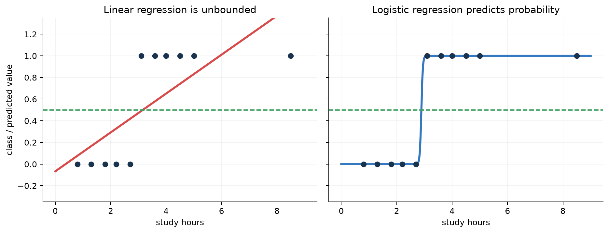
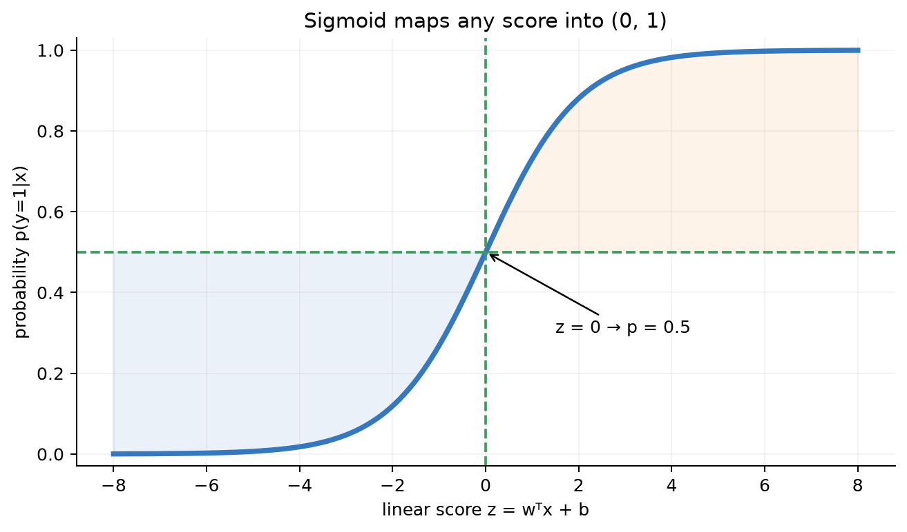
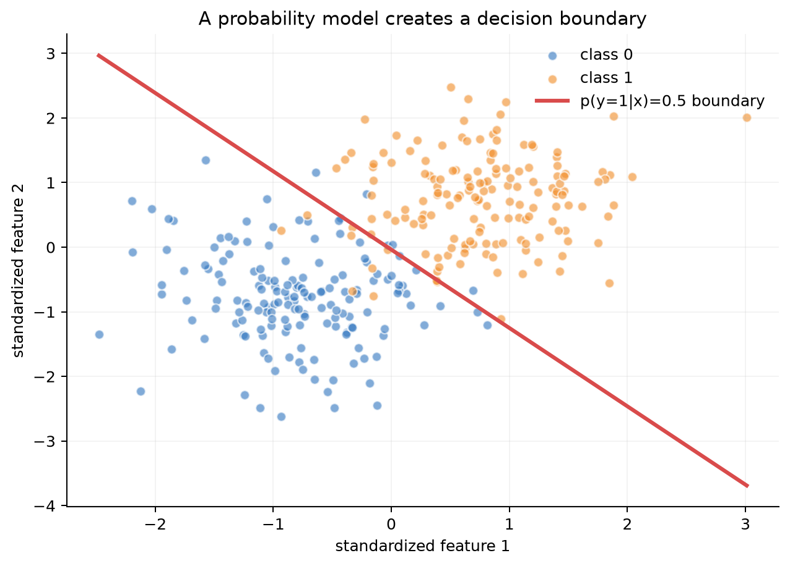
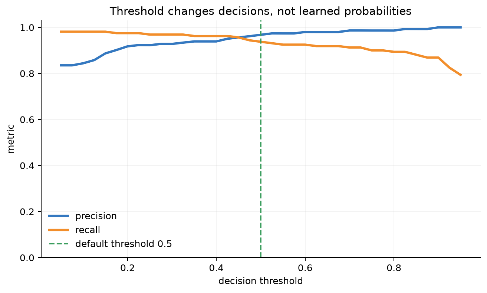
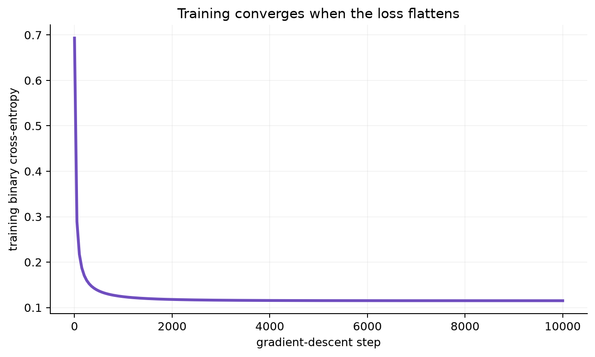

# 第 4 章：逻辑回归、感知机与广义线性模型

[← 第 3 章](03-linear-regression.md) | [English](../en/04-logistic-regression.md) | [符号约定](appendix-a-notation.md) | [课程设计](00-course-roadmap.md)

> **先修**：[样本、特征与标签](01-what-is-ml.md#12-从一张表开始样本特征与标签)、
> [最大似然、MAP 与后验](02-math-foundations.md#25-最大似然为何变成常见损失)、
> [梯度与链式法则](02-math-foundations.md#22-导数偏导梯度与链式法则)。

> [!IMPORTANT]
> 逻辑回归（Logistic Regression）名字里有“回归”，但它通常是**分类算法**。它先计算线性
> 分数，再把分数转换成类别概率。

### 从第 3 章自然走到这里

第 3 章的问题是“这套房月租多少钱”，标签是连续数值。现在租客换了一个决策问题：“月租是否
超过 4000 元？”特征仍可用面积、地段、楼龄，但标签变成 0/1：

| 同一套房屋数据 | 回归任务 | 分类任务 |
|---|---|---|
| 标签 | 月租 4585 元 | 是否超过预算：1 |
| 模型输出 | 任意实数 | 0 到 1 的概率 |
| 损失 | 平方误差 | Bernoulli 交叉熵 |
| 最终用途 | 给出价格估计 | 根据风险和预算阈值做决定 |

因此本章不是另起炉灶：仍然计算 $w^Tx+b$、仍然用梯度下降，只是输出类型改变后，概率假设和
损失函数也必须一起改变。下面再用“学习时长—是否通过”作为第二个易画图例子。

## 本章学习路线


学完后，你不仅要会调用 `.fit()`，还要能从 Bernoulli 假设推导二元交叉熵和梯度，并解释
概率、类别、阈值、决策边界之间的区别。

## 4.1 为什么分类不能直接照搬线性回归？

假设根据学习时长预测“是否通过考试”，标签 $y\in\{0,1\}$：

| 学习时长 | 真实标签 |
|---:|---:|
| 0.8 h | 0（未通过） |
| 2.2 h | 0 |
| 3.1 h | 1（通过） |
| 5.0 h | 1 |

线性回归可以拟合一条直线，再以 0.5 为阈值分类，但会遇到三个问题：

1. 输出无边界，可能预测 $-0.3$ 或 $1.4$，不能直接解释为概率；
2. 远处新增样本会拉动整条直线和 0.5 交点；
3. 平方误差不是 Bernoulli 标签最自然的概率目标。



左图的红线越过 $[0,1]$；右图把输出限制为概率。逻辑回归仍保留线性模型的可解释边界，但换了
输出函数和损失。

> **为什么不把线性预测强行裁剪到 0～1？** 裁剪区域的梯度会变成 0，模型不知道应该怎样继续
> 修正；裁剪也没有给出一致的概率生成模型。

## 4.2 Sigmoid：把线性分数变成概率

先计算 logit/线性分数：

$$z=w^Tx+b.$$

再通过 sigmoid：

$$\sigma(z)=\frac1{1+e^{-z}},\qquad
p(y=1\mid x)=\sigma(w^Tx+b).$$



- $z=0\Rightarrow p=0.5$；
- $z$ 很大且为正， $p$ 接近 1；
- $z$ 很小且为负， $p$ 接近 0；
- 输出永远在 $(0,1)$，不会真正等于端点。

sigmoid 的导数为

$$\sigma'(z)=\sigma(z)(1-\sigma(z)).$$

它在 $z=0$ 附近最大，两端接近 0。若模型给出非常极端的错误分数，单独看 sigmoid 会出现
饱和；交叉熵与 sigmoid 合并推导后，logit 梯度会简化为 $p-y$。

### 什么是 logit？

概率 $p$ 对应的 odds（几率）是 $p/(1-p)$，log-odds 为

$$\log\frac{p}{1-p}=w^Tx+b.$$

因此权重 $w_j$ 表示：其他特征不变时， $x_j$ 增加 1，log-odds 增加 $w_j$；odds 乘以
$e^{w_j}$。这比直接说“概率增加 $w_j$”准确，因为概率变化还取决于当前所在位置。

## 4.3 从最大似然推导交叉熵

对第 $i$ 个样本，记

$$p^{(i)}=\sigma(w^Tx^{(i)}+b).$$

二分类标签服从 Bernoulli 分布：

$$p(y^{(i)}\mid x^{(i)};w,b)
=(p^{(i)})^{y^{(i)}}(1-p^{(i)})^{1-y^{(i)}}.$$

验证两个情况： $y^{(i)}=1$ 时只剩 $p^{(i)}$； $y^{(i)}=0$ 时只剩 $1-p^{(i)}$。

若样本条件独立，全部数据的似然为

$$\mathcal L(w,b)=\prod_{i=1}^m
(p^{(i)})^{y^{(i)}}(1-p^{(i)})^{1-y^{(i)}}.$$

最大化乘积等价于最小化平均负对数似然：

$$J(w,b)=-\frac1m\sum_{i=1}^m
\left[y^{(i)}\log p^{(i)}+(1-y^{(i)})\log(1-p^{(i)})\right].$$

这就是二元交叉熵（binary cross-entropy, BCE）。它不是任意选择，而是由 Bernoulli 概率模型
和最大似然推出来的。

### 交叉熵为什么会严厉惩罚“自信地犯错”？

若真实 $y=1$：

| 模型概率 $p$ | 损失 $-\log p$ | 含义 |
|---:|---:|---|
| 0.9 | 0.105 | 正确且有信心 |
| 0.5 | 0.693 | 犹豫不决 |
| 0.1 | 2.303 | 自信地判断错误 |
| 0.001 | 6.908 | 极端错误 |

计算机中不要直接算 `log(sigmoid(z))`。稳定形式是

$$\ell(z,y)=\log(1+e^z)-yz,$$

代码可使用 `np.logaddexp(0, z) - y*z`，避免指数溢出和 `log(0)`。

## 4.4 从交叉熵推导梯度

对单个样本：

$$z^{(i)}=w^Tx^{(i)}+b,\qquad p^{(i)}=\sigma(z^{(i)}).$$

链式求导后得到关键结果：

$$\frac{\partial\ell^{(i)}}{\partial z^{(i)}}=p^{(i)}-y^{(i)}.$$

所以

$$
\nabla_wJ=\frac1m\sum_{i=1}^m(p^{(i)}-y^{(i)})x^{(i)}
=\frac1mX^T(p-y),
$$

$$\frac{\partial J}{\partial b}=\frac1m\sum_i(p^{(i)}-y^{(i)}).$$

形状检查： $X^T:[d,m]$， $p-y:[m]$，结果 $[d]$，与 $w$ 相同。

如果 $y=1,p=0.2$，误差信号 $p-y=-0.8$，更新会提高对应 logit；如果 $y=0,p=0.9$，
误差信号为 $0.9$，更新会降低 logit。

加入 $L_2$ 正则后：

$$J_\lambda=J+\frac{\lambda}{2m}\|w\|_2^2,\qquad
\nabla_wJ_\lambda=\frac1mX^T(p-y)+\frac\lambda m w.$$

通常不正则化偏置 $b$。

## 4.5 概率、阈值、类别与决策边界

模型先输出概率 $p$，再由业务阈值 $\tau$ 转成类别：

$$\hat y=\mathbb I[p\ge\tau].$$

默认 $\tau=0.5$ 时，边界满足 $w^Tx+b=0$。两个特征时它是一条直线，三维时是平面，更高维
称超平面。



线性决策边界不表示概率处处线性；概率沿法线方向按 sigmoid 平滑变化。



提高阈值通常减少阳性预测：精确率可能上升，召回率通常下降。0.5 只是数学默认，不是业务真理：
疾病筛查可能降低阈值减少漏诊，垃圾邮件拦截可能提高阈值避免误杀重要邮件。

> **阈值改变会重新训练模型吗？** 不会。它改变概率到行动的规则，不改变已学到的 $w,b$。

## 4.6 从零实现、梯度校验与框架对照

运行：

```bash
python code/chapter04/generate_figures.py
python code/chapter04/logistic_regression.py
```

核心代码：

```python
logits = X @ w + b
probability = sigmoid(logits)
loss = np.mean(np.logaddexp(0.0, logits) - y * logits)
dw = X.T @ (probability - y) / len(X)
db = np.mean(probability - y)
w -= learning_rate * dw
b -= learning_rate * db
```

脚本完成：分层训练/测试切分；只在训练集拟合标准化；有限差分梯度校验；NumPy 训练；
scikit-learn 概率对照；准确率、精确率、召回率；边界和阈值图。

参考运行结果：梯度误差约 $2.5\times10^{-11}$，测试准确率 0.95，NumPy 与框架最大概率差约
0.003。随机数据或库版本变化时数值可能略有差异，关键是断言范围与实验逻辑。



损失先快速下降、随后变平，表示在当前学习率下逐渐接近最优区域。若损失上下震荡或变成
`nan`，先检查学习率、特征尺度和数值稳定性；训练损失下降并不自动证明测试集泛化良好。

## 4.7 分类评估：准确率为什么不够？

第一章已经从具体交易例子讲解了 [TP/FP/FN/TN、常用指标、ROC/PR 与概率指标](01-what-is-ml.md#评估指标模型的好到底是什么意思)。
这里把它们放回逻辑回归：模型输出的概率经过阈值后才形成下面的混淆矩阵，改变阈值会同时改变
TP、FP、FN、TN，因此也会改变 precision、recall 和 F1。

混淆矩阵：

| | 预测正类 | 预测负类 |
|---|---:|---:|
| 真实正类 | TP 真阳性 | FN 假阴性 |
| 真实负类 | FP 假阳性 | TN 真阴性 |

$$\text{Precision}=\frac{TP}{TP+FP},\qquad
\text{Recall}=\frac{TP}{TP+FN}.$$

- 类别平衡且错误代价近似时，准确率直观；
- 正类稀少时看 precision/recall、PR-AUC；
- ROC-AUC 衡量跨阈值排序能力，但极度不平衡时可能显得过于乐观；
- 概率要用于风险决策时，还要看校准曲线、Brier score 或 log loss。

**概率校准**问的是：“所有预测为 0.8 的样本中，是否约 80% 真为正类？”分类正确率高不代表
概率校准好。

## 4.8 感知机：相似的边界，不同的学习目标

感知机通常用 $y\in\{-1,+1\}$，预测

$$\hat y=\mathrm{sign}(w^Tx+b).$$

若样本分类错误，即 $y^{(i)}(w^Tx^{(i)}+b)\le0$，更新：

$$w\leftarrow w+\eta y^{(i)}x^{(i)},\qquad b\leftarrow b+\eta y^{(i)}.$$

| 对比 | 逻辑回归 | 感知机 |
|---|---|---|
| 输出 | 概率 | 硬类别/分数 |
| 损失 | 平滑交叉熵 | 只关心误分类点的感知机损失 |
| 不可分数据 | 仍可优化有限解（常配正则） | 可能持续振荡 |
| 用途 | 概率分类、排序、校准 | 理解在线线性分类与间隔思想 |

感知机为后续 SVM 铺路：仅仅“分对”还不够，SVM 会进一步追求更大的几何间隔。

## 4.9 广义线性模型 GLM：把回归和分类放进同一框架

指数族可以写成

$$p(y;\eta)=b(y)\exp\left(\eta T(y)-a(\eta)\right),$$

其中 $\eta$ 是自然参数， $T(y)$ 是充分统计量， $a(\eta)$ 负责归一化。GLM 有三部分：

1. **随机部分**：选择指数族分布描述 $y$；
2. **线性预测器**： $z=w^Tx+b$；
3. **链接函数**：把 $\mathbb E[y\mid x]$ 与线性分数连接。

| 目标数据 | 分布 | 链接 | 得到的模型 |
|---|---|---|---|
| 连续、近似高斯 | Gaussian | identity | 线性回归 |
| 0/1 | Bernoulli | logit | 逻辑回归 |
| 非负计数 | Poisson | log | Poisson 回归 |

这回答了“为什么线性回归和逻辑回归长得相似”：它们共享线性预测器，但假设的输出分布和链接
函数不同。选模型应先看目标变量性质，而不是习惯性套 MSE。

## 4.10 多分类：从 Sigmoid 到 Softmax

若类别数为 $K$，每类有一个分数

$$z_k=w_k^Tx+b_k,$$

softmax 给出

$$p(y=k\mid x)=\frac{e^{z_k}}{\sum_{j=1}^Ke^{z_j}}.$$

配合多类交叉熵，梯度仍是“预测概率减 one-hot 标签”。实现必须先减最大 logit 保持数值稳定。
另一方法 one-vs-rest 训练 $K$ 个二分类器，但概率不天然共同归一化。

## 4.11 现代 AI 中的逻辑回归思想

- **LLM**：每个 token 的线性 logits 经 softmax 形成下一 token 分布，训练使用交叉熵；
- **推荐/广告**：点击率 CTR 常以二分类概率为目标，log loss 衡量概率质量；
- **奖励模型**：偏好数据可用 Bradley–Terry/逻辑形式建模回答 A 胜过 B 的概率；
- **线性探针**：冻结 embedding，仅训练逻辑回归检查类别信息能否线性读出；
- **安全分类器**：阈值必须按漏检/误杀成本选择，概率还需跨分布校准。

系统视角下，线性分类器推理只需矩阵乘、偏置和 sigmoid，延迟低、可解释，常适合端侧或作为
大模型前后的轻量守门器。

## 4.12 常见失败模式与诊断

| 现象 | 可能原因 | 处理方向 |
|---|---|---|
| 训练/验证都差 | 真边界非线性、特征不足 | 特征工程、核/树/神经网络 |
| 训练好、验证差 | 高维小样本、泄漏、正则不足 | 修复切分、正则、更多数据 |
| 概率接近 0/1 且错得离谱 | 分布漂移、完全分离、校准差 | 正则、校准、漂移监控 |
| 少数类召回为 0 | 类别不平衡、阈值不合适 | 类别权重、重采样、调阈值 |
| loss 出现 NaN | 直接 `log(0)` 或指数溢出 | 从 logits 计算稳定 BCE |
| 系数巨大 | 特征尺度、共线或完全分离 | 标准化、正则、检查数据 |

## 4.13 苏格拉底导师

<details><summary>Q1：逻辑回归为什么叫回归，却做分类？</summary>

它回归的是 log-odds/线性分数对应的概率，再用阈值产生类别；算法用途通常是分类。
</details>

<details><summary>Q2：sigmoid 输出 0.9，是否代表模型有 90% 概率正确？</summary>

只在概率校准良好且部署分布匹配时可近似这样解释。softmax/sigmoid 数值本身不保证校准。
</details>

<details><summary>Q3：把阈值从 0.5 降到 0.2，通常怎样影响召回率？</summary>

更多样本会判为正类，召回率通常上升，但假阳性也会增加，精确率可能下降。
</details>

<details><summary>Q4：为什么 BCE 梯度最后这么简单？</summary>

sigmoid 导数中的 $p(1-p)$ 与对数似然导数中的分母相消，得到 $p-y$。这是规范链接的好处。
</details>

<details><summary>Q5：数据完全线性可分时，无正则逻辑回归会怎样？</summary>

似然可通过不断增大权重继续逼近上界，有限的 MLE 可能不存在；实践中正则化提供有限稳定解。
</details>

<details><summary>Q6：逻辑回归能处理非线性边界吗？</summary>

原始特征上是线性边界；加入多项式/交互特征后可在原空间形成曲线，但仍可能过拟合。
</details>

## 4.14 练习

完成后对照：[第 4 章提示与参考答案](solutions/04-solutions.md)。

1. **手算**： $w=[1,-2]^T,b=0.5,x=[2,1]^T$，计算 $z,p$ 与阈值 0.5 下类别。
2. **推导**：从 Bernoulli 似然推导 BCE，并证明 $\partial\ell/\partial z=p-y$。
3. **实验**：将阈值从 0.1 扫到 0.9，画 precision/recall/F1，按一种业务成本选阈值。
4. **反例**：构造 XOR 数据，说明原始二维逻辑回归为什么失败；加入哪个特征可解决？
5. **正则**：改变 $L_2$ 强度，比较权重范数、训练 loss、验证 loss 和校准。
6. **研究**：在文本 embedding 上训练线性探针；设计多数类、随机特征和不同层表示对照。

## 4.15 面试八股

- **为什么不用 MSE 做逻辑回归？** Bernoulli MLE 自然导出 BCE；其优化性质和概率解释更合适。
- **逻辑回归是线性模型吗？** 决策边界对输入特征线性，概率对线性分数是非线性 sigmoid。
- **odds 与概率关系？** odds = $p/(1-p)$，log-odds 是线性预测器。
- **多分类怎么做？** multinomial softmax 或 one-vs-rest。
- **类别不平衡怎么办？** 先选合适指标，再考虑权重/采样/阈值，并校准真实先验。
- **逻辑回归与朴素贝叶斯？** 前者判别式建模 $p(y\mid x)$；后者生成式建模 $p(x\mid y)p(y)$。
- **逻辑回归与 SVM？** 前者给概率并优化 log loss；SVM 最大化间隔、常用 hinge loss。

## 本章通关标准

- [ ] 我能解释为什么逻辑回归是分类器，并画出 sigmoid。
- [ ] 我能从 Bernoulli 似然推到 BCE，再推到 $X^T(p-y)/m$。
- [ ] 我能区分概率、阈值、类别和决策边界。
- [ ] 我能根据业务成本选择指标和阈值，而非固定使用准确率/0.5。
- [ ] 我能从零实现稳定 BCE，通过梯度校验，并与 scikit-learn 对照。
- [ ] 我能比较逻辑回归、感知机、线性回归及 softmax。

### 扩展阅读

- [CS229 Lecture Notes](https://cs229.stanford.edu/main_notes.pdf)
- [scikit-learn LogisticRegression](https://scikit-learn.org/stable/modules/generated/sklearn.linear_model.LogisticRegression.html)

[继续：从“直接建模 p(y | x)”转向“先建模数据怎样由类别生成”——第 5 章 →](05-generative-classifiers.md)
