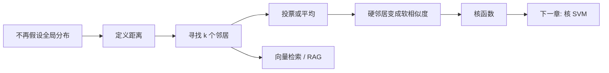
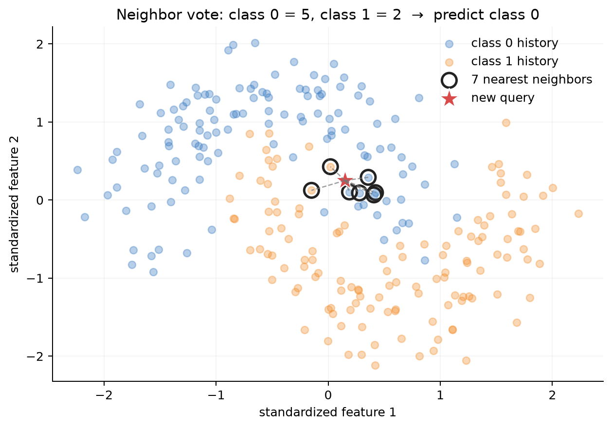
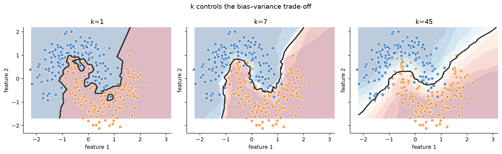
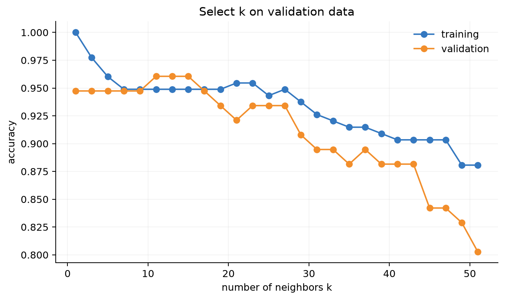
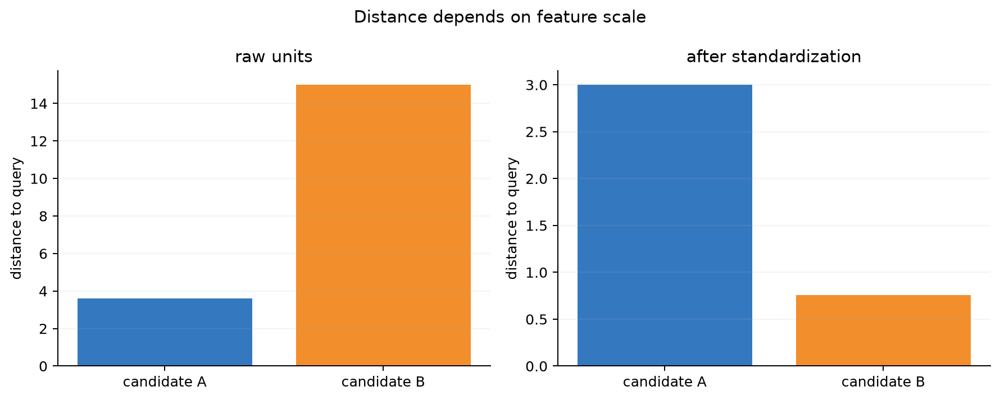
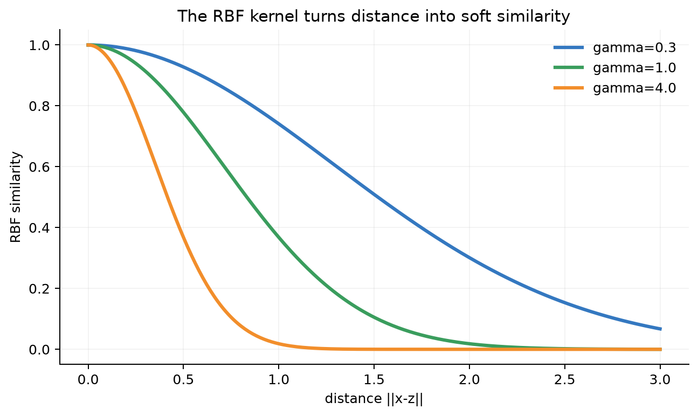

# 第 6 章：从邻居到核方法——kNN、距离、特征映射与 RAG

[← 第 5 章](05-generative-classifiers.md) | [English](../en/06-neighbors-and-kernels.md) | [符号约定](appendix-a-notation.md) | [课程设计](00-course-roadmap.md)

> **先修**：[向量、点积与范数](02-math-foundations.md#21-标量向量矩阵与张量)、
> [训练/验证/测试](01-what-is-ml.md#14-一次完整的机器学习实验)、[偏差与方差](02-math-foundations.md#26-统计从样本推断总体)。

## 从第 5 章自然走到这里

第 5 章必须先选择“一类数据是什么分布”。如果房屋数据是双峰、多峰或形状难以描述，能否不画
全局分布，只问：**与这套房最相似的历史房屋是什么？它们的标签是什么？** 这产生 k 近邻
（k-Nearest Neighbors，kNN）。再把“近/远”变成连续相似度，就走向核方法。



## 6.1 为什么需要 kNN？

考虑一个旧问题：预测一套房是否“适合学生租住”。市中心小户型和大学附近的
合租房都可能适合，郊区大户型也可能不适合。类别边界可能弯曲、多块，难以用一条直线或“每类
一个高斯”描述。

但我们已有大量历史租房记录。面对新房，最自然的问题是：

1. 历史上哪些房子与它最相似？
2. 这些相似房屋多数被学生选择还是拒绝？

这就是需要 kNN 的场景：**我们不愿先假设全局边界或全局分布，但相信相近样本往往拥有相近
标签。** 这个假设叫局部平滑性。

| 旧方法遇到的困难 | kNN 的回答 |
|---|---|
| 逻辑回归边界太直 | 局部投票可形成弯曲甚至多块边界 |
| GDA 的单高斯假设不适合多峰数据 | 不描述整类分布，只参考附近样本 |
| 新业务暂时没有可靠机制模型 | 先以历史相似案例建立可解释基线 |

**三个例子**：相似房屋估价、相似患者辅助诊断、embedding 中检索相似文档。kNN 的价值不是
“一定比前面模型准”，而是提供一个假设不同的局部基线。若“近”没有业务意义，kNN 也不会有效。

> **课堂追问**：如果相邻两套房因为学区边界而价格突然不同，“相近样本标签相近”的假设
> 还可靠吗？距离中是否遗漏了决定性特征？

## 6.2 kNN 到底怎样完成一次预测？

kNN 几乎没有显式训练：它主要保存训练数据。一次分类预测分五步：

1. 把新样本和训练样本放到同一特征空间；
2. 计算新样本到每个训练样本的距离；
3. 从小到大排序，取最近的 $k$ 个；
4. 查看这些邻居的标签；
5. 多数投票得到类别。回归任务则取均值或距离加权均值。



图中的红色五角星是待预测的新样本，黑色空心圆圈出了距离最近的 7 个历史样本，虚线连接了
查询点与每个邻居。数一数被圈出的蓝、橙样本，就能得到这次预测的投票结果；标题同时给出两类票数和
最终预测，票数更多的类别获胜。没有被圈出的点不会参与这一次预测，但另一个查询会有另一组邻居。

现在再把上述步骤写成数学。对查询 $x$，欧氏距离为

$$d(x,x^{(i)})=\sqrt{\sum_{j=1}^d(x_j-x_j^{(i)})^2}.$$

分类可写为

$$\hat y=\operatorname{mode}\{y^{(i)}:i\in\mathcal N_k(x)\}.$$

二分类概率常用邻居正类比例近似，但它并不自动是良好校准概率。

## 6.3 $k$ 为什么决定欠拟合与过拟合？



这张图不是三份数据，而是**同一训练集使用三个不同的 $k$**：圆点是历史样本；背景蓝/红表示
该位置被模型预测为哪一类；黑线是两类预测交界处。三个子图从左到右展示边界怎样随 $k$ 变化：

1. **$k=1$**：每个点都能控制自己附近的小区域。注意黑线形成许多小岛和尖角，这是模型追随
   个别噪声的信号；训练误差接近 0，但换一批数据边界可能大变，称为高方差；
2. **$k=7$**：一次错误标签常会被周围多数票抵消，仍能保留月牙形局部结构；
3. **$k=45$**：一次投票覆盖很大区域，黑线非常平滑，却开始忽略局部弯曲，偏差增大。

因此 $k$ 不是“邻居越多越可靠”：它控制模型在**相信局部细节**和**用更多样本平均噪声**之间
的取舍。图只能建立直觉，不能替我们选择 $k$。



这张图横轴是 $k$，纵轴是准确率。蓝线是训练集，橙线是从未参与拟合的验证集。$k=1$ 时训练
准确率为 1 并不值得庆祝；真正关心的是橙线。橙线在中等 $k$ 附近较高，随后下降，呈现“过度
平滑”。应在橙线较优且稳定的区域选择 $k$，而不是挑蓝线最高点。

$k$ 是超参数，必须在验证集或交叉验证中选择。类别不平衡时不能只看 accuracy，还应看
macro-F1、召回率或业务成本。测试集只能做最后一次验收。

> **为什么常取奇数？** 二分类时减少平票，但不能解决距离并列、类别不平衡或多分类平票；仍需
> 明确 tie-breaking 规则。

## 6.4 距离不是自然真理：尺度、表示与度量



左图直接把“平方米差”和“卧室数差”相加：候选 A 看起来更近。右图按训练数据的典型波动缩放
后，A 的卧室数差异变得显著，候选 B 反而更近。柱高不是预测概率，而是到查询房屋的距离。

若面积取值几十到几百、卧室数只有 1～5，原始欧氏距离会几乎只看面积。标准化必须只在训练集
拟合，再应用于验证/测试集，否则发生数据泄漏。

常见度量：

| 度量 | 公式/思想 | 适合场景 |
|---|---|---|
| 欧氏距离 | $\|x-z\|_2$ | 已缩放的连续特征 |
| Manhattan | $\|x-z\|_1$ | 稀疏/异常值影响需减弱 |
| cosine | $x^Tz/(\|x\|\|z\|)$ | 文本 embedding 方向相似 |
| 马氏距离 | 考虑协方差 | 相关、不同尺度特征 |

缺失值、类别变量、时间和地理坐标不能不加思考地塞进欧氏距离。距离表达的是任务中的“不相似
成本”，选择表示往往比选择搜索算法更重要。

## 6.5 从零实现：训练很轻，预测很重

对 $q$ 个查询和 $m$ 个训练样本，暴力 kNN 计算全部距离需约 $O(qmd)$；保存数据需 $O(md)$。
核心代码：

```python
distance2 = ||Q||² + ||X||² - 2 * Q @ X.T
nearest = np.argpartition(distance2, k - 1, axis=1)[:, :k]
prediction = majority_vote(y[nearest])
```

运行：

```bash
python code/chapter06/neighbors_and_kernels.py
python code/chapter06/course_lab.py
```

第一个脚本生成本章图片并对照 scikit-learn；`course_lab.py` 是适合逐行阅读的教学实现，会打印
kNN 邻居编号、每个核权重、核预测值以及不同 $\gamma$ 的验证 MSE。

固定实验输出：

```text
scratch_test_accuracy=0.926
sklearn_prediction_agreement=1.000
```

KD-tree/ball-tree 在低维可能加速；高维时常退化。大规模系统使用近似最近邻（ANN）、量化和
分片，以少量召回损失换延迟与内存。

## 6.6 维度灾难：高维中“最近”还近吗？

维度增加时，要维持相同邻域覆盖率，需要指数级更多样本；最近与最远距离的相对差异也可能缩小。
无关维度会污染距离。这不是说高维检索一定失败：现代 embedding 通过训练把语义压入有结构的
空间，但仍要用 Recall@k、人工相关性和切片评估检查。

**反例**：给二维月牙数据追加 500 个随机噪声特征，欧氏近邻可能由噪声决定。修复方向包括特征
选择、降维、度量学习、更好的 embedding 和更多数据，而不只是换一个 $k$。

## 6.7 从硬邻居到软邻居：核函数

kNN 对前 $k$ 名赋权、其余为 0。核方法用连续函数衡量任意两点相似度。RBF 核：

$$K(x,z)=\exp(-\gamma\|x-z\|_2^2).$$



横轴是两点距离，纵轴是相似度：距离为 0 时三条曲线都等于 1；向右移动时相似度下降。蓝线
$\gamma=0.3$ 下降慢，较远样本仍有影响；橙线 $\gamma=4$ 下降快，只信任非常近的样本。

$\gamma$ 小：影响范围宽，模型更平滑；$\gamma$ 大：只相信非常近的点，模型更局部、更易过拟合。
它与局部加权回归的带宽是同一个思想。

### 用核权重完成一次预测

核函数不只是画一条“相似度曲线”。它可以让所有训练样本参与预测，但距离近的样本权重大：

$$
\hat y(x)=\frac{\sum_iK(x,x^{(i)})y^{(i)}}{\sum_iK(x,x^{(i)})}.
$$

设三个一维训练点为 $x=[0,1,3]$，回归标签为 $y=[0,2,6]$，查询点是 $x=1.5$，取
$\gamma=1$。三个平方距离为 $[2.25,0.25,2.25]$，RBF 权重约为
$[0.105,0.779,0.105]$。归一化后得到

$$
\hat y\approx
\frac{0.105\times0+0.779\times2+0.105\times6}{0.105+0.779+0.105}
\approx2.21.
$$

它与 kNN 的区别是：没有一道“第 $k$ 名之后全部归零”的硬门槛。$\gamma$ 太小会把远处样本也
平均进来而欠拟合，太大又几乎只相信最近一点而高方差，因此仍要在验证集选择。

### 特征映射与核技巧

设 $\phi(x)$ 把输入映射到高维特征。若算法只通过内积使用特征，则可以直接计算

$$K(x,z)=\phi(x)^T\phi(z),$$

而不显式构造 $\phi(x)$。这叫核技巧。多项式核 $(x^Tz+c)^p$ 隐式包含多项式交互；RBF 核
对应无限维特征空间的内积直觉。

不是任意“相似度”都是合法核。训练点的 Gram 矩阵 $K_{ij}=K(x^{(i)},x^{(j)})$ 应对称且
半正定：对任意 $a$，$a^TKa\ge0$。下一章在 SVM 对偶中会看见核为何可以直接替换点积。

## 6.8 与现代 AI 的联系：embedding、推荐召回与 RAG

### LLM 与 RAG：近邻不生成答案，但决定模型先看到什么

RAG 的检索阶段与 kNN 共享骨架：文档切块 → embedding → ANN 索引 → 查询向量 → top-k →
重排 → 送入 LLM。这里 kNN/ANN 负责找候选证据，LLM 负责基于上下文生成；两者不能混为一个
模型。“向量相近”也不等于“答案可靠”：还要检查语料覆盖、切块、过滤、时间有效性、权限、引用
和生成模型是否真正使用了证据。

| 经典概念 | 现代系统对应 |
|---|---|
| 特征向量 | embedding |
| 距离/相似度 | cosine、dot product、learned score |
| 邻居数量 $k$ | retrieval top-k |
| 精确搜索 | ANN 索引 |
| 标签投票 | 文档聚合、重排或上下文构造 |

### 推荐系统：先从百万物品中召回几百个

推荐系统常分为召回与排序两阶段。召回可把用户和物品映射到 embedding，用内积或 cosine 找
top-k；排序再用更复杂模型综合价格、上下文和行为特征。这里的 $k$ 影响召回覆盖率、延迟和后续
排序成本，不是越大越好。常见离线指标包括 Recall@k、Precision@k、MRR 和 NDCG。

### 表征学习：距离的质量来自训练目标

原始像素、词频或混合单位表格中的欧氏距离往往没有语义。对比学习、双塔模型和度量学习通过
“拉近正对、推远负对”塑造 embedding 空间，再让 kNN/ANN 工作。因此现代系统的关键经常不是
换搜索算法，而是训练出更符合任务的表示。

### 核方法与现代网络：联系在“改变表示”，但不要说成同一种模型

核函数隐式把输入映射到高维特征，深度网络则显式学习多层非线性表示；二者都说明“换一个表示
后，简单边界可能足够”。但 Transformer 并不是核 SVM，attention 中的相似度也不自动满足
Mercer 核条件。联系是建模思想，不是算法等价。

## 6.9 失败诊断与选择

| 症状 | 原因 | 修复 |
|---|---|---|
| 某一特征主宰邻居 | 未缩放 | 训练集标准化/合理度量 |
| 边界碎片化 | $k$ 太小、噪声 | 增大 $k$、距离加权、清洗数据 |
| 少数类总被淹没 | 类别不平衡 | 类别距离权重、重采样、合适指标 |
| 高维性能差 | 距离集中/噪声维度 | 表征学习、降维、度量学习 |
| 离线好线上慢 | 暴力搜索 | ANN、压缩、缓存、批处理 |

## 6.10 苏格拉底导师

<details><summary>为什么 kNN 被称为非参数方法？</summary>
不是“没有参数”，而是模型容量/存储随数据增长，不能由固定维度参数完全概括。
</details>

<details><summary>cosine 相似度高是否意味着欧氏距离近？</summary>
只有归一化等条件下关系才直接；cosine 忽略向量长度，欧氏距离保留长度差异。
</details>

<details><summary>kNN 几乎不训练，为什么仍然会过拟合？</summary>
过拟合取决于预测规则的有效复杂度，不取决于训练代码运行多久。$k=1$ 可为每个噪声点建立一个
局部小岛，训练误差很低而验证误差较高。
</details>

<details><summary>ANN 没有保证找到真正最近邻，为什么工业系统仍愿意使用？</summary>
精确搜索在百万到十亿向量上可能无法满足延迟和成本要求。ANN 用少量 Recall@k 损失换取数量级
加速；是否值得必须由端到端回答质量、延迟和成本共同验证。
</details>

<details><summary>RBF 相似度为 0.9，能否解释为“两样本有 90% 概率同类”？</summary>
不能。核值是由距离和 $\gamma$ 定义的相似度，不是自动校准的类别概率。要得到概率还需要具体
概率模型和校准证据。
</details>

<details><summary>检索 Recall@10 很高，为什么 RAG 仍可能答错？</summary>
相关证据可能排序太后、切块缺少上下文、文档已过期、生成模型忽略证据，或问题本身需要多跳组合。
检索指标只验证链路的一部分。
</details>

## 6.11 练习

完成后对照[第 6 章参考答案](solutions/06-solutions.md)。

1. **手算**：计算 5 个二维点到查询点的距离，完成 $k=3$ 投票；改变一个特征单位后重算。
2. **偏差—方差**：在同一数据上画 $k\in\{1,3,9,31\}$ 的边界与验证曲线，说明选择依据。
3. **维度灾难**：追加不同数量的噪声维度，画最近/最远距离比和测试准确率。
4. **核函数**：推导 RBF 中 $\gamma=1/(2\sigma^2)$，解释 $\sigma$ 与邻域宽度。
5. **检索实验**：比较 cosine、欧氏距离与未归一化点积，报告 Recall@k、MRR、p95 延迟。
6. **RAG 错误分析**：收集 20 个失败查询，将错误分为覆盖、切块、召回、重排、生成和权限问题。

## 6.12 面试八股

- **kNN 的“训练”是什么？** 主要是保存/索引训练样本，可包含缩放和索引构建；计算负担后移到预测。
- **$k$ 大小怎样影响模型？** 小 $k$ 低偏差、高方差；大 $k$ 更平滑、高偏差、低方差。
- **为什么必须标准化？** 欧氏距离受数值尺度影响，大单位特征会无意中主宰邻居。
- **kNN 时间复杂度？** 暴力单查询约 $O(md)$，存储约 $O(md)$；索引收益取决于维度和数据结构。
- **什么是维度灾难？** 高维空间覆盖需要指数级数据，距离还可能集中，使“最近”失去区分力。
- **核技巧是什么？** 用 $K(x,z)=\phi(x)^T\phi(z)$ 直接计算隐式特征内积，无需显式构造 $\phi$。
- **怎样判断函数是不是合法核？** 对任意有限样本形成的 Gram 矩阵应对称半正定。
- **精确 kNN 与 ANN 怎样选？** 小数据或高精度需求用精确搜索；大规模系统按召回—延迟—内存曲线选 ANN。
- **kNN 与 RAG 有什么关系？** 检索骨架相似，但 RAG 还包含切块、重排、上下文构造和生成评估。

## 本章通关标准

- [ ] 我能不看公式讲清为什么需要局部方法，并手算一次分类与回归预测。
- [ ] 我能从零实现 kNN，并解释训练、查询和存储复杂度。
- [ ] 我能说明尺度、维度与表示为何决定邻居。
- [ ] 我能根据验证曲线选择 $k$，并从边界识别欠拟合和过拟合。
- [ ] 我能解释 RBF 的 $\gamma$、核技巧和 Gram 矩阵。
- [ ] 我能为 ANN 报告 Recall@k、延迟与内存，而非只报搜索速度。
- [ ] 我能把 kNN 映射到推荐召回和 RAG，同时画出端到端失败链路。

### 扩展阅读

- [scikit-learn：Nearest Neighbors 用户指南](https://scikit-learn.org/stable/modules/neighbors.html)
- [Faiss：高效向量相似搜索官方仓库](https://github.com/facebookresearch/faiss)
- [Lewis et al., Retrieval-Augmented Generation](https://arxiv.org/abs/2005.11401)
- [Stanford CS229：课程讲义与材料](https://cs229.stanford.edu/materials.html-withcomments)

[继续：只保留关键样本并最大化间隔——第 7 章 SVM →](07-support-vector-machines.md)
