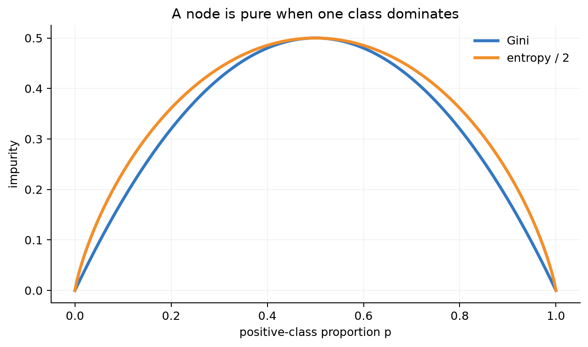
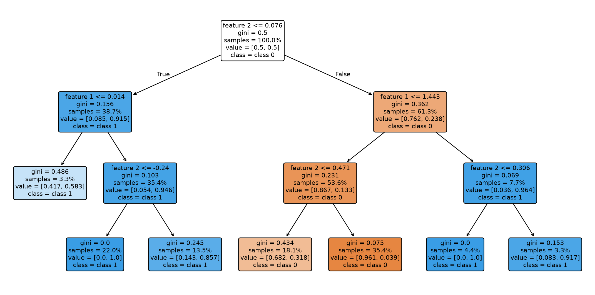
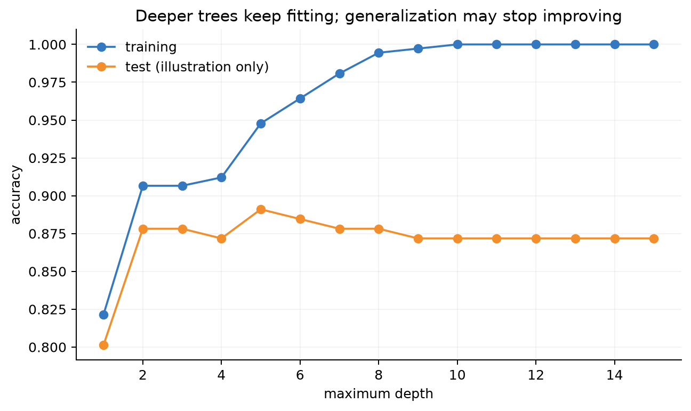
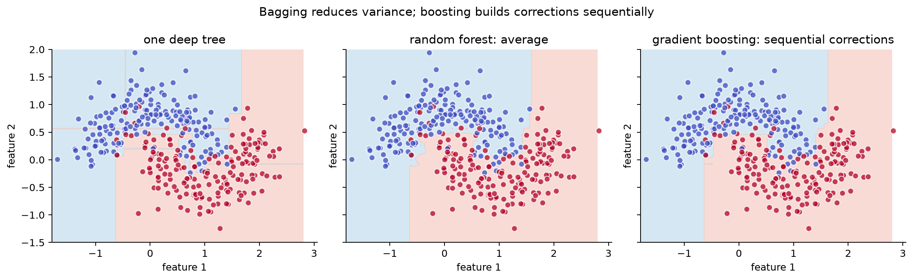

# 第 8 章：决策树与集成学习——RF、GBDT 为什么强

[← 第 7 章](07-support-vector-machines.md) | [English](../en/08-trees-and-ensembles.md) | [符号约定](appendix-a-notation.md)

> **先修**：[过拟合与泛化](01-what-is-ml.md#15-拟合欠拟合过拟合与泛化)、
> [熵](02-math-foundations.md#熵交叉熵与-kl-散度)、[验证集选择](01-what-is-ml.md#14-一次完整的机器学习实验)。

## 从第 7 章自然走到这里

SVM、kNN 都依赖几何距离。表格数据常同时包含年龄、类别、计数、阈值和缺失模式。业务规律也
可能天然是：“若近 7 日点击数 > 5 且新用户，则……”。决策树把预测写成一串 if-then 问题，
无需把整体边界假设为平滑曲线。


## 8.1 为什么需要决策树？先把预测写成问题

先看一个贷款审批的简化例子。训练表中有“是否有逾期、负债率、收入、工作年限”等列，标签是
“是否按时还款”。我们观察到：

- 有严重逾期的人风险通常较高；
- 没有逾期的人中，负债率高者仍可能有风险；
- 负债率不高的人中，工作年限较长者又更稳定。

这类规律天然像一组连续提问：

```text
过去是否严重逾期？
├─ 是  → 高风险
└─ 否  → 负债率是否 > 45%？
          ├─ 是  → 高风险
          └─ 否  → 低风险
```

线性模型试图用一个整体平面同时组合所有特征；树则反复提出一个简单的“是/否”问题，把大群体
逐步分成更同质的小群体。因此树特别适合阈值规则、特征交互和表格数据，而且不要求特征关系是
一条平滑直线。

但新的问题出现了：第一步应该问“是否逾期”，还是问“负债率是否大于 45%”？树需要一个量化
标准评价哪一个问题把两类分得更干净，这就引出下一节的**不纯度**。

<details><summary>苏格拉底追问：为什么不能凭直觉手写整棵树？</summary>
特征和候选阈值可能成千上万，人的直觉也容易受样本偏见影响。学习算法需要在训练数据上系统比较
候选问题；同时还要用验证数据限制树的复杂度，避免把偶然现象写成规则。
</details>

## 8.2 树如何选择第一个问题？

先把“分得更干净”说清楚。一个节点若全是正类或全是负类，就是纯净；若两类各占一半，就最
混杂。候选问题写作“特征 $j\le t$”，它把样本分到左、右两个子节点。分类树选择使加权子节点
不纯度最小的 $(j,t)$：

$$I_{split}=\frac{m_L}{m}I(L)+\frac{m_R}{m}I(R).$$

二分类 Gini：

$$G=1-p^2-(1-p)^2=2p(1-p).$$

熵：

$$H=-p\log_2p-(1-p)\log_2(1-p).$$



图中横轴 $p$ 表示节点中正类所占比例，纵轴表示不纯度。两条曲线共同呈现以下规律：

- $p=0$ 或 $p=1$ 时，节点只有一个类别，两条曲线都为 0；
- $p=0.5$ 时两类各半，最难直接给出统一标签，不纯度最高；
- Gini 和 entropy 的形状相似，所以很多数据上会选出相近切分；
- 图中 entropy 为便于同图比较做了缩放，曲线高度不能跨定义直接解释成准确率。

选择切分等价于最大化不纯度下降/信息增益
$I(parent)-I_{split}$。Gini 与熵通常给出相似树；它们不是模型准确率，而是节点内部混杂程度。

### 手算一个切分

某节点有 10 人，6 正4负，Gini=$1-.6^2-.4^2=.48$。切分后左边 4 正0负，右边2正4负：

$$I_{split}=\frac4{10}(0)+\frac6{10}\left[1-(2/6)^2-(4/6)^2\right]\approx.267.$$

不纯度下降约 $.213$。算法枚举候选特征和阈值，选择下降最大者，再对子节点递归。

## 8.3 从树桩到完整树

树桩只有一次切分。本章 NumPy 实现枚举所有特征和相邻取值中点，找到最小加权 Gini。完整树
递归重复，直到纯净或触发停止条件。



这棵树从最上方根节点开始执行：条件成立时沿左分支，不成立时沿右分支，到达叶节点后输出
预测类别。节点里的 `gini` 表示当前混杂程度，`samples` 是到达该节点的训练样本数，`value`
记录各类别计数，`class` 是多数类。挑一条从根到叶的路径连起来，就是一条完整 if-then 规则。
颜色越深通常表示节点越纯，不代表模型对现实世界一定越有把握。

每个叶节点输出训练样本类别比例；回归树通常输出均值，并选择最小化平方误差的切分。

常见控制项：`max_depth`、`min_samples_leaf`、`min_samples_split`、`max_leaf_nodes`，以及训练后
cost-complexity pruning。限制树不是越多越好，应由验证数据选择。

## 8.4 为什么树特别容易过拟合？

不限制深度时，树可不断切分直到记住训练样本。一次数据扰动可能让根节点选择完全不同的规则，
这叫高方差。



图中横轴是允许的最大树深，越往右模型越复杂；纵轴是准确率。训练曲线通常随
深度增加而继续上升，因为叶子可以记住更多细节；保留集曲线先上升、在中等深度附近达到峰值，
随后持平或下降。两条曲线间不断扩大的缺口，就是高方差/过拟合的信号之一。不能只凭“训练分数
很高”判断模型好，也没有一个对所有数据通用的过拟合深度阈值。

图中标为 test 的曲线只用于一次性教学展示；真实调参必须用验证集，不能反复看测试集选择深度。深树训练好、
验证差时优先限制深度/叶节点、增加最小叶样本，或采用集成。

## 8.5 从零实现与框架对照

核心伪代码：

```python
for feature in features:
    for threshold in midpoints(unique(X[:, feature])):
        left = X[:, feature] <= threshold
        score = n_left/n * gini(y[left]) + n_right/n * gini(y[~left])
        keep_split_with_smallest_score()
```

运行：

```bash
python code/chapter08/trees_and_ensembles.py
python code/chapter08/course_lab.py
```

主脚本生成树和集成边界；`course_lab.py` 用短小、分步的函数手算不纯度、三树投票和一轮 boosting，
更适合作为第一次阅读的代码入口。

固定输出：

```text
scratch_stump_accuracy=0.801
sklearn_stump_accuracy=0.801
tree_test_accuracy=0.872
random_forest_test_accuracy=0.897
gradient_boosting_test_accuracy=0.897
```

一致准确率不保证选到完全相同阈值：多个切分可能并列，库的排序与浮点规则也可能不同。

## 8.6 随机森林：让许多不同的高方差树平均

Bagging 对训练集有放回采样，独立训练多棵树，再投票/平均。若树误差不完全相关，平均会降低
方差。随机森林进一步在每个节点只查看随机特征子集，使树之间更不相似。

$$\hat f_{RF}(x)=\frac1B\sum_{b=1}^B f_b(x).$$

没有被某棵树 bootstrap 抽到的样本叫 out-of-bag（OOB）样本，可估计泛化性能，但仍不能替代
最终测试集，也不能解决时间/主体切分错误。

### 三棵树怎样形成一次投票？

训练每棵树前，先从训练行编号中**有放回**抽取与原数据同样多的编号；同一行可能重复，也会有行
一次都没抽到。三棵树因而看到不同训练集。假设它们对四个新样本分别预测

$$[0,1,1,0],\quad[0,1,0,0],\quad[1,1,1,0].$$

四列得到的正类票数是 $[1,3,2,0]$，多数投票得到 $[0,1,1,0]$。第三个样本有一棵树反对，但
集成没有被单棵树左右。随机森林有效的前提不是“树越多越神奇”，而是单树有一定能力且错误不完全
相同；若所有树都由同一个泄漏特征主导，它们会一起犯错。

## 8.7 Gradient Boosting：后一棵树专门修正前面的错

Boosting 不是并行平均独立树，而是串行建立加法模型：

$$F_M(x)=F_0(x)+\eta\sum_{m=1}^M h_m(x).$$

平方损失下，$h_m$ 拟合当前残差；一般可微损失下，拟合负梯度/伪残差，因此称 gradient
boosting。学习率 $\eta$ 小通常需更多树，形成 shrinkage 正则效果。

### 一轮 boosting 怎样修正残差？

取四个回归标签 $y=[2,2,8,10]$。初始模型只预测均值 $F_0=5.5$，残差为
$[-3.5,-3.5,2.5,4.5]$。一棵树桩把前两个和后两个样本分开，两个叶子预测的平均残差分别为
$-3.5$ 与 $3.5$。若学习率 $\eta=0.5$，更新后预测为

$$F_1=[3.75,3.75,7.25,7.25].$$

MSE 从 $12.75$ 降到约 $3.56$。下一棵树不会重新拟合原始标签，而是继续拟合新的剩余错误；这就是
“串行纠错”的具体含义。分类 GBDT 使用的是损失对当前分数的负梯度，步骤相同，伪残差公式不同。



三个子图使用完全相同的训练点。点的颜色表示真实类别，背景颜色表示模型在相应网格位置上的
预测，颜色交界处就是决策边界。三个面板从左到右只改变模型，背景并不是额外的数据：

- 单棵深树用许多横竖切分围住训练点，边界呈碎片状，容易跟随噪声；
- 随机森林把许多经过采样和特征随机化的树投票，个别树的偶然小块往往被平均掉；
- GBDT 用浅树逐轮修正当前错误，边界是前面所有弱学习器的叠加结果。

这幅图展示的是一个数据集上的典型行为，不证明任意情况下 GBDT 都优于随机森林。公平比较还要
使用同一训练/验证划分和相同评价指标，并分别调节叶大小、深度、树数与学习率。

XGBoost、LightGBM、CatBoost 都属于现代 boosting 家族，分别强化正则/系统优化、直方图与叶子
生长、类别特征处理等。不能只记库名，应先理解“加法模型 + 梯度纠错”。

## 8.8 Bagging 与 Boosting 不要混淆

| | 随机森林 / Bagging | Gradient Boosting |
|---|---|---|
| 训练 | 多树可并行 | 串行依赖前一轮 |
| 主要作用 | 降低方差 | 逐步降低偏差，也需控方差 |
| 单树 | 常较深、随机化 | 常较浅、弱学习器 |
| 关键参数 | 树数、特征子采样、叶大小 | 树数、学习率、深度、子采样 |
| 对噪声 | 通常稳健 | 过多轮/深树可能追噪声 |

## 8.9 特征重要性为什么可能误导？

基于 impurity decrease 的重要性偏爱取值多、可切分点多的特征；相关特征会互相分摊或替代重要性。
Permutation importance 应在验证/测试式保留数据上打乱特征并观察性能下降，但相关特征仍会让
结论复杂。SHAP 描述模型预测归因，不等于因果作用。

**例子**：用户 ID 几乎唯一，深树可用它记忆训练集并得到高 impurity importance，但线上新用户
毫无帮助。重要性高不能取代泄漏检查与消融。

## 8.10 缺失值、类别特征与分布外推

- scikit-learn 的具体 estimator 对 NaN 支持随版本/模型不同，应查对应文档，不能默认；
- one-hot 类别可用，但高基数会膨胀；CatBoost 等有专门策略；
- 树回归在训练标签范围外通常不能像线性模型那样自然外推；
- 时间、用户、商户重复会造成泄漏，随机切分的高分可能虚假。

## 8.11 复杂度、系统成本与失败诊断

平衡树预测约 $O(depth)$；森林是 $O(B\cdot depth)$，但树可并行。GBDT 串行训练限制并行度，
推理仍需遍历多棵树。工程上要测模型大小、p95 延迟、吞吐和批处理效率。

| 症状 | 可能原因 | 处理方向 |
|---|---|---|
| 训练近满分、验证差 | 树太深、叶太小、泄漏 | 限深/增大叶、修复切分、剪枝 |
| RF 多棵树仍不稳 | 树高度相关、样本少 | 特征子采样、叶约束、更多数据 |
| GBDT 后期验证恶化 | 树太多、学习率/深度过大 | early stopping、降学习率/深度 |
| 线上延迟高 | 树多且深、特征计算慢 | 压缩、批推理、减少树/特征 |
| 重要性被 ID 占据 | 高基数记忆或泄漏 | 删除/重新编码、时间主体切分 |
| 未来数值外推失败 | 叶输出局限在训练范围 | 加趋势特征、线性/混合模型 |

训练时还应记录每轮验证损失、叶子数、模型字节数和特征生成成本。GBDT 推理慢不一定是树遍历
本身，也可能是上游实时特征查询拖慢了整个服务。

## 8.12 与现代 AI 的联系：表格排序、混合模型与 LLM 路由

### 推荐与广告：embedding 负责语义，树负责表格交互

推荐系统可先用双塔 embedding 召回候选，再用 GBDT/排序模型结合价格、时间、计数、用户统计和
上下文特征进行排序。树擅长非线性阈值和特征交互，但训练日志受曝光偏差影响；离线 AUC 提升不
自动等于线上收益，仍需 A/B 测试和长期指标。

### 风控与医疗：规则路径可审查，但可解释不等于因果

树路径便于说明“哪些条件把样本送到这个叶子”，适合规则审查和人工复核。随机森林/GBDT 的整体
解释仍比单树复杂；SHAP 是对模型输出的归因，不证明某特征改变会导致结果改变，也不能替代公平性
与泄漏审计。

### LLM 系统：树常在模型外做路由，而不是替代 Transformer

小树或 GBDT 可根据请求长度、领域、风险分数、预计延迟和成本，在小模型/大模型、检索/不检索、
缓存/重新生成之间路由；也可预测 token 数或超时风险。它属于 LLM **系统层**的控制器，不是
Transformer 内部下一 token 建模的主体。

### 现代 boosting 工具：算法思想相同，工程实现不同

XGBoost、LightGBM、CatBoost 都建立加法树模型，但在二阶近似、正则化、直方图、叶生长策略和
类别特征处理上不同。比较时不能只用默认参数或只报最好分数，还要统一数据划分、调参预算、硬件
和 early stopping 规则。

## 8.13 苏格拉底导师

<details><summary>为什么贪心选择当前最佳切分不保证全局最佳树？</summary>
根节点的局部最佳可能阻碍后续组合；搜索所有树结构是组合爆炸，因此实践采用贪心近似。
</details>

<details><summary>随机森林树越多会像单树加深一样更易过拟合吗？</summary>
增加树数通常让平均稳定并趋于平台，不等同于增加单树复杂度；树深、叶大小和相关性仍决定泛化。
</details>

<details><summary>为什么决策树通常不需要标准化？</summary>
切分只比较单个特征是否小于阈值；对该特征做保持顺序的缩放不会改变候选划分顺序。但距离特征、
正则化模型或上游特征工程仍可能需要缩放。
</details>

<details><summary>随机森林为什么要同时随机样本和随机特征？</summary>
bootstrap 制造不同训练集，节点特征子采样避免所有树总被同一强特征主导；两者共同降低树间误差
相关性，平均才更能降方差。
</details>

<details><summary>GBDT 为什么拟合“负梯度”而不只是拟合分类错误？</summary>
负梯度指出在当前预测处让所选损失下降最快的函数方向。平方损失时它恰好是残差，一般损失下则
是伪残差，因此能统一处理回归、分类和排序目标。
</details>

<details><summary>feature importance 很高，能否说明这个特征导致了结果？</summary>
不能。重要性描述模型怎样使用特征，受相关性、取值基数和泄漏影响；因果结论需要额外假设与实验。
</details>

## 8.14 练习

完成后对照[第 8 章参考答案](solutions/08-solutions.md)。

1. **手算**：对两个候选阈值计算 Gini、entropy、加权不纯度和信息增益，选出根节点。
2. **从零实现**：在树桩基础上实现两层分类树，加入空节点、纯节点和最小叶样本停止条件。
3. **过拟合实验**：画深度—训练/验证曲线，用验证集选择深度并保留独立测试集。
4. **随机森林消融**：比较 bootstrap、特征子采样和树数，记录树间误差相关性与 OOB 分数。
5. **Boosting 消融**：网格比较学习率×树数×深度，报告 early stopping 轮次、时间与模型大小。
6. **重要性审计**：加入唯一 ID 和相关特征，比较 impurity、permutation、SHAP，并解释冲突。
7. **现代系统设计**：设计一个 LLM 路由树，写出特征、标签、误路由成本、延迟和漂移监控方案。

## 8.15 面试八股

- **树怎样选择切分？** 枚举候选特征和阈值，选择加权不纯度最小、即信息增益最大的切分。
- **Gini 与 entropy 区别？** 都衡量类别混杂，常得到相似切分；Gini 计算稍简，entropy 有信息论解释。
- **决策树为什么容易过拟合？** 可不断切出小叶记住噪声，而且贪心结构对数据扰动敏感、方差高。
- **树为什么通常不需要标准化？** 阈值切分依赖顺序而非欧氏距离，单调缩放不改变排序。
- **Bagging 与 Boosting？** Bagging 并行训练并平均以降方差；Boosting 串行纠错以逐步降低损失。
- **随机森林比 Bagging 多了什么？** 每个节点再随机抽取候选特征，降低树间相关性。
- **OOB 是什么？** 某棵树 bootstrap 未抽中的样本，可用于该树的外样本预测和集成评估。
- **GBDT 为什么叫 gradient？** 每轮弱学习器拟合损失关于当前函数预测的负梯度。
- **学习率与树数关系？** 小学习率通常需要更多树；二者应联合验证并配合 early stopping。
- **特征重要性为什么不等于因果？** 它只描述已训练模型的使用方式，还受基数、相关性和泄漏影响。
- **RF 与 GBDT 怎样选择？** RF 默认稳健、易并行；GBDT 表格精度常强但调参和噪声敏感，最终按
  验证表现、延迟、内存和维护成本决定。

## 本章通关标准

- [ ] 我能从具体业务问题解释为什么 if-then 规则比一条全局直线自然。
- [ ] 我能手算 Gini、entropy、加权不纯度与信息增益。
- [ ] 我能从零搜索树桩最佳特征/阈值，并解释递归生长。
- [ ] 我能诊断深度导致的高方差并正确使用验证集。
- [ ] 我能从偏差—方差和训练依赖关系比较 bagging、随机森林与 gradient boosting。
- [ ] 我能联合调节学习率、树数、深度和叶大小，并使用 early stopping。
- [ ] 我能审计重要性、泄漏、类别/缺失处理、外推限制和系统成本。
- [ ] 我能说明树在推荐排序与 LLM 路由中的位置，而不把它说成 Transformer 的内部算法。

### 扩展阅读

- [scikit-learn：Decision Trees 用户指南](https://scikit-learn.org/stable/modules/tree.html)
- [scikit-learn：Ensemble Methods 用户指南](https://scikit-learn.org/stable/modules/ensemble.html)
- [Breiman, Random Forests](https://doi.org/10.1023/A:1010933404324)
- [Chen & Guestrin, XGBoost: A Scalable Tree Boosting System](https://arxiv.org/abs/1603.02754)

[下一章：学习理论与模型选择 →](09-learning-theory-and-model-selection.md)
