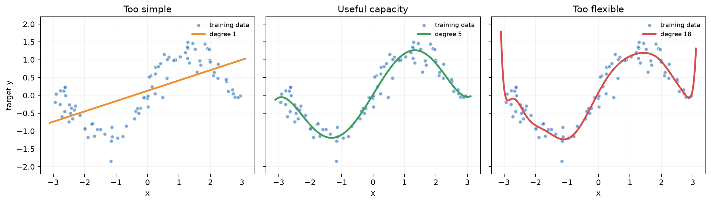
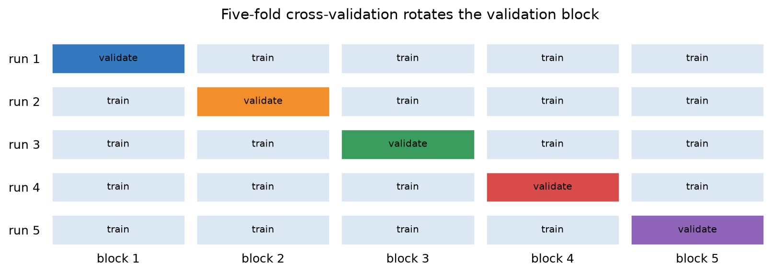
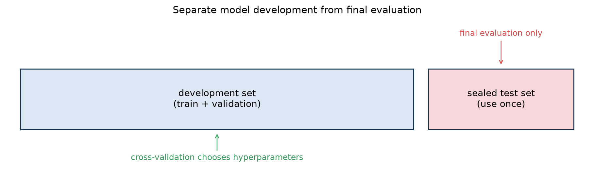
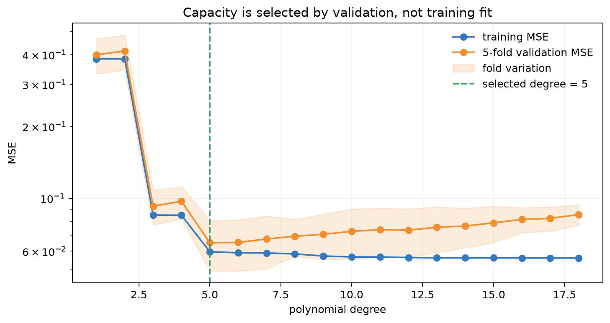
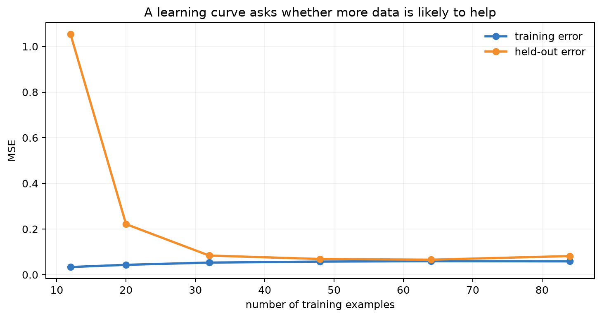

# 第 9 章：学习理论与模型选择——怎样知道模型真的学会了？

[← 第 8 章](08-trees-and-ensembles.md) | [English](../en/09-learning-theory-and-model-selection.md) | [符号约定](appendix-a-notation.md)

> **先修**：[训练集、验证集与测试集](01-what-is-ml.md#14-一次完整的机器学习实验)、
> [拟合、欠拟合与过拟合](01-what-is-ml.md#15-拟合欠拟合过拟合与泛化)、
> [Ridge 与 Lasso](03-linear-regression.md)。

## 从第 8 章自然走到这里

我们已经见过很多控制复杂度的旋钮：多项式次数、正则化强度、邻居数、树深、树数。训练误差
最低的设置往往不是新数据上最好的设置。本章不再增加一个预测算法，而是回答所有算法都绕不开
的问题：**如何估计泛化能力，如何公平选择模型，以及“更多数据”究竟能否解决问题。**


## 本章学习路线

先用多项式回归观察容量变化，再用偏差—方差解释现象；随后学习交叉验证、验证曲线和学习曲线，
最后用一个有限假设空间的界说明：训练误差、模型复杂度、样本量和置信度为什么必须一起考虑。

## 9.1 为什么训练分数不能回答“模型学会了吗”？

设数据来自未知分布 $(x,y)\sim\mathcal D$，模型为 $f$，损失为 $\ell$。我们真正关心的是
**总体风险**（expected risk）：

$$R(f)=\mathbb E_{(x,y)\sim\mathcal D}[\ell(f(x),y)].$$

但我们拿不到整个分布，只拿到 $m$ 个训练样本，于是计算**经验风险**：

$$\hat R_m(f)=\frac1m\sum_{i=1}^{m}\ell(f(x^{(i)}),y^{(i)}).$$

二者不是同一个量。一个足够灵活的模型可以记住训练样本，使 $\hat R_m$ 很小，却在新样本上
$R$ 很大。训练集既用于拟合参数又用于打分，就像让学生提前看到考题再评价理解程度。

### 一个贯穿本章的例子：用面积预测租金

真实租金随面积总体上升，但还受楼龄、地段和随机噪声影响。若只用面积 $x$：

- 一次直线可能忽略真实弯曲趋势；
- 五次多项式可能抓住主要趋势；
- 十五次多项式可能绕着少量训练点剧烈摆动。



三幅图使用同一批训练点，横轴是标准化后的房屋面积，纵轴是标准化租金。左图的直线连总体趋势
都没有表达，训练与新数据都会产生系统性误差；中图的曲线能跟随主要规律而不过分追逐噪声；右图
虽然贴近训练点，却在样本稀疏处产生不合理振荡。这里展示的是典型现象，而不是说“五次永远最好”；
最佳复杂度必须由独立数据决定。

## 9.2 偏差—方差：误差究竟从哪里来？

假设回归目标满足

$$y=f^{\ast}(x)+\varepsilon,\qquad \mathbb E[\varepsilon\mid x]=0,
\quad \mathrm{Var}(\varepsilon\mid x)=\sigma^2.$$

如果反复抽取训练集并训练得到 $\hat f$，在平方损失下，一个固定位置 $x$ 的期望预测误差可分解为

$$
\mathbb E[(y-\hat f(x))^2]
=\underbrace{\sigma^2}_{\text{不可约噪声}}
+\underbrace{(\mathbb E[\hat f(x)]-f^{\ast}(x))^2}_{\text{偏差平方}}
+\underbrace{\mathbb E[(\hat f(x)-\mathbb E[\hat f(x)])^2]}_{\text{方差}}.
$$

推导只需加减 $\mathbb E[\hat f(x)]$ 并展开平方。交叉项期望为零：噪声均值为零，而
$\hat f-\mathbb E\hat f$ 的均值也为零。

- **高偏差**：模型假设过强，多次换训练集都犯相似错误，如用直线拟合明显弯曲关系。
- **高方差**：模型对训练样本扰动敏感，换一批数据曲线就大变，如高次多项式或过深单树。
- **不可约噪声**：现有特征无法解释的随机性；换更复杂模型也未必能消除。

偏差—方差不是“简单模型一定欠拟合、复杂模型一定过拟合”的口号。正则化、优化方法、数据规模、
噪声以及模型结构都会改变二者；分类的 0-1 损失也没有上述同样简洁的逐项等式。

## 9.3 交叉验证：让每个样本都有一次“模拟考试”

一次验证集划分可能碰巧偏难或偏易。 $K$ 折交叉验证把数据分成 $K$ 份；第 $k$ 轮用其中一份验证，
其余 $K-1$ 份训练，最后平均验证损失：

$$CV_K(\lambda)=\frac1K\sum_{k=1}^{K}L_k(\lambda).$$

这里 $\lambda$ 泛指超参数，例如正则化强度或树深。**每一折中的标准化、特征选择和缺失值填补都
必须只在该折训练部分拟合**，否则验证样本的信息已经泄漏进模型。



图中每一行代表一次训练：橙色块轮流充当验证折，蓝色块构成该轮训练集。因此每个样本恰好被验证
一次、被训练四次。最终平均值比单次划分稳定，但五个分数并非五份完全独立的数据，标准差不能被
误写成严格置信区间。

### 划分方式必须尊重数据的生成过程

| 数据关系 | 合理方式 | 为什么普通随机 $K$ 折会错 |
|---|---|---|
| 类别不平衡 | Stratified K-fold | 某折可能几乎没有少数类 |
| 同一患者多条记录 | Group K-fold | 同一个人同时出现在训练与验证中 |
| 时间序列 | 按时间向前验证 | 用未来信息预测过去 |
| 调参后还要无偏估计 | Nested CV 或独立测试集 | 反复看验证结果会对验证集过拟合 |

测试集不是“另一个调参集”。只有模型、阈值、预处理和报告指标都确定后，才使用一次测试集。

### 先把三种数据的职责钉死

假设有 1000 条房租记录，最朴素但可靠的做法是先锁住 200 条测试样本，剩余 800 条才允许参与
训练和选择。下面不是强制比例，而是一种可审计的职责分工：

| 数据 | 可做什么 | 绝不能做什么 | 类比 |
|---|---|---|---|
| 训练部分 | 拟合权重、均值、方差、词表 | 报告最终成绩 | 平时练习 |
| 验证部分 | 选次数、正则强度、阈值 | 更新该轮模型参数 | 模拟考试 |
| 测试部分 | 所有决定冻结后评估一次 | 看完再改模型 | 密封期末考试 |



图从左向右表示信息允许流动的方向。测试集在整个开发阶段保持密封；交叉验证只发生在开发集内部。
选出超参数后，可以用全部开发数据重新拟合参数，但不能把测试集并入训练再声称原测试分数仍然有效。

### 五个样本手算一次 5 折验证

设样本编号为 A～E，要比较树深 $d\in\{1,2\}$。每轮留一个样本验证，得到损失：

| 留出的样本 | 深度 1 | 深度 2 |
|---|---:|---:|
| A | 0.30 | 0.10 |
| B | 0.20 | 0.45 |
| C | 0.40 | 0.15 |
| D | 0.30 | 0.50 |
| E | 0.30 | 0.20 |
| 平均 | **0.30** | **0.28** |

只看均值会选深度 2，但它的折间波动明显更大。若二者业务差异很小，深度 1 可能因稳定、便宜而
更合理。交叉验证不是替你做业务决策；它只是提供“均值、波动和失败样本”三类证据。

### 四种容易混淆的验证

- **Repeated K-fold**：换几次随机分折，研究划分偶然性；仍假设样本近似独立同分布。
- **Group K-fold**：按患者、用户或设备整体移动，回答“能否泛化到未见实体”。
- **Walk-forward**：训练窗口永远早于验证窗口，回答“用过去预测未来”。
- **Nested CV**：内层选超参数，外层只估计选模流程，适合样本少又需要较无偏报告的场景。

嵌套验证中，外层第 $j$ 折的训练部分再做一套内层交叉验证，选出 $\lambda_j$；随后用该外层训练
部分重训，并在外层验证部分打分。最终平均的是外层分数，而不是内层最优分数。因此它评估的是
“包含调参在内的完整学习程序”，而不是某个事先固定的模型。

## 9.4 验证曲线：复杂度旋钮应该停在哪里？



横轴是多项式次数，代表模型容量；纵轴是均方误差，越低越好。训练误差随次数增加总体下降，因为
高次模型包含更多可选函数。验证误差先下降后上升：开始时增加容量修复欠拟合，超过合适范围后，
模型开始学习训练样本的偶然波动。虚线标出交叉验证选出的次数 5。这个位置只对当前数据、特征、
损失和候选范围成立，不能当成普遍规律。

参数和超参数要区分：多项式系数由训练算法从数据中学习，是**参数**；次数、正则强度和学习率由
实验设计者选择，是**超参数**。若用测试集选择次数，最后的测试分数就不再是诚实的泛化估计。

## 9.5 学习曲线：更多数据能解决问题吗？

学习曲线固定模型与超参数，逐步增加训练样本量，分别记录训练分数和验证分数。



横轴是训练样本数，纵轴是均方误差。样本少时模型容易记住训练集，因此训练误差很低、验证误差很高；
数据增加后，两者逐渐靠近，验证误差继续改善但收益递减。若两条曲线都停在较高误差且间隔很小，
通常是高偏差，单纯收集同分布数据帮助有限；若训练误差低而验证误差高，通常是高方差，更多数据、
更强正则化或更简单模型可能有帮助。

“曲线靠近”本身不代表模型好：两条曲线也可能在很差的位置会合。还要与业务基线、噪声水平和
可接受误差比较。

## 9.6 正则化：把“不要太复杂”写进学习过程

经验风险最小化只追求训练拟合。结构风险最小化加入复杂度惩罚：

$$\min_\theta\ \hat R_m(\theta)+\lambda\Omega(\theta).$$

- L2： $\Omega=\|\theta\|_2^2$，平滑缩小权重；与零均值高斯先验的 MAP 估计相联系。
- L1： $\Omega=\|\theta\|_1$，常产生稀疏解；与 Laplace 先验相联系。
- 限制树深、增大最小叶样本数：直接限制函数族容量。
- Early stopping：在继续训练开始损害验证表现时停止，是一种隐式正则化。
- 数据增强：规定输入发生合理变化时输出应保持稳定，把领域知识写进数据。

$\lambda$ 太小可能高方差，太大可能高偏差。它不是根据训练误差最小来选，而应由验证过程选择。

## 9.7 一个学习界：样本量、复杂度和置信度如何相连？

先考虑有限假设集合 $\mathcal H$，损失取值在 $[0,1]$。对某个固定 $h$，Hoeffding 不等式给出

$$P(|R(h)-\hat R(h)|>\epsilon)\le 2e^{-2m\epsilon^2}.$$

我们会从 $|\mathcal H|$ 个候选中选择，所以需要同时控制所有候选。用 union bound：

$$P\left(\max_{h\in\mathcal H}|R(h)-\hat R(h)|>\epsilon\right)
\le 2|\mathcal H|e^{-2m\epsilon^2}.$$

令右侧不超过 $\delta$，解得：以至少 $1-\delta$ 的概率，对所有 $h$ 同时成立

$$|R(h)-\hat R(h)|\le
\sqrt{\frac{\log(2|\mathcal H|/\delta)}{2m}}.$$

它揭示三件事：样本量 $m$ 增大，间隙缩小；候选集合越大，付出的复杂度代价越高；要求失败概率
$\delta$ 更小，也需要更多数据。这是**上界**而非模型实际测试误差的精确预测，通常较保守。
无限函数族需要 VC 维、Rademacher complexity 等更细工具。

### 把偏差—方差推导完整走一遍

记 $\bar f(x)=\mathbb E_D[\hat f_D(x)]$，其中期望对随机训练集 $D$ 取。把
$y=f^{\ast}(x)+\varepsilon$ 代入，并加减 $\bar f(x)$：

$$
y-\hat f_D=(f^{\ast}-\bar f)+(\bar f-\hat f_D)+\varepsilon.
$$

平方后有三个平方项和三个交叉项。对数据集与噪声取期望时，
$\mathbb E_D[\bar f-\hat f_D]=0$、 $\mathbb E[\varepsilon\mid x]=0$，且训练集与测试噪声独立，
所以交叉项消失，留下噪声、偏差平方和方差。这个推导也指出了适用边界：若测试噪声与训练过程
相关、损失不是平方损失，便不能原样套用这条等式。

### 多试模型本身也会过拟合

假设 100 个候选实际能力完全相同，但验证分数都含随机误差。选择最高分，等于刻意选择“能力加
幸运”最大的那个；候选越多，幸运成分通常越大。这就是**选择偏差**。反复查看测试集、手动修改
特征后再测试，本质上也把测试集变成了验证集。

应对方式不是禁止实验，而是记录搜索预算、使用嵌套验证或新的独立测试集，并报告多个随机种子。
若比较两个最终模型，可在同一批测试样本上计算逐样本损失差，再用 bootstrap 重采样给出差值区间；
区间跨过 0 时，不应把微小均值优势包装成确定结论。

### 为什么现代大模型似乎违背“参数越多越过拟合”？

经典 U 形图是重要起点，却不是最后结论。过参数化模型配合随机优化、预训练数据和隐式正则化时，
测试误差可能出现 double descent；扩大模型、数据与算力还可呈现经验 scaling law。它们没有取消
泛化问题：数据污染、分布外输入、记忆隐私、能力突现和评测泄漏反而要求更严格的验证设计。

## 9.8 从零实验与复现结果

运行：

```bash
python code/chapter09/learning_theory.py
```

脚本从零生成非线性回归数据，比较 1～15 次多项式，完成五折交叉验证并保留独立测试集。固定随机
种子下，本次运行选择次数 5，平均交叉验证 MSE 约为 0.065，最终测试 MSE 约为 0.049。两个数
来自不同样本，测试误差略低并不矛盾；若反复根据测试结果改模型，这个分数便会逐渐乐观。

## 9.9 模型选择的一张工作清单

1. 先确定预测时真正可获得的特征、样本单位和业务损失。
2. 在任何探索前隔离测试集；按组或时间划分，防止实体泄漏。
3. 建立简单基线，再定义有限、合理的候选空间。
4. 把全部预处理放进每折训练流程，记录均值、波动、训练时间和模型大小。
5. 若多个模型分数接近，优先选择更简单、更稳定、更便宜者。
6. 选择完成后在训练集与验证集上重训，只评估一次测试集。
7. 上线监控输入漂移、预测分布、延迟与真实业务结果。

## 9.10 复杂度、系统成本与失败诊断

若有 $H$ 组超参数、 $K$ 折交叉验证，每次训练成本为 $C$，粗略成本为 $O(HKC)$。随机搜索通常
比在无关维度上密集网格更有效；贝叶斯优化适合单次训练昂贵的场景，但也必须保留最终测试集。

常见失败包括：先在全数据标准化再交叉验证、把同一用户拆到不同集合、只汇报最好一次随机种子、
指标选择与业务代价不一致，以及调参次数不同却声称算法公平。诊断时先审计数据边界，再怀疑算法。

### 一张从现象到行动的诊断表

| 观察 | 更可能的问题 | 下一步验证 | 不应立刻做 |
|---|---|---|---|
| 训练、验证都差且接近 | 高偏差、特征不足或标签噪声 | 更强基线、误差分组、查标签 | 盲目收集同分布数据 |
| 训练好、验证差 | 高方差或泄漏后的分布落差 | 学习曲线、正则化、组/时间切分 | 继续增大模型 |
| 各折差异很大 | 样本少、子群差异或划分不当 | 查看每折组成、重复/分组验证 | 只报平均值 |
| 验证好、测试差 | 对验证集过拟合或测试分布不同 | 审计搜索次数与分布 | 偷看测试集继续调参 |
| 离线好、线上差 | 目标错位、反馈回路或延迟 | shadow/A-B、业务指标分解 | 只重跑离线分数 |

建议按“数据边界 → 指标实现 → 简单基线 → 优化是否收敛 → 容量与正则 → 分布迁移”的顺序排查。
这个顺序能优先发现最常见、最便宜修复的问题。

## 9.11 与现代 AI 的联系

- **LLM 预训练**：训练 loss 下降只说明更会预测训练分布中的 token；独立验证 loss、下游任务、
  安全评测和污染审计分别覆盖不同风险。
- **微调与 LoRA**：可训练参数少不等于不会过拟合。小数据指令微调仍需 early stopping、数据去重
  和任务级验证。
- **RAG**：要分别验证召回、重排和生成；只看最终答案会掩盖“没检索到”与“检索到但没使用”。
- **推荐系统**：随机切分可能把未来点击泄漏到过去；应采用时间切分，并同时看离线排序指标、线上
  点击/留存和曝光公平性。
- **分布迁移**：离线 IID 测试不能保证新地区、新用户或政策变化下有效，需要分组评估和上线监控。

## 9.12 苏格拉底导师

<details><summary>训练误差为零，为什么仍不能宣布模型完美？</summary>
训练误差衡量模型对已见样本的拟合。模型可能记忆样本或数据含泄漏，真正目标是未知分布上的风险。
</details>

<details><summary>为什么不能用交叉验证选好模型后，再把同一个交叉验证分数当最终成绩？</summary>
因为模型选择已经针对这些折优化，分数会有选择偏差。需要独立测试集或外层交叉验证。
</details>

<details><summary>验证误差高时，为什么“收集更多数据”不总是正确答案？</summary>
若训练和验证误差都高且接近，主要问题可能是高偏差或特征不足；同分布数据再多也难修复错误假设。
</details>

<details><summary>为什么交叉验证中的标准化必须每折重新拟合？</summary>
全数据均值和方差包含验证折信息。即使没有标签，也改变了训练过程能看到的分布，形成数据泄漏。
</details>

<details><summary>学习界为什么包含假设数量的对数，而不是直接包含数量？</summary>
union bound 先乘以候选数，解指数不等式时取对数，因此复杂度以 $\log|\mathcal H|$ 进入界。
</details>

<details><summary>测试集表现很好，是否足以保证上线可靠？</summary>
不够。测试集只代表其采样分布和指标；上线还会遇到漂移、反馈回路、延迟约束与未覆盖的子群体。
</details>

## 9.13 练习

完成后对照[第 9 章参考答案](solutions/09-solutions.md)。

1. **手算**：给定 5 折损失 $[0.42,0.38,0.51,0.40,0.44]$，计算均值与样本标准差，并解释后者。
2. **泄漏审计**：找出“全数据标准化→随机拆分→调参→报告最好测试分数”中的问题并重写流程。
3. **曲线诊断**：分别画出高偏差和高方差的理想学习曲线，写出下一步行动。
4. **理论推导**：从 Hoeffding 与 union bound 重新推出有限假设类的一致收敛界。
5. **代码实验**：改变噪声、样本量和最高次数，记录交叉验证选择怎样变化。
6. **分组验证**：为“患者多次就诊”“用户多次点击”“按日销量”各设计合理划分。
7. **现代 AI**：为一个 RAG 系统设计检索、生成、端到端三层评测和无污染测试集。

## 9.14 面试八股

- **训练/验证/测试集分别做什么？** 训练参数、选择超参数、最后一次无偏近似泛化评估。
- **偏差和方差是什么？** 偏差是平均预测与真实规律的系统差，方差是模型随训练集变化的波动。
- **交叉验证的 $K$ 越大越好吗？** 不一定；训练偏差可能降低，但计算更贵、各折结果相关，方差也未必更小。
- **什么时候用 Group K-fold？** 同一实体有多条相关记录，且部署时要泛化到未见实体时。
- **时间序列为什么不能随机打乱？** 会让未来信息进入训练，模拟的部署方向错误。
- **L1 与 L2 如何影响模型？** L1 倾向稀疏，L2 平滑缩小；二者都需按验证表现选择强度。
- **学习曲线有什么用？** 区分数据不足、高偏差和高方差，判断增加数据是否可能有效。
- **超参数搜索为什么会过拟合验证集？** 候选越多、反复查看越多，越可能选中偶然高分配置。
- **什么是 nested CV？** 外层估计泛化，内层选择超参数，避免同一折同时承担选择与报告。
- **学习界说明什么？** 以高概率控制经验风险与总体风险的差，联系样本量、复杂度和置信度。

## 本章通关标准

- [ ] 我能区分总体风险与经验风险，并解释训练误差为什么不等于泛化误差。
- [ ] 我能用公式与直觉解释偏差、方差和不可约噪声。
- [ ] 我能为类别、分组和时间数据选择正确验证方式，避免预处理泄漏。
- [ ] 我能结合验证曲线与学习曲线提出下一步实验，而不是只说“调参”。
- [ ] 我能从 Hoeffding 与 union bound 推出有限假设空间的学习界。
- [ ] 我能说明正则化、early stopping 和数据增强怎样限制有效复杂度。
- [ ] 我能设计 LLM、RAG 或推荐系统的分层验证方案，并保留真正独立的测试集。

### 扩展阅读

- [Stanford CS229：Bias/Variance Analysis](https://cs229.stanford.edu/summer2020/BiasVarianceAnalysis.pdf)
- [Stanford CS229：Learning Theory](https://cs229.stanford.edu/notes_archive/cs229-notes4.pdf)
- [scikit-learn：Cross-validation](https://scikit-learn.org/stable/modules/cross_validation.html)
- [scikit-learn：Validation curves and learning curves](https://scikit-learn.org/stable/modules/learning_curve.html)

[下一章：聚类、GMM 与 EM →](10-clustering-em-and-elbo.md)
