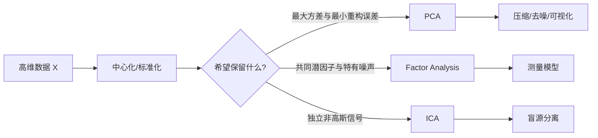
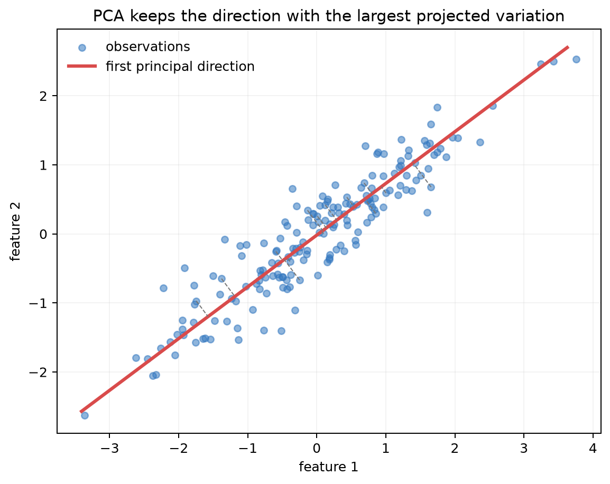
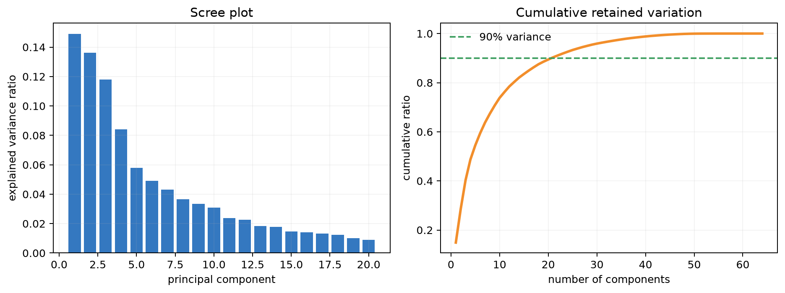
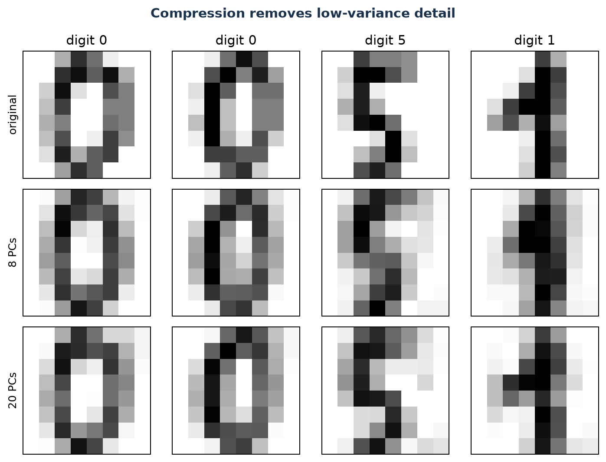
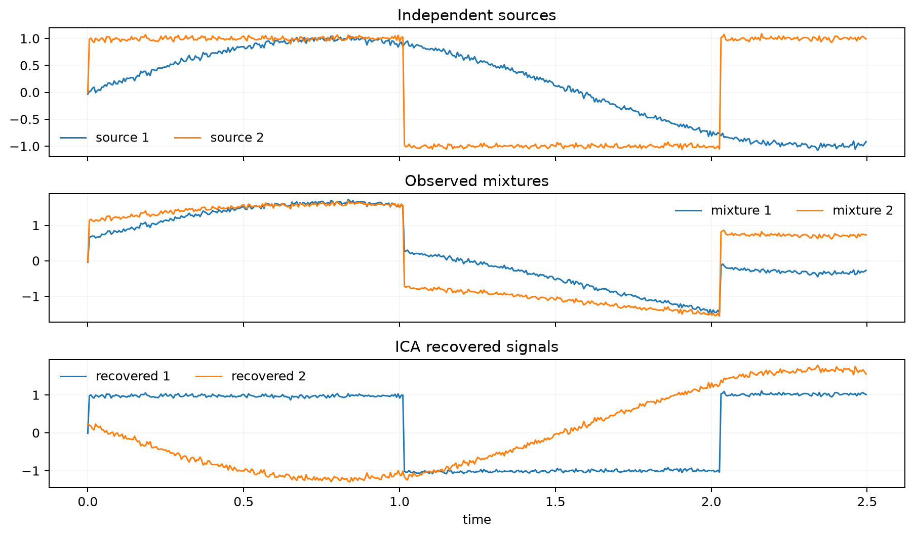

# 第 11 章：降维——PCA、因子分析与 ICA 在保留什么？

[← 第 10 章](10-clustering-em-and-elbo.md) | [English](../en/11-dimensionality-reduction.md) | [符号约定](appendix-a-notation.md)

> **先修**：[向量、矩阵与特征值](02-math-foundations.md)、[协方差](02-math-foundations.md)、
> [无监督学习](10-clustering-em-and-elbo.md)。

## 从第 10 章自然走到这里

聚类在原始空间中寻找群体，但高维特征常重复、相关且含噪声。房屋的面积、卧室数和卫生间数共同
描述“房屋规模”；图像的相邻像素高度相关；embedding 数百个维度也未必都同样重要。降维不是
简单删列，而是用更少的坐标表达主要结构。本章会区分三种问题：PCA 保留最大方差，因子分析解释
共同潜因子，ICA 寻找统计独立的源。



## 本章学习路线

先从二维点云投影到一条线，推导 PCA 的最大方差形式和最小重构形式；再用 SVD 实现并选择维度；
随后解释因子分析和 ICA 的不同假设，最后联系 embedding 压缩与神经网络表示分析。

### 本章学到什么程度？

PCA 是本章必须掌握的主干：应能完成中心化、协方差/SVD、投影、重构和维度选择。因子分析与 ICA
在本课程中属于“能区分问题、读懂假设、知道何时使用”的拓展层：需要理解 FA 的共同因子与特有
噪声、ICA 的独立非高斯源及不可辨识性，但不要求从零推导完整优化器。若后续研究测量模型或盲源
分离，再分别进入专门课程。这个边界避免把三个不同深度的主题误当成同等考试要求。

## 11.1 为什么需要降维？

设 $X\in\mathbb R^{m\times d}$，每行是样本、每列是特征。若 $d$ 很大，会遇到：

- 存储、训练与检索成本上升；
- 特征相关导致冗余，参数估计不稳定；
- 距离在高维中区分度下降；
- 人无法直接观察超过三维的数据结构；
- 小样本配高维度更容易过拟合。

降维可构造 $k<d$ 个新坐标 $Z\in\mathbb R^{m\times k}$。但“保留信息”不是完整定义：标签信息、
总体方差、邻域、距离和独立源是不同目标。选算法前必须先说清想保留哪一种。

## 11.2 PCA 的直觉：找一条投影后最分散的轴

先将每列减去均值：

$$X_c=X-\mathbf 1\mu^\top,\qquad
\mu=\frac1m\sum_{i=1}^m x^{(i)}.$$

选择单位方向 $w$，样本投影为 $z=X_cw$。投影方差是

$$\mathrm{Var}(z)=\frac1m z^\top z
=w^\top\left(\frac1mX_c^\top X_c\right)w=w^\top S w,$$

其中 $S$ 是协方差矩阵。PCA 第一主成分解

$$\max_{\|w\|_2=1}w^\top S w.$$

用拉格朗日函数 $w^\top Sw-\lambda(w^\top w-1)$ 求导：

$$Sw=\lambda w.$$

因此最大方差方向就是最大特征值对应的特征向量；后续方向要求与此前方向正交，依次取下一特征向量。



图中蓝点沿一条斜长方向分布。红色主轴沿点云变化最大的方向，灰色线段把每个点投影到该轴；投影点
是只保留一个主成分后的重构。被舍弃的是垂直于红轴的变化。数据若主要沿一条窄带分布，线段较短，
一维表示损失较小；若点云近似圆形，任何单轴都会丢掉大量变化。

主成分正负号可以整体翻转而不改变子空间，所以不同软件给出相反方向不代表结果冲突。

### 四个二维点，手算 PCA 到底做了什么

取中心化后的四个点 $(-2,-1),(-1,-2),(1,2),(2,1)$。用 $1/m$ 定义协方差：

```math
S=\frac14X^\top X=\begin{bmatrix}2.5&2\\2&2.5\end{bmatrix}.
```

它的特征值为 $4.5$ 与 $0.5$，对应单位方向
$w_1=(1,1)^\top/\sqrt2$、 $w_2=(1,-1)^\top/\sqrt2$。第一点的一维坐标是
$z^{(1)}=(-2,-1)w_1=-3/\sqrt2\approx-2.12$。只保留第一主成分时重构为
$z^{(1)}w_1=(-1.5,-1.5)$，误差为 $(-0.5,0.5)$。

四个点总方差为 $4.5+0.5=5$，第一维解释 $4.5/5=90\%$。被删掉的不是“第二个原始特征”，
而是与主轴正交的组合方向。这也明确了三个接口：fit 在训练集保存均值与 $W_k$；transform 执行
$(x-\mu)^\top W_k$；inverse transform 执行 $W_kz+\mu$。验证和测试只能使用训练集保存的参数。

## 11.3 为什么最大方差等价于最小重构误差？

保留单位方向 $w$ 后，样本 $x$ 的投影和重构为

$$z=w^\top x,\qquad \hat x=ww^\top x.$$

由勾股关系，中心化样本满足

$$\|x-\hat x\|^2=\|x\|^2-(w^\top x)^2.$$

总能量 $\sum_i\|x^{(i)}\|^2$ 固定，因此最小化重构误差等价于最大化投影平方和，也就是最大方差。
对 $k$ 维矩阵 $W_k=[w_1,\ldots,w_k]$：

$$Z=X_cW_k,\qquad \hat X=ZW_k^\top+\mu.$$

这说明 PCA 是线性自编码器的一种特殊情形，但它优化重构，不保证最适合分类。

## 11.4 SVD：实际计算 PCA 的稳定方式

对中心化矩阵作奇异值分解：

$$X_c=U\Sigma V^\top.$$

- $V$ 的列是特征空间中的主轴；
- $X_cV_k=U_k\Sigma_k$ 是低维坐标；
- 协方差特征值满足 $\lambda_j=\sigma_j^2/m$（若样本协方差用 $m-1$，分母相应改变）。

直接构造 $d\times d$ 协方差矩阵可能放大数值误差；SVD 通常更稳定，也适用于 $m<d$ 的情况。

### 是否要先标准化？

只中心化保留原单位的方差含义；标准化到单位方差则让每列贡献更可比。若“平方米”数值范围远大于
“房间数”，不标准化的 PCA 会更重视面积。选择取决于单位是否本身有意义，不能自动套流程。

对词袋这类巨大稀疏矩阵，减均值会把稀疏矩阵变稠密。实践常对未中心化稀疏矩阵做
Truncated SVD（文本处理中又常称 LSA）；它与严格中心化 PCA 不完全相同，名称相近不代表预处理
可以互换。

## 11.5 保留多少个主成分？

第 $j$ 个主成分的解释方差比为

$$r_j=\frac{\lambda_j}{\sum_{l=1}^{d}\lambda_l},\qquad
R_k=\sum_{j=1}^{k}r_j.$$



柱形表示每个新增主成分单独解释的方差，折线表示前 $k$ 个成分累计解释的比例。本实验约需 21 个
成分达到 90%。阈值 90%、95% 并非定律；还应结合重构质量、下游指标、延迟和存储选择。高方差
方向也可能只是光照、背景或批次效应，而低方差方向可能携带稀有类别信号。



每一列对应一个固定的数字样本，第一行是原始图像，第二行是只保留 8 个主成分的重构，第三行是保留
20 个主成分的重构。可以看到主成分从 8 个增加到 20 个后，笔画细节更接近第一行原图，很少维度时只
剩数字的大致轮廓。
这把抽象的“解释方差”转换为可见重构损失：保留维度越少，压缩率越高，通常丢失的细节也越多。
视觉可辨认仍不等于适合所有下游任务。

## 11.6 因子分析：共同原因与特有噪声

PCA 将所有方向的方差都看作要解释的信号。因子分析（FA）提出一个生成模型：

$$x=\mu+\Lambda z+\epsilon,\qquad
z\sim\mathcal N(0,I),\quad \epsilon\sim\mathcal N(0,\Psi),$$

其中 $z\in\mathbb R^k$ 是潜因子， $\Lambda$ 是载荷矩阵， $\Psi$ 通常为对角矩阵，表示每个观测
变量独有的噪声。因此

$$\mathrm{Cov}(x)=\Lambda\Lambda^\top+\Psi.$$

例如多道考试题都受“数学能力”这一共同因子影响，同时每道题还有表述、运算失误等特有噪声。FA
试图区分共同协方差与特有方差；PCA 只寻找重构总体方差最好的正交子空间。

| 比较 | PCA | 因子分析 |
|---|---|---|
| 类型 | 确定性线性投影 | 概率生成模型 |
| 目标 | 最大方差/最小重构误差 | 最大化带潜因子的似然 |
| 噪声 | 不显式区分 | 显式建模特有噪声 $\Psi$ |
| 方向 | 主成分正交 | 因子可旋转，解释依赖约束 |

因子名称来自研究者解释，不是模型自动发现的因果实体。

## 11.7 ICA：不相关还不够，要寻找独立源

独立成分分析假设观测是若干独立源的线性混合：

$$x=As,$$

其中 $s$ 的各分量相互独立且至多一个是高斯。目标是学习解混矩阵 $W\approx A^{-1}$，得到
$\hat s=Wx$。经典例子是多个麦克风同时录到多个人说话，希望恢复各自声音。



上排是两个独立源信号，中排是麦克风听到的线性混合，下排是 ICA 恢复结果。恢复波形与源的形状
接近，但顺序可能交换、正负和尺度可能改变；这些都是 ICA 固有不可辨识性，不算失败。PCA 只保证
输出不相关，对非高斯变量，不相关并不等于独立，因此通常不能完成同样的盲源分离。

ICA 常先中心化和白化，使协方差变为单位阵，再寻找让非高斯性最大的旋转。中心极限定理提供一个
逆向直觉：多个独立源相加通常更接近高斯，因此“最不像高斯”的方向更可能接近原始源。FastICA
可用峰度或 negentropy 的近似作为目标。它只能恢复到排列、符号和尺度：把某个源乘 $c$ 并把
混合矩阵对应列除以 $c$，观测完全不变。

## 11.8 从零实现与框架对照

运行：

```bash
python code/chapter11/dimensionality_reduction.py
```

脚本用 NumPy SVD 从零实现 PCA，再与 scikit-learn 的 PCA 子空间比较，投影差约为数值精度级别；
同时完成手写数字压缩与 FastICA 源分离。验证时应比较子空间或重构，而不是直接逐元素比较主轴，
因为主轴符号可翻转，重根情况下同一子空间内还可旋转。

## 11.9 与其他降维方法怎样选择？

| 方法 | 主要保留 | 能否映射新样本 | 适合用途 |
|---|---|---|---|
| PCA | 全局线性方差 | 能 | 压缩、去噪、预处理 |
| Factor Analysis | 共同潜因子协方差 | 能 | 测量模型、潜变量解释 |
| ICA | 独立非高斯源 | 能 | 盲源分离、伪迹去除 |
| t-SNE | 局部邻域概率 | 标准版不便 | 二维探索可视化 |
| UMAP | 局部流形结构 | 通常能 | 可视化、近邻结构探索 |

t-SNE/UMAP 图中的簇间距离、面积和方向很容易被过度解释；不同随机种子和超参数会改变布局。它们
适合提出问题，不应单独作为“数据天然分成几类”的证据。

### 可视化算法最常见的误读

同一数据改变 t-SNE perplexity，可能从许多小岛变成几个大岛；UMAP 的 `n_neighbors` 与
`min_dist` 也在局部和全局结构之间取舍。正确流程是：用多个随机种子检查邻域稳定性；回到原空间
计算邻居保持率；若用于分类或聚类，再用独立验证评价任务指标。看过测试标签着色图后再挑降维参数，
同样属于测试泄漏。

| 真正问题 | 第一选择 | 必须补测 |
|---|---|---|
| 压缩并能重构新样本 | PCA / 自编码器 | 重构误差与下游性能 |
| 解释问卷背后的共同维度 | FA | 载荷稳定性、模型拟合 |
| 分离独立传感器源 | ICA | 源相关性、非高斯性、噪声 |
| 画二维探索图 | UMAP / t-SNE | 多随机种子与原空间邻域 |
| 压缩 embedding 向量库 | PCA / 学习投影 | Recall@k、内存、P99 延迟 |

## 11.10 复杂度、系统成本与失败诊断

完整 SVD 对 $m\times d$ 矩阵成本较高，大规模场景可用 randomized/incremental PCA。PCA 的
训练均值与主轴必须保存，线上新样本使用同一中心化与投影，不能在每个批次重新拟合。

常见失败包括：忘记中心化、单位主导方差、训练与测试分别拟合 PCA、用全数据 PCA 后再交叉验证
造成泄漏、把二维可视化当成定量证据，以及把主成分载荷相关误写成因果关系。若下游任务是分类，
必须用独立验证比较“降维前后任务性能”，而不只看解释方差。

## 11.11 与现代 AI 的联系

- **embedding 压缩**：PCA 可把高维文本/图像向量压到较小维度，降低向量库内存和相似度计算；
  需要测 Recall@k 与延迟，而非只看 95% 方差。
- **白化**：对主成分再按标准差缩放可去相关并单位化方差，常用于经典视觉和表示分析；小特征值
  会放大噪声，需要截断或正则化。
- **神经表示分析**：PCA 可观察隐藏状态的主要变化方向，但“某主成分像情感”只是相关描述。
- **低秩思想**：LoRA 假设权重更新可由低秩矩阵表达，与“高维变化集中在低维子空间”共享直觉，
  但 LoRA 学的是任务优化方向，并不是对激活直接做 PCA。
- **线性与非线性自编码器**：线性、平方损失、适当约束下与 PCA 相连；深度自编码器能表达非线性
  流形，却更依赖数据、优化与正则化。

## 11.12 苏格拉底导师

<details><summary>PCA 为什么先中心化？</summary>
不中心化时“最大能量方向”会受原点到均值的偏移支配，而不是描述围绕均值的变化。
</details>

<details><summary>解释方差达到 95%，是否说明保留了 95% 的任务信息？</summary>
不是。它只说明保留了 95% 的总方差；标签信号可能处在低方差方向。
</details>

<details><summary>主成分载荷最大的特征是否“造成”这个方向？</summary>
载荷描述线性组合和相关结构，不提供干预意义上的因果结论。
</details>

<details><summary>PCA 与线性回归都用线性代数，它们优化的是同一件事吗？</summary>
不是。PCA 不看标签，优化输入重构/方差；线性回归看标签，优化预测误差。
</details>

<details><summary>ICA 为什么需要非高斯假设？</summary>
多个独立高斯变量的正交旋转仍是独立高斯，无法唯一确定源方向；非高斯性提供可辨识信号。
</details>

<details><summary>二维 t-SNE 图上两个群体很远，能否断言原空间也很远？</summary>
不能。t-SNE 重点保留局部邻域，会扭曲全局距离；需回到原空间与定量指标验证。
</details>

## 11.13 练习

完成后对照[第 11 章参考答案](solutions/11-solutions.md)。

1. **手算 PCA**：对三个二维中心化点计算协方差、特征值、第一主轴和一维投影。
2. **证明**：证明一维 PCA 最大方差与最小平方重构误差等价。
3. **SVD 形状**：写出 $X\in\mathbb R^{m\times d}$ 的薄 SVD 各矩阵形状及 $Z$ 的形状。
4. **缩放实验**：把一个特征乘 100，比较中心化 PCA 与标准化 PCA。
5. **任务验证**：在数字分类前加入不同维度 PCA，画精度—维度—训练时间曲线。
6. **ICA 实验**：改变源相关性、噪声与高斯性，观察恢复失败的条件。
7. **现代 AI**：压缩一组 embedding，报告内存、查询延迟、Recall@1/10 与重构误差。

## 11.14 面试八股

- **PCA 优化什么？** 最大化投影方差，等价于最小化线性子空间平方重构误差。
- **为什么要中心化？** 让协方差和主轴描述相对均值的变化，而非均值偏移。
- **PCA 用特征分解还是 SVD？** 二者等价关联；实际常直接对中心化数据做更稳定的 SVD。
- **如何选主成分数？** 结合累计解释方差、重构、下游性能和系统预算。
- **PCA 是否需要标准化？** 取决于单位与方差是否可比；不是无条件必须。
- **PCA 的符号为什么会变？** 特征向量乘以 $-1$ 仍是同一方向和同一子空间。
- **PCA 与 FA 区别？** PCA 是方差/重构投影；FA 是含共同因子和特有噪声的生成模型。
- **PCA 与 ICA 区别？** PCA 找正交不相关方向；ICA 进一步寻找独立、通常非高斯的源。
- **t-SNE 图能否用于聚类结论？** 只能作探索，布局会扭曲全局关系，需定量与稳定性验证。
- **PCA 会数据泄漏吗？** 会；若在全数据拟合主轴再划分，验证/测试分布进入了训练预处理。

## 本章通关标准

- [ ] 我能从二维投影推导 PCA 的特征值问题与重构等价性。
- [ ] 我能写清 $X,U,\Sigma,V,Z$ 的形状，并用 SVD 从零实现 PCA。
- [ ] 我能根据单位决定中心化或标准化，并避免训练—测试泄漏。
- [ ] 我能结合解释方差、重构和下游任务选择维度。
- [ ] 我能从目标、噪声模型和可辨识性比较 PCA、FA 与 ICA。
- [ ] 我能谨慎解释 t-SNE/UMAP，而不把二维布局当作真相。
- [ ] 我能设计 embedding 压缩实验，报告质量与系统成本的共同变化。

### 扩展阅读

- [scikit-learn：Decomposing signals in components](https://scikit-learn.org/stable/modules/decomposition.html)
- [scikit-learn：FastICA](https://scikit-learn.org/stable/modules/generated/fastica-function.html)
- [Jolliffe & Cadima：Principal component analysis: a review](https://doi.org/10.1098/rsta.2015.0202)
- [Hyvärinen & Oja：Independent Component Analysis: Algorithms and Applications](https://www.cs.helsinki.fi/u/ahyvarin/papers/NN00new.pdf)

[下一章：神经网络、反向传播与优化 →](12-neural-networks-and-backprop.md)
