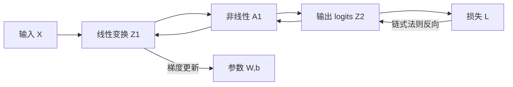
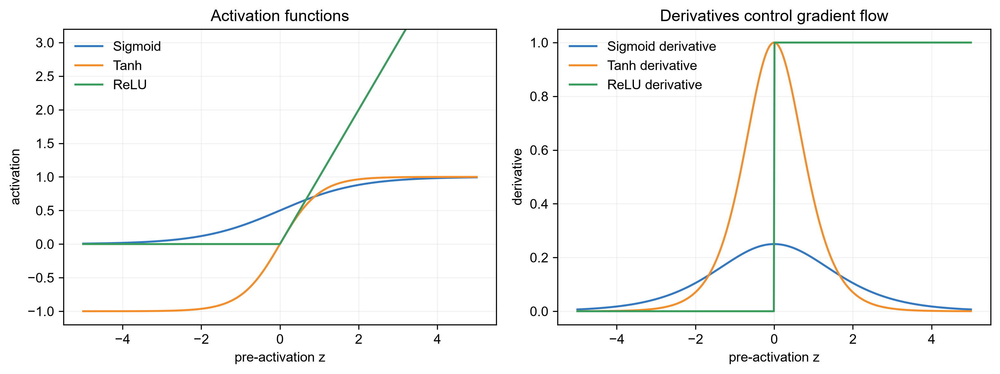
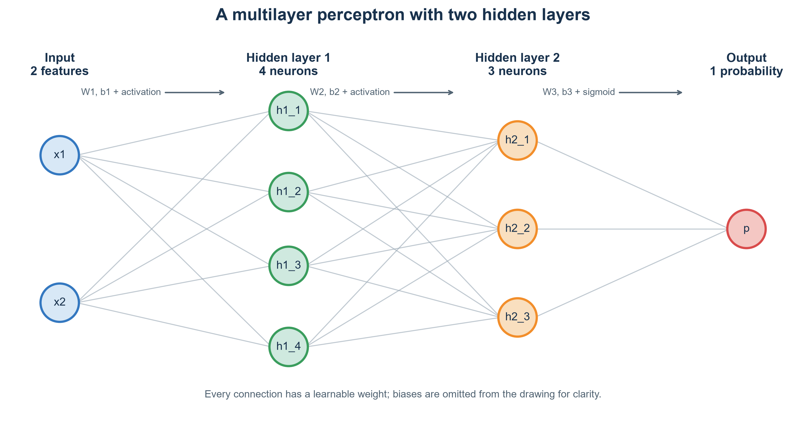
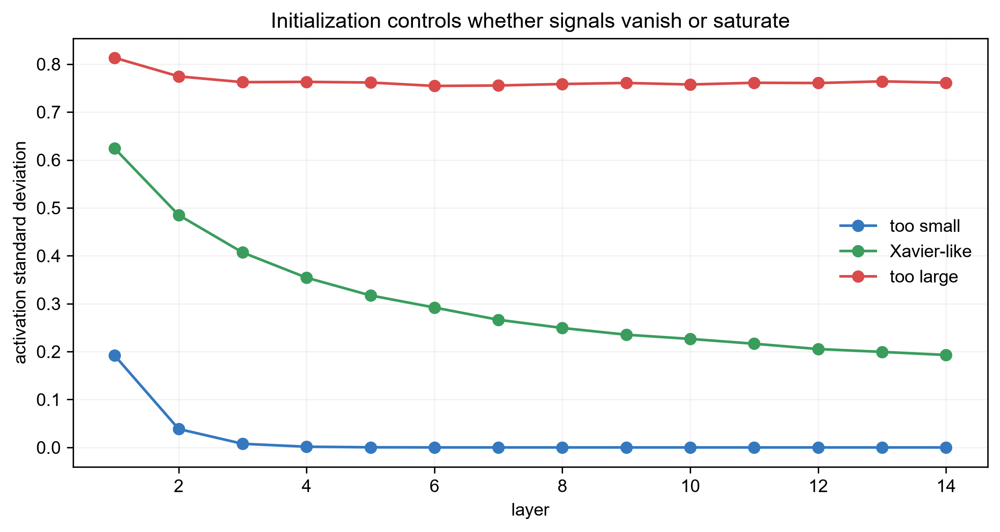
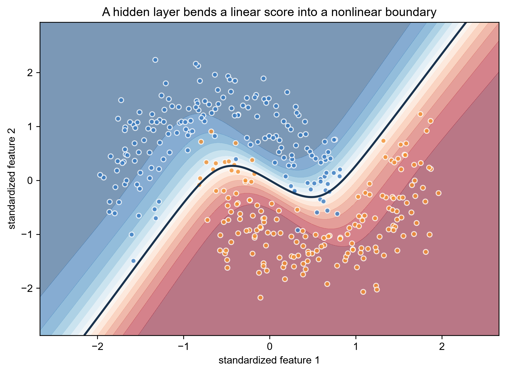
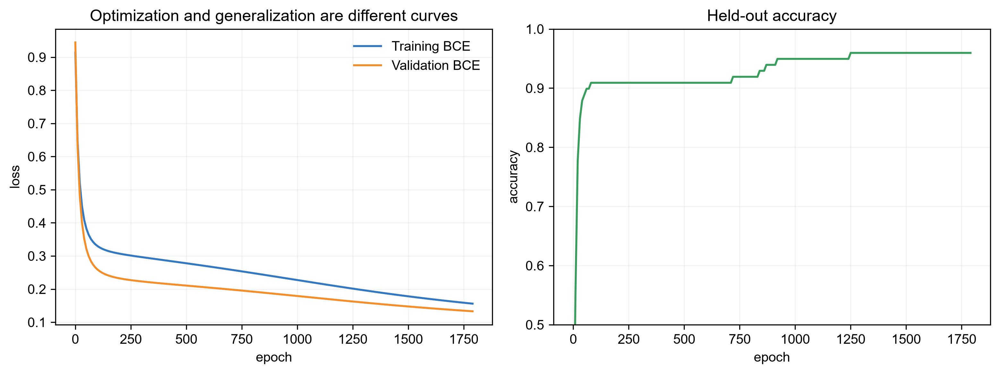

# 第 12 章：神经网络与反向传播——模型怎样自动学习非线性特征？

[← 第 11 章](11-dimensionality-reduction.md) | [English](../en/12-neural-networks-and-backprop.md) | [符号约定](appendix-a-notation.md)

> **先修**：[向量、矩阵与链式法则](02-math-foundations.md)、
> [梯度下降](03-linear-regression.md)、[交叉熵](04-logistic-regression.md)、
> [模型选择与正则化](09-learning-theory-and-model-selection.md)。

## 从第 11 章自然走到这里

PCA 的表示是固定的线性投影。若数据沿弯曲边界分布，一次线性变换后再接线性分类器，整体仍然
只是线性函数。神经网络通过“线性变换 + 非线性激活”的反复组合，自动学习适合任务的中间特征。
真正关键的不是把许多神经元堆在一起，而是反向传播能用一次计算高效求出所有参数的梯度。



## 本章学习路线

从“两层线性为何仍是线性”出发，定义一个最小 MLP 的每个张量，完成前向传播；然后逐行推导
反向传播，用数值梯度检查实现；接着解释初始化、mini-batch、Momentum、Adam 与正则化，最后
把 MLP 放回 Transformer 和现代训练系统中。

## 12.1 为什么只增加线性层没有用？

连续两层若没有非线性：

$$h=XW_1+b_1,\qquad o=hW_2+b_2,$$

代入得到

$$o=X(W_1W_2)+(b_1W_2+b_2),$$

仍是一次线性/仿射变换。无论堆多少层，都可合并为一层，无法解决 XOR、同心圆或弯月形边界。
激活函数 $\phi$ 阻止这种合并，使网络能组合出分段、弯曲和层次化特征。



上排显示 sigmoid、tanh 和 ReLU 的输出，下排显示相应导数。sigmoid/tanh 在输入绝对值较大时
导数接近零，深层链式相乘会导致梯度消失；ReLU 在正半轴导数为 1，训练通常更容易，但负半轴
梯度为零，神经元可能长期“死亡”。激活函数没有脱离网络、初始化和任务的绝对赢家；现代网络还
常用 GELU、SiLU 等平滑变体。

## 12.2 一个最小 MLP：先把形状写清楚

考虑二分类，batch 中有 $m$ 个样本、每个 $d$ 个特征，隐藏层宽度为 $h$：

| 符号 | 形状 | 含义 |
|---|---:|---|
| $X$ | $m\times d$ | 一批输入 |
| $W_1$ | $d\times h$ | 输入到隐藏层权重 |
| $b_1$ | $1\times h$ | 隐藏层偏置，可广播 |
| $Z_1,A_1$ | $m\times h$ | 隐藏层激活前/后 |
| $W_2$ | $h\times1$ | 隐藏层到输出权重 |
| $b_2$ | 标量 | 输出偏置 |
| $p,y$ | $m\times1$ | 预测概率与标签 |

前向传播为

$$Z_1=XW_1+b_1,$$
$$A_1=\tanh(Z_1),$$
$$Z_2=A_1W_2+b_2,$$
$$p=\sigma(Z_2).$$

平均二元交叉熵是

$$L=-\frac1m\sum_{i=1}^{m}\left[y^{(i)}\log p^{(i)}+(1-y^{(i)})\log(1-p^{(i)})\right].$$

实现中应使用稳定的 logit 形式，避免 $\log 0$ 和 sigmoid 溢出。

### 先看一张具有两个隐藏层的 MLP



这张图从左向右阅读：2 个输入特征先进入含 4 个神经元的第一隐藏层，再进入含 3 个神经元的第二
隐藏层，最后由 1 个输出神经元给出二分类概率。相邻两层之间采用全连接，因此上一层的每个神经元
都会连接到下一层的每个神经元；每条连线对应一个可学习权重。为了避免图过于拥挤，偏置没有单独
画成节点，但每个非输入神经元仍有自己的偏置。

两层隐藏表示为

$$A_1=\phi(XW_1+b_1),\qquad
A_2=\phi(A_1W_2+b_2),\qquad
p=\sigma(A_2W_3+b_3).$$

若一个样本有 2 个特征，两个隐藏层宽度分别为 4 和 3，则
$W_1\in\mathbb R^{2\times4}$、 $W_2\in\mathbb R^{4\times3}$、
$W_3\in\mathbb R^{3\times1}$。隐藏层不是在“投票”，而是在逐层构造新表示：第一层可学习较简单
组合，第二层再组合这些中间模式，输出层据此完成预测。

“几层网络”存在两种计数习惯：按隐藏层数说，这是一个**具有两个隐藏层的 MLP**；按带参数的
变换层计数，它也常被称为“三层网络”，因为共有 $W_1,W_2,W_3$ 三组权重。下面为了让第一次手算
足够清晰，会暂时缩成一个隐藏层；增加第二隐藏层只是再重复一次“线性变换—激活”，原理完全相同。

### 一个样本的完整前向数字例子

取 $x=[1,2]$，隐藏层有两个单元：

```math
W_1=\begin{bmatrix}0.1&-0.2\\0.3&0.4\end{bmatrix},\quad
b_1=[0,0],\quad W_2=\begin{bmatrix}0.5\\-0.5\end{bmatrix},\quad b_2=0.
```

则 $Z_1=xW_1=[0.7,0.6]$， $A_1=\tanh(Z_1)\approx[0.604,0.537]$，
$Z_2\approx0.0335$， $p=\sigma(Z_2)\approx0.508$。若标签 $y=1$，损失
$L=-\log p\approx0.677$。每层只是矩阵乘法、加偏置和逐元素非线性。

## 12.3 反向传播：把链式法则组织成可复用计算

反向传播不是另一种优化器。它负责计算 $\nabla_\theta L$；SGD/Adam 再决定怎样用梯度更新参数。
对 sigmoid 与交叉熵的组合可化简为

$$dZ_2=\frac{p-y}{m}.$$

从输出向输入依次计算：

$$dW_2=A_1^\top dZ_2,\qquad db_2=\sum_i dZ_{2,i},$$

$$dA_1=dZ_2W_2^\top,$$

因为 $\frac{d}{dz}\tanh z=1-\tanh^2z$，所以

$$dZ_1=dA_1\odot(1-A_1^2),$$

$$dW_1=X^\top dZ_1,\qquad db_1=\sum_i dZ_{1,i}.$$

$\odot$ 是逐元素乘法。每一行都可用“上游梯度 × 当前局部导数”理解。矩阵转置不是记忆技巧：
检查目标梯度形状必须与对应参数相同，就能排除许多错误。

继续上面的数字例子。 $dZ_2=p-y\approx-0.492$，所以
$dW_2=A_1^\top dZ_2\approx[-0.297,-0.264]^\top$，
$dA_1=dZ_2W_2^\top\approx[-0.246,0.246]$。再乘 tanh 的局部导数，得到
$dZ_1\approx[-0.156,0.175]$，进而

```math
dW_1=x^\top dZ_1=
\begin{bmatrix}-0.156&0.175\\-0.312&0.350\end{bmatrix}.
```

每个梯度的形状都与对应参数一致。用学习率 $0.1$ 更新时，
$W_{2,1}\leftarrow0.5-0.1(-0.297)=0.5297$，它增大了正向激活对正类 logit 的贡献。

### 一个标量链式法则例子

若 $u=wx+b$， $a=\tanh u$， $L=(a-y)^2/2$，则

$$\frac{\partial L}{\partial w}=(a-y)(1-a^2)x.$$

反向传播把大计算图拆成许多这样的局部操作，并缓存前向值，避免为每个参数重复整条计算。

## 12.4 自动微分：框架为什么知道梯度？

现代框架把前向操作记录成有向无环计算图。反向模式自动微分先拓扑排序，再从 $dL/dL=1$ 出发，
沿反向边累加梯度。若一个变量被多条路径使用，梯度必须相加。

运行最小标量自动微分引擎：

```bash
python code/chapter12/miniautograd.py
```

脚本只实现加法、乘法和 tanh，却已经能自动得到 $w$ 的梯度；结果与手推导数一致到数值精度。
PyTorch/JAX 的图更完整并支持张量、设备和编译，但核心仍是局部导数与链式法则。

### 梯度检查

对参数第 $j$ 维，用中心差分近似：

$$g_j^{num}=\frac{L(\theta+\epsilon e_j)-L(\theta-\epsilon e_j)}{2\epsilon}.$$

比较解析梯度 $g$ 与数值梯度：

$$\text{relative error}=\frac{\|g-g^{num}\|_2}{\|g\|_2+\|g^{num}\|_2+10^{-12}}.$$

梯度检查很慢，只用于小网络、小 batch 和开发测试；还要避开 ReLU 的不可导点。

## 12.5 初始化：为什么所有权重不能都设为零？

若同一层所有神经元权重相同，它们前向输出和反向梯度也相同，之后仍学成同一个神经元，这叫
**对称性无法打破**。随机初始化打破对称，但方差也不能随便选。

若每层输入方差不断缩小，信号和梯度会消失；若不断放大，会爆炸。Xavier 初始化常用于 tanh：

$$\mathrm{Var}(W)\approx\frac{1}{n_{in}},$$

He 初始化常用于 ReLU：

$$\mathrm{Var}(W)\approx\frac{2}{n_{in}}.$$

这个系数来自方差传播。若输入近似独立、零均值， $z=\sum_jw_jx_j$ 有
$\mathrm{Var}(z)\approx n_{in}\mathrm{Var}(w)\mathrm{Var}(x)$。
让前后方差相近便得到 Xavier 的 $1/n_{in}$；ReLU 约丢掉一半激活能量，因此用 2 补偿。



横轴是层数，纵轴是激活方差。过小初始化让方差迅速衰减，过大初始化使其增长或让激活饱和；与
激活函数匹配的缩放能让信号在多层中保持较稳定。该图只展示随机前向信号的一个诊断，不保证训练
一定成功；残差连接、归一化和优化器也会改变深网动力学。

## 12.6 从全量梯度到 SGD、Momentum 与 Adam

**全量梯度下降**每步使用所有样本，方向稳定但大数据成本高。**mini-batch SGD** 用一小批样本的
梯度作为总体梯度的有噪估计，能利用矩阵硬件并频繁更新：

$$\theta_{t+1}=\theta_t-\eta g_t.$$

Momentum 累积平滑方向：

$$v_t=\beta v_{t-1}+(1-\beta)g_t,\qquad
\theta_{t+1}=\theta_t-\eta v_t.$$

Adam 同时维护一阶、二阶矩并做偏差修正：

$$m_t=\beta_1m_{t-1}+(1-\beta_1)g_t,$$
$$v_t=\beta_2v_{t-1}+(1-\beta_2)g_t^2,$$
$$\theta_{t+1}=\theta_t-\eta\frac{\hat m_t}{\sqrt{\hat v_t}+\epsilon}.$$

Adam 常让早期训练更容易，但不意味着无需学习率调度、权重衰减或验证。AdamW 将 weight decay
与自适应梯度更新解耦，是 Transformer 中常见选择。

### batch、step 与 epoch 不要混用

若有 10,000 个样本、batch size 为 100，一轮 epoch 约含 100 个 optimization steps。梯度累积
4 个 micro-batch 后更新一次，有效 batch 是 400，但峰值激活内存仍接近单个 micro-batch。
复现实验应同时报告样本数、batch、step、学习率调度和随机种子。

## 12.7 拟合一条弯曲边界



蓝橙点是两类弯月数据，背景颜色是 NumPy MLP 预测为正类的概率，黑线是概率 0.5 的决策边界。
线性逻辑回归只能画直线，而隐藏层先把输入变换为非线性表示，使输出层能画出贴合两条弯月间隙的
曲线。框架模型在同一数据划分上作为数值对照，其测试结果在下文报告；图中不把两种实现叠加，避免
边界遮挡影响观察。



左图比较训练损失和验证损失，右图显示验证准确率。两种损失同时下降且验证准确率趋稳，说明模型
既在优化目标，也把规律迁移到了未参与更新的数据。若训练损失不降，应检查学习率、梯度和数值稳定；若训练继续改善而
验证损失回升，则是过拟合信号，应考虑 early stopping、权重衰减、dropout 或更多数据。

运行完整实验：

```bash
python code/chapter12/neural_networks.py
```

固定随机种子下，梯度检查相对误差约 $2.45\times10^{-9}$，NumPy MLP 测试准确率约 0.927，
框架对照约 0.953。准确率不是代码正确性的唯一证据；梯度检查、损失下降、形状断言和基线对照
共同形成验证链。

## 12.8 正则化与训练诊断

- **weight decay**：限制权重过大；对 Adam 通常使用解耦的 AdamW。
- **dropout**：训练时随机屏蔽激活，测试时使用完整网络与对应缩放；过强会欠拟合。
- **early stopping**：保留验证指标最好的 checkpoint，而不是最后一轮。
- **数据增强**：注入希望模型保持不变的变换，如图像裁剪；错误增强会破坏标签。
- **Batch/Layer Normalization**：稳定中间尺度。BatchNorm 依赖 batch 统计，LayerNorm 沿特征归一化。

BatchNorm 训练时用 batch 均值方差并维护推理统计；小 batch 或训练/推理模式切换错误会造成漂移。
LayerNorm 对每个样本的特征维归一化，不依赖其他样本，更适合序列。残差连接 $y=x+F(x)$ 给梯度
提供恒等路径，使深层更容易优化；它解决优化困难，不自动保证不过拟合。

诊断顺序建议：先让很小数据集过拟合到近零损失，验证实现有学习能力；再扩大数据，观察训练/验证
曲线；最后才搜索正则化与宽深度。直接在有 bug 的网络上大规模调参只会浪费算力。

更具体的排查顺序是：输入和标签 → 损失单位 → 小样本过拟合 → 梯度是否 NaN/全零 → 参数是否
真的变化 → 简单基线 → 学习率 → 宽深度与正则。若几十个样本都记不住，应先怀疑实现、容量或
优化，不要先增加 dropout。

## 12.9 与已有模型怎样选择？

表格小数据先试线性模型、树集成与明确基线；图像、语音、文本等高维结构数据通常更适合神经网络。
神经网络优势是特征与预测器可端到端联合学习，代价是数据、算力、调试和校准要求更高。性能接近时，
应同时比较延迟、内存、可解释性、重训练成本和分布漂移，而非默认“更深更先进”。

## 12.10 复杂度、系统成本与失败诊断

全连接层前向成本约为 $O(mn_{in}n_{out})$，反向通常同阶并需保存中间激活。训练内存不仅包含参数，
还有梯度、优化器状态和激活；Adam 的状态会额外占用显著内存。混合精度、梯度累积、检查点重算和
数据并行是在质量不变或可控条件下换取系统可行性的工具。

常见失败包括形状广播悄悄出错、标签/损失不匹配、忘记切换 train/eval、学习率过大、梯度爆炸、
数据泄漏和只看训练 loss。应记录随机种子、代码版本、数据版本、超参数和最佳 checkpoint 规则。

## 12.11 与现代 AI 的联系

- **Transformer 中的 MLP**：每个 block 不只有注意力，还有逐 token 的前馈网络，通常是
  Linear→GELU/SiLU→Linear；本章的矩阵、激活和反向传播直接适用。
- **注意力也靠反向传播学习**：query/key/value 投影与 softmax 都在计算图中，由同一链式法则训练。
- **预训练与微调**：大模型先从海量自监督目标学参数，再全量微调或用 LoRA 等参数高效方法适配；
  可训练参数变少改变成本，但不改变需要独立验证的原则。
- **自动微分与加速器**：框架将计算图融合并调度到 GPU/TPU；数学上仍是张量运算与反向模式 AD。
- **规模不是原理替代品**：梯度稳定、初始化、归一化、优化、数据质量与评测设计在大模型中更重要。

## 12.12 苏格拉底导师

<details><summary>为什么两层线性网络不能比一层表达更多？</summary>
线性/仿射变换的复合仍是线性/仿射变换，可合并成新的权重与偏置。
</details>

<details><summary>反向传播与梯度下降有什么区别？</summary>
反向传播计算梯度；梯度下降、Momentum 或 Adam 使用梯度更新参数。
</details>

<details><summary>为什么梯度从多条路径流向同一变量时要相加？</summary>
多元链式法则要求把该变量通过所有下游路径对损失的贡献求和。
</details>

<details><summary>训练损失突然变成 NaN，第一步查什么？</summary>
检查学习率、输入尺度、除零/log 0/exp 溢出、梯度范数与损失的稳定实现，再查数据异常。
</details>

<details><summary>隐藏层越宽，训练误差下降，为什么测试可能变差？</summary>
容量提高同时增加拟合噪声的可能；需用数据、正则化、优化隐式偏置和验证共同控制有效复杂度。
</details>

<details><summary>框架模型准确率高，能否说明手写反向传播没有 bug？</summary>
不能。不同实现可能偶然达到相近分数；应做逐参数梯度检查、极小数据过拟合和中间张量对照。
</details>

## 12.13 练习

完成后对照[第 12 章参考答案](solutions/12-solutions.md)。

1. **形状推理**：给定 $m=32,d=10,h=20$，写出前向与反向每个张量形状。
2. **手推**：推导 sigmoid+BCE 的 $dZ=(p-y)/m$。
3. **从零实现**：为 NumPy MLP 增加 ReLU、两层隐藏层和 mini-batch。
4. **梯度检查**：故意删掉 tanh 导数，观察 relative error 与训练曲线怎样变化。
5. **初始化消融**：比较零、极小、极大、Xavier 和 He 初始化的激活/梯度分布。
6. **优化器比较**：在相同训练预算下比较 SGD、Momentum、AdamW，并报告最佳验证轮次。
7. **现代 AI**：统计一个 Transformer block 中注意力与 MLP 的参数量、激活量和主要矩阵形状。

## 12.14 面试八股

- **MLP 为什么需要非线性？** 否则多层线性复合仍等价于一层线性模型。
- **反向传播本质是什么？** 在计算图上应用链式法则的反向模式自动微分。
- **梯度消失/爆炸为何发生？** 多层 Jacobian 连乘使尺度指数缩小或放大。
- **为什么不能全零初始化？** 同层神经元保持完全对称，学不到不同特征。
- **Xavier 与 He 区别？** 前者常匹配 tanh/线性，后者补偿 ReLU 丢弃约一半激活的方差。
- **SGD 与 Adam？** SGD 状态少、常有良好泛化；Adam 自适应尺度、早期易优化，但仍需调度与正则。
- **mini-batch 有什么作用？** 以可控噪声近似全量梯度，提高硬件吞吐并增加更新频率。
- **dropout 训练和测试有何不同？** 训练随机屏蔽并缩放，测试使用完整确定性网络。
- **BatchNorm 与 LayerNorm？** 前者依赖 batch 维统计，后者对单样本特征归一化，Transformer 常用后者。
- **如何验证反向传播实现？** 数值梯度检查、极小数据过拟合、形状断言和框架逐层对照。

## 本章通关标准

- [ ] 我能证明没有激活的多层网络仍是线性模型。
- [ ] 我能写出两层 MLP 的所有张量形状和稳定前向计算。
- [ ] 我能从输出到输入推导每个梯度，并解释梯度累加。
- [ ] 我能实现最小反向自动微分并使用数值梯度检查。
- [ ] 我能从信号方差解释 Xavier/He 初始化与梯度消失/爆炸。
- [ ] 我能比较 SGD、Momentum、AdamW 及正则化方法，而不只背公式。
- [ ] 我能说明 MLP、反向传播和自动微分在 Transformer/LLM 中的具体位置。

### 扩展阅读

- [Deep Learning Book：Deep Feedforward Networks](https://www.deeplearningbook.org/contents/mlp.html)
- [Deep Learning Book：Optimization for Training Deep Models](https://www.deeplearningbook.org/contents/optimization.html)
- [Karpathy：micrograd](https://github.com/karpathy/micrograd)
- [PyTorch：Autograd mechanics](https://pytorch.org/docs/stable/notes/autograd.html)

[下一章：表征学习与对比学习 →](13-representation-learning.md)
