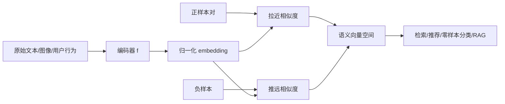

# 第 13 章：表征学习——怎样让相似的内容在向量空间中靠近？

[← 第 12 章](12-neural-networks-and-backprop.md) | [English](../en/13-representation-learning.md) | [符号约定](appendix-a-notation.md)

> **先修**：[相似度与高维距离](06-neighbors-and-kernels.md)、
> [交叉熵与 softmax](04-logistic-regression.md)、[神经网络与反向传播](12-neural-networks-and-backprop.md)。

## 从第 12 章自然走到这里

上一章的隐藏层已经在学习中间特征，但监督分类只要求把预先给定的类别分开。现代 AI 更希望得到
可复用的表示：意思相近的句子、描述同一物体的图文、同一用户可能喜欢的商品，即使没有共享类别
编号，也应在向量空间中靠近。表征学习研究如何设计数据关系、编码器和训练目标，让距离具有语义。



## 本章学习路线

先明确“表示好”必须相对于任务定义，再构造双塔编码器；随后把 batch 内匹配写成 softmax 分类，
推导 InfoNCE；通过训练前后空间、相似度矩阵和检索指标验证效果，最后分析温度、负样本、表示坍塌
及其在 CLIP、推荐和 RAG 中的应用。

## 13.1 为什么原始特征不够？

字符串“如何办理退款”和“退货后钱什么时候到账”词面不同但语义相近；同一只猫的裁剪图和原图
像素不同却应表示同一内容。若直接比较 one-hot、词面或像素距离，邻居常反映表面重合而非任务语义。

表征学习寻找编码器

$$f_\theta:\mathcal X\rightarrow\mathbb R^d,$$

把输入映射为 embedding $z=f_\theta(x)$。好的表示通常希望：

- 与任务无关的变化被忽略，即具有合适的**不变性**；
- 与任务相关的变化仍可分辨；
- 相似度能支持检索、分类或生成；
- 在未见数据和子群体上保持稳定。

不变性不能无限增加。若在数字识别中把 6 旋转成 9 仍当正样本，增强就破坏了语义；数据对的定义
本身就是监督信号。

## 13.2 从人工特征到预训练表示

传统流程由人设计词频、边缘、统计量，再训练小模型；深度表征学习让编码器与任务目标联合优化。
当人工标签稀缺时，可从数据自身构造监督：遮住词让模型预测、对同一对象做两种增强、把配对图文
作为正样本。这类从数据关系产生训练信号的方法称为**自监督学习**。

预训练先在大规模通用数据上学习表示，再通过线性探针、微调或直接检索适配下游。它能复用统计规律，
也会继承预训练数据的偏差、版权风险和分布盲区。

常见预训练信号并不等价：自回归语言建模学习预测下一个 token；掩码建模利用双向上下文恢复缺失
内容；对比学习直接塑造相似度；自编码重构强调保留输入信息。选择目标，就是选择哪些关系值得模型
花容量保存。

## 13.3 双塔模型：查询和候选各自编码一次

检索中有第 $i$ 个查询 $x_q^{(i)}$ 与匹配文档 $x_d^{(i)}$。双塔分别编码：

$$q^{(i)}=f_\theta(x_q^{(i)}),\qquad d^{(i)}=g_\phi(x_d^{(i)}).$$

常把向量 L2 归一化：

$$\bar q_i=\frac{q_i}{\|q_i\|_2},\qquad
\bar d_i=\frac{d_i}{\|d_i\|_2},$$

此时点积就是余弦相似度

$$s_{ij}=\bar q_i^\top\bar d_j\in[-1,1].$$

文档向量可离线计算并建立近似最近邻索引；在线只编码查询再搜索，因此适合百万级召回。交叉编码器
让查询和文档共同经过模型，交互更充分但必须对每一对重新计算，常用于小候选集重排。

## 13.4 正样本、负样本与对比目标

对一批 $B$ 个匹配对， $(q_i,d_i)$ 是正样本，其余 $d_j,j\ne i$ 可作为 batch 内负样本。对每个
查询，把“正确文档是哪一个”写成 $B$ 类 softmax：

$$P(d_j\mid q_i)=
\frac{\exp(s_{ij}/\tau)}{\sum_{k=1}^{B}\exp(s_{ik}/\tau)}.$$

InfoNCE 损失就是正确匹配的负对数概率：

$$\mathcal L_{q\to d}=-\frac1B\sum_{i=1}^{B}
\log\frac{\exp(s_{ii}/\tau)}{\sum_j\exp(s_{ij}/\tau)}.$$

常再计算文档到查询的对称损失并平均。它本质上是相似度矩阵上的交叉熵：对角线是标签位置。

### 三个候选，手算一次 InfoNCE

设某查询与三篇文档的余弦相似度为 $[0.8,0.3,0.1]$，第一篇是正样本，温度 $\tau=0.2$。
logits 为 $[4,1.5,0.5]$。减去最大值后做 softmax：

$$P_+=\frac{1}{1+e^{-2.5}+e^{-3.5}}\approx0.899,\\qquad
L=-\log P_+\approx0.107.$$

若出现困难负样本，把第二个相似度改为 0.75，则 $P_+\approx0.547$、损失升到约 0.604。这解释
了梯度为何主要关注“很像但不该配对”的样本。若困难负样本其实是同义文档，低温度也会让模型
更猛烈地做错事。

### 温度 $\tau$ 在控制什么？


横轴是候选相似度，曲线表示 softmax 后的相对权重。较小温度把微小相似度差异放大，使分布更尖、
更关注困难负样本，同时梯度也更敏感；较大温度让分布平缓，训练信号可能过弱。温度不是“越小越
好”的精度旋钮，需要结合 batch 大小、相似度范围和验证检索指标选择。

## 13.5 训练到底改变了什么？

为了看清机制，本章代码使用二维合成语义变量，查询与文档由不同线性变换和噪声生成；两个线性塔
必须学会消除视角差异，把同一潜在对象对齐。


圆点代表查询、叉号代表文档，颜色代表四个潜在语义群体，浅灰线连接真实配对。左图中不少配对线较长，
说明未训练的两个视角没有对齐；右图训练后，多数圆点与对应叉号彼此靠近，同时不同颜色仍分布在
空间的不同区域。图展示的是“配对关系被编码进几何空间”，
不是说所有真实语义都能压缩成二维，也不能仅凭漂亮分布证明检索质量。


矩阵第 $i$ 行是查询 $q_i$ 与各文档的相似度，亮色对角线表示正确配对得分较高。若出现明亮的非
对角元素，它可能是真负样本很相似、数据中存在重复项，或模型发生混淆。相似度热图能定位错误结构，
而单一平均 loss 往往看不出这些细节。


随着训练进行，InfoNCE 下降，Recall@1 上升后趋于稳定。两条曲线回答不同问题：loss 衡量 batch
分类目标，Recall@1 衡量图库检索中正确项是否排第一；二者通常相关但不保证同步。因此应依据实际
检索指标选择 checkpoint，而不是只保留训练 loss 最低的一轮。

## 13.6 负样本为什么既重要又危险？

若没有负样本，只拉近正对，所有输入映射为同一向量也能使正对距离为零，这叫**表示坍塌**。
负样本提供“哪些内容需要区分”的约束。batch 越大通常有更多负样本，但也带来：

- **假负样本**：batch 中未标为配对的内容其实语义相同，强行推远会伤害表示；
- **过易负样本**：与查询毫不相关，很快没有有效梯度；
- **困难负样本偏差**：采样机制若过度集中某类，模型会学习捷径；
- **跨设备通信**：分布式大 batch 需要汇聚向量，增加带宽和显存压力。

改进方法包括去重、同标签屏蔽、hard-negative mining、队列/内存库、蒸馏和无负样本方法的停止梯度
与冗余约束。策略必须与任务语义一致。

队列和 memory bank 提供更多负样本，却可能存放旧模型产生的“陈旧向量”；跨 batch hard mining
提高难度，也会放大标注错误。无负样本方法并非没有防坍塌机制，通常依赖停止梯度、非对称预测头、
方差/协方差约束或教师网络。判断坍塌不能只看 loss，应监控每维标准差、协方差谱和近邻多样性。

## 13.7 怎样评价表示，而不是只看训练损失？

### 检索指标

- **Recall@k**：正确候选是否出现在前 $k$ 名；多个相关答案时按是否召回任一/全部明确定义。
- **MRR**：正确答案排名倒数的平均， $MRR=\frac1m\sum_i1/r_i$。
- **NDCG@k**：支持多级相关性，并对靠前位置赋更高权重。

### 表示质量探针

- **线性探针**：冻结编码器，只训练线性分类器，检查信息是否容易线性读取。
- **kNN 评估**：用邻居标签判断局部语义结构。
- **聚类与可视化**：用于发现模式，但必须配合稳定性和定量指标。
- **迁移评估**：在多个下游任务、领域和子群体上验证，避免只对单一 benchmark 优化。

测试图库必须与训练去重，并模拟真实候选规模。只在 batch 内做检索会比百万候选的线上问题容易得多。

## 13.8 从零实现、索引与复现结果

运行：

```bash
python code/chapter13/representation_learning.py
```

脚本用 NumPy 手推两个线性塔和 InfoNCE 梯度，再用最近邻索引完成检索。固定随机种子下，未训练
Recall@1 约 0.013；训练后 Recall@1 约 0.863、Recall@5 约 0.975、MRR 约 0.908。
这些数值只验证合成问题上的机制，不代表真实语言模型质量。

实际向量库常用 approximate nearest neighbor（ANN）以少量召回损失换取显著速度和内存收益。
评估时应同时报告编码耗时、索引构建时间、查询延迟、吞吐、内存和精确 Recall@k；更快但漏掉
关键候选的索引并不一定更有价值。

## 13.9 双塔、交叉编码器与生成模型怎样组合？

一个常见检索系统是：

1. 双塔从大库快速召回数百个候选；
2. 交叉编码器读取查询—候选对，精细重排到几十个；
3. 规则或生成模型综合证据给出结果；
4. 分别记录召回遗漏、重排错误和生成错误。

双塔把候选独立编码，速度快但早期交互弱；交叉编码器质量高但计算随候选数增长。生成模型能组织
答案，却不能补回未召回的证据。三者不是互相替代，而是质量—成本链条中的不同角色。

完整上线链路还包括：语料切块与去重 → 编码 → 建索引 → 查询编码 → ANN 召回 → 元数据过滤 →
重排 → 生成/展示 → 反馈回流。编码器更新后，旧索引与新查询向量可能不在同一空间，必须版本化并
重建或双写索引。高维中还可能出现 hubness：少数向量成为大量查询的近邻；需要检查热门邻居频率、
各语言/领域分组召回和向量各向异性，而不只看总 Recall。

## 13.10 复杂度、系统成本与失败诊断

batch 内完整相似度矩阵成本为 $O(B^2d)$、内存为 $O(B^2)$；大 batch 需要分块、跨设备负样本或
队列。全库精确搜索为 $O(Nd)$，ANN 用索引换取亚线性候选访问或更高硬件效率。

常见失败包括：训练/测试重复、用文档 ID 等捷径匹配、正样本定义错误、归一化遗漏、只报小图库指标、
假负样本过多，以及 embedding 模型更新后未重建索引。上线还要监控向量范数、相似度分布、空结果、
热门内容偏置和新内容冷启动。

## 13.11 与现代 AI 的联系

- **RAG**：查询编码器与文档编码器产生向量，召回外部证据供 LLM 生成。检索质量是生成答案的上限
  之一，应把 Recall、证据使用率和答案正确率分层评估。
- **CLIP**：用配对图像—文本做对称对比学习，使两种模态进入共同空间，可做跨模态检索和零样本分类。
- **推荐系统双塔**：用户塔编码历史与上下文，物品塔编码商品；先向量召回，再由精排模型加入交互特征。
- **句向量**：将句子编码为可比较 embedding，支持语义搜索、去重和聚类；余弦高不等于事实一致。
- **LLM 表征**：token/句子隐藏状态是上下文表示，但直接取哪个层、怎样池化、是否微调都会影响用途。
- **预训练目标塑造能力**：语言建模、掩码预测和对比学习强调不同关系；不存在脱离目标的“万能语义”。

## 13.12 苏格拉底导师

<details><summary>为什么 embedding 的每一维通常没有明确人类含义，仍然有用？</summary>
信息可分布在多个维度的组合中；只要几何关系支持下游预测和迁移，不要求每维独立命名。
</details>

<details><summary>把同一图片的两种裁剪作为正样本，模型究竟学到了什么假设？</summary>
它被要求对这些裁剪保持不变。若裁剪删掉决定标签的区域，这个假设就可能错误。
</details>

<details><summary>InfoNCE 为什么可以看成分类？</summary>
对每个查询，batch 中每个文档是一个候选类，正确配对的位置是标签，相似度除温度是 logits。
</details>

<details><summary>Recall@5 很高，为什么用户仍可能觉得检索差？</summary>
相关项可能只排第五、相关定义不完整、结果缺乏多样性，或下游重排/生成没有使用它；需联合指标与人工评估。
</details>

<details><summary>二维图中同类聚得很好，能否证明表示可泛化？</summary>
不能。降维会扭曲结构，图也可能只覆盖训练分布；必须在未见数据、下游指标和子群体上验证。
</details>

<details><summary>更大的 batch 为什么可能既提升又伤害训练？</summary>
它提供更多负样本和更稳定估计，但也增加假负样本、计算通信与对温度/学习率的敏感性。
</details>

## 13.13 练习

完成后对照[第 13 章参考答案](solutions/13-solutions.md)。

1. **手算 InfoNCE**：给定 $3\times3$ 相似度矩阵和温度，计算第一行概率与损失。
2. **梯度直觉**：说明降低一行损失会怎样改变正样本与高分负样本的相似度。
3. **温度消融**：比较 $\tau=0.03,0.1,0.5,1.0$ 的训练稳定性与 Recall@k。
4. **假负样本**：在 batch 中加入语义重复文档，比较屏蔽前后的表示与检索。
5. **双塔对照**：实现共享参数与不共享参数的塔，讨论何时各自合理。
6. **系统实验**：比较精确搜索与 ANN 的 Recall、P95 延迟、吞吐和内存。
7. **RAG 设计**：构造 100 个问题的分层评测，区分召回失败、重排失败和生成失败。

## 13.14 面试八股

- **什么是表征学习？** 从数据与目标中学习可供下游使用的特征映射，而非完全依赖人工特征。
- **自监督学习是什么？** 从数据自身结构构造训练信号，如遮盖预测或同对象增强配对。
- **双塔为什么适合召回？** 候选可离线编码建索引，在线只编码查询并做向量搜索。
- **余弦相似度与点积关系？** 向量 L2 归一化后，点积等于余弦相似度。
- **InfoNCE 是什么？** 用正对作为正确类、负样本作为候选类的温度 softmax 交叉熵。
- **温度有什么作用？** 控制相似度 logits 的尺度与 softmax 尖锐程度，影响困难负样本梯度。
- **什么是表示坍塌？** 不同输入映射为相同或近似表示，失去区分能力。
- **假负样本是什么？** 被训练目标当作负例、实际却语义相关的样本。
- **如何评价 embedding？** Recall/MRR/NDCG、线性探针、迁移任务、鲁棒性及系统成本联合评价。
- **双塔与交叉编码器区别？** 前者独立编码、可索引、交互弱；后者联合编码、质量高、逐对计算昂贵。
- **RAG 中检索好为何答案仍可能错？** 生成器可能忽略、误解或拼接证据，也可能任务需要库外知识。

## 本章通关标准

- [ ] 我能解释“好表示”必须相对于任务、不变性和评测定义。
- [ ] 我能写出双塔、归一化、余弦相似度和批内相似度矩阵。
- [ ] 我能把 InfoNCE 推导为 batch 候选上的交叉熵，并解释温度作用。
- [ ] 我能诊断表示坍塌、假负样本、捷径学习和训练/测试重复。
- [ ] 我能用 Recall@k、MRR、NDCG、线性探针与迁移任务评价表示。
- [ ] 我能设计双塔召回、交叉编码器重排和生成模型的分层系统。
- [ ] 我能准确说明表征学习在 CLIP、推荐、句向量和 RAG 中的应用与限制。

### 扩展阅读

- [SimCLR：A Simple Framework for Contrastive Learning](https://arxiv.org/abs/2002.05709)
- [Contrastive Predictive Coding / InfoNCE](https://arxiv.org/abs/1807.03748)
- [CLIP：Learning Transferable Visual Models From Natural Language Supervision](https://arxiv.org/abs/2103.00020)
- [Sentence-BERT](https://arxiv.org/abs/1908.10084)

[下一章：序列、视觉与 Attention →](14-sequence-vision-and-attention.md)
