# 第 14 章：结构化神经网络——CNN、RNN、LSTM 与 Attention 为什么各有所长？

[← 第 13 章](13-representation-learning.md) | [English](../en/14-sequence-vision-and-attention.md) | [符号约定](appendix-a-notation.md) | [课程路线](00-course-roadmap.md)

> **先修**：[神经网络与反向传播](12-neural-networks-and-backprop.md)、
> [表征学习](13-representation-learning.md)、矩阵乘法与 softmax。

## 从第 13 章自然走到这里

上一章把一个完整对象编码成向量，但图像有空间邻域，文本和时间序列有先后顺序。把每个像素或
token 当成互不相关的普通特征，会丢掉结构并产生大量参数。本章围绕同一个问题展开：**怎样让网络
用与数据结构匹配的方式共享参数和传递信息？** CNN 在局部位置共享滤波器，普通 RNN 沿时间复用
状态更新，LSTM 再给递归状态增加可控的长期记忆，Attention 则让每个位置按内容选择要读取的其他位置。

本章虽然把四种结构放在一起，但不会把它们压缩成名词概览。CNN、RNN、LSTM 各自按照“为什么
引入—怎样完成一次预测—数学结构—训练—代码—失败诊断”的小章节展开；最后才统一比较和收束。

## 本章学习路线

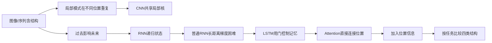

## 14.1 为什么全连接网络不够自然？

一张 $224\times224\times3$ 图像若直接连接 1000 个隐藏单元，仅第一层就约有 1.5 亿个权重；
而“竖直边缘”无论出现在左上角还是右下角，检测方法应相同。卷积用**局部连接和参数共享**表达这个
先验。文本中“not good”和“good”不能只看词袋计数，顺序会改变意义；RNN 用状态表达历史。
当相关词相隔数百位置时，信息沿 RNN 链逐步传递又太长，Attention 让位置之间直接建立加权连接。

<details><summary>苏格拉底追问：结构先验会不会限制模型？</summary>
会。先验正确时减少样本和参数，先验错误时产生偏差。例如卷积天然偏好局部平移模式，却不自动理解
任意远距离关系；选择结构就是在样本效率与灵活性之间做取舍。
</details>

## 14.2 CNN 小专题：为什么图像需要局部连接和参数共享？

### 14.2.1 为什么引入 CNN？

设我们要判断监控图像中有没有裂纹。裂纹可能出现在左上、中央或右下，但“短小、高对比、连续的
边缘”这一识别规则不应因位置改变而重新学习。全连接网络却为每个像素位置分配独立权重：它不知道
左上的竖直边缘与右下的竖直边缘是同一种模式，而且参数量会随图像面积快速增加。

卷积神经网络（Convolutional Neural Network, CNN）加入两个假设：

1. **局部连接**：一个位置先看附近像素，而不是第一层就连接整张图；
2. **参数共享**：同一个局部检测器在所有位置重复使用。

这两个假设适合图像、语音波形、心电信号和某些短文本模式。若任务由任意远距离位置之间的关系决定，
只用浅层小卷积就不自然，需要加深、扩张、全局汇聚或与 Attention 组合。

<details><summary>苏格拉底追问：CNN 参数少是否只是为了省内存？</summary>
不只是。更少参数还表达了“相同模式可在不同位置复用”的归纳偏置，因此通常需要更少样本；但若这个
偏置不适合任务，也会限制模型。
</details>

### 14.2.2 一维卷积怎样完成一次局部检测？

先把输入想成每天的传感器读数。长度为 3 的核每次读取连续 3 天，算一个加权和，然后向右移动。
输入 $x\in\mathbb R^n$，核 $w\in\mathbb R^k$，无填充、步幅 1 时：

$$y_t=b+\sum_{j=0}^{k-1}w_jx_{t+j},\qquad t=0,\ldots,n-k.$$

### 把一次滑动计算拆成四步

令输入 $x=[0,0,1,1,1]$，核 $w=[-1,0,1]$。这里输入长度 $n=5$、核宽 $k=3$，步长为 1，
不填充边界，因此核只能放在 3 个合法位置：

$$n_{\text{out}}=n-k+1=5-3+1=3.$$

每个输出都严格执行四步：

1. 从输入中截取连续 3 个数，称为当前**窗口**；
2. 将窗口和核的三个位置一一对齐；
3. 对齐位置分别相乘；
4. 把三个乘积相加，得到当前位置的一个输出。

完整计算如下：

$$y_0=[0,0,1]\cdot[-1,0,1]=1,$$

$$y_1=[0,1,1]\cdot[-1,0,1]=1,\qquad
y_2=[1,1,1]\cdot[-1,0,1]=0.$$

把点积进一步展开，就能看见每个数从哪里来：

| 输出 | 当前窗口 | 逐元素乘积 | 求和 |
|---|---|---|---:|
| $y_0$ | $[0,0,1]$ | $[0\times(-1),\,0\times0,\,1\times1]=[0,0,1]$ | 1 |
| $y_1$ | $[0,1,1]$ | $[0\times(-1),\,1\times0,\,1\times1]=[0,0,1]$ | 1 |
| $y_2$ | $[1,1,1]$ | $[1\times(-1),\,1\times0,\,1\times1]=[-1,0,1]$ | 0 |

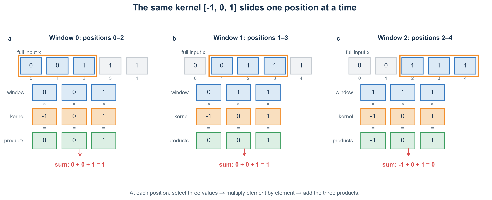

图中的橙色框是核当前覆盖的 3 个输入。三个小图从左到右分别对应 $y_0,y_1,y_2$：先选窗口，再把
窗口与同一个核逐元素相乘，最后将绿色乘积相加。输出不是“复制某个输入值”，而是对当前局部模式
给出的一个响应分数。

这个核尤其容易理解，因为中间权重为 0：

$$y_t=-x_t+x_{t+2}=x_{t+2}-x_t.$$

它实际上在比较窗口最右边和最左边：右边比左边大，输出为正，表示出现“从低到高”的变化；右边
比左边小，输出为负，表示“从高到低”；两边相同则输出为 0，表示这个尺度下没有边缘。因此前两个
窗口虽然中间值不同，输出仍都是 1；最后窗口左右都是 1，所以输出为 0。

最关键的“共享”是：计算 $y_0,y_1,y_2$ 时，始终重复使用同一组权重 $[-1,0,1]$，而不是每个位置
另学一组权重。若步长是 1，核每次右移一个位置；本例没有 padding，所以不会把核放到输入边界之外。

严格数学卷积会先翻转核；PyTorch、TensorFlow 等深度学习库通常直接按当前顺序做互相关。因为核
是从数据中训练出来的，是否预先翻转并不限制可学习的模式，工程中仍习惯把这一层称为“卷积层”。

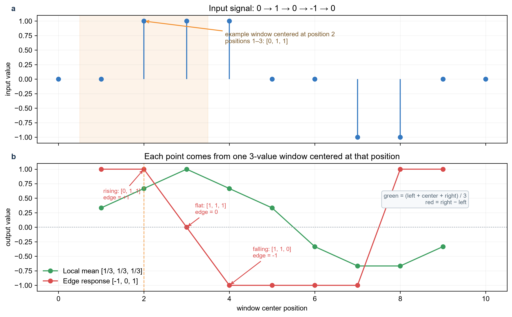

### 怎样读这张总览图？

先只看上半图。它画出的完整输入是

$$x=[0,0,1,1,1,0,0,-1,-1,0,0],$$

横坐标 0～10 是输入下标，纵坐标是该位置的数值。信号先从 0 上升到 1，又下降到 0 和 $-1$，最后
回到 0。下半图不是把上半图复制一遍，而是对这个输入分别滑动两个不同的核：

$$w_{\text{mean}}=[1/3,1/3,1/3],\qquad
w_{\text{edge}}=[-1,0,1].$$

绿色点是局部平均，红色点是边缘响应。为了让上下图位置对齐，下图把每个三元素窗口的输出画在
**窗口中心** $c$。因此中心为 $c$ 时使用

$$[x_{c-1},x_c,x_{c+1}],\qquad c=1,2,\ldots,9.$$

位置 0 和 10 没有输出点，因为本例没有 padding，无法以它们为中心取得完整的三个输入。

下面挑几个图上的点手算：

| 下图中心 $c$ | 上图对应窗口 | 绿色：局部平均 | 红色：边缘响应 |
|---:|---|---:|---:|
| 2 | $[0,1,1]$ | $(0+1+1)/3=2/3$ | $-0+1=1$ |
| 3 | $[1,1,1]$ | $(1+1+1)/3=1$ | $-1+1=0$ |
| 4 | $[1,1,0]$ | $(1+1+0)/3=2/3$ | $-1+0=-1$ |
| 8 | $[-1,-1,0]$ | $(-1-1+0)/3=-2/3$ | $-(-1)+0=1$ |

以中心 2 为例，上图橙色阴影标出窗口 $[0,1,1]$。绿色核把三个数平均，所以得到 $2/3$；红色核
只比较右端与左端，所以得到 $1-0=1$。这两个结果都画在下图横坐标 2，而不是画在窗口起点 1。

现在就能解释两条曲线：

- **绿色曲线**回答“附近三个值的平均水平是多少”。在全为 1 的平台中心达到 1；滑到 $-1$ 区域
  后变为负数。它主要用于平滑，而不是判断升降方向。
- **红色曲线**回答“窗口右端比左端高多少”。上升沿为正，下降沿为负，左右一样时为 0。红线连续
  几个位置为 $-1$，表示多个相邻窗口都跨越了向下变化，并不是同一条边被重复画错。

如果此处只想理解前面的手算，可以暂时忽略绿色曲线；加入它是为了说明：**相同输入、相同滑动
方式，只要换一组共享权重，就会得到含义不同的特征图。** 两组人工核只用于建立直觉，真实 CNN 会
通过反向传播学习许多核。

### 14.2.3 二维图像、通道和特征图是什么？

灰度图可写成矩阵 $X\in\mathbb R^{H\times W}$。一个 $K_h\times K_w$ 核覆盖一个小图块，逐元素
相乘后求和。下面把“图像 → 核 → 特征图”完整画出：

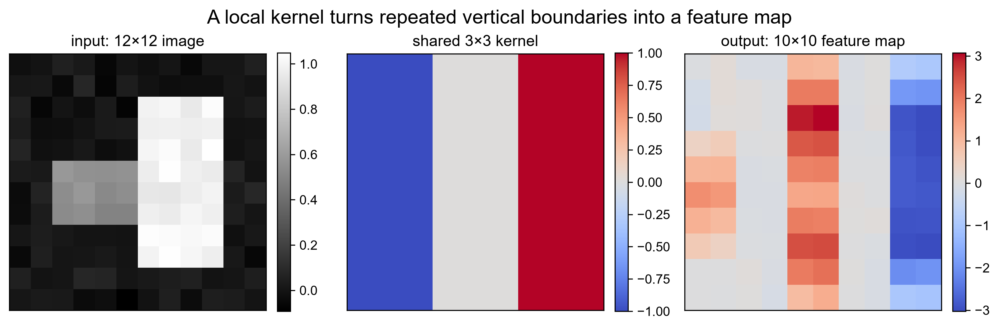

左图是 $12\times12$ 输入，亮块的左右边界位于不同位置；中图是 $3\times3$ 竖直边缘核；右图是
$10\times10$ 输出。右图中的强正负色带出现在边界附近，而均匀区域接近 0。特征图不是类别概率，
只是“这个局部模式在各位置匹配得多强”。

彩色图像有红、绿、蓝三个输入通道。按本课程“样本外不写 batch 维”的约定，输入为

$$X\in\mathbb R^{H\times W\times C_{in}},$$

核组为

$$W\in\mathbb R^{K_h\times K_w\times C_{in}\times C_{out}},$$

输出为 $Y\in\mathbb R^{H_{out}\times W_{out}\times C_{out}}$。第 $c_{out}$ 个输出通道为

$$Y_{r,s,c_{out}}=b_{c_{out}}+
\sum_{u=0}^{K_h-1}\sum_{v=0}^{K_w-1}\sum_{c=1}^{C_{in}}
W_{u,v,c,c_{out}}X_{r+u,s+v,c}.$$

一个输出通道需要同时组合全部输入通道。参数量是

$$K_hK_wC_{in}C_{out}+C_{out},$$

与 $H,W$ 无关。例如 $3\times3$、3 输入通道、64 输出通道只有
$3\times3\times3\times64+64=1792$ 个参数；同尺寸全连接层会大得多。

> **框架布局提醒**：上式为了阅读采用 HWC；PyTorch `Conv2d` 默认 batch 输入是
> `[N,C_{in},H,W]`。很多“卷积算错”其实是通道顺序错。

### 14.2.4 padding、stride、dilation 分别改变什么？

一维输出长度为

$$n_{out}=\left\lfloor\frac{n+2p-d(k-1)-1}{s}\right\rfloor+1,$$

其中：

- padding $p$ 在边界补值；`same` 常用于保持空间尺寸，但边界看到的是人工补值；
- stride $s$ 每次移动多远；增大 stride 会下采样，也可能跳过细小模式；
- dilation $d$ 是核元素之间的间隔；它扩大覆盖范围而不增加核参数。

例如 $n=7,k=3,p=1,s=2,d=1$ 时，$n_{out}=4$。下取整不是技巧，而是只保留核能完整落下的位置。
不同框架对 `same`、奇偶核和 stride 的边界约定可能不同，迁移模型时必须打印形状验证。

### 14.2.5 感受野为什么随着网络加深而扩大？

**感受野**是某个输出单元可能依赖的输入区域。连续两个宽度 3、stride 1 的卷积并不是只看 3 个位置：
第二层的三个输入各自已看过第一层三个位置，合起来覆盖 5 个原始位置。对第 $l$ 层，可递推

$$j_l=j_{l-1}s_l,$$

$$r_l=r_{l-1}+(k_l-1)d_lj_{l-1},$$

其中 $j_l$ 是相邻输出在原输入上的跳距，$r_l$ 是感受野宽度，初始 $j_0=r_0=1$。

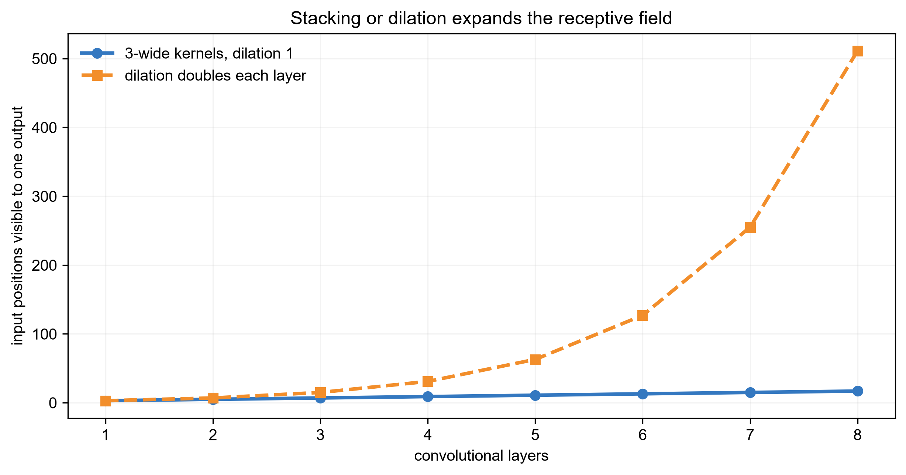

横轴是卷积层数，纵轴是一个输出理论上能看到的输入位置数。普通宽度 3 卷积线性扩大感受野；逐层
加倍 dilation 扩得更快。理论感受野不等于每个位置贡献相同的“有效感受野”，也不保证模型已学会
使用最远信息。

### 14.2.6 激活、池化、归一化和残差各做什么？

一层 CNN 通常不只有卷积：

```text
输入 → 卷积 → 归一化（可选）→ ReLU/GELU → 下采样（可选）
```

- 非线性激活让多层卷积不退化成一个大线性运算；
- 最大/平均池化或 stride 卷积降低空间分辨率，扩大后续视野、降低计算，但会丢失精确位置；
- BatchNorm 使用 batch 统计稳定训练，训练/推理模式不同；小 batch 时 GroupNorm 常更稳；
- 残差连接 $y=F(x)+x$ 给深层梯度提供短路径，使 ResNet 更易优化。

全局平均池化把每个通道的空间位置求平均，再接分类器，参数比把整张特征图展平后全连接少，也更
接近平移不变。但检测和分割需要保留“在哪里”，不能过早全部平均。

### 14.2.7 CNN 怎样训练，怎样过拟合？

分类 CNN 最后输出 logits，用 softmax 交叉熵训练。反向传播对某个核参数的梯度会累加它在**所有位置**
的使用贡献；共享不仅发生在前向，也发生在梯度聚合。优化器仍可用第 12 章的 SGD/Adam。

小数据上，深 CNN 可能记住背景、水印或拍摄设备，而不是目标。应同时观察：

- 训练/验证 loss 与 accuracy 的分叉；
- 平移、裁剪、亮度、旋转和噪声压力测试；
- 按患者、视频、设备或采集地点分组切分；
- 错误类别、混淆矩阵和置信度校准。

数据增强只有在变换不改变标签时才合理：猫左右翻转仍是猫，但数字 6 旋转后可能变 9；医学影像左右
方向也可能具有临床含义。增强是一种任务假设，不是越强越好。

### 14.2.8 CNN 从零实现与框架对照

本章脚本的核心二维实现是：

```python
for row in range(out_h):
    for col in range(out_w):
        patch = image[row:row+kh, col:col+kw]
        output[row, col] = np.sum(patch * kernel)
```

它清楚但很慢；工业库用 im2col、Winograd、FFT 或高度优化的直接 kernel。PyTorch 对应形状示例：

```python
layer = torch.nn.Conv2d(in_channels=3, out_channels=64,
                        kernel_size=3, padding=1)
x = torch.randn(8, 3, 32, 32)   # NCHW
y = layer(x)                     # [8, 64, 32, 32]
```

对照时必须固定权重、bias、padding、stride 和布局；NumPy 教学实现与框架输出应在浮点容差内一致。

## 14.3 普通 RNN 小专题：为什么序列需要一个不断更新的状态？

### 14.3.1 为什么引入 RNN？

考虑房屋每小时用电量预测。只看当前一小时无法区分“早晨刚开始升温”和“晚上逐渐关闭设备”；同一个
数值在不同历史之后含义不同。把最近固定 24 小时全部展平给 MLP 可以工作，但窗口长度固定、参数不
共享，而且 25 小时前的信息完全消失。

循环神经网络（Recurrent Neural Network, RNN）的核心想法是：**读一个时间步，更新一次状态；同一
套更新规则反复使用。** 状态像一张不断改写的便签，不保存全部历史原文，而保存对当前任务有用的摘要。

适合的例子包括：传感器预测、语音帧、交易序列、用户点击序列和较短文本。若每个样本其实独立无序，
强行使用 RNN 只会增加训练难度；若要离线并行处理很长序列，Attention 或卷积常更合适。

### 14.3.2 RNN 怎样完成一次序列预测？

给定序列 $x_1,\ldots,x_T$，最简单的 tanh RNN 更新为

$$a_t=W_xx_t+W_hh_{t-1}+b,$$

$$h_t=\tanh(a_t),\qquad o_t=W_oh_t+c.$$

设 $x_t\in\mathbb R^d$、隐藏维度为 $h$、输出维度为 $q$，则

| 对象 | 形状 | 含义 |
|---|---|---|
| $W_x$ | $h\times d$ | 当前输入怎样写入状态 |
| $W_h$ | $h\times h$ | 旧状态怎样影响新状态 |
| $b$ | $h$ | 状态偏置 |
| $W_o$ | $q\times h$ | 状态怎样映射到输出 |
| $h_t$ | $h$ | 前缀 $x_{1:t}$ 的任务相关摘要 |

一次预测按以下顺序发生：从 $h_0=0$ 开始；读 $x_1$ 得 $h_1$；把 $h_1$ 与 $x_2$ 合成 $h_2$；一直
到当前时刻；最后把需要位置的 $h_t$ 送入输出层。所有时间步使用同一个 $W_x,W_h,b$，这就是时间上的
参数共享。

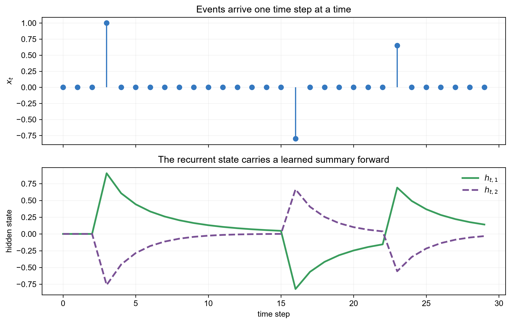

上图横轴是时间。上半图的脉冲是三个输入事件；下半图是两个隐藏维度。事件到来时状态发生改变，之后
在递归作用下逐步衰减并被新事件改写。隐藏维度没有预先指定的人工意义；图展示的是“历史通过状态向
前传递”，不能证明模型记住了所有细节。

### 14.3.3 序列任务的四种输入—输出形式

RNN 不是只能做“输入一句话，输出一个类别”：

| 形式 | 输出位置 | 例子 | 常用读取方式 |
|---|---|---|---|
| many-to-one | 序列末尾一次 | 情感分类、患者风险 | 最终状态/池化 |
| many-to-many 对齐 | 每个输入位置 | 词性标注、逐时刻异常 | 每个 $h_t$ |
| one-to-many | 一个条件生成序列 | 图像描述的旧式 decoder | 初始状态 + 自回归 |
| encoder-decoder | 输入、输出长度不同 | 翻译、摘要 | encoder 状态传给 decoder |

序列分类只读最后状态很简单，却会让长序列全部信息挤进一个向量；平均/最大池化或 attention pooling
可使用所有 $h_t$。逐时刻预测必须明确是在线因果预测还是离线标注；离线双向模型能看未来，不能直接
用于实时预测。

### 14.3.4 一个可以手算的标量 RNN

令激活暂时用恒等函数，$h_t=w_xx_t+w_hh_{t-1}$，取 $w_x=1,w_h=0.5,h_0=0$，输入
$[2,0,1]$：

$$h_1=2,\qquad h_2=0.5\times2=1,$$

$$h_3=1+0.5\times1=1.5.$$

当前输入 1 贡献 1，第一步输入 2 经过两次递归后只剩 $2\times0.5^2=0.5$。这同时说明 RNN 怎样
记忆，也提前暴露了问题：较早信息会连续乘 $w_h$。

### 14.3.5 BPTT 怎样训练共享参数？

把递归按时间展开后，它看起来像一个很深但每层共享参数的网络。假设总损失

$$L=\sum_{t=1}^{T}\ell_t(o_t,y_t),$$

反向传播会从后往前累计每个时间步对共享参数的贡献。对 $W_h$：

$$\frac{\partial L}{\partial W_h}
=\sum_{t=1}^{T}\frac{\partial L}{\partial a_t}h_{t-1}^{\top}.$$

关键在于某个较晚损失对早期状态的导数：

$$\frac{\partial h_T}{\partial h_t}
=\prod_{k=t+1}^{T}
\underbrace{\operatorname{diag}(1-h_k^2)W_h}_{J_k}.$$

这是许多 Jacobian 的乘积。如果其主导尺度反复小于 1，梯度消失；反复大于 1，梯度爆炸。tanh
饱和时 $1-h_k^2$ 接近 0，也会加重消失。

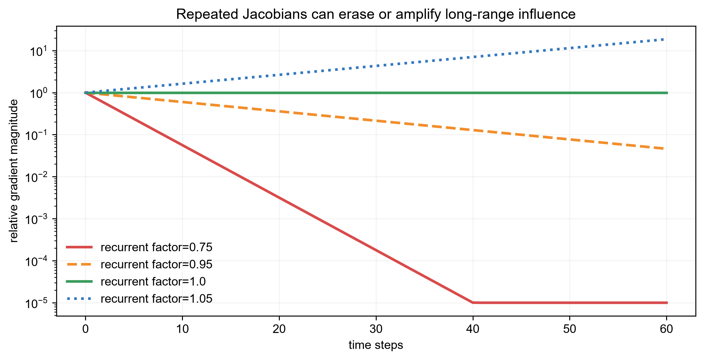

横轴是梯度跨越的时间步，纵轴用对数刻度表示相对大小。0.75 很快降到图底，1.05 持续放大，接近
1 的路径保留得更久。真实 RNN 是不同矩阵与状态相关导数的乘积，曲线只是机制示意，不能用单个标量
预测某个真实网络一定在哪一步失败。

### 14.3.6 梯度爆炸和消失分别怎样处理？

**梯度裁剪**主要限制爆炸。若全局梯度范数为 $\|g\|_2$，阈值为 $c$：

$$g\leftarrow g\min\left(1,\frac{c}{\|g\|_2+\epsilon}\right).$$

它保留方向并限制长度，但没有解决长期信息消失。正交初始化、合适激活和归一化可改善条件；LSTM/GRU
通过门控加法路径专门缓解长期传播。截断 BPTT（truncated BPTT）只反传最近 $K$ 步，节省显存和
计算，却明确放弃超过 $K$ 步的直接梯度。

诊断时应画梯度范数、按序列长度分组的准确率、截断长度消融，以及“关键信息距离”与性能的关系。
只看总 loss 无法区分优化失败和状态容量不足。

### 14.3.7 双向、多层与 dropout

双向 RNN 分别从左到右、从右到左读取，再拼接状态。它适合整段文本标注或离线语音识别，因为每个
位置能用两边上下文；它不适合严格在线预测，因为反向状态偷看了未来。多层 RNN 把上一层的整段
状态作为下一层输入，增加表示能力，也增加优化和延迟。

普通 dropout 若在每个时间步独立改变递归掩码，可能引入强时间噪声。框架的 RNN dropout 往往只
作用于层间，或使用时间共享的 variational dropout；必须阅读接口文档而不是只看参数名。

### 14.3.8 RNN 从零实现与框架对照

NumPy 前向核心只有几行：

```python
h = np.zeros(hidden_size)
for x_t in sequence:
    h = np.tanh(W_x @ x_t + W_h @ h + b)
```

本章脚本还手写 BPTT，并用中心有限差分检查 $W_h$ 的一个梯度，误差约为 $10^{-11}$。PyTorch 中：

```python
rnn = torch.nn.RNN(input_size=d, hidden_size=h,
                   batch_first=True)
output, h_last = rnn(x)  # x: [batch, time, d]
```

`output` 含所有时间步状态，`h_last` 含各层最后状态。框架默认形状、层数方向和隐藏状态轴容易混淆；
先用很小张量打印 shape，再连接损失。

### 14.3.9 RNN 的评估与泄漏

时间序列应按时间滚动划分，标准化和缺失填补只拟合过去。患者多次记录、同一设备连续窗口或同一用户
相邻点击不能随机散到训练和测试，否则模型可能识别实体而不是学习可泛化动态。除平均指标外，应按
序列长度、关键信息距离、冷启动实体和时间段报告结果，并记录流式单步延迟与状态内存。

## 14.4 LSTM 小专题：怎样让网络决定记住、忘掉和输出什么？

### 14.4.1 为什么普通 RNN 之后还需要 LSTM？

假设序列开头出现"本次设备已经校准"，中间穿插数百条普通读数，末尾需要据此判断报警阈值。普通 RNN 的隐藏状态在每一步都经过同一种非线性变换，早期的关键信息必须逐层"挤过"每一时刻的激活函数才能传到末尾；同时梯度在反向传播时需连续乘以权重矩阵，容易指数级衰减（梯度消失）或膨胀（梯度爆炸），导致长程依赖难以学习。

LSTM（Long Short-Term Memory）增加一条相对直接的**细胞状态** $c_t$，并用门决定旧信息保留多少、新信息写入多少、当前
暴露多少。

它解决的是“让长期记忆和梯度更容易保留”，不是“无限记忆”或“自动理解重要信息”。门也要从数据
学；样本不足、监督太弱或序列远超训练长度时，LSTM 仍会失败。

### 14.4.2 完整 LSTM 单元，而不只是一条简写公式

把上一隐藏状态与当前输入拼接：

$$z_t=[h_{t-1};x_t]\in\mathbb R^{h+d}.$$

四个分支为

$$f_t=\sigma(W_fz_t+b_f)\quad\text{（遗忘门）},$$

$$i_t=\sigma(W_iz_t+b_i)\quad\text{（输入门）},$$

$$\tilde c_t=\tanh(W_gz_t+b_g)\quad\text{（候选记忆）},$$

$$o_t=\sigma(W_oz_t+b_o)\quad\text{（输出门）}.$$

然后更新

$$c_t=f_t\odot c_{t-1}+i_t\odot\tilde c_t,$$

$$h_t=o_t\odot\tanh(c_t).$$

$\sigma$ 把三个门限制在 $(0,1)$：0 近似关闭，1 近似全开；$\odot$ 是逐元素乘法。细胞状态 $c_t$
负责内部长期存储，隐藏状态 $h_t$ 是当前对外输出；二者形状都是 $h$，但职责不同。

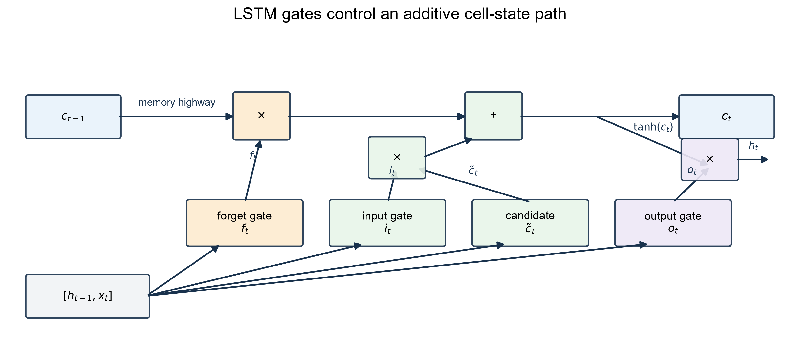

从图上方先看：$c_{t-1}$ 乘遗忘门后沿水平通路前进，再加上“输入门 × 候选记忆”成为 $c_t$。下方
$[h_{t-1},x_t]$ 同时生成三个门和候选。最后输出门只决定当前暴露多少 $\tanh(c_t)$。图中的水平加法
路径是 LSTM 与普通 RNN 的关键区别；它不表示门是人工规则，门值由权重学习。

### 14.4.3 用数字走完一次门控更新

只看一个隐藏维度。假设旧记忆 $c_{t-1}=2.0$，模型判断旧信息重要，给 $f_t=0.9$；当前输入有少量
新证据，$i_t=0.2,\tilde c_t=0.5$；当前需要部分输出，$o_t=0.6$。则

$$c_t=0.9\times2.0+0.2\times0.5=1.9,$$

$$h_t=0.6\tanh(1.9)\approx0.574.$$

若下一步是无关噪声，理想门可能令 $f$ 接近 1、$i$ 接近 0，保留旧记忆而不写入噪声。注意这只是
解释门的行为；训练时没有人告诉网络“这个门应该是 0.9”，损失通过反向传播间接塑造门。

### 14.4.4 LSTM 为什么能缓解梯度消失？

只沿细胞状态的直接路径观察：

$$\frac{\partial c_t}{\partial c_{t-1}}\approx f_t,$$

因此跨多步的直接梯度约为

$$\frac{\partial c_T}{\partial c_t}\approx\prod_{k=t+1}^{T}f_k.$$

当相关区间内 $f_k$ 学到接近 1，乘积可以长期保留；普通 tanh RNN 还反复乘 $W_h$ 和饱和导数。
“约等于”是因为门本身也依赖 $h_{t-1}$，完整导数还有其他路径，不能把 LSTM 简化成一个常数门。

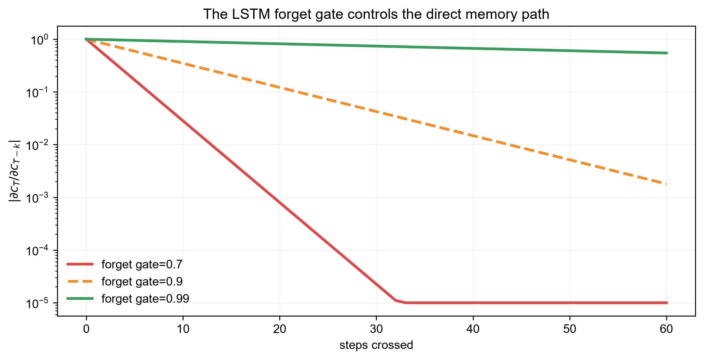

横轴是跨越步数，纵轴是直接细胞状态路径的梯度尺度。遗忘门 0.99 跨 60 步仍保留较多，0.70 很快
衰减。纵轴是对数尺度，曲线是固定门值的机制示意；真实门随输入和维度变化。图说明“可学习的近 1
通路为何有帮助”，不证明所有 LSTM 都能学到它。

### 14.4.5 参数量、初始化和数值问题

四个分支各有形状 $h\times(h+d)$ 的权重和长度 $h$ 的偏置，所以一层单向 LSTM 参数量为

$$4h(h+d)+4h.$$

它约是同隐藏宽度普通 RNN 的四倍。实践中常把四组矩阵合并成一个大矩阵，一次矩阵乘后切成四块，
提高硬件效率。遗忘门 bias 有时初始化为正值，让初始 $f_t$ 更偏向保留；这是优化启发，不是理论保证。

$c_t$ 虽有加法路径，仍可能数值变大；梯度裁剪、合适初始化、归一化和监控 gate saturation 仍重要。
若 $f,i,o$ 长期全接近 0 或 1，sigmoid 导数小，门也可能难以继续调整。

### 14.4.6 LSTM、GRU 与普通 RNN 怎样选？

GRU 把门和状态合并得更紧凑，常见更新为

$$z_t=\sigma(W_zx_t+U_zh_{t-1}),$$

$$r_t=\sigma(W_rx_t+U_rh_{t-1}),$$

$$\tilde h_t=\tanh(W_hx_t+U_h(r_t\odot h_{t-1})),$$

$$h_t=(1-z_t)\odot h_{t-1}+z_t\odot\tilde h_t.$$

GRU 参数更少、只有一个状态，可能在小数据或低延迟场景更方便；LSTM 分离 $c_t,h_t$，控制更细。
不存在普遍胜者。普通 RNN 是理解和短依赖基线；LSTM/GRU 是长依赖递归基线；最终应在同切分、相近
调参预算下比较质量、长距离分组性能、参数、吞吐和流式延迟。

### 14.4.7 LSTM 从零实现与框架对照

本章脚本实现四个门并返回全部 $h_t,c_t$ 与 gate history，同时断言三个 sigmoid 门都在 $[0,1]$。
框架用法：

```python
lstm = torch.nn.LSTM(input_size=d, hidden_size=h,
                     num_layers=2, batch_first=True)
output, (h_last, c_last) = lstm(x)
```

`output` 是最后一层全部时间步状态；`h_last,c_last` 的第一维还包含层和方向。若用可变长度 batch，
padding 位置不能参与 loss；可使用 mask 或 packed sequence。错误处理 padding 会让模型学习“序列有多
长”或让最后状态落在补零上。

### 14.4.8 LSTM 常见失败与正确诊断

| 症状 | 可能原因 | 怎样验证 | 修复方向 |
|---|---|---|---|
| 长序列后半准确率下降 | 记忆仍不足/训练长度短 | 按依赖距离分桶 | curriculum、Attention、增大有效上下文 |
| 训练突然 NaN | 梯度爆炸/学习率大 | 梯度范数与首个异常 batch | 裁剪、降学习率、查输入 |
| 只预测多数状态 | 标签稀疏/逐步 loss 失衡 | 每类 recall、时间位置切片 | 加权 loss、重采样、改变目标 |
| 双向离线好、上线差 | 使用了未来信息 | 前缀不变性测试 | 单向因果模型 |
| padding 越多预测越变 | mask/最终状态索引错 | 同序列换 padding 长度 | pack/mask、取真实末位 |

LSTM 在流式语音、传感器、较小时间序列和资源受限系统中仍常见。LLM 主干转向 Transformer，不代表
递归结构“失效”；它们优化的是不同的并行、内存和延迟约束。

## 14.5 Attention：每个位置按内容读取其他位置

给定表示矩阵 $X\in\mathbb R^{T\times d_{model}}$，线性投影得到

$$Q=XW_Q,\qquad K=XW_K,\qquad V=XW_V.$$

缩放点积 Attention 为

$$A=\operatorname{softmax}\left(\frac{QK^\top}{\sqrt{d_k}}+M\right),
\qquad O=AV.$$

第 $i$ 行 $A_{ij}$ 表示查询位置 $i$ 从位置 $j$ 读取多少信息；每行非负且和为 1。除以
$\sqrt{d_k}$ 是为了避免维度增大时点积方差过大，使 softmax 过早饱和。$M$ 可加入 padding mask
或因果 mask。

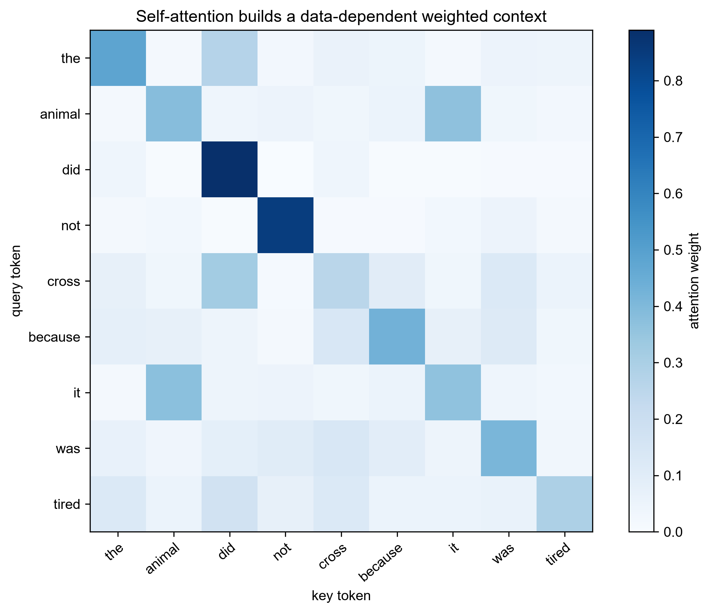

纵轴是发起查询的 token，横轴是被读取的 token，颜色越深表示权重越大。示例中特意让 “animal”
与代词 “it” 的输入特征相似，因此相应位置会出现较强联系。Attention 权重能显示模型本次计算使用
了哪些位置，但不能自动当作因果解释；多个头、残差和后续层还会继续改变信息。

### 14.5.1 Multi-head Attention

单个头只生成一种相似度关系。多头对不同投影子空间并行计算：

$$\operatorname{MHA}(X)=\operatorname{Concat}(head_1,\ldots,head_H)W_O.$$

不同头可能关注局部搭配、指代或位置模式，但头的语义并非人工预先指定，也可能存在冗余。

## 14.6 没有位置信息，Attention 知道顺序吗？

纯自注意力对输入排列具有等变性：同时重新排列 token，输出也只是相同排列。模型需要位置编码。
绝对位置可把位置向量加到 token embedding；相对位置、旋转位置编码（RoPE）则让注意力分数依赖
位置差。位置方案会影响长度外推，但不能单独保证模型在超出训练长度时可靠。

## 14.7 复杂度怎样随序列长度变化？

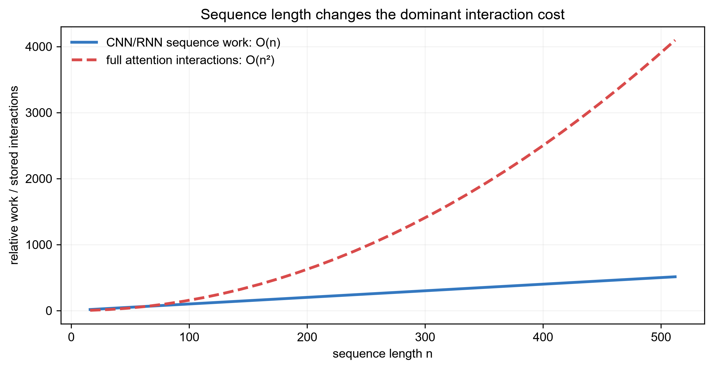

横轴是序列长度，纵轴是需要保存或计算的相对交互量。RNN 每步只维护状态，沿长度线性增长但必须
顺序执行；完整 Attention 同时形成 $T\times T$ 分数矩阵，计算和显存随 $T^2$ 增长，却能并行处理
训练序列并直接连接远距离位置。图比较的是主要增长趋势，不代表实际运行时间只由这一项决定。

卷积每层约为 $O(Tkd_{in}d_{out})$，RNN 约为 $O(T(hd+h^2))$，Attention 的分数与加权约为
$O(T^2d)$。局部/稀疏 Attention、状态空间模型和分块计算都在尝试改进长序列代价。

## 14.8 从零实验与框架对照

运行：

```bash
python code/chapter14/expanded_models.py
```

脚本现在包含四组可检查实验：

1. 手写一维/二维卷积，并与 NumPy 互相关结果对照；
2. 手写普通 RNN 前向和 BPTT，用有限差分验证 $W_h$ 梯度；
3. 手写完整 LSTM 四个门，检查状态形状和门值范围；
4. 手写稳定 softmax、缩放点积 Attention，检查每行权重和与输出形状。

一次运行的关键输出类似：

```text
conv2d_output_shape=(10, 10)
rnn_bptt_gradient_error=5.60e-11
lstm_hidden_shape=(8, 4)
attention_row_sum_error=2.22e-16
```

框架中对应模块是 `Conv1d/Conv2d`、`RNN/LSTM/GRU` 与 `MultiheadAttention`。公平对照必须固定输入、
初始权重、bias、padding/mask、batch 维和张量布局；只比较两个库默认配置不叫数值验证。

## 14.9 四种结构怎样选择？

| 结构 | 核心先验 | 优势 | 主要限制 | 典型适用场景 |
|---|---|---|---|---|
| CNN | 局部模式跨位置复用 | 参数少、并行、硬件成熟 | 远距离关系需堆层/扩张 | 图像、局部信号 |
| 普通 RNN | 历史递归压进状态 | 最简递归基线、流式、状态固定 | 梯度与记忆瓶颈明显 | 短序列、教学/轻量基线 |
| LSTM/GRU | 门控决定记忆更新 | 比普通 RNN 更能保留长期信息 | 串行、门多、仍会遗忘 | 流式语音、传感器、小型时序 |
| Attention | 位置按内容直接交互 | 远距离路径短、训练并行 | 完整交互为 $O(T^2)$ | LLM、ViT、离线长上下文 |

不要按“新旧”选择。先问：模式是否局部重复？是否必须逐步流式更新？最长有效依赖多远？训练能否
离线并行？单步状态内存和总上下文内存限制是多少？它们可以组合：卷积提取局部视觉/声学特征，LSTM
维护流式状态，局部 Attention 补充较长关系。最终用相同切分和预算比较质量、按长度切片、P95 延迟、
峰值内存与参数量。

## 14.10 统一失败诊断与数据泄漏

| 症状 | 可能原因 | 验证与修复 |
|---|---|---|
| CNN 训练好、平移后失效 | padding/下采样破坏等变性 | 做平移压力测试与合理增强 |
| RNN loss 不稳定 | 梯度爆炸或序列太长 | 梯度范数、裁剪、门控/截断 BPTT |
| LSTM 比 RNN 没有提升 | 依赖本来很短/调参预算不公平 | 按依赖距离分桶，比较参数与预算 |
| LSTM 依赖 padding | mask 或末状态索引错误 | 同一序列改变补齐长度 |
| Attention 看未来 | 因果 mask 错误 | 构造前缀不变性单元测试 |
| 时间序列离线分数虚高 | 随机划分泄漏未来 | 严格按时间滚动验证 |
| 图像同源样本跨集合 | 视频相邻帧/同患者泄漏 | 按实体或采集批次分组 |

## 14.11 与现代 AI 的联系

- **视觉模型**：ResNet、ConvNeXt 直接使用卷积；ViT 把图像切成 patch 后使用 Attention。混合模型用
  CNN 提取局部细节、Attention 交流全局信息，评价需同时看精度、分辨率鲁棒性和吞吐。
- **语音与流式系统**：卷积提取局部声学模式，LSTM/GRU 用固定状态逐帧更新；Conformer 再混合卷积
  与 Attention。低延迟系统要报告实时率、单帧延迟和状态内存，而不只报告离线词错率。
- **LLM**：Transformer 的核心通信算子就是带因果 mask 的多头自注意力，下一章完整展开。
- **多模态模型**：图像编码器产生视觉 token，跨注意力或统一自注意力让文本读取视觉信息。
- **推荐序列**：CNN 可识别短行为片段，LSTM 可维护流式用户状态，Attention 可直接找关键历史行为；
  必须避免把目标点击之后的行为泄漏进特征，并按用户与时间切分。
- **状态空间模型**：它们也维护沿序列更新的状态，与 RNN 共享“压缩历史”的思想，但使用不同参数化、
  并行扫描和长序列设计，不能简单等同为 LSTM。

## 14.12 苏格拉底导师

<details><summary>卷积为什么比同尺寸全连接层参数少？</summary>
它只连接局部邻域，并在所有位置复用同一组核权重；参数量主要由核大小和通道数决定，而非图像面积。
</details>

<details><summary>卷积的平移等变与分类的不变有什么区别？</summary>
等变是输入移动导致特征同步移动；不变是最终输出不随移动改变，通常还需池化、汇聚或训练约束。
</details>

<details><summary>RNN 能处理任意长度，是否表示能记住任意久？</summary>
不能。接口允许任意长度，但有限状态、梯度连乘和训练分布限制实际记忆能力。
</details>

<details><summary>LSTM 有长期记忆，为什么遗忘门不是永远设为 1？</summary>
永不遗忘会让无关旧信息不断累积，妨碍适应状态变化。模型需要按输入决定保留与清除，长期记忆不等于
永久记忆。
</details>

<details><summary>LSTM 为什么同时需要 $c_t$ 和 $h_t$？</summary>
$c_t$ 提供较直接的内部存储通路；$h_t$ 是经输出门筛选后暴露给当前输出和下一步门计算的状态。把
二者区分开，才能同时控制“内部保留”和“现在展示”。
</details>

<details><summary>双向 LSTM 离线效果更好，为什么不能直接用于实时预测？</summary>
反向分支读取未来位置。上线当前时刻尚无这些数据，离线分数包含不可部署信息。
</details>

<details><summary>Attention 权重和为 1，能否直接解释为每个词的贡献比例？</summary>
不能。它只是某个头一次加权中的系数，值向量、残差、其他头和后续非线性都会改变最终贡献。
</details>

<details><summary>为什么 Attention 点积除以 $\sqrt{d_k}$？</summary>
独立分量点积方差随 $d_k$ 增长；缩放让 logits 尺度较稳定，避免 softmax 饱和和梯度过小。
</details>

<details><summary>Attention 一定比 RNN 快吗？</summary>
训练中并行性通常更好；但长序列二次显存、单 token 解码和硬件内核会改变实际结论，必须测量。
</details>

## 14.13 练习

完成后对照[第 14 章参考答案](solutions/14-solutions.md)。

1. **CNN 手算**：计算长度 6 输入与长度 3 核的互相关，再翻转核比较数学卷积。
2. **CNN 形状**：推导 padding、stride、dilation 输出长度；计算多通道参数量。
3. **CNN 实现**：扩展脚本支持 batch、多输入/输出通道，并与 `Conv2d` 固定权重对照。
4. **CNN 反例**：构造训练图像含固定角落水印的分类任务，测试去水印后的性能。
5. **RNN 手算**：展开三步标量 RNN，写出状态和 $\partial h_3/\partial h_0$。
6. **BPTT 实现**：完成 $W_x,W_h,b$ 全部梯度，逐项有限差分检查。
7. **LSTM 手算**：给定一维 $f,i,o,\tilde c,c_{t-1}$，计算 $c_t,h_t$ 和直接梯度。
8. **门控实验**：记录不同序列位置的 gate histogram，判断门是否饱和，不能只看平均值。
9. **模型对照**：在 delayed-copy 任务公平比较 RNN、GRU、LSTM 与 Attention，按依赖距离画准确率。
10. **Attention 手算**：给定 $Q,K,V$，计算两 token 权重和输出，并解释缩放。
11. **因果测试**：实现 causal mask，验证修改未来 token 不改变过去位置输出。
12. **数据设计**：为视频或患者时间序列设计按实体、时间的无泄漏划分和压力测试。

## 14.14 面试八股

- **卷积的两个核心先验？** 局部连接和跨位置参数共享。
- **padding/stride/dilation？** 分别控制边界补齐、滑动步长和核采样间隔。
- **CNN 参数量怎样算？** $K_hK_wC_{in}C_{out}+C_{out}$，与输入空间面积无关。
- **感受野是什么？** 某个特征单元在输入中可能受影响的区域。
- **池化的作用与代价？** 降低分辨率和计算、增加局部不变性，但丢失精确空间信息。
- **RNN 隐藏状态是什么？** 用共享更新规则得到的前缀任务相关摘要，不等于完整历史副本。
- **RNN 为什么梯度消失/爆炸？** BPTT 中多次 Jacobian 相乘使尺度指数缩小或放大。
- **梯度裁剪解决什么？** 限制爆炸；它不能恢复已经消失的长期梯度。
- **LSTM 三个门？** 遗忘门保留旧记忆，输入门写入候选，输出门控制当前暴露。
- **LSTM 为何缓解消失？** 细胞状态包含受遗忘门控制的加法路径，直接梯度可在门接近 1 时保留。
- **LSTM 与 GRU？** LSTM 分离细胞/隐藏状态、控制细；GRU 更紧凑。应公平验证而非按名称选择。
- **双向 RNN 的限制？** 需要未来上下文，不能直接用于严格实时或自回归生成。
- **Q/K/V 各是什么？** 查询决定想找什么，键用于匹配，值是被加权汇聚的信息。
- **为何缩放点积？** 控制 logits 方差，稳定 softmax 与梯度。
- **为何需要位置编码？** 纯自注意力本身不区分同一组 token 的排列顺序。
- **Attention 复杂度？** 完整自注意力分数通常为时间和显存 $O(T^2)$。
- **权重能否等同解释？** 不能，只是计算的一部分，需要干预或归因验证。

## 本章通关标准

- [ ] 我能从局部性、递归记忆、门控记忆和长距离关系解释四类结构为什么出现。
- [ ] 我能手算卷积输出、输出尺寸、参数量和二维多通道张量形状。
- [ ] 我能解释感受野、padding、stride、dilation、池化和残差各解决什么。
- [ ] 我能展开普通 RNN，从 BPTT Jacobian 乘积解释消失/爆炸并检查梯度。
- [ ] 我能逐门计算 LSTM，区分 $c_t,h_t$，解释其长期梯度路径和失败边界。
- [ ] 我能推导缩放点积 Attention 并正确实现 mask。
- [ ] 我能公平比较 CNN、RNN、LSTM、GRU 和 Attention 的质量、复杂度与流式约束。
- [ ] 我能为图像、时间序列和多模态任务设计无泄漏验证。
- [ ] 我能准确说明这些结构在视觉、语音、推荐和 LLM 中的直接应用与联系边界。

### 扩展阅读

- [LeCun et al., Gradient-Based Learning Applied to Document Recognition](https://doi.org/10.1109/5.726791)
- [Hochreiter & Schmidhuber, Long Short-Term Memory](https://doi.org/10.1162/neco.1997.9.8.1735)
- [Vaswani et al., Attention Is All You Need](https://arxiv.org/abs/1706.03762)
- [Dive into Deep Learning：CNN、RNN 与 Attention](https://d2l.ai/)

[下一章：Transformer、LLM、微调与 MoE →](15-transformers-llms-and-finetuning.md)
