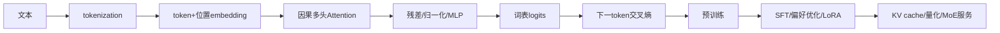
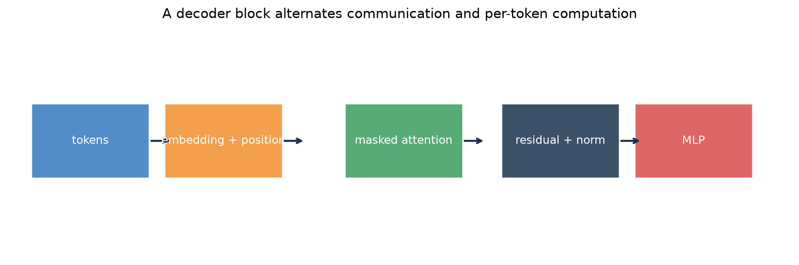
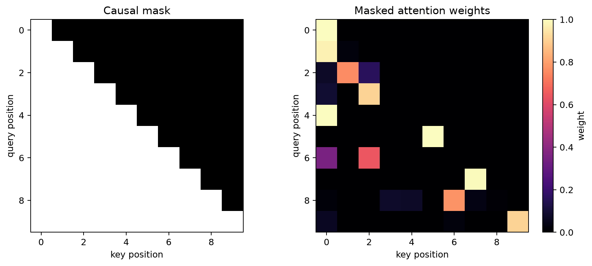
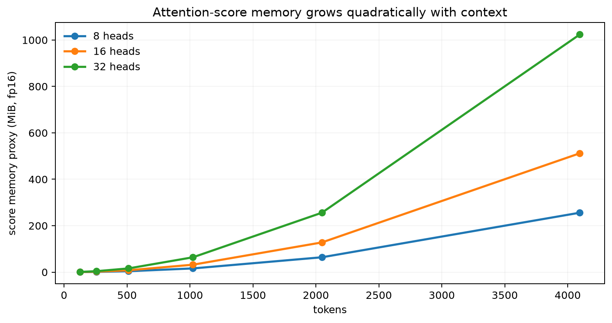
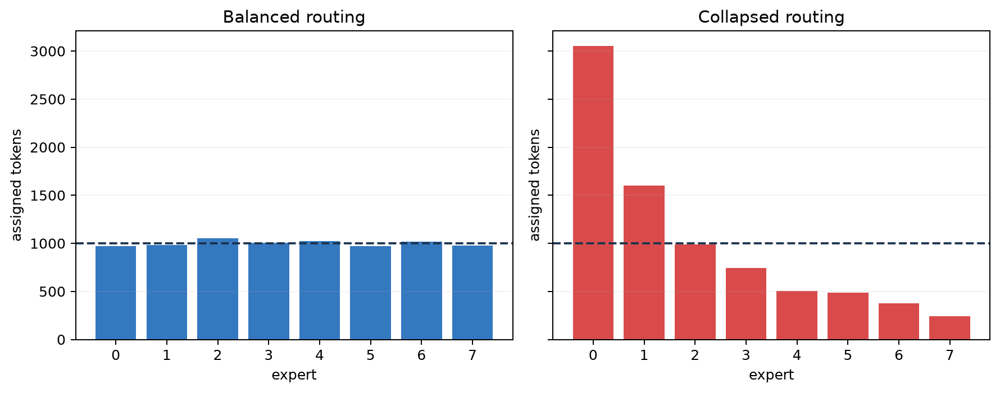

# 第 15 章：Transformer 与 LLM——从下一个 token 到可用基础模型

[← 第 14 章](14-sequence-vision-and-attention.md) | [English](../en/15-transformers-llms-and-finetuning.md) | [符号约定](appendix-a-notation.md) | [课程路线](00-course-roadmap.md)

> **先修**：[Attention](14-sequence-vision-and-attention.md#144-attention每个位置按内容读取其他位置)、
> [交叉熵](04-logistic-regression.md)、[反向传播与 AdamW](12-neural-networks-and-backprop.md)。

## 从第 14 章自然走到这里

Attention 只定义“位置怎样交流”，还不是完整语言模型。要从文字生成文字，还需要 tokenization、
位置表示、因果遮罩、残差与归一化、逐 token MLP、训练目标以及高效解码。本章沿一条完整链解释：
文本怎样变成 token，Transformer 怎样预测下一个 token，预训练模型怎样经 SFT/偏好优化适配，
以及 LoRA、KV cache 与 MoE 怎样改变训练或推理成本。

## 本章学习路线



### 本章学到什么程度？

这是一门入门课程，所以本章的主线只有四件事：能把文本变成右移的监督样本；能沿张量形状走完一个
decoder block；能解释训练与生成为什么不同；能判断 SFT、LoRA、偏好优化和 MoE 分别改变哪一层。
你不需要在本章从零训练大模型，也不要求掌握分布式预训练。SFT、偏好优化和 MoE 先达到“知道为何
需要、输入输出是什么、主要风险是什么”的程度，后续需要时再专题深化。

## 15.1 LLM 究竟在学习什么？

自回归语言模型把序列概率分解为

$$p(x_{1:T})=\prod_{t=1}^{T}p(x_t\mid x_{<t}).$$

训练样本来自文本自身：给前缀预测真实下一个 token。对词表大小 $V$ 的 logits $z_t\in\mathbb R^V$，

$$p_t=\mathrm{softmax}(z_t),\qquad
L=-\frac1{N}\sum_{t\in\text{valid tokens}}\log p_t[x_t].$$

这里 $N$ 是非 padding 目标 token 数。最小化平均负对数似然等价于最大化训练文本似然。它使模型
学习语言与数据中的统计规律，但没有单独保证事实正确、遵循指令、安全或了解最新信息。

## 15.2 Tokenization：模型看到的不是“词”

tokenizer 把字符串变成整数序列。字符级词表小但序列长；整词词表处理未登录词困难；BPE、WordPiece
或 unigram 等子词方法在二者之间折中。一个 token 可能是词、词片、空格或字节片段。

tokenization 会影响：

- 同一语义在不同语言中的 token 数和成本；
- 上下文长度能容纳多少原文；
- 代码、数字、罕见名字的表示；
- 输出约束与字符计数。

token ID 通过 embedding 表查成 $X\in\mathbb R^{T\times d}$，再加入或结合位置信息。embedding
不是 one-hot 的“美化”，而是训练中共同更新的稠密参数。

### 从一句话到监督样本

假设 tokenizer 把“机器学习很有趣”编码为 `[BOS, 机器, 学习, 很, 有趣, EOS]`。训练输入是
前五个 token，目标是后五个 token：

| 位置 | 输入 | 要预测的目标 |
|---:|---|---|
| 1 | BOS | 机器 |
| 2 | 机器 | 学习 |
| 3 | 学习 | 很 |
| 4 | 很 | 有趣 |
| 5 | 有趣 | EOS |

这叫右移目标，不是把整句话只做成一个标签。batch 中短句补 PAD；PAD 不能计入 loss，也通常不能
被有效 token 当作内容读取。分词器必须与 checkpoint 配套。

## 15.3 一个 decoder block 怎样流动？



输入先形成 token 与位置表示；masked attention 让各位置读取允许的前缀；残差连接把新信息加回
主通路，归一化控制尺度；MLP 对每个 token 独立做非线性变换。多个 block 堆叠后，最后线性层把
隐藏状态映射为词表 logits。图省略了多头拆分、dropout 和 Pre-LN/Post-LN 差异，只呈现主数据流。

常见 Pre-LN block 可写为

$$H'=H+\mathrm{MHA}(\mathrm{LN}(H)),$$

$$H_{next}=H'+\mathrm{MLP}(\mathrm{LN}(H')).$$

残差提供短梯度路径；LayerNorm 对每个 token 的特征维归一化，不依赖 batch 统计；MLP 通常扩张
到约 $4d$ 或采用 gated 变体后再投影回来。

若 batch 为 $B$、长度 $T$、模型宽度 $d$、头数 $H$、每头宽度 $d_h=d/H$，隐藏状态形状依次是
$[B,T,d]\rightarrow Q,K,V:[B,H,T,d_h]\rightarrow$ 注意力分数 $[B,H,T,T]$
$\rightarrow[B,T,d]$。MLP 只在最后一维变换，不混合 token；跨位置通信发生在 Attention。

一个 block 的近似参数量是 $4d^2+2d d_{ff}$。若 $d_{ff}=4d$，约为 $12d^2$，且 MLP 参数往往
多于 Attention。

把形状放进一个具体例子。设 batch 大小 $B=2$、序列长度 $T=4$、模型宽度 $d=8$、头数 $H=2$，
则每头宽度 $d_h=4$：

| 位置 | 张量形状 | 这一项在做什么 |
|---|---|---|
| token 与位置表示 | $[2,4,8]$ | 每个样本有 4 个 token，每个 token 用 8 个数表示 |
| $Q,K,V$ 拆头后 | $[2,2,4,4]$ | 2 个头分别产生查询、键和值 |
| 注意力分数 | $[2,2,4,4]$ | 每个头中，每个位置给 4 个位置打分 |
| 拼回多头结果 | $[2,4,8]$ | 头的结果拼接回模型宽度 |
| MLP 与残差之后 | $[2,4,8]$ | 只改变表示内容，不改变序列长度和模型宽度 |

因此，残差两侧必须同为 $[B,T,d]$。如果实现中得到 $[B,H,T,d_h]$ 后直接与输入相加，问题不是
“框架不兼容”，而是还没有把多头维度拼回 $d$。

## 15.4 因果遮罩为什么是训练正确性的底线？

位置 $t$ 预测 $x_{t+1}$ 时不能读取未来 token。令

```math
M_{ij}=\begin{cases}0,&j\le i,\\-\infty,&j>i,
\end{cases}
```

再计算 $\mathrm{softmax}(QK^\top/\sqrt{d_k}+M)$，未来位置概率为零。



左图白色上三角代表被禁止的“看未来”区域；右图中对应权重严格为零，每一行只能读取自身和左侧
前缀。若 mask 方向写反，训练 loss 可能异常好，因为模型直接偷看答案；必须用单元测试确认修改
未来 token 不会改变过去位置输出。

## 15.5 多头不是多个独立模型

模型把 $d_{model}$ 划为 $H$ 个头，每头维度 $d_h$，分别计算 Attention 后拼接。多头让同一层并行
表达多种关系，但总宽度固定时，增加头数会缩小每头维度，并不会免费增加总容量。Q/K/V/O 投影
总参数量大致为 $4d_{model}^2$；MLP 若宽度 $4d$，两层约为 $8d^2$，常占更多参数和计算。

## 15.6 训练时并行，生成时为什么仍逐 token？

教师强制训练中，整段目标已知，所有位置可并行计算带 mask 的 loss。生成时第 $t+1$ 个 token
依赖刚生成的第 $t$ 个，只能自回归循环。若每步重新计算整个前缀，会重复大量 K/V 投影；KV cache
保存各层历史 key/value，新一步只计算新 token 并与缓存交互。

缓存显存近似

$$M_{KV}=2\times L\times T\times H_{kv}\times d_h\times b,$$

其中 2 代表 K 与 V， $L$ 是层数， $T$ 是缓存 token 数， $b$ 是每元素字节数。



横轴是 token 数，纵轴是不同头数下完整注意力分数的相对 fp16 显存。长度翻倍时分数矩阵约增四倍。
FlashAttention 通过分块减少中间显存和内存读写，但不把标准 Attention 的算术复杂度变成线性；
推理时 KV cache 则随长度线性增长。

例如 32 层、32 个 KV 头、head dim 128、上下文 4096、fp16、单序列时，缓存约为
$2\times32\times4096\times32\times128\times2\approx2$ GiB。若使用 8 个 KV 头的 GQA，
可降到约 0.5 GiB。并发数会近似线性放大这部分内存。

## 15.7 预训练之后：SFT、偏好优化与工具使用

### 监督微调（SFT）

用“指令—理想回答”序列继续做 token 交叉熵，通常只对回答 token 计损失。SFT 教模型回答格式、
任务行为和领域语言，但小数据易过拟合或遗忘通用能力。

### 偏好优化

人类或 AI 对候选回答给偏好。RLHF 可训练奖励模型后用 PPO 优化策略；DPO 等方法直接根据偏好对
调整 chosen/rejected 的相对对数概率。偏好数据反映标注规范，不等同于客观真理，需防长度偏好、
奖励投机和分布外崩溃。

三者职责不同：预训练获得通用语言与知识统计；SFT 教“按示范回答”；偏好优化调整多个回答的相对
倾向。偏好优化不能凭空补入缺失知识，也不能替代事实评测。安全还需要数据过滤、权限隔离与监控。

### RAG 与工具

RAG 在推理时检索外部文档，工具调用让模型请求计算器、数据库或 API。它们扩展可访问的信息和动作，
但还要验证检索、权限、参数、引用与失败回退，不能把所有责任交给生成模型。

## 15.8 LoRA：为什么低秩更新能省训练资源？

冻结预训练权重 $W_0\in\mathbb R^{d_{out}\times d_{in}}$，只学习

$$W=W_0+\Delta W,
\qquad \Delta W=\frac{\alpha}{r}BA,$$

其中 $A\in\mathbb R^{r\times d_{in}}$、 $B\in\mathbb R^{d_{out}\times r}$， $r$ 很小。可训练参数
从 $d_{out}d_{in}$ 降到 $r(d_{in}+d_{out})$。LoRA 减少梯度和优化器状态，不自动减少基础权重的
推理成本；适配器合并、量化和多租户服务是另外的系统问题。

## 15.9 MoE：每个 token 只激活部分专家

MoE 层含多个 MLP 专家，路由器为 token 计算分数并选择 top-k 专家：

$$g(x)=\mathrm{softmax}(W_gx),\qquad
y=\sum_{e\in TopK(g)}g_e(x)E_e(x).$$

总参数可增大而单 token 激活计算较少，但路由不均会让少数专家拥堵、其余专家闲置。



每根柱表示分到某专家的 token 数，虚线是理想平均负载。左图负载接近均匀；右图大部分 token
涌向少数专家，导致容量溢出、丢 token 或通信热点。负载均衡辅助损失能缓解问题，但过强也可能
妨碍专家形成专长。

## 15.10 从零实验与最小验证

运行：

```bash
python code/chapter15/transformers_and_llms.py
python code/chapter15/course_lab.py
```

第一个脚本生成本章图片并检查 causal attention。第二个是课程实验，依次完成：构造右移标签、训练
一个最小 bigram 下一 token 模型、执行 top-p 生成、计算单头 causal attention，并比较全量矩阵
与 LoRA 的参数量。典型输出中 loss 从约 1.95 降到 0.15，且生成出
`<BOS> machine learning is fun <EOS>`。

bigram 模型不是 Transformer；这里故意把“语言模型训练循环”和“Attention 内部运算”分开，避免
初学者同时调试所有部件。它必须满足三项断言：loss 明显下降、Attention 上三角严格为零、每行权重
和为 1。真正训练 Transformer 时，还需把 embedding、多个 block 和词表输出层接成同一可微计算图。

## 15.11 解码：模型概率怎样变成文本？

- Greedy 每次选最大概率，确定但可能重复或局部最优。
- Temperature 用 $z/\tau$ 控制分布尖锐度；不是事实性开关。
- Top-k 只保留概率最高的 $k$ 个 token。
- Top-p 保留累计概率达到 $p$ 的最小集合。
- Beam search 保留多条高概率序列，适合某些受约束任务，但开放生成可能变得单调。

比较解码必须固定模型和提示，报告任务质量、重复率、长度、延迟与多样性。采样随机性要求多次运行。

### 一个 top-p 数字例子

若下一 token 概率为 $[0.50,0.25,0.15,0.07,0.03]$， $p=0.8$ 时累加前三个得到 0.90，因此保留
前三个并归一化为约 $[0.556,0.278,0.167]$。top-k=2 则只保留前两个。temperature 在截断前
改变概率；这些操作只改变抽样，不会修改模型参数。

生成循环是：编码提示 → prefill 建立 KV cache → 从末位置 logits 采样 → 追加 token → 只对新
token decode → 遇到 EOS/长度/停止串终止。语法约束可屏蔽非法 token，但语法有效不代表事实正确。

## 15.12 复杂度、系统成本与失败诊断

训练成本来自参数矩阵乘、Attention、激活存储与优化器状态；推理还区分高并行的 prefill 和逐 token
decode。不能只报参数量：上下文长度、batch、精度、KV cache、硬件和内核决定真实吞吐。

| 症状 | 可能原因 | 检查 |
|---|---|---|
| 训练 loss 异常低 | 标签未 shift、mask 泄漏 | 前缀不变性与对齐单元测试 |
| 输出循环重复 | 解码过尖、数据重复、上下文退化 | logits/重复 n-gram/温度消融 |
| 长上下文答错 | 位置外推、检索噪声、注意力稀释 | 按证据位置和长度分桶 |
| 微调后通用能力下降 | 数据窄、学习率高、遗忘 | 多任务回归集、减小更新或混合数据 |
| MoE 吞吐不稳 | 路由不均与跨设备通信 | 专家负载、溢出率、all-to-all 时间 |

训练时应记录 token 数而不只记 epoch，并做去重与 contamination 审计。推理时分别测首 token
延迟、tokens/s 与端到端 P99。幻觉可能来自知识缺失、提示歧义、检索失败、上下文未利用或工具
结果未验证，必须分层定位。

## 15.13 与现代 AI 的联系

本章不是“联系”而是现代 LLM 的直接主体：decoder-only 模型用于生成，encoder-only 模型擅长
理解与表示，encoder-decoder 适合条件生成。多模态模型把图像、音频等变成 token 或通过跨注意力
接入；Agent 在 LLM 外增加状态、工具、规划与验证循环。模型规模扩大不会取消数据治理、评测、
权限隔离和系统预算。

## 15.14 苏格拉底导师

<details><summary>下一 token 训练为何能产生许多下游能力？</summary>
要压缩并预测多样文本，模型必须捕捉语法、语义、事实共现和任务格式；但能力来自数据与规模的综合，
并不意味着目标直接保证推理正确。
</details>

<details><summary>训练时有 causal mask，为什么所有位置仍可并行？</summary>
整段真实 token 已知，矩阵运算可同时计算每个位置，只需遮住其未来列；生成时未来 token 尚未产生。
</details>

<details><summary>KV cache 为什么省计算却占显存？</summary>
它避免历史 token 重算 K/V，但必须为每层保存这些张量，显存随序列、层数和并发增长。
</details>

<details><summary>LoRA 的 rank 越大越好吗？</summary>
rank 增大提高适配容量，也增加参数、显存和过拟合风险；应按验证质量与资源联合选择。
</details>

<details><summary>MoE 总参数很大，为何 FLOPs 可以较小？</summary>
每个 token 只经过少数专家；未激活专家不做该 token 的 MLP 计算，但权重存储和通信仍存在。
</details>

<details><summary>温度降低是否能减少幻觉？</summary>
它只让采样更集中，可能稳定也可能更确定地选择错误高概率 token；事实性还取决于数据、检索与验证。
</details>

## 15.15 练习

完成后对照[第 15 章参考答案](solutions/15-solutions.md)。

1. 给定 6 个 token，构造输入、右移目标与 causal mask。
2. 计算一个双头 Attention 的所有张量形状和参数量。
3. 推导语言模型交叉熵与 perplexity 的关系。
4. 实现最小 decoder block，并测试未来 token 不影响过去 logits。
5. 估算指定层数、头数、head_dim、长度、并发下的 KV cache。
6. 比较全量微调与不同 LoRA rank 的质量、可训练参数和峰值显存。
7. 设计 MoE 路由监控：负载、溢出、通信、质量与专家专长。
8. 为一个领域助手设计 SFT、偏好评测、RAG 和工具权限边界。

## 15.16 面试八股

- **语言模型训练目标？** 最大化每个真实下一个 token 的条件似然，即最小化 token 交叉熵。
- **为什么 causal mask？** 防止预测当前位置时读取未来答案。
- **残差与 LayerNorm 作用？** 残差提供信息/梯度通路，LayerNorm 稳定每 token 特征尺度。
- **训练与生成并行性差异？** 教师强制可同时算所有位置；生成必须等待前一个 token。
- **KV cache 保存什么？** 每层历史 token 的 key 和 value。
- **perplexity 是什么？** 平均 token 负对数似然的指数，越低表示对评测文本分配概率越高。
- **LoRA 节省什么？** 可训练参数、梯度和优化器状态；基础模型推理计算不必然减少。
- **MoE 优势与代价？** 扩大总容量而保持稀疏激活，但引入路由、负载和通信问题。
- **Top-k 与 Top-p？** 固定候选数与按累计概率动态选择候选集合。
- **SFT 与偏好优化？** 前者模仿目标回答，后者调整候选回答的相对偏好。
- **长上下文主要瓶颈？** Attention/激活、KV cache、位置泛化和有效利用证据，而不只是最大长度参数。

## 本章通关标准

- [ ] 我能从字符串解释 token、embedding、位置和 shifted target 的全过程。
- [ ] 我能写出 decoder block 的张量形状、因果 mask 与残差公式。
- [ ] 我能推导自回归似然、交叉熵和 perplexity。
- [ ] 我能解释训练并行、生成串行和 KV cache 的质量—成本关系。
- [ ] 我能推导 LoRA 参数量并诊断 rank、遗忘和适配器服务问题。
- [ ] 我能解释 MoE 稀疏激活与路由负载，不把总参数等同单 token FLOPs。
- [ ] 我能为 SFT、偏好优化、RAG、工具调用设计分层评测与安全边界。

### 扩展阅读

- [Vaswani et al., Attention Is All You Need](https://arxiv.org/abs/1706.03762)
- [Brown et al., Language Models are Few-Shot Learners](https://arxiv.org/abs/2005.14165)
- [Hu et al., LoRA](https://arxiv.org/abs/2106.09685)
- [Fedus et al., Switch Transformers](https://arxiv.org/abs/2101.03961)
- [Dao et al., FlashAttention](https://arxiv.org/abs/2205.14135)

[下一章：VAE 与扩散生成模型 →](16-vae-and-diffusion.md)
