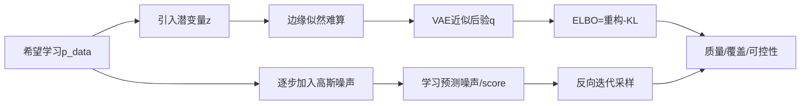
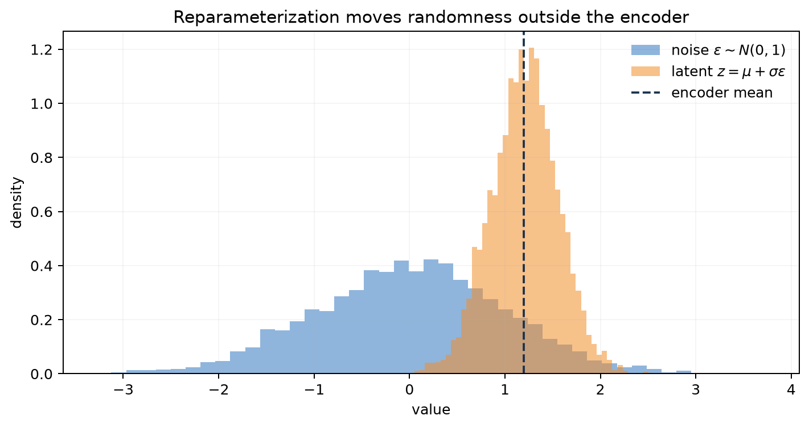
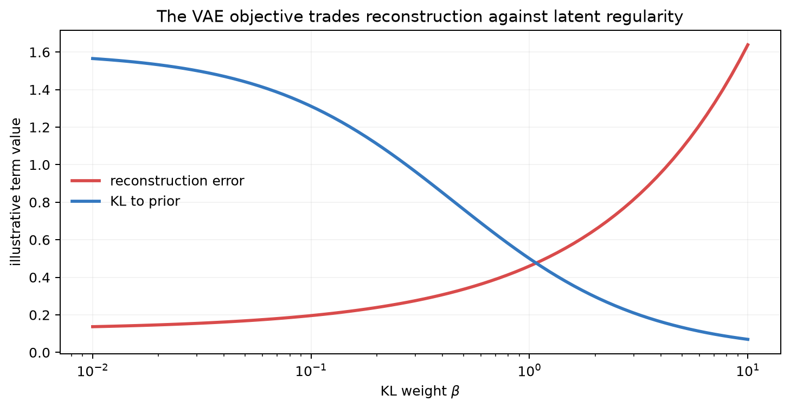
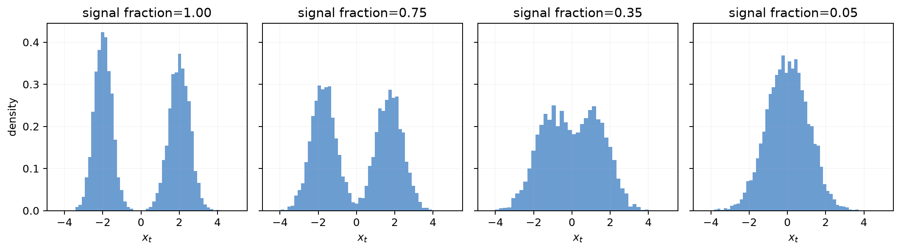
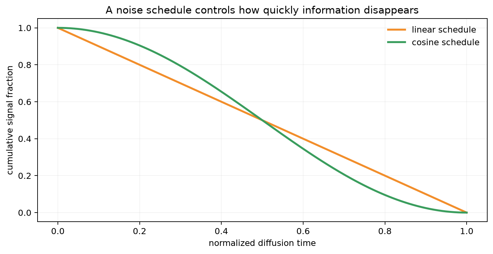

# 第 16 章：生成模型——VAE 与扩散模型怎样学习数据分布？

[← 第 15 章](15-transformers-llms-and-finetuning.md) | [English](../en/16-vae-and-diffusion.md) | [符号约定](appendix-a-notation.md) | [课程路线](00-course-roadmap.md)

> **先修**：[GMM、EM 与 ELBO](10-clustering-em-and-elbo.md)、
> [神经网络](12-neural-networks-and-backprop.md)、高斯分布、KL 散度与最大似然。

## 从第 15 章自然走到这里

自回归 LLM 按顺序生成离散 token。图像、音频和连续信号还可用另外两条生成路线：VAE 用低维潜变量
解释样本并近似后验；扩散模型先逐步加噪，再学习逐步去噪。本章不把“生成一张好看的图”当作全部
目标，而是追问：模型定义了什么分布、训练目标从何而来、采样为何可行、怎样评价质量与覆盖。

## 本章学习路线



### 本章学到什么程度？

本章只建立两条可复述的生成链：VAE 的“编码分布—采样潜变量—解码—重构与 KL”，以及扩散的
“随机时间步加噪—预测噪声—逐步去噪”。你需要能手算最小例子、解释训练目标和诊断典型失败；
不要求掌握所有采样器、score-SDE、视频扩散或大规模 U-Net 工程。后面的名词用于认路，不作为本章
通关要求。

## 16.1 为什么还需要连续生成模型？

分类器学习 $p(y\mid x)$；生成模型试图刻画 $p(x)$ 或条件分布 $p(x\mid c)$，从而生成、补全、
压缩、去噪或发现潜在因素。直接给每个可能图像分配概率不可行，因为空间巨大。VAE 假设复杂样本由
较简单潜变量生成；扩散把一次困难生成拆成许多小去噪步骤。

<details><summary>苏格拉底追问：会生成是否意味着理解真实世界？</summary>
不必然。模型可逼真复现训练分布的表面统计，却缺乏因果、物理或事实约束。评价必须覆盖记忆、偏差、
条件一致性和任务可靠性，而不只看视觉吸引力。
</details>

## 16.2 VAE 的生成故事

先从先验采样潜变量，再由 decoder 生成观测：

$$z\sim p(z)=\mathcal N(0,I),
\qquad x\sim p_\theta(x\mid z).$$

边缘似然

$$p_\theta(x)=\int p_\theta(x\mid z)p(z)\,dz$$

通常难以精确积分；真实后验 $p_\theta(z\mid x)$ 也难算。VAE 用 encoder
$q_\phi(z\mid x)$ 近似后验，常设为对角高斯，网络输出 $\mu_\phi(x)$ 和
$\log\sigma_\phi^2(x)$。

## 16.3 ELBO 怎样从对数似然推出？

插入 $q_\phi(z\mid x)$ 并使用 Jensen 不等式：

$$
\log p_\theta(x)
=\log\mathbb E_{q_\phi}
\left[\frac{p_\theta(x,z)}{q_\phi(z\mid x)}\right]
\ge \mathbb E_{q_\phi}[\log p_\theta(x\mid z)]
-D_{KL}(q_\phi(z\mid x)\|p(z)).
$$

右侧就是 ELBO。第一项鼓励从 $z$ 重构 $x$；第二项让每个样本的后验不要远离共同先验，确保从
$p(z)$ 采样时 decoder 仍见过附近区域。实际最小化负 ELBO：重构损失 + KL。

若 decoder 输出固定方差高斯，负对数似然对应 MSE；二值 Bernoulli decoder 对应 BCE。损失选择
来自观测分布假设，不是随意换一个熟悉指标。

## 16.4 重参数化：随机采样怎样反向传播？

直接写 $z\sim\mathcal N(\mu_\phi,\sigma_\phi^2)$，采样节点对参数不可普通求导。把随机性改写为

$$\epsilon\sim\mathcal N(0,I),\qquad
z=\mu_\phi(x)+\sigma_\phi(x)\odot\epsilon.$$

随机变量 $\epsilon$ 与参数无关，$z$ 对 $\mu,\sigma$ 是确定可微函数。



蓝色直方图是标准正态噪声，橙色直方图是经 encoder 均值和标准差平移缩放后的潜变量，虚线是均值。
这不是删除随机性，而是把随机源固定在计算图入口，使梯度能沿 $z=\mu+\sigma\epsilon$ 回传。

对角高斯 KL 有闭式：

$$D_{KL}(q\|p)=\frac12\sum_j
(\mu_j^2+\sigma_j^2-\log\sigma_j^2-1).$$

### 一维 VAE 的数字例子

设 encoder 输出 $\mu=1$、$\log\sigma^2=\log0.25$，所以 $\sigma=0.5$。本次采到
$\epsilon=-0.4$，则 $z=1+0.5(-0.4)=0.8$。它到标准正态的 KL 为

$$\frac12(1^2+0.5^2-\log0.25-1)\approx0.818.$$

若 decoder 给出重构负对数似然 1.2，则单样本负 ELBO 约为 2.018。下一次 $\epsilon$ 会变，重构项
也会变；训练用 Monte Carlo 样本估计期望，KL 有闭式所以通常不必采样估计。

一次训练 step 是：encoder 输出 $\mu,\log\sigma^2$ → 重参数采样 $z$ → decoder 输出观测分布
参数 → 计算重构 NLL 与 KL → 反向传播。重构时从 $q(z\mid x)$ 取样；无条件生成直接从 $p(z)$
取样。混淆这两条路径会导致“只会重构、不会从先验生成”的错误评估。

## 16.5 重构与规则潜空间为什么会冲突？

$\beta$-VAE 常写为

$$L=\underbrace{-\mathbb E_q\log p_\theta(x\mid z)}_{\text{reconstruction}}
+\beta\underbrace{D_{KL}(q_\phi(z\mid x)\|p(z))}_{\text{regularization}}.$$



横轴是 KL 权重，红线表示示意重构误差，蓝线表示后验与先验的 KL。增大 $\beta$ 迫使潜空间更接近
先验，却可能丢失细节、提高重构误差。图展示典型权衡，不是某个真实数据集的定量结论。

若 decoder 很强，它可能无视 $z$ 也能重构，导致 KL 接近零，称为 posterior collapse。可用 KL
warm-up、free bits、限制 decoder 或改变架构，但需同时观察潜变量是否真正影响输出。

可固定 $x$ 后逐维改变 $z$ 看输出，或在 batch 中打乱 $z$ 检查重构是否变差。只看 KL 非零仍
不够：它可能保存样本 ID 等无用信息，还应看潜变量对下游因素、插值和先验采样的影响。

## 16.6 扩散：先定义一个容易的加噪过程

前向过程逐步加入高斯噪声：

$$q(x_t\mid x_{t-1})=\mathcal N(\sqrt{1-\beta_t}x_{t-1},\beta_tI).$$

令 $\alpha_t=1-\beta_t$、$\bar\alpha_t=\prod_{s=1}^t\alpha_s$，可一步采样任意时刻：

$$x_t=\sqrt{\bar\alpha_t}x_0+\sqrt{1-\bar\alpha_t}\epsilon,
\qquad \epsilon\sim\mathcal N(0,I).$$



从左到右，保留的原始信号比例逐渐下降。开始时可见两个数据峰，噪声增大后峰变宽并合并，最终接近
标准高斯。前向过程没有学习参数；它故意摧毁信息，以获得一个容易采样的终点分布。

### 两步加噪的手算

取标量 $x_0=2$，$\alpha_1=0.9,\alpha_2=0.8$，所以 $\bar\alpha_2=0.72$。若闭式采样的
$\epsilon=-0.5$，则

$$x_2=\sqrt{0.72}\times2+\sqrt{0.28}\times(-0.5)\approx1.433.$$

训练网络看到 $(x_2,t=2)$，目标是本次真实噪声 $-0.5$。随机抽 $t$ 使每个 batch 不必展开完整
链，但长期训练会覆盖不同噪声等级。

## 16.7 学习反向过程

模型 $\epsilon_\theta(x_t,t,c)$ 接收带噪样本、时间步和可选条件 $c$，预测所加噪声。常用简化目标：

$$L_{simple}=\mathbb E_{x_0,t,\epsilon}
\left[\|\epsilon-\epsilon_\theta(x_t,t,c)\|_2^2\right].$$

预测噪声等价关联到预测 score $\nabla_{x_t}\log q_t(x_t)$。采样从高斯噪声 $x_T$ 开始，反复用
网络估计去噪方向并加入规定随机性，最终得到 $x_0$。标准 DDPM 需要许多网络调用；DDIM、蒸馏和
更高阶求解器可减少步数，但速度—质量取舍必须实测。

训练和采样方向不要混淆：训练的前向加噪可直接跳到任意 $t$；生成的反向去噪要从大 $t$ 按采样器
走回去。噪声预测网络常用 U-Net：下采样汇聚全局结构，上采样恢复细节，skip connection 保留
局部信息，时间 embedding 表示噪声等级，文本条件通过 cross-attention 注入。

### 噪声日程



横轴是归一化时间，纵轴是仍保留的累计信号比例。线性和余弦日程在中间阶段保留信息的速度不同，
从而改变各噪声水平的学习难度。日程属于训练定义的一部分；采样器、预测参数化和训练日程需匹配。

## 16.8 条件生成与 classifier-free guidance

条件可来自类别、文本 embedding、边缘图或其他模态。classifier-free guidance 在训练时随机丢弃
条件，同时学习有条件和无条件预测；采样时组合

$$\hat\epsilon=(1+w)\epsilon_\theta(x_t,t,c)-w\epsilon_\theta(x_t,t,\varnothing).$$

较大 $w$ 往往增强条件一致性，却可能降低多样性、产生过饱和或伪影。guidance scale 必须和步数、
采样器一起验证。

## 16.9 从零实验与复现结果

运行：

```bash
python code/chapter16/generative_models.py
python code/chapter16/course_lab.py
```

第一个脚本生成图并验证重参数化样本。第二个脚本训练一个可逐行阅读的线性 VAE：二维输入经 encoder
得到一维 $\mu,\log\sigma^2$，重参数采样后再解码回二维；它同时打印总 loss、重构 MSE 和先验采样
形状。随后脚本从双峰数据随机抽时间步加噪，拟合一个小型噪声预测器，并验证预测噪声优于始终预测 0。

这不是高质量图像生成器，而是把两类模型的训练闭环真正跑通。阅读代码时按下面顺序检查：

1. VAE 的随机性是否只来自独立的 $\epsilon$；
2. 重构梯度与 KL 梯度是否都回到 encoder；
3. 扩散训练目标中的噪声是否就是构造 $x_t$ 时使用的那一个；
4. 训练 loss 下降是否只说明目标被优化，而没有被误写成“生成质量已经很好”。

## 16.10 VAE、自回归与扩散怎样选择？

| 方法 | 生成方式 | 优势 | 主要代价 |
|---|---|---|---|
| VAE | 一次采样潜变量后解码 | 编码快、潜空间连续、可重构 | 输出可能平滑，ELBO 有间隙 |
| 自回归 | 按维/token 顺序生成 | 显式似然、离散序列自然 | 采样串行、长输出慢 |
| 扩散 | 从噪声多步去噪 | 高保真、条件控制灵活 | 多次网络调用、采样昂贵 |

Latent diffusion 先用 autoencoder 把图像压到潜空间，再扩散，减少空间计算；它是 VAE/autoencoder
压缩与扩散去噪的组合，不是简单二选一。

从任务倒推选择：需要快速编码、异常检测或连续潜空间时优先 VAE；离散长序列且需 token 概率时
优先自回归；高保真连续生成且能接受多步延迟时考虑扩散。部署评估还要包含步数、峰值显存、单样本
延迟与能耗，不能只比 FID。

## 16.11 评价、系统成本与失败诊断

生成评价至少包含：保真度、覆盖/多样性、条件一致性、记忆隐私、偏差安全和成本。FID 比较深度特征
的均值/协方差，对样本量和域敏感；CLIP score 测图文相似但可被表面对应欺骗；人工偏好也受提示和
标注者影响。没有一个分数覆盖全部维度。

| 症状 | 可能原因 | 检查与修复 |
|---|---|---|
| VAE 重构模糊 | 似然假设/decoder/强 KL | 查看逐项 loss，调容量与 $\beta$ |
| latent 不影响输出 | posterior collapse | 打乱/固定 $z$ 做干预，KL warm-up |
| 扩散采样有伪影 | 日程/采样器/guidance 不匹配 | 分时间步误差和采样消融 |
| 只会生成少数模式 | 覆盖不足或条件过强 | 类别覆盖、近邻与多样性指标 |
| 评测虚高 | 训练评测重复 | 去重与最近邻审计 |

## 16.12 与现代 AI 的联系

- **图像/视频生成**：latent diffusion、时空 Attention 和条件控制是主流组合。
- **音频生成**：连续波形或声谱可用扩散，离散音频 token 也可自回归生成。
- **LLM 潜变量**：文本 LLM 多为自回归，但 ELBO、后验近似与潜变量仍用于压缩和多样生成研究。
- **世界模型**：在潜空间预测环境动态并生成未来，服务规划；逼真预测不自动保证控制正确。
- **安全**：训练数据记忆、身份/版权、深度伪造与偏见需要数据治理、水印/溯源和使用边界共同处理。

## 16.13 苏格拉底导师

<details><summary>VAE 为什么不直接最大化精确对数似然？</summary>
潜变量积分与后验通常不可解，VAE 用可学习近似后验构造可优化的 ELBO 下界。
</details>

<details><summary>KL 项越小越好吗？</summary>
不是。它小可能表示后验接近先验，也可能是 encoder 被忽略；必须结合重构和潜变量干预判断。
</details>

<details><summary>重参数化是否把随机模型变成确定模型？</summary>
没有。随机性仍来自 $\epsilon$，只是改写位置以获得低方差路径梯度。
</details>

<details><summary>扩散训练为何可随机采一个时间步，而不展开全部链？</summary>
$x_t$ 有闭式边缘采样式，能直接从 $x_0$ 和噪声构造任意 $t$ 的训练对。
</details>

<details><summary>更多去噪步一定更好吗？</summary>
不一定。收益会饱和，采样器与模型可能针对特定步数；更多步增加延迟。
</details>

<details><summary>图像看起来真实，为什么仍要做训练样本近邻审计？</summary>
高保真可能来自记忆或近复制，涉及泛化、隐私和版权，肉眼难以可靠发现。
</details>

## 16.14 练习

完成后对照[第 16 章参考答案](solutions/16-solutions.md)。

1. 从 Jensen 不等式完整推导 VAE ELBO。
2. 推导对角高斯到标准正态的 KL 闭式。
3. 实现重参数化并用有限差分检查 $\mu,\log\sigma^2$ 梯度。
4. 训练小 VAE，画重构、随机采样、latent traversal 和 KL 曲线。
5. 从递推前向过程推导 $q(x_t\mid x_0)$ 的闭式。
6. 比较线性/余弦日程和不同采样步数的质量—延迟曲线。
7. 设计训练样本记忆、条件一致性、多样性和群体偏差审计。

## 16.15 面试八股

- **VAE 生成过程？** 从先验采 $z$，再从 decoder 条件分布生成 $x$。
- **ELBO 两项？** 期望重构对数似然减去近似后验到先验的 KL。
- **为何重参数化？** 把参数相关采样改为可微变换外部噪声，使路径梯度可计算。
- **posterior collapse？** decoder 忽略 $z$，后验回到先验，潜变量不携带信息。
- **扩散前向过程？** 按日程逐步加入高斯噪声，最终接近简单高斯。
- **扩散模型预测什么？** 可预测噪声、干净样本、velocity 或 score，参数化可互相转换。
- **为何扩散采样慢？** 反向生成通常需要多次串行网络评估。
- **classifier-free guidance？** 组合有/无条件预测增强条件控制，可能牺牲多样性。
- **VAE 与 diffusion？** VAE 潜变量一次解码且有 ELBO；扩散多步去噪、质量高但采样贵。
- **如何评价生成？** 质量、覆盖、条件、记忆、安全和系统成本联合评价。

## 本章通关标准

- [ ] 我能从潜变量边缘似然困难推导 ELBO，而不是只背两项 loss。
- [ ] 我能推导重参数化和对角高斯 KL，并实现数值检查。
- [ ] 我能解释 posterior collapse 并设计潜变量干预实验。
- [ ] 我能推导扩散任意时刻采样式与噪声预测目标。
- [ ] 我能比较日程、采样器、步数和 guidance 的质量—成本影响。
- [ ] 我能公平比较 VAE、自回归、扩散和 latent diffusion。
- [ ] 我能设计覆盖质量、记忆、偏差与算力的生成模型评测。

### 扩展阅读

- [Kingma & Welling, Auto-Encoding Variational Bayes](https://arxiv.org/abs/1312.6114)
- [Ho et al., Denoising Diffusion Probabilistic Models](https://arxiv.org/abs/2006.11239)
- [Song et al., Score-Based Generative Modeling](https://arxiv.org/abs/2011.13456)
- [Rombach et al., Latent Diffusion Models](https://arxiv.org/abs/2112.10752)

[下一章：推荐系统——协同过滤、双塔与排序 →](17-recommender-systems.md)
