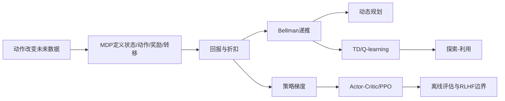

# 第 18 章：强化学习——MDP、价值函数、策略梯度与 PPO

[← 第 17 章](17-recommender-systems.md) | [English](../en/18-reinforcement-learning.md) | [符号约定](appendix-a-notation.md) | [课程路线](00-course-roadmap.md)

> **先修**：条件概率与期望、[梯度优化](12-neural-networks-and-backprop.md)、
> [推荐反馈回路](17-recommender-systems.md)、重要性采样的基本直觉。

## 从第 17 章自然走到这里

监督学习的训练数据通常被当作固定；推荐、机器人、游戏和对话系统的动作却会改变接下来看到的状态
和数据。只预测“用户会不会点”还没有回答“为了长期价值现在应展示什么”。强化学习研究序列决策：
智能体观察状态、选择动作、获得奖励并进入新状态，在探索未知行动与利用已有知识之间优化长期回报。

## 本章学习路线



### 本章学到什么程度？

本章核心是 MDP、Bellman 递推、TD、SARSA 与 Q-learning。策略梯度、GAE、PPO、DQN 和离线 RL
用于建立后续地图：需要理解它们为什么出现以及解决什么不稳定，但不要求在入门阶段复现大型深度 RL
结果。若能在同一个小环境中解释价值怎样更新、on/off-policy 怎样不同，就已经达到本章目标。

## 18.1 为什么即时最优不等于长期最优？

导航中绕开拥堵的短路可能进入死胡同；推荐中标题党带来一次点击，却降低长期留存；对话模型给讨好
回答可能获得即时偏好，却牺牲事实性。当前动作 $a_t$ 不只产生奖励 $r_{t+1}$，还改变下一状态
$s_{t+1}$，进而改变未来可选动作和数据。

<details><summary>苏格拉底追问：有标签的行为克隆为什么不等于强化学习？</summary>
行为克隆模仿日志动作，不显式优化动作对未来状态与累计奖励的影响；它还会在偏离示范分布后累积错误。
强化学习需要环境反馈或有效的离线决策假设。
</details>

## 18.2 MDP：把序列决策写清楚

马尔可夫决策过程（MDP）由 $(\mathcal S,\mathcal A,P,R,\gamma)$ 组成：

- $s_t\in\mathcal S$：状态，应包含预测未来所需信息；
- $a_t\in\mathcal A$：动作；
- $P(s'\mid s,a)$：转移概率；
- $R(s,a,s')$：奖励；
- $\gamma\in[0,1)$：折扣因子。

马尔可夫性是

$$p(s_{t+1}\mid s_0,a_0,\ldots,s_t,a_t)=p(s_{t+1}\mid s_t,a_t).$$

若观测不足以构成状态，就成为部分可观测 MDP（POMDP），可用历史、belief state 或记忆网络近似。

策略 $\pi(a\mid s)$ 给定状态的动作分布。折扣回报

$$G_t=\sum_{k=0}^{\infty}\gamma^k r_{t+k+1}.$$

$\gamma$ 越大越重视远期，也使估计方差和有效规划范围增大；它还可表达任务终止概率，但不能替代
合理奖励设计。

## 18.3 价值函数与 Bellman 方程

策略价值和动作价值分别为

$$V^\pi(s)=\mathbb E_\pi[G_t\mid s_t=s],$$

$$Q^\pi(s,a)=\mathbb E_\pi[G_t\mid s_t=s,a_t=a].$$

把第一步奖励与余下回报拆开：

$$V^\pi(s)=\sum_a\pi(a\mid s)
\sum_{s'}P(s'\mid s,a)[R(s,a,s')+\gamma V^\pi(s')].$$

最优价值满足 Bellman optimality：

$$V^*(s)=\max_a\sum_{s'}P(s'\mid s,a)
[R(s,a,s')+\gamma V^*(s')].$$

这不是把未来“忽略”，而是用下一状态价值递归总结未来。

### 三状态 MDP 手算 Bellman 更新

状态 $S$ 有两个动作：`safe` 立即终止并得 2；`risky` 到状态 $R$ 得 0。状态 $R$ 下一步以
0.8 概率得 4、0.2 概率得 $-2$ 后终止，取 $\gamma=0.9$。于是

$$V(R)=0.8\times4+0.2\times(-2)=2.8,$$

$$Q(S,safe)=2,\\qquad Q(S,risky)=0+0.9\times2.8=2.52.$$

只看即时奖励会选 safe，考虑未来则选 risky；失败概率或折扣变化时结论可能反转。价值函数是把
未来奖励分布压缩成期望，不是模型凭空给出的“好坏分”。

## 18.4 动态规划：已知环境时反复备份

价值迭代反复应用最优 Bellman 算子：

$$V_{k+1}(s)\leftarrow\max_a\sum_{s'}P(s'\mid s,a)
[R(s,a,s')+\gamma V_k(s')].$$

收敛后选择使右侧最大的动作。


颜色表示最优状态价值，箭头表示当前格应走的动作，G 是目标，X 是陷阱。靠近目标且不被陷阱阻断的
格子价值更高；奖励通过 Bellman 更新逐步向远处传播。箭头只适用于本章设定的转移、奖励和折扣，
改变一步代价或加入随机滑动会改变路线。

已知完整 $P,R$ 在现实中少见，但动态规划给出了后续采样算法要近似的目标。

策略评估固定 $\pi$ 应用 Bellman expectation；策略改进对 $Q^\pi$ 变 greedy；二者交替是策略
迭代。价值迭代把“评估到收敛”和“立即改进”合为最优备份。公式相似，但分别回答评估现有策略
还是寻找最优策略。

## 18.5 Monte Carlo 与 TD：没有环境模型怎样学价值？

Monte Carlo 等一回合结束，用实际回报更新：

$$V(s_t)\leftarrow V(s_t)+\alpha(G_t-V(s_t)).$$

它无偏但等待久、方差高。TD(0) 用一步奖励加当前估计作为目标：

$$\delta_t=r_{t+1}+\gamma V(s_{t+1})-V(s_t),$$

$$V(s_t)\leftarrow V(s_t)+\alpha\delta_t.$$

这叫 bootstrapping：用估计更新估计，偏差更大但可在线、方差通常更小。

用同一条三步轨迹对比会更直观。若奖励为 $[0,0,1]$、$\gamma=0.9$，从三个时刻看到的完整
Monte Carlo 回报是 $[0.81,0.9,1]$。若当前下一状态价值估计为 $[0.4,0.7,0]$，一步 TD target
则是 $[0.36,0.63,1]$。MC 等到结局后使用真实长回报；TD 不等待结局，但前两步目标依赖尚不准确的
价值估计。二者不是谁永远更好，而是在偏差、方差和在线更新之间选择。


浅色线是每回合平均绝对 TD error，深线是移动平均。早期估计错误大，更新信号强；学习后总体下降，
但随机轨迹仍造成波动。TD error 小只说明 Bellman 一致性改善，不保证奖励设计正确或所有状态被充分访问。

## 18.6 Q-learning：直接学习该选哪个动作

Q-learning 的 off-policy 更新为

$$Q(s_t,a_t)\leftarrow Q(s_t,a_t)+\alpha
[r_{t+1}+\gamma\max_{a'}Q(s_{t+1},a')-Q(s_t,a_t)].$$

行为可用 $\epsilon$-greedy 探索，目标却使用 greedy 最大值，因此是 off-policy。表格状态小可直接存
$Q$；DQN 用神经网络近似，并引入 replay buffer 打破相关性、target network 稳定目标。

函数近似、bootstrapping 与 off-policy 同时存在会导致不稳定，被称为 deadly triad。过估计还来自
max 对噪声的偏好，Double DQN 分开选择与评价动作以缓解。

SARSA 的 target 是 $r+\gamma Q(s',a')$，$a'$ 真由当前探索策略选择；Q-learning 用
$r+\gamma\max_{a'}Q(s',a')$。悬崖行走中，SARSA 会把探索时掉下悬崖的风险计入价值，可能学习
更安全路线；Q-learning 学探索结束后的 greedy 最短路线。

## 18.7 探索—利用：不尝试就永远不知道

多臂老虎机没有状态转移，只需选择不同奖励分布的动作，是理解探索的最小模型。


纵轴是相对始终选择最佳臂的累计机会损失。完全 greedy 可能早期误判后长期坚持差动作；适量
$\epsilon$ 探索能发现更优臂；探索过多则持续付出机会成本。图中最佳 $\epsilon$ 只对该 horizon、
奖励间隔和初始化成立。UCB 用置信上界，Thompson sampling 用后验采样，更有原则地利用不确定性。

## 18.8 策略梯度：直接优化动作分布

参数化策略 $\pi_\theta(a\mid s)$ 的目标

$$J(\theta)=\mathbb E_{\tau\sim\pi_\theta}
\left[\sum_t\gamma^tr_{t+1}\right].$$

log-derivative trick 得到 REINFORCE：

$$\nabla_\theta J=\mathbb E
\left[\sum_t\nabla_\theta\log\pi_\theta(a_t\mid s_t)G_t\right].$$

减去与动作无关的 baseline 不改变期望，却降低方差。用

$$A^\pi(s,a)=Q^\pi(s,a)-V^\pi(s)$$

表示动作比平均策略好多少。Actor 更新策略，Critic 估计价值/优势，这就是 Actor-Critic。

广义优势估计 GAE 写成

$$\hat A_t^{GAE}=\sum_{l=0}^{\infty}(\gamma\lambda)^l\delta_{t+l},\qquad
\delta_t=r_{t+1}+\gamma V(s_{t+1})-V(s_t).$$

$\lambda$ 小更依赖 critic、偏差较高方差较低；接近 1 更像长回报、方差较高。优势标准化只改变
优化尺度，不能修复错误奖励。

## 18.9 PPO：为什么限制一次策略改变？

新旧策略概率比

$$r_t(\theta)=\frac{\pi_\theta(a_t\mid s_t)}{\pi_{old}(a_t\mid s_t)}.$$

PPO clipped surrogate：

$$L^{clip}=\mathbb E_t\left[
\min(r_tA_t,\operatorname{clip}(r_t,1-\epsilon,1+\epsilon)A_t)
\right].$$


横轴是新旧动作概率比，蓝色区域是未截断范围。正优势动作的概率比超过上界后，目标不再继续奖励；
负优势动作在过度降低概率时也受限制。clipping 是近似稳定机制，不是严格保证 KL 很小；实际还监控
KL、clip fraction、entropy、value loss 和回报。

## 18.10 从零实验

运行：

```bash
python code/chapter18/reinforcement_learning.py
python code/chapter18/course_lab.py
```

第一个脚本生成 GridWorld、TD、bandit 与 PPO 图。第二个课程实验在同一个 GridWorld 中训练 SARSA
和 Q-learning，打印前后期回报与最终成功率；同时手算同一轨迹的 MC/TD target，并检查 PPO 正优势
在概率比超过 1.2 后不再继续增加奖励。这样正文中的四组公式都有可运行落点。

课程实验使用表格 $Q$，刻意避开神经网络带来的额外不稳定。DQN 可以理解成“把这张表换成网络，
再加入 replay 和 target network”；PPO 部分只要求读懂 clipping，不把一次曲线计算冒充完整 PPO 训练。

## 18.11 On-policy、Off-policy 与离线 RL

### DQN 为什么需要两套稳定装置？

连续轨迹相邻样本高度相关，直接按顺序训练会让梯度偏向最近经历；replay buffer 随机抽样打散相关，
并复用昂贵交互。若生成 target 的网络每一步都随被训练网络变化，目标会追着自己移动；target
network 延迟复制参数，使一段时间内目标较稳定。二者缓解问题但不消除函数近似的发散风险。

评估 RL 不能只给一条最好曲线。至少报告多个随机种子的回报中位数/区间、环境步数、成功率、样本
效率、wall-clock、安全违规和最终策略回放；超参数若用测试环境挑选，也会产生选择偏差。

- On-policy 使用当前策略产生的数据更新当前策略，如基础策略梯度；数据新鲜但样本成本高。
- Off-policy 可用其他行为策略数据，如 Q-learning；更复用数据但有分布偏移。
- 离线 RL 只使用固定日志。若目标策略选择日志几乎没覆盖的动作，价值估计会外推并虚高。

离线策略评估可用 importance sampling：

$$\hat J(\pi)=\frac1N\sum_{i=1}^{N}
\left(\prod_t\frac{\pi(a_t^{(i)}\mid s_t^{(i)})}{\mu(a_t^{(i)}\mid s_t^{(i)})}\right)G^{(i)},$$

但长轨迹权重乘积方差巨大。模型化、doubly robust 和保守算法能改善，仍依赖覆盖和假设。

## 18.12 奖励设计、复杂度与失败诊断

奖励是代理目标。智能体会寻找所有能提高奖励的路径，包括设计者没想到的漏洞。应把成功、成本、
安全和长期影响明确化，并保留不可由单一奖励替代的硬约束。

| 症状 | 可能原因 | 检查与修复 |
|---|---|---|
| 回报高但行为荒谬 | reward hacking | 行为回放、独立安全指标、改奖励/约束 |
| 多种子差异巨大 | 探索与优化不稳定 | 报告分布，增加种子和诊断 |
| value loss 爆炸 | 尺度/bootstrapping/学习率 | 奖励归一、target、裁剪与学习率 |
| 离线策略异常激进 | 支持外动作外推 | 覆盖分析、保守约束 |
| 模拟好、现实差 | sim-to-real gap | 随机化、真实小流量与安全回退 |

## 18.13 与现代 AI 的联系

- **RLHF**：奖励模型近似人类偏好，PPO 优化 LLM 策略；奖励投机与 KL 漂移仍需监控。
- **DPO**：直接从偏好对优化相对概率，省去显式在线 RL 环，但仍依赖参考模型和偏好数据质量。
- **Agent**：工具调用形成状态—动作—观察循环；真实在线探索可能有安全和成本风险。
- **推荐/广告**：bandit 处理即时探索，完整 RL 处理长期留存；归因延迟和环境非平稳很困难。
- **机器人/控制**：样本昂贵且安全关键，常结合模拟、模型预测控制、离线数据和约束。

## 18.14 苏格拉底导师

<details><summary>折扣因子越大是否一定更有远见？</summary>
它提高远期权重，也增加估计方差和对模型误差的敏感性；奖励与状态若错误，更远规划可能更差。
</details>

<details><summary>TD target 含当前估计，为什么还能学习？</summary>
在表格、适当步长和充分访问等条件下，Bellman 算子是压缩映射；函数近似时则不保证稳定。
</details>

<details><summary>Q-learning 为何是 off-policy？</summary>
数据可由探索行为产生，但 target 使用 $\max Q$ 对应的 greedy 目标策略。
</details>

<details><summary>策略梯度为什么乘 advantage？</summary>
正 advantage 动作应提高概率，负 advantage 动作应降低；baseline 减少共同回报噪声。
</details>

<details><summary>PPO clipping 能保证策略安全更新吗？</summary>
不能。它只截断代理目标激励，还需监控实际 KL、性能、安全约束与分布外行为。
</details>

<details><summary>离线日志很多，为什么仍可能无法评价新策略？</summary>
若行为策略从未采取新策略偏好的动作，日志没有反事实证据，样本量无法弥补覆盖缺失。
</details>

## 18.15 练习

完成后对照[第 18 章参考答案](solutions/18-solutions.md)。

1. 为一个三状态 MDP 手算两轮价值迭代。
2. 推导 Bellman expectation equation 与 optimality equation 的区别。
3. 实现 TD(0)、SARSA 和 Q-learning，比较 on/off-policy。
4. 比较 $\epsilon$-greedy、UCB 和 Thompson sampling 的 regret。
5. 从 log-derivative trick 推导 REINFORCE，并说明 baseline 为何不改期望。
6. 实现 PPO clipping 曲线，监控 KL、entropy 与 clip fraction。
7. 为推荐长期留存或 LLM 偏好设计奖励、护栏与 reward hacking 测试。

## 18.16 面试八股

- **MDP 五元组？** 状态、动作、转移、奖励与折扣。
- **Bellman 方程？** 当前价值等于一步奖励加下一状态价值的期望递推。
- **MC 与 TD？** MC 等完整回报、无 bootstrap；TD 一步更新、用估计作为目标。
- **SARSA 与 Q-learning？** 前者 on-policy 用实际下一动作，后者 off-policy 用最大动作。
- **探索—利用？** 尝试未知动作获取信息与选择当前最好动作获取回报的权衡。
- **DQN 两个稳定技巧？** replay buffer 与 target network，另常配 Double DQN。
- **策略梯度定理直觉？** 提高带来高于基线回报的动作对数概率。
- **advantage？** 某动作相对该状态平均策略价值的增益。
- **PPO 为什么 clip？** 限制代理目标鼓励策略概率比发生过大变化。
- **off-policy evaluation 风险？** 重要性权重高方差，覆盖不足时不可识别。
- **reward hacking？** 策略提高代理奖励却违背真实意图。

## 本章通关标准

- [ ] 我能把实际序列决策写成 MDP，并审查状态与奖励是否充分。
- [ ] 我能推导 Bellman 方程并手算价值迭代。
- [ ] 我能实现 TD、SARSA、Q-learning 并解释 on/off-policy。
- [ ] 我能用 regret 分析探索策略，而不只看一次总奖励。
- [ ] 我能推导 REINFORCE、advantage 和 PPO clipped objective。
- [ ] 我能诊断 deadly triad、覆盖缺失、reward hacking 与高方差。
- [ ] 我能准确说明 RLHF、DPO、Agent、推荐 RL 的联系和限制。

### 扩展阅读

- [Sutton & Barto, Reinforcement Learning: An Introduction](http://incompleteideas.net/book/the-book-2nd.html)
- [Mnih et al., Human-level control through deep reinforcement learning](https://doi.org/10.1038/nature14236)
- [Schulman et al., Proximal Policy Optimization Algorithms](https://arxiv.org/abs/1707.06347)
- [Ouyang et al., Training language models to follow instructions with human feedback](https://arxiv.org/abs/2203.02155)

[下一章：评估、因果陷阱、数据与 MLOps →](19-evaluation-causality-and-mlops.md)
