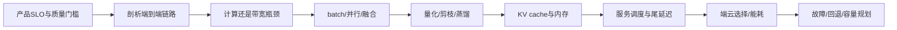
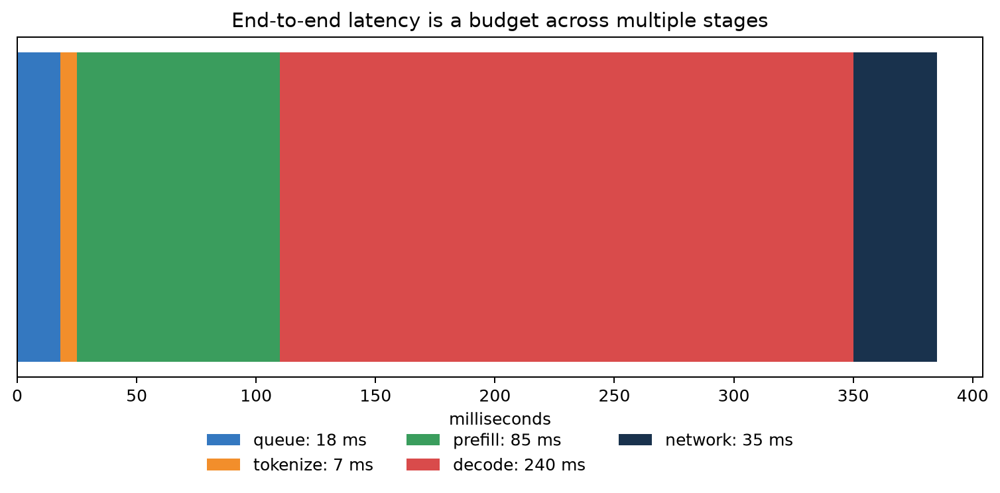
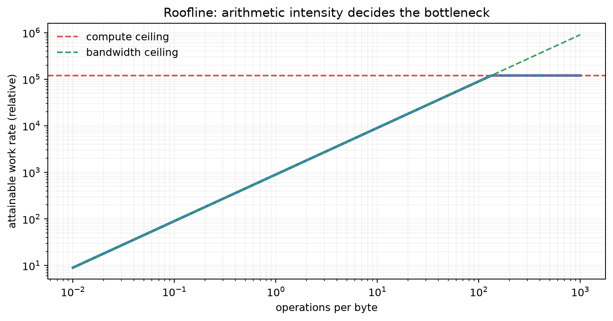
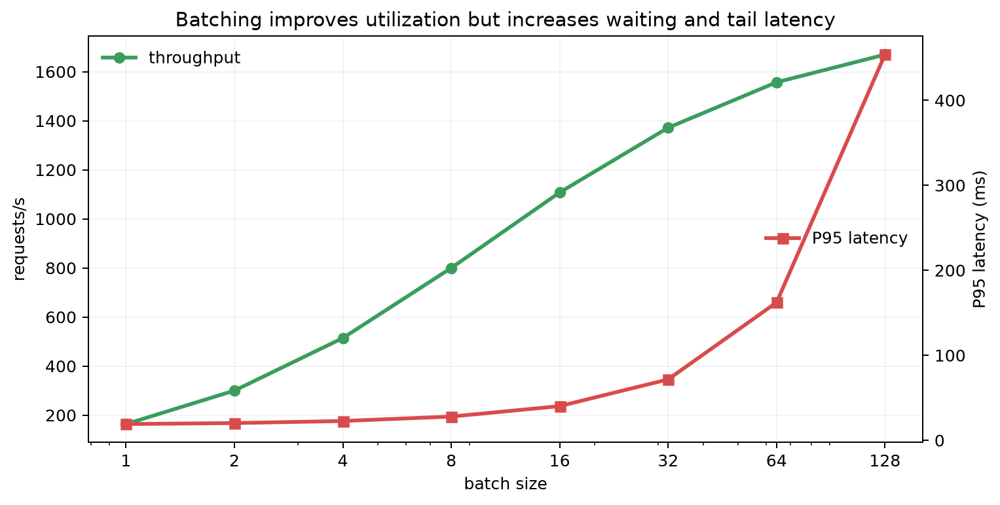
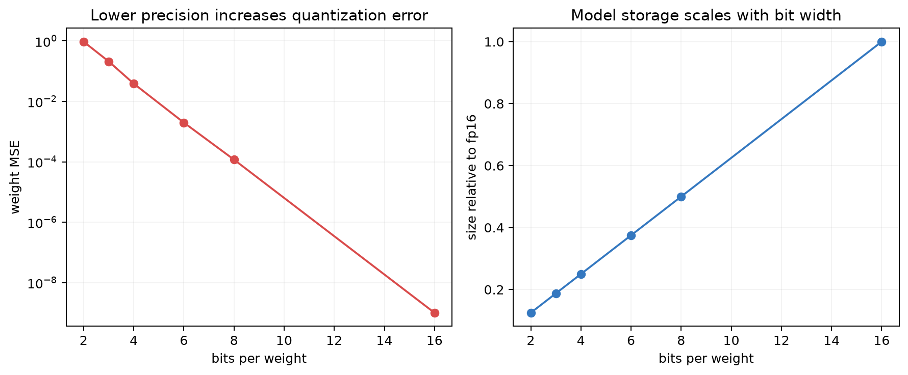
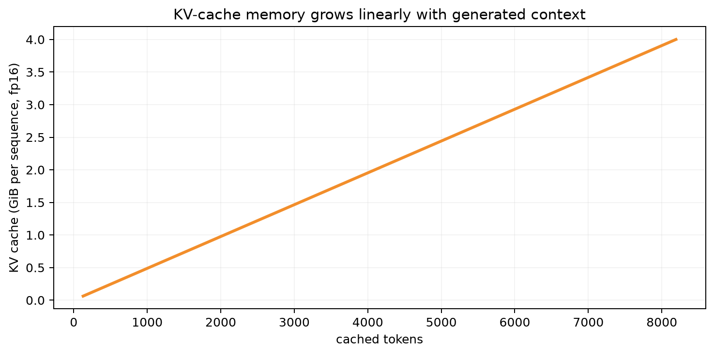

# 第 20 章：机器学习系统——性能、内存、量化与可靠部署

[← 第 19 章](19-evaluation-causality-and-mlops.md) | [English](../en/20-machine-learning-systems.md) | [符号约定](appendix-a-notation.md) | [课程路线](00-course-roadmap.md)

> **先修**：[Transformer 与 KV cache](15-transformers-llms-and-finetuning.md)、
> [MLOps 监控与发布](19-evaluation-causality-and-mlops.md)、矩阵乘法形状与时间/空间复杂度。

## 从第 19 章自然走到这里

评估正确的模型仍可能因延迟、内存、成本、能耗或故障不可部署。算法层问“需要多少运算”，系统层
还问“数据从哪里搬到哪里、硬件能否并行、请求怎样排队、缓存占多少、错误如何隔离”。本章采用
CS249r 风格，把模型、编译器、运行时、硬件与产品 SLO 放进同一个约束问题。

## 本章学习路线



### 本章学到什么程度？

本章只训练一种系统思维：先测量，再定位瓶颈，再选择优化，并同时验证质量。需要会算 Amdahl、模型/
KV 内存、简单量化误差和排队尾延迟；数据并行、张量并行、编译器和专用硬件先理解职责与代价，不要求
搭建分布式集群。这里是 CS249r 视角的入口，不是它的压缩替代品。

## 20.1 优化前先定义 SLO

一个在线系统至少写清：质量下限、P50/P95/P99 延迟、吞吐、峰值并发、可用性、内存、能耗/成本、
隐私与设备范围。平均延迟 100 ms 可能掩盖 1% 请求超过 5 s；最大吞吐配置也可能让交互延迟不可接受。

<details><summary>苏格拉底追问：模型 FLOPs 降低 50%，服务一定快 2 倍吗？</summary>
不一定。瓶颈可能在内存带宽、tokenization、排队、网络或未优化算子；硬件利用率和并行度也会改变。
必须用端到端剖析而非只看理论 FLOPs。
</details>

## 20.2 延迟预算：慢在哪里？

端到端延迟可拆为排队、预处理、模型 prefill、逐 token decode、后处理和网络。



横向堆叠条表示一次请求的示例预算，decode 占最大部分，但 queue、prefill 和网络也不可忽略。若只把
模型 kernel 加速一倍，端到端收益受 Amdahl 定律限制：未优化部分会成为新瓶颈。应分别记录各阶段
的分布而非只记总平均。

Amdahl 定律：若可加速比例为 $p$、该部分加速 $s$ 倍，总加速上限

$$S=\frac1{(1-p)+p/s}.$$

若模型 kernel 占端到端 60%，即使把它加速 4 倍，总加速也只有
$1/(0.4+0.6/4)\approx1.82$ 倍；无限加速上限是 $1/0.4=2.5$ 倍。优化前应先 profile 占比，
否则可能花数周优化一个只占 5% 的算子。

## 20.3 FLOPs、带宽与 roofline

算术强度定义为

$$I=\frac{\text{operations}}{\text{bytes moved}}.$$

硬件可达到的性能受

$$P\le\min(P_{peak},B_{memory}I)$$

约束。低强度算子受内存带宽限制，强度足够高后才受峰值算力限制。



横轴是每搬一字节执行的操作数，纵轴是可达工作率。斜线区域增加复用/融合可能有效；水平区域需要
更少算术或更高峰值算力。roofline 是上界模型，真实性能还受占用率、kernel launch、形状和通信影响。

矩阵乘通常算术强度高，LayerNorm、embedding lookup、逐元素激活可能更受带宽影响。算子融合把
中间结果留在片上，减少往返显存。

## 20.4 Batching：吞吐和尾延迟的交换



绿色吞吐随 batch 增大逐渐饱和，红色 P95 延迟则因等待凑批和单批计算增加而上升。离线任务可偏向
大 batch；交互服务需要动态 batching、最大等待时间和请求长度感知调度。图是示意曲线，实际拐点
必须在目标硬件、真实长度分布下压测。

LLM 请求长度差异大，短请求与长请求同批会产生 padding 浪费或 head-of-line blocking。continuous
batching 在解码步动态加入/移除序列，提高利用率，但调度、KV 内存和公平性更复杂。

排队不是免费等待。若到达率接近服务率，利用率小幅上升也可能让尾延迟急剧恶化。容量规划应以峰值
到达率与长度分布压测，并留故障余量；不能用平均 QPS 除以单卡平均吞吐。过载时要限流、排队上限、
超时和降级，而不是让队列无限增长。

## 20.5 训练并行：数据、张量、流水线与 ZeRO

- 数据并行：每设备持模型副本，分 batch，聚合梯度；模型需放得下。
- 张量并行：一个大矩阵跨设备切分，每层需要通信。
- 流水线并行：不同层放不同设备，以 micro-batch 填流水线；存在 bubble。
- ZeRO/FSDP：分片参数、梯度和优化器状态，按需聚合。

通信量、互联拓扑和计算重叠决定扩展效率。$N$ 张卡吞吐不到 $N$ 倍很正常；应报告 scaling efficiency：

$$E_N=\frac{Throughput_N}{N\,Throughput_1}.$$

梯度累积增加有效 batch 而不增加激活峰值，但不减少总计算，也不能模拟所有大 batch 动力学。

## 20.6 数值精度与量化

### 量化到底丢了什么

假设 4 bit 对称量化 $q_{max}=7$，权重最大绝对值为 1.4，则 scale $s=1.4/7=0.2$。
$w=0.73$ 被量化为 $q=round(3.65)=4$，反量化为 0.8，误差 0.07。per-channel 量化给每个输出
通道独立 scale，可避免一个异常大通道迫使其他小通道使用过粗步长，但元数据和 kernel 更复杂。

训练常用 fp16/bfloat16 混合精度，关键累加保留较高精度；推理可把权重/激活降到 int8/int4。
对称均匀权重量化示意：

$$s=\frac{\max|w|}{2^{b-1}-1},\qquad
q=\operatorname{clip}(\operatorname{round}(w/s),-q_{max},q_{max}),
\qquad \hat w=sq.$$



左图显示位宽降低时示例权重 MSE 增大，右图显示存储近似与位宽成正比；int4 约为 fp16 四分之一
权重大小。权重误差不等于任务误差：异常通道、激活范围和层敏感性不同。必须报告下游质量、速度、
内存和目标硬件 kernel 是否真正支持。

PTQ 在训练后校准范围，成本低；QAT 在训练中模拟量化，质量通常更稳但需训练。per-channel 比
per-tensor 精细，代价是更多 scale 和实现复杂度。

## 20.7 剪枝、蒸馏与低秩

- 非结构化剪枝产生稀疏权重，若硬件/库不能利用稀疏，文件变小但延迟不降。
- 结构化剪枝删除通道、头或层，更易获得实际加速，但容量损失明显。
- 知识蒸馏让学生匹配教师 soft targets/logits/中间表示，压缩知识但继承教师偏差。
- 低秩分解近似权重矩阵，效果取决于奇异值衰减和 kernel 支持。

压缩方法可叠加，但误差也会叠加；每一步都要在共同基线和真实部署栈验证。

### 先做一张内存账本

训练内存至少包括参数、梯度、优化器状态、激活和临时 workspace。10 亿参数用 bf16 权重约 2 GB；
若 Adam 保留 fp32 master weight、两份矩状态和梯度，仅参数相关状态就可超过 16 GB，尚未包含激活。
推理虽没有梯度和优化器，却增加随并发与长度增长的 KV cache。checkpointing 用重算换激活内存；
ZeRO/FSDP 分片模型状态；量化主要缩小权重，三者解决的不是同一块账目。

## 20.8 LLM 的 prefill、decode 与 KV cache

prefill 并行处理提示，矩阵乘大、算术强度较高；decode 每步只处理新 token，容易受内存带宽和 KV
读取限制。TTFT（time to first token）主要受队列与 prefill 影响，TPOT（time per output token）
主要反映 decode。



横轴是每序列缓存 token，纵轴是示例 32 层、32 个 KV 头、head_dim 128、fp16 的缓存大小。长度
翻倍，单序列 KV 约翻倍；再乘并发后很快成为容量瓶颈。MQA/GQA 减少 KV 头，分页缓存减少碎片，
量化缓存降低内存，但均需质量和 kernel 支持验证。

## 20.9 编译、图优化与硬件映射

编译器可做常量折叠、算子融合、布局选择、内存规划、kernel autotuning 和静态/动态 shape 专门化。
图捕获失败、频繁重编译或不支持算子会让性能退化。优化应保留数值对照：绝对/相对误差、任务指标
和边界输入。

CPU 适合控制流、小 batch 和易部署；GPU/TPU 擅长大规模张量并行；NPU/DSP 面向特定精度与端侧
能效。硬件选择不是排行榜，而是形状、算子、精度、内存、软件栈与供应约束的匹配。

## 20.10 从零系统实验

运行：

```bash
python code/chapter20/ml_systems.py
python code/chapter20/course_lab.py
```

第一个脚本绘制 batch 吞吐—延迟、roofline、量化、延迟预算和 KV cache，它们是可解释的系统模型。
第二个课程实验补上“测量与计算”：预热后计时 NumPy 矩阵乘；比较 int8/int4 权重量化误差；估算
十亿参数模型权重与 KV cache；模拟低/高利用率单服务队列，观察 P99 在接近饱和时快速增加。

矩阵乘输出只代表运行该脚本的机器，不能作为不同硬件排行榜。实验断言只检查计算关系和数值有限，
不会武断要求某台机器达到固定 GFLOP/s。这正是可移植系统实验与“写死性能数字”的区别。

一次规范 profile 应先用端到端 trace 找阶段，再进入最慢阶段看算子，最后用 roofline/带宽计数器
解释原因。每次只改一个因素，并同时验证输出误差与任务质量。优化后瓶颈会迁移，因此必须重新测量，
不能沿用旧 profile。

## 20.11 端侧、云端与隐私

端侧降低网络延迟并让原始数据留在设备，但受功耗、内存、散热和设备碎片化限制；云端资源强、更新
集中，却有网络、隐私和成本。常用混合方案：端侧小模型/缓存做快速决策，困难请求在授权后上云。

联邦学习让设备上传更新而非原始数据，但梯度仍可能泄露，且非 IID、掉线、通信和安全聚合困难。
差分隐私提供可量化隐私预算，代价是噪声和质量下降；“数据不出端”不是自动隐私保证。

## 20.12 可靠服务、容量与成本

容量规划从峰值到达率、服务时间和目标利用率开始。利用率接近 100% 时排队延迟会急剧上升，应留
余量并做过载保护：限流、优先级、超时、降级、小模型回退和缓存。重试若无指数退避和幂等会放大
故障形成 retry storm。

单位经济可报告每千请求、每百万 token 或每成功任务成本。降低单 token 成本却让输出变长，可能
总成本反升；应按端到端成功任务计量。

## 20.13 失败诊断

| 症状 | 可能原因 | 验证与修复 |
|---|---|---|
| GPU 利用率低 | 小 batch/CPU供给/同步 | 时间线与 profiler，预取/融合 |
| FLOPs 降但不加速 | 带宽/不支持稀疏/kernel | roofline 与算子级 profile |
| 平均快但 P99 高 | 排队、长请求、GC/重试 | 长度分桶、超时、容量余量 |
| OOM 随并发出现 | KV/激活/碎片 | 分项内存、分页、限流 |
| 量化后质量突降 | outlier/校准集不代表 | 层敏感性、per-channel/QAT |
| 多卡扩展差 | 通信或 pipeline bubble | 通信占比、拓扑与重叠 |

## 20.14 与现代 AI 的联系

- **LLM serving**：continuous batching、paged KV、GQA、speculative decoding 和量化共同决定成本。
- **RAG**：向量索引、embedding、重排和生成共享延迟预算，优化生成器不一定改善端到端。
- **多模态**：图像/视频 token 增加序列长度与预处理带宽，常需压缩和异步流水线。
- **Agent**：模型延迟之外还有多轮工具网络调用，缓存、并发和超时决定任务完成时间。
- **绿色 AI**：报告能耗/碳需包含硬件利用、地区电力和摊销边界，不用单一 FLOPs 替代。

## 20.15 苏格拉底导师

<details><summary>参数少的模型为什么可能更慢？</summary>
算子不规则、内存访问差、并行度低或 kernel 不成熟都可能让小模型利用率更低。
</details>

<details><summary>为什么 P99 比平均延迟难优化？</summary>
尾部由排队、长度、资源争用和故障共同造成；平均值会掩盖少数极慢请求。
</details>

<details><summary>量化权重小四倍，吞吐一定四倍吗？</summary>
不一定。还受激活、KV、带宽、反量化和硬件 int4 吞吐限制。
</details>

<details><summary>FlashAttention 为什么省显存？</summary>
它分块计算并在线 softmax，避免把完整 $T\times T$ 分数写回显存；算术仍近似二次。
</details>

<details><summary>batch 越大为什么延迟会上升？</summary>
请求要等待凑批，且更大批次单次执行更久；吞吐利用提升不等于单请求更快。
</details>

<details><summary>优化一个 kernel 后端到端几乎不变，说明什么？</summary>
该 kernel 占比小或瓶颈转移，应按 Amdahl 定律重新 profile，而非继续局部优化。
</details>

## 20.16 练习

完成后对照[第 20 章参考答案](solutions/20-solutions.md)。

1. 用 Amdahl 定律计算优化 Attention/网络/预处理的端到端上限。
2. 为几个算子估算算术强度并在 roofline 上判断瓶颈。
3. 压测 batch/并发/长度，画吞吐—P95/P99—显存 Pareto 曲线。
4. 实现 int8/int4 PTQ，比较 per-tensor/per-channel 质量与速度。
5. 估算指定 Transformer 的参数、激活、优化器和 KV 内存。
6. 为 8 卡训练设计数据/张量/流水线并行并计算通信量。
7. 写一个 LLM 服务容量、过载降级、回滚和成本方案。

## 20.17 面试八股

- **FLOPs 与延迟为何不同？** 延迟还受带宽、并行、kernel、通信和排队影响。
- **算术强度？** 运算数除以搬运字节数，决定更可能计算受限还是带宽受限。
- **Amdahl 定律？** 总加速受未优化部分比例限制。
- **batch 的取舍？** 提高吞吐与利用率，但增加等待、显存和尾延迟。
- **数据/张量/流水线并行？** 分 batch、分层内矩阵、分层阶段，通信与内存不同。
- **PTQ 与 QAT？** 训练后校准成本低；量化感知训练质量通常更稳但需再训练。
- **结构化与非结构化剪枝？** 前者硬件易利用，后者稀疏度高却未必实际加速。
- **TTFT 与 TPOT？** 首 token 时间和后续每 token 时间，对应 prefill/queue 与 decode。
- **KV cache 复杂度？** 随层数、KV 头、head_dim、长度、并发和字节线性增长。
- **P50/P99？** 中位体验与尾部最慢请求，二者都需报告。
- **speculative decoding？** 小模型提出多个 token，大模型并行验证，接受率决定收益。

## 本章通关标准

- [ ] 我能把产品质量、延迟、吞吐、内存、成本和可靠性写成 SLO。
- [ ] 我能用 profiler、Amdahl 和 roofline 定位真实瓶颈。
- [ ] 我能解释 batching 与各类并行的收益、通信和尾延迟代价。
- [ ] 我能实现量化并在目标硬件验证质量—速度—内存，而非只看文件大小。
- [ ] 我能估算 Transformer 参数、训练状态、激活和 KV cache。
- [ ] 我能设计 continuous batching、过载保护、降级、回滚和容量计划。
- [ ] 我能共同报告端云隐私、能耗和单位成功任务成本。

### 扩展阅读

- [Harvard CS249r Machine Learning Systems](https://github.com/harvard-edge/cs249r_book)
- [Williams et al., Roofline: An Insightful Visual Performance Model](https://doi.org/10.1145/1498765.1498785)
- [Dao et al., FlashAttention](https://arxiv.org/abs/2205.14135)
- [Kwon et al., vLLM / PagedAttention](https://arxiv.org/abs/2309.06180)
- [Dettmers et al., LLM.int8()](https://arxiv.org/abs/2208.07339)

[下一章：面试复习与研究项目 →](21-interview-and-capstone.md)
