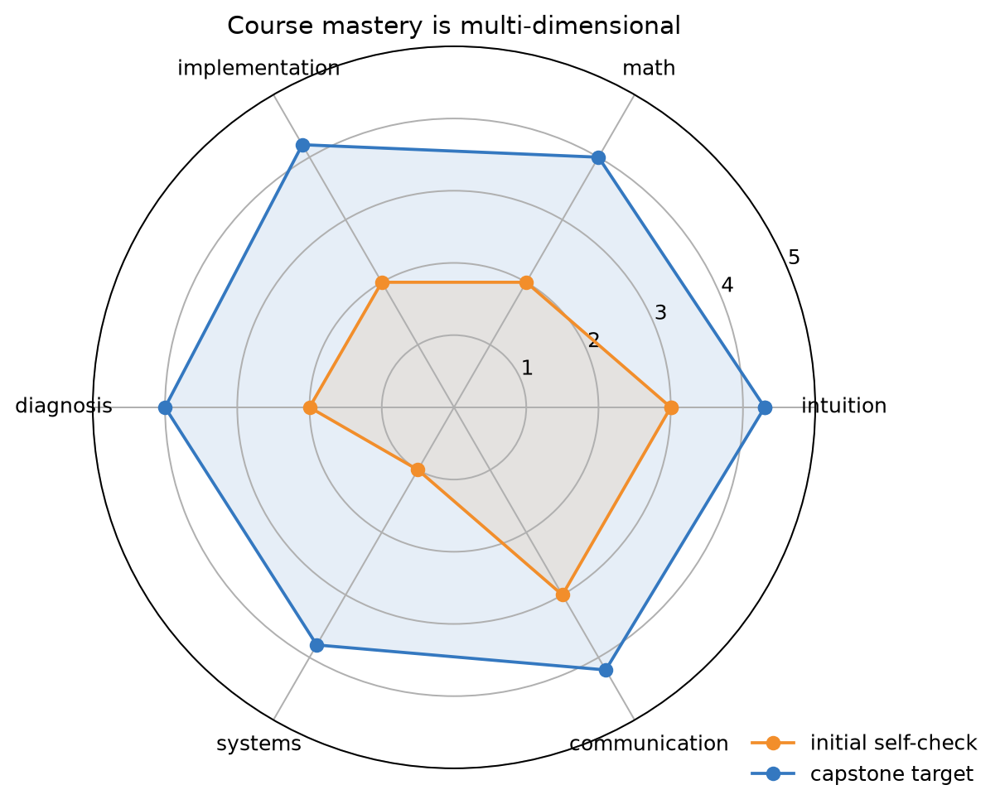
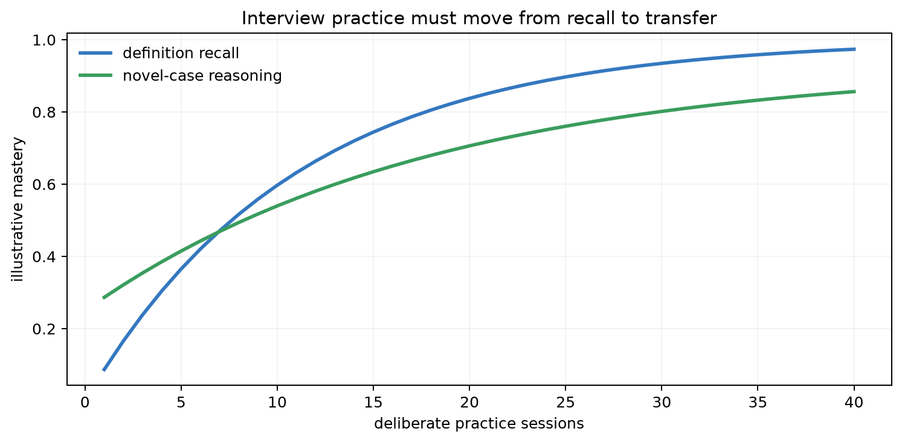
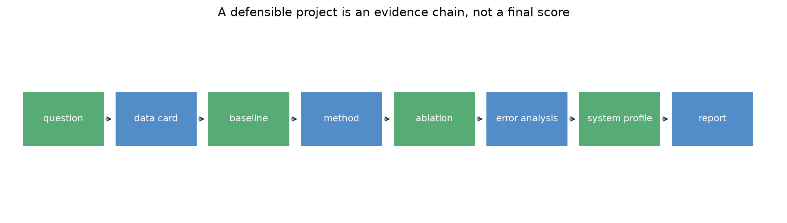
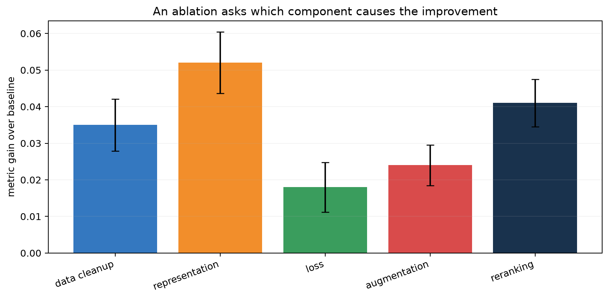

# 第 21 章：课程收束——面试知识网络与可复现研究项目

[← 第 20 章](20-machine-learning-systems.md) | [English](../en/21-interview-and-capstone.md) | [符号约定](appendix-a-notation.md) | [课程路线](00-course-roadmap.md)

> **先修**：第 1～20 章。本章不引入一个新模型，而是把已有知识组织为可解释、可实现、可验证、
> 可迁移的能力。

## 从第 20 章自然走到这里

课程已覆盖数据定义、数学、经典模型、深度学习、LLM、生成、推荐、RL、评估和系统。最后的风险是
“每章都看过，但遇到新问题不知从哪开始”。本章用两类产出检验真正掌握：一是面试中从定义追到
假设、推导、失败和系统；二是研究项目中用公平对照、消融、误差分析和复现证据支持结论。

## 本章学习路线


### 本章学到什么程度？

本章不要求做出论文级创新。一个合格入门项目只需做到：问题可检验、基线正确、切分无明显泄漏、
改进有成对证据、失败样本被分类、质量与成本一起报告。项目小但证据完整，比堆许多未验证模块更符合
本课程目标。

## 21.1 “会”一个模型的六层证据

1. **直觉**：为什么需要，不用会怎样。
2. **表示**：输入、输出、参数、形状和假设。
3. **推导**：从概率/几何假设到目标与更新。
4. **实现**：从零核心、框架对照、数值检查。
5. **诊断**：根据曲线、错误和系统 profile 定位失败。
6. **迁移**：说明在现代 AI 中是直接模块还是共享思想，并指出边界。



雷达图六个方向对应上述能力的扩展版本。只背定义可能“沟通”尚可但推导、实现和诊断薄弱；只会调包
也可能无法解释失败。目标不是每项自评满分，而是用作业、代码和答辩提供可观察证据，并针对短板练习。

## 21.2 面试回答的主干：定义—为什么—怎样—失败—验证

遇到“解释某算法”时使用五步，而非倾倒关键词：

1. 一句话定义任务和核心假设；
2. 说明旧方法的痛点与它为何出现；
3. 给关键公式，解释符号和求解；
4. 说一个不适用反例和诊断信号；
5. 给公平实验、复杂度与现代应用位置。

例如“Ridge 与 Lasso 区别”不能只答 L2/L1：应说明二者如何限制系数、共线时怎样、Lasso 稀疏条件、
缩放要求、$\lambda$ 如何验证，以及在高相关特征中选择不稳定。

## 21.3 高频知识网络

### 数据与泛化

- 训练/验证/测试、交叉验证、分组/时间切分、泄漏；
- 偏差—方差、学习曲线、正则、early stopping；
- 类别不平衡、阈值、校准、不确定性和分布漂移。

### 模型与目标

- OLS/MLE/MAP，逻辑回归与 softmax；
- GDA/NB 的生成假设，SVM 间隔与核；
- 树、随机森林、GBDT 的方差和串行纠错；
- k-means/GMM/EM，PCA/ICA；
- 反向传播、初始化、优化、归一化；
- Attention/Transformer、InfoNCE、VAE/扩散；
- 推荐召回/排序，Bellman/TD/策略梯度。

### 系统与研究

- 时间/空间复杂度、数值稳定、向量化；
- 吞吐/尾延迟/内存、batch、量化、KV cache；
- 基线、公平预算、消融、统计区间、复现和局限。

学习时给每个节点建立双向链接：例如“交叉熵”同时连接逻辑回归、softmax、语言模型、InfoNCE 和
策略；“低秩”连接 PCA、矩阵分解、LoRA 和压缩，但这些方法的目标不同，不能只因公式相似而等同。

## 21.4 为什么只刷题不能形成迁移？



横轴是刻意练习次数，蓝线表示定义回忆通常较快饱和，绿线表示对新案例的迁移需要更多诊断和反例
练习。曲线是教学示意，不是实测学习定律。每次练习应继续追问：条件改变后结论是否仍成立？怎样用
实验区分两个解释？系统预算改变如何选模型？

推荐三轮：60 秒短答 → 白板推导/代码 → 开放系统设计。录音复盘是否先定义、是否偷换指标、是否
遗漏假设，以及结论是否有验证方法。

## 21.5 研究项目先写问题卡

项目开始前用一页写清：

- 问题与使用者；输入在预测时是否可得；
- 样本单位、标签来源和时间；
- 主指标、护栏和最低可用基线；
- 核心假设：“机制 X 应改善失败 Y”；
- 训练/验证/测试与污染控制；
- 计算、数据、隐私和时间预算；
- 成功、失败与停止标准。

若问题卡无法写清，先不要堆模型。研究问题应能被证伪，而非“试试更大的模型是否更好”。

### 可直接复制的问题卡

```text
问题：谁在什么时刻，用模型输出做什么决定？
样本/标签：一行是谁？标签何时产生、何时可见？
假设：因为机制____，方法____应在条件____下改善失败____。
基线：常数/规则____；经典模型____；强对照____。
主指标与护栏：____；不能退化的安全/延迟指标____。
切分：按____划分；去重/污染/时间泄漏检查____。
预算：数据____；GPU/CPU____；截止时间____。
停止标准：若____仍无改善，则拒绝该假设。
```

## 21.6 一个可答辩的证据链



每个方框都是缺失后会让结论断裂的一环：数据卡界定证据来源，基线说明改进幅度，消融检查改进来自
哪个部件，错误分析揭示平均指标外的边界，系统 profile 说明能否落地。最终报告不是把结果表放在
最后，而是让每个结论都能沿链条回到实验和产物。

### 推荐项目结构

```text
project/
  README.md              # 一键复现与主结论
  data_card.md           # 来源、许可、划分、限制
  configs/               # 所有实验配置
  src/                   # 数据、模型、训练、评估
  tests/                 # 形状、泄漏、数值与回归测试
  reports/               # 表格、图、错误案例、模型卡
  environment/           # 依赖与硬件记录
```

原始大数据和密钥不入 Git；保存校验和、下载说明或受控访问路径。

### 一个贯穿示例：校园课程问答 RAG

问题不是“做一个 RAG”，而是“在 2 秒 P95 内，对课程政策问题给出带正确引用的答案”。样本单位
是一条真实问题；金标准包含可回答性、答案要点和证据段落。第一基线是关键词检索，第二基线是
embedding top-5，提案增加 cross-encoder 重排。

主表同时报告证据 Recall@5、答案正确率、引用支持率、P95 与单问成本。消融分别去掉重排、改变
chunk 大小、替换 embedding；错误 taxonomy 分为库中无文档、未召回、重排错、模型未用证据、
引用错。若重排只提升答案 0.3% 却增加 600 ms，就不能只写“指标提高”，而要讨论是否值得部署。

这份示例体现完整主干：问题 → 标签 → 基线 → 机制 → 分层指标 → 消融 → 错误 → 系统权衡。

## 21.7 基线与公平比较

至少三层基线：

1. 常数/随机/热门规则，验证指标管道；
2. 经典简单模型，建立可解释下限；
3. 与提案最接近的强方法，验证新机制价值。

统一数据、预处理、搜索预算、随机种子集合、early stopping、硬件和指标。若新方法算力高十倍，只比
默认弱基线不公平；应同时报告等算力和最佳可用两种视角。

## 21.8 消融：改进究竟来自哪里？



每根柱表示只加入或移除一个组件后的指标变化，误差棒表示重复实验波动。表示学习和重排在该示意中
增益较大，但只有置信区间和交互实验才能判断差异稳定。消融不是把所有开关排列一次；它应对应机制
假设，并控制其他变量。

需要的消融类型：

- 组件消融：去掉模块；
- 目标消融：替换损失/正则；
- 数据消融：规模、质量、增强、负样本；
- 容量/预算对照：参数、训练步、FLOPs；
- 反例/压力测试：噪声、漂移、长尾、对抗；
- 系统消融：精度、batch、缓存、索引参数。

## 21.9 误差分析：从平均数回到样本

先定义互斥或可解释的错误 taxonomy，随机抽取而非只挑有趣案例，双人标注一部分检查一致性。统计
错误类别占比、置信度、群体和随版本变化，再选能覆盖大量错误的改进。LLM/RAG 可区分：库缺失、
召回漏、重排错、证据未用、推理错、引用错、安全拒答错。

错误案例需保护隐私；展示时去标识并说明选择规则。定性例子帮助解释，不替代定量总体证据。

## 21.10 统计报告与诚实结论

报告多随机种子的均值/标准差或区间、样本单位和效应大小。测试集只在设计冻结后使用；若根据测试
结果继续改方法，必须承认它已成为验证集并另建测试证据。

结论强度不能超过证据：单一数据集上“提高 2%”不能写成“普遍优于所有方法”；合成实验验证机制，
不证明真实部署有效。负结果也有价值，只要能说明假设为何失败、在哪些条件失败。

推荐主结果表至少包含：方法、参数/训练预算、主指标均值与区间、关键护栏、训练时间、推理延迟和
峰值内存。每条结论写成“在数据/协议/预算 X 下，方法 A 相对基线 B 改善 Y，代价 Z”，不要省略
适用范围。

## 21.11 从零复现实验

运行：

```bash
python code/chapter21/capstone_and_interviews.py
python code/chapter21/course_lab.py
```

第一个脚本生成消融、能力雷达、证据链和迁移练习图。第二个课程实验演示一个最小项目分析：检查
问题卡字段，对多个固定种子的基线与提案做 paired bootstrap，记录两项消融和错误 taxonomy，再
验证每条 claim 同时具有 evidence 与 boundary。典型输出给出约 0.029 的平均增益及不跨 0 的区间，
同时报告质量—延迟组合。

这段代码的重点不是这组合成数字，而是输出结构：结论不能只有“提升了”，还要说明相对谁、波动多大、
适用协议是什么、付出了多少延迟。项目的最终入口也应是一条命令，能重建主结果与关键诊断。

## 21.12 项目选题建议与最低交付

可选方向：

- 经典：比较正则/核/树在真实小数据上的归纳偏置；
- 表征：对比学习负样本与检索质量；
- RAG：chunk、embedding、重排、生成的分层消融；
- 推荐：双塔召回、精排和多样性/曝光偏差；
- 生成：VAE/diffusion 的质量—覆盖—步数；
- RL：离线覆盖或 PPO 稳定性；
- 系统：量化、batch、KV cache 的质量—延迟—内存 Pareto。

最低交付：问题卡、数据卡、复现 README、基线、主结果、至少三项有机制的消融、错误分析、系统
成本、局限、模型卡和 10 分钟答辩。

### 一个八周节奏

| 周 | 目标 | 过关证据 |
|---:|---|---|
| 1 | 问题卡、数据卡、指标测试 | 人工检查 20 个样本 |
| 2 | 最简单端到端基线 | 一条命令复现 |
| 3 | 强基线与公平协议 | 主表第一版 |
| 4 | 提案最小实现 | 数值、形状、小样本过拟合测试 |
| 5 | 主实验与多种子 | 冻结测试前完成选择 |
| 6 | 消融、反例、错误分析 | 每个 claim 有对应证据 |
| 7 | 系统 profile、局限与模型卡 | 质量—成本 Pareto |
| 8 | 复现包与模拟答辩 | 陌生同学可复现主结果 |

时间不足时优先保住基线、无泄漏协议和证据链，缩小模型/数据范围；不要用大量未完成实验换掉一个
可信结论。

## 21.13 面试系统设计题怎样回答？

按顺序：澄清目标/SLO → 数据与标签 → 基线 → 架构与多阶段 → 训练/评估 → 服务/容量 → 监控/
回滚 → 安全/隐私 → 权衡。先估量级：QPS、候选数、特征维、模型大小、时延和更新频率。每个组件
说“为何需要”和失败回退，不要画一堆框却没有数据流。

例如设计 RAG：先定义答案和证据质量；文档解析/权限/版本；embedding 与索引；召回/重排；提示和
引用；离线分层 eval；缓存、延迟和成本；注入攻击、越权和无答案回退；最后上线监控。

## 21.14 复杂度、风险与失败诊断

项目最大风险常是范围过大。先用最小数据跑通端到端，再扩展。维护实验表记录假设、配置、commit、
数据、结果和结论；不要只留下 `final_v7_really_final.ipynb`。

| 症状 | 可能原因 | 修复 |
|---|---|---|
| 结果无法复现 | 数据/环境/随机性遗漏 | 锁版本、一键脚本、容差测试 |
| 所有改动一起提升 | 无法归因 | 逐机制消融与交互实验 |
| 只在一个 seed 赢 | 方差/挑选 | 预定种子、报告分布 |
| 测试集越调越好 | 测试泄漏 | 冻结新测试或 nested 设计 |
| 图表漂亮但无主线 | 结论未映射证据 | claim-evidence 表与删减 |
| demo 快、批量崩 | 系统规模未测 | 长度/并发/资源压力测试 |

## 21.15 与现代 AI 的联系

- **论文复现**：先复现基线和评价协议，再改模型；数字差异需追踪版本和预处理。
- **LLM 应用**：需要分层评估、prompt/version 管理、成本和安全，不以一次 demo 为证据。
- **开源贡献**：清晰 issue、最小复现、测试和可审查小改动比大而模糊 PR 更有价值。
- **研究能力**：创新不是堆模块，而是提出可检验机制并用反例和消融缩小解释空间。
- **职业面试**：面试官常从算法追问数据、失败与系统；知识网络比背孤立答案更稳。

## 21.16 苏格拉底导师

<details><summary>主结果显著提升，为什么仍需要简单基线？</summary>
简单基线验证数据和指标管道，并说明复杂度是否必要；许多“提升”来自泄漏或弱对照。
</details>

<details><summary>消融中去掉模块性能下降，能否证明模块机制正确？</summary>
只能说明该实现有贡献；下降可能来自参数量、训练预算或正则变化，还需匹配容量和机制反例。
</details>

<details><summary>为什么错误分析要随机抽样？</summary>
只挑显眼案例会高估某类错误，无法估计总体占比和改进收益。
</details>

<details><summary>负结果怎样写得有价值？</summary>
明确假设、控制实验、失败范围和可能机制，给出他人无需重复踩坑的可复现证据。
</details>

<details><summary>面试中忘记公式怎么办？</summary>
从假设、形状和目标重新推导，明确暂时不确定的常数；有结构的推理比自信背错更可靠。
</details>

<details><summary>项目何时应该停止扩展？</summary>
当核心问题已有足够证据、剩余时间应投入复现/误差/写作，或新增实验不再区分关键解释时。
</details>

## 21.17 练习

完成后对照[第 21 章参考答案](solutions/21-solutions.md)。

1. 为 20 个核心算法各写 60 秒定义—假设—失败—验证卡。
2. 随机抽三章，在白板上从目标推到梯度/更新并标注形状。
3. 对一个公开结果做最小复现，记录所有差异来源。
4. 写问题卡与数据卡，邀请同学只根据两张卡指出泄漏和不可识别问题。
5. 设计主实验、三类消融、反例、统计区间和系统 profile。
6. 完成 10 分钟答辩与 20 分钟追问，复盘每个无证据结论。
7. 模拟设计一个 RAG、推荐或端侧模型系统，给出容量、监控和回滚。

## 21.18 面试八股

- **如何选择模型？** 从数据结构、指标、样本量、复杂度和系统约束建立基线，再用独立验证选择。
- **如何判断过拟合？** 训练改善而验证恶化、泛化间隙大；结合学习曲线和泄漏审计。
- **如何公平比较？** 同数据、预处理、预算、种子、停止规则、硬件与指标。
- **为什么做消融？** 检查增益归因和机制，而不只证明完整系统好。
- **如何做误差分析？** 定义 taxonomy、随机抽样、统计占比/切片、选择高覆盖改进。
- **显著性与实际意义？** 统计区间回答不确定性，效应大小和成本决定是否值得发布。
- **怎样复现论文？** 固定版本与数据，先对齐协议/基线，再定位实现、随机性和硬件差异。
- **系统设计先问什么？** 用户目标、规模、SLO、数据可得性和失败代价。
- **如何处理未知？** 明确假设，给测量/实验方案，不用未经证据的确定结论填空。
- **研究创新是什么？** 新问题、洞察、机制或证据，而不只是组合新名词。
- **项目最重要的产物？** 可复查的 claim—evidence 链及可复现代码/数据说明。

## 本章通关标准

项目可用 100 分量表自评：问题与数据 15、正确基线 15、方法与推导 15、实验公平性 15、消融与
误差分析 15、统计与局限 10、系统成本 10、复现与表达 5。任何泄漏、无法运行或结论超出证据，
即使平均分高也不能通关。

- [ ] 我能对第 1～20 章核心方法完成六层掌握说明。
- [ ] 我能在白板上从假设推导目标、梯度/更新并检查形状。
- [ ] 我能把开放任务写成可证伪问题、基线、指标和无泄漏实验。
- [ ] 我能设计公平对照、消融、反例、统计区间和误差分析。
- [ ] 我能报告质量—延迟—内存—成本 Pareto 与真实限制。
- [ ] 我能交付一键复现、数据卡、模型卡、实验账本和回滚说明。
- [ ] 我能在面试/答辩中区分事实、假设、证据和未知。

### 扩展阅读

- [Pineau et al., Improving Reproducibility in Machine Learning Research](https://www.jmlr.org/papers/v22/20-303.html)
- [NeurIPS Paper Checklist](https://neurips.cc/public/guides/PaperChecklist)
- [Stanford CS229](https://cs229.stanford.edu/)
- [Harvard CS249r Machine Learning Systems](https://github.com/harvard-edge/cs249r_book)

至此，第 0～21 章主线完成。下一步应选择一个项目，用真实证据把“看懂课程”变成“能独立研究与交付”。
